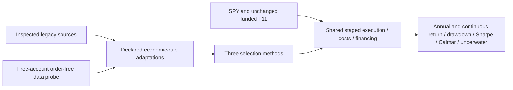

# QuantConnect selection comparison: three candidates, SPY and T11

User requested source inspection, actual free-account access verification and a
bounded comparison of the first three [shortlisted methods](2026-10-26-quantconnect-shortlist.md).
The [frozen plan](../../research/plans/qc-breadth-v1.json) owns executable scope;
[research intake](../research-intake.md) and [research procedure](../research-development.md)
own policy. This dated record does not redefine the investment mandate or roadmap.

## Source inspection and deviations

Pinned public documentation repository: QuantConnect/Tutorials commit
`4a341890296f7e79e095508f06170c72ccaa629c`. Inspected Method, Algorithm and Source
HTML for folders13Asset Class Momentum,21Momentum Effect in Stocks and18Volatility
Effect in Stocks. The Algorithm pages point to public embedded backtests:
`1cb38e96cec6120fc85152da661605c1`, `e7b55d46fa8677ed8ec91dd1a0159a6e`, and
`34e8ae2763e7e2122634d4091120d320`, respectively. HTML/code snapshots and hashes
remain private in `.local/qc-breadth-v1/intake/`; no redistribution license is
asserted. Embedded backtest code is a separately retrieved snapshot; the pinned
repository revision alone does not freeze that externally linked content.

Primary sources:
[ETF momentum](https://www.quantconnect.com/research/15338/asset-class-momentum/),
[stock momentum](https://www.quantconnect.com/research/15364/momentum-effect-in-stocks/),
[low-volatility stocks](https://www.quantconnect.com/research/15381/volatility-effect-in-stocks/).

| Candidate | Inspected legacy implementation | Explicit adaptation tested |
| --- | --- | --- |
| Asset-class momentum | SPY/EFA/BND/VNQ/GSG;252-period dollar MOM; new additions sized using1/number-added, which can overallocate when existing names remain | Same five ETFs, percentage momentum, top3 equal target weights; monthly rebalance intent including unchanged names |
| Stock momentum | Monthly top100 dollar-volume stocks, then50 using positive PE×EPS×shares proxy; top5 dollar MOM | Historical monthly top100 dollar volume after price>5/fundamental filter; positive finite true market cap top50; top5 percentage momentum |
| Low volatility | Daily top100 dollar volume/top50 proxy-cap universe; monthly five smallest standard deviations of price levels | Same universe cadence with true market cap; monthly five smallest sample standard deviations of252daily returns |

These are project-owned source-informed economic-rule adaptations, not literal
reproductions of legacy code or published performance. Current article descriptions
and older code differ materially. No claim of reproducing upstream CAGR/Sharpe.
No external-data loaders or downloaded code were executed locally. Public source
was inspected; the hosted algorithms contain project-owned adapters, except the
unchanged private T11 source already used in prior authorized studies.

## Access evidence

The [current pricing table](https://www.quantconnect.com/pricing) lists equities
and corporate fundamentals in the free plan. The account project page displayed
FREE on2026-10-26. Actual order-free probe
`2160a89284772b0867e0b61bfcbc3a88` onLEAN2.5.0.0.18209 received3400eligible
fundamental rows, selected50stocks and retrieved253completed historical daily
bars for all50stocks and all5ETFs. All55histories included the current completed
session. No orders were placed. This proves observed hosted sample access, not
permission to export raw data, full-history completeness or future entitlements.
Raw prices/fundamentals remain hosted; only aggregate metrics/counts/hashes leave.
Full2020–2025 access is accepted only after the requested cases complete with
fundamental callbacks and feature-readiness evidence.

## Frozen comparison

Five fresh cases: asset-class momentum, stock momentum, low-volatility stocks,
SPY holding and unchanged funded T11. Dates2020-01-01–2025-12-31,USD10,000 each,
25bp slippage, original native IB margin/default fees,90% base target, shared
staged MOO reductions-before-buys, cash/margin preflight and6% debit ACT/360 on
prior closing negative cash. Credit interest zero; no accrual beyond final close.
Same [funded execution](2026-10-26-qc504-funded-execution.md) functions preserved
by AST checks. T11 must reproduce the prior financial control exactly.

The three adaptations decide at the first observed SPY close each month. A single
253-close SCALED_RAW history window is rebuilt at each decision to avoid mixing
normalization bases or missing split resets; no future-ended bars accepted, and
only symbols with the current completed close and full window are eligible.
Missing top3/top5 slots remain cash; readiness/short-history counts are reported.
Stock membership uses historical fundamentals, not today's500-stock list.
Monthly allocation intent resets even when names stay unchanged. SPY receives one
initial90% target, with no monthly maintenance; it is not100%-invested SPY.
T11 retains its daily signals. Common execution mechanics do not imply identical
turnover, delay, realized leverage or risk. Costs are absolute per instrument under
the same model; equal capital is relevant to whole shares and minimum fees.

Bound: eight total hosted attempts including one access probe, five financial
cases and two technical-only retries;60-minute deadline. Financial source hashes
frozen before runs. A preserved pre-run technical correction prevents duplicate
ETF symbol aliases and keeps SPY entry-only; no financial results were inspected
when making it. No signal optimization, performance-driven rule changes, paid
upgrade, broker action, commits, publication or MLflow imports. Preserve failed
runs; do not fill missing cases with invented performance.

## Preserved technical correction

The first stock-momentum run used a replacing security initializer, which can
remove brokerage defaults for dynamically added stocks. It is excluded, without
using its performance to choose the fix. The corrected adapter extends the
brokerage initializer and asserts InteractiveBrokersFeeModel for every configured
security. This follows the [official initialization contract](https://www.quantconnect.com/docs/v2/writing-algorithms/initialization).
Static ETF subscriptions were already initialized by the native brokerage model
before the replacing callback, so their financial path is unaffected. No ETF
performance parameter changed. One of the two technical retry slots is consumed;
the aggregate eight-attempt cap is unchanged.

## Second preserved failure and bounded repair

Low-volatility attempt `9d5a8844b72242a2deca696203834eea` stopped on2021-06-02:
`Target price unavailable` from the common executor. Its source and terminal
failure remain private and excluded from ranking. Daily universe removal can
unsubscribe an unheld monthly weight target before staging finishes. The repair
returns the daily selected universe plus existing monthly weight targets as
subscriptions, while the feature/ranking universe stays the independently selected
50. A synthetic removal test verifies that a target is retained without entering
the feature-selection list. This uses the last technical retry; no remaining
repair slots or signal/cost changes are permitted.

## Interpretation before ranking

A common starting balance and funded executor do not equalize economic leverage:
T11 can hold leveraged/inverse/volatility ETFs, while these selection rules buy
ordinary stocks or the five specified asset-class ETFs. Differences in realized
exposure, concentration, turnover and whole-share rounding are part of the result.
There is no same-universe or matched-risk attribution control in this five-case
budget. Any under-ready decision remains cash under the declared eligibility rule;
it is a coverage limitation, not proof that the strategy intentionally predicted
a downturn. Free data access and a completed simulation do not prove signal quality.

Short-history counts are symbol-month feature requests, not counts of denied
subscriptions or unique missing tickers. A successful sample access probe does
not imply every feature window is full in the actual strategy lifecycle. Minimum
ready count zero is disclosed; missing selections remain cash. Aggregate summaries
do not identify which decision dates need diagnosis. That limitation must not be
relabelled as a successful market-timing signal.

## Completed comparison

Eight hosted attempts closed within the original60-minute bound: one order-free
access probe, five selected full financial cases, one superseded stock run and
one failed low-volatility run. Both technical repair slots were consumed. The
[receipt](evidence/2026-10-26-qc-selection-comparison.json) records every attempt,
source/config/code hashes, source snapshots and checks. The
[browser comparison](http://127.0.0.1:8765/qc-breadth-v1/index.html) includes all
30annual rows, six annual metric views, temporal diagnostics and CSV downloads.

| Case | CAGR | Max closing DD depth | Sharpe | Calmar | Longest underwater sessions / calendar days |
| --- | ---: | ---: | ---: | ---: | ---: |
| Asset-class momentum | 6.01% | 26.12% | 0.49 | 0.23 | 802 / 1169 |
| Stock momentum | 28.78% | 29.66% | 1.03 | 0.97 | 585 / 847 |
| Low-volatility stocks | 1.94% | 29.86% | 0.21 | 0.06 | 653 / 947 |
| SPY holding | 13.62% | 29.79% | 0.79 | 0.46 | 488 / 708 |
| Funded T11 | 119.67% | 51.26% | 1.69 | 2.33 | 146 / 214 |

SPY is the same90% nominal initial budget with whole-share rounding and retained
cash, not a100%-invested index total-return series. No maintenance rebalance.

| Year | Asset momentum | Stock momentum | Low-volatility stocks | SPY holding | Funded T11 |
| --- | ---: | ---: | ---: | ---: | ---: |
| 2020 | 3.08% | 92.16% | -6.51% | 16.05% | 187.47% |
| 2021 | 20.00% | -0.14% | 9.74% | 25.72% | 149.94% |
| 2022 | -7.33% | 2.49% | -1.81% | -16.66% | 125.30% |
| 2023 | 8.39% | 31.68% | -4.20% | 23.56% | 103.02% |
| 2024 | 2.67% | 55.77% | 7.74% | 22.87% | 228.95% |
| 2025 | 11.29% | 13.08% | 7.92% | 16.55% | 4.04% |

## Findings and decision

Stock momentum is the most promising of these three adaptations for further
controlled validation. Compared with SPY it had15.16percentage points more CAGR,
only0.13points less maximum drawdown depth, and97more sessions in its longest
underwater stretch (585versus488). It also spent90.58% of closes underwater,
versus84.88% for SPY. In2021 it returned-0.14% versus SPY25.72%; in2025 it returned
13.08% versus16.55%. Full-period outperformance is not consistent annual dominance.

Asset-class momentum reduced DD by3.67points versus SPY but grew much more slowly
and had a longer underwater spell. This low-volatility adaptation did not improve
SPY's full-period return, DD or temporal tradeoff; this does not reject the whole
low-volatility literature. T11 retained higher CAGR/Sharpe/Calmar but had51.26%
closing DD and economic leverage inside ETF holdings. No same-risk comparison or
future annual-doubling evidence follows from this table. No promotion.

All three new methods reported minimum ready count zero. Short-history requests
were5/51/52for asset/stock-momentum/low-volatility respectively, across360/3600/3600
symbol-month requests. Unready candidates were excluded under the frozen rule.
These are provisional as-implemented results, not clean source replications or
complete feature-coverage proof. Exact decision dates and whether the gaps were
initialization, factor-file or listing-related are not identified by these
aggregate exports and remain unresolved. Do not call their cash periods forecasts.

A proposed next bounded question is to diagnose readiness without optimizing the
signal, then compare stock momentum with equal-weight stocks in exactly the same
historical universe and with cost/timing stress. Freeze it before launch. Return
concentration, economic beta/sector exposure, input independence and unseen
validation remain open; do not automatically combine it with T11 from summaries.

## Validation and closure

All five selected cases share1508sessions and the exact calendar hash. Forty
summary records passed complete-fragment SHA checks. All30annual/full NAV,
return-moment Sharpe, Calmar, underwater and financing consistency checks passed.
Fresh T11 exactly matches prior NAV/CAGR/DD/Sharpe/Calmar/fills/financing. All five
selected cases have zero rejected orders, zero non-MOO fills and zero pending
orders at the endpoint. Native PnL plus explicit financing residuals are within
2cents. Only T11 had a debit balance and chargedUSD0.275876; zero funding in other
cases does not test rate sensitivity. This remains native-book aggregation, not
independent cash/fill/corporate-action reconstruction.

`make check` exited0:304offline tests plus documentation and dependency checks.
Browser checks exercised all six annual selectors (six years×five cases each),
Calmar sorting and shortest-underwater sorting, with no NaN/undefined values.
Source, code, raw-summary and report manifest hashes were checked separately.
Original funded ensemble source was restored and verified exactly in the hosted
editor, with zero extra backtests. No paid data, broker operations, orders outside
simulation, new services, MLflow imports, commits or publication occurred.
