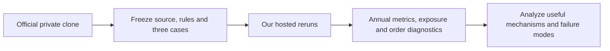

# QuantConnect 504: copied-source evaluation

User requested copying strategy504, evaluating it ourselves, then studying reusable
ideas. Official Clone created a separate user-owned
[research project](https://www.quantconnect.com/project/38484741). The copied
`main.py` exactly matched the displayed V1.1.0 source by clipboard text comparison.
[Original](https://www.quantconnect.com/strategies/504/Multi-Model-Tactical-ETF-Rotation)
by sanchari, submitted2026-05-25. Redistribution rights are unverified; the complete
original and generated adapters remain ignored/private in `.local/qc504-v1/`.
No third-party code is added to tracked source, committed or published.

[Research intake](../research-intake.md) and
[experiment procedure](../research-development.md#experiment-execution) own the
workflow. [Frozen protocol](../../research/plans/qc504-evaluation-v1.json) defines
three cases and at most five total financial attempts (two technical-only repair
slots), with45-minute execution checkpoint. No strategy tuning or broker operation.

## Frozen evaluation

| Case | Dates | Slippage | Purpose |
| --- | --- | --- | --- |
| recent | 2020–2025 | Original native default | Fresh hosted evaluation of the copied rule |
| long | 2010–2025 | Original native default | Earlier crises and readiness/inception behavior |
| cost25 | 2020–2025 | Explicit25bp constant model | Execution-cost sensitivity on identical dates |

All cases keep the upstream USD10,000 initial capital, IB margin/fee defaults,
subscriptions, signal rules, quarter budgets, signal-change trading and MOO sizing.
The published end2026-12-31 is future; the frozen end2025-12-31 avoids a moving
endpoint. These are our hosted reruns, not an independent engine/data reproduction
or exact replication of the rolling five-year leaderboard summary. They do not
establish scalability to the user's USD300,000 scenario.

Project-owned [observer](../../research/quantconnect/qc504_audit.py) and
[adapter builder](../../scripts/prepare_qc504_audit.py) replace price/debug logs with
aggregate reporting. Static AST comparison verified all signal/readiness/rebalance
functions remain unchanged except redirecting legacy debug logging. Observation
recomputes read-only target functions for selection counts after each decision;
no signal values, targets or orders are replaced. Counts are intended target days,
not realized sleeve profit attribution. The full copied code is inspected before
cloud execution; no arbitrary external network, package or broker action is present.

Metrics reuse [closing-NAV temporal definitions](2026-10-25-sector-momentum-comparison.md#metric-definitions).
Full and annual returns/drawdown/Sharpe/Calmar, underwater counts, order rejections,
non-MOO fill counts, gross exposure and minimum cash are emitted. Native asset
P&L uses `NetProfit + TotalCloseProfit(false)`; NetProfit already includes dividends
and fees. Sum versus NAV gain is reported as a residual, not silently forced to zero.
The [LEAN holdings reference](https://www.lean.io/docs/v2/lean-engine/class-reference/classQuantConnect_1_1Securities_1_1SecurityHolding.html)
and public `SecurityHolding.cs` implementation were inspected; this is native-book
aggregation, not an independent ledger. Only summary statistics/P&L aggregates
leave QC. Raw prices, daily NAV and per-order fill prices remain inside the platform.

Order rejections are counted and retained; any such path is a conditional
execution diagnostic, not a clean intended-policy reproduction. Margin credit,
embedded fund leverage, opening gaps, ETF inception, corporate actions, capacity
and defaults remain relevant limitations. No parameter is changed to improve an
observed score. Missing results, failed runs and technical repairs are preserved.

## Status

**Completed with partial evidence.** Five attempts consumed: three declared cases,
one excluded stale-build attempt and one reporting-only retry. No additional runs
are authorized by this protocol. The final long retry reproduced native ending
NAV and headline statistics exactly, but custom logs remained unavailable. Annual,
custom Sharpe/Calmar, underwater and asset attribution are therefore missing for
long; these are not inferred from other runs. At least one buying-power rejection
was observed in the first valid long run, so its financial path is conditional.

[Browser comparison](http://127.0.0.1:8765/qc504-v1/index.html) includes the two
complete custom cases and explicitly marked native-only long evidence.
[Machine-readable receipt](evidence/2026-10-26-qc504-evaluation.json) preserves
attempts, source hashes and limitations. The observer tests and final offline
checks are recorded below. Sources and the coordinator ledger remain ignored in
`.local/qc504-v1/`.

## Preliminary baseline evidence

2020–2025 rerun `7f62da5ec252102361c53213c3c911b0` completed with1,508sessions,
zero rejected orders and3,291fill events, all MOO. Closing-NAV CAGR221.79%,
max drawdown65.19%, zero-RF daily Sharpe2.301 and Calmar3.402. Initial10,000became
11,120,962under modeled costs. The65.19%loss-depth includes2020, outside the
later rolling-five-year leaderboard window; the displayed31.8% is not a common
sample risk limit. Even a year ending strongly positive can contain a severe loss.

Maximum ETF market-value/NAV was1.1298, with minimum cash-492,735.66; neither
figure includes embedded ETF leverage. No explicit funding model was added;
funding treatment, liquidity, fills and capacity remain unqualified.

Native holdings P&L reconciled to NAV gain within one cent. TQQQ/SOXL/TECL account
for about76.3%of that gain. This identifies asset concentration, not causal
sleeve attribution or an independent reconstruction of P&L. All four sleeves
frequently select overlapping tech/semiconductor funds.

A launched long-window request `980e10e93d19475e67459a17e37e8745` actually returned
`case=recent` and the same dates/metrics. Summary identity checks caught the stale
editor build. It is retained/excluded and consumes one technical slot. Explicit
cloud compilation now precedes the retry; no trading-rule repair was made.

## Cost sensitivity and reporting repair

The25bp case `84a2d882e72d595e6f60edb27dd8fd42` completed with1,508sessions,
zero rejects and the same session hash as recent. CAGR164.68%, closing maxDD66.54%,
Sharpe1.960, Calmar2.475; ending NAV3,442,590.82. The slippage intervention changes
fill prices, portfolio wealth, whole-share quantities and later fills; it is a
policy-path cost sensitivity, not subtracting a fixed dollar charge afterward.

Long run `18f7e694305224b414843577826e5e24` completed natively:100.305%native
CAGR,70.2%native drawdown,676,247,852.71ending NAV. Its log table remained empty;
UI controls failed to activate. The last reserved technical attempt changes only
reporting: aggregate Debug output and a smaller long-window annual schema to
respect free log storage. Return-moment exports remain available for recent/cost;
long-window moments are omitted. Preserve earlier sources as01-recent-source.py
and03-long-source.py. No new strategy or execution policy was introduced.

The engine also warned that some histories begin later because of factor-file
precision or map-file start dates, including UVXY, SVIX and LABU. A long backtest
therefore exercises a changing available instrument set and the author's readiness/
fallback rules; it does not provide all modern products back to2010. These provider
warnings and unqualified data/fill/capacity/financing remain limits.

## Research ideas after this evaluation

1. **Measure sleeve overlap and standalone value.** T10/T11/S2/S3 share technology,
   semiconductor and inverse-volatility instruments. Their quarter budgets do not
   prove independent signals. Separate held-out ablations and a shared-capital
   attribution policy would be a new bounded study.
2. **Treat embedded leverage as an explicit decision.** A small ETF market-value
   weight can still carry multiple underlying exposures. Future controls should
   separate asset selection, leverage and risk scaling instead of assuming the
   gross ETF percentage is the full risk budget.
3. **Test crash depth and rebound participation together.** This study's65–70%
   loss-depth conflicts with the project's approximate30% reassessment tolerance.
   A guard must be judged on return, loss depth and underwater duration over
   matched dates. No statement that the return aspiration and tolerance are jointly
   achievable follows from the result.
4. **Carry cost and capacity forward.**25bp slippage materially reduced growth.
   Repeated compounding eventually exceeds the published capacity estimate; no
   market-impact or scale-up evidence was generated. Local raw/daily paths were
   not acquired through this hosted test.

These are proposed hypotheses, not an additional search or authorization for
paper/live deployment. The fixed evidence package is closed at the five-attempt cap.

## Validation and handoff

The report checks recent/cost annual NAV compounding, full totals, Sharpe from
annual daily-return moments, Calmar formula, carried-peak underwater totals and
matching session hashes. Long native statistics were read directly from the
completed final result; no custom metrics were reconstructed. The report contains
12 annual rows, not a complete 28-row three-case comparison. Original attempt
3 and final attempt 5 both show ending NAV $676,247,852.71, CAGR 100.305% and
70.200% native drawdown. A native recovery value of755 is not substituted for
our missing session-based temporal metric because its convention is not audited.

This is research intake evidence, not promotion. Source comments claiming OOS
survival or independent signals are the author's claims; this study did not verify
the original development history or establish genuine unseen performance.

Final `make check` exited0: documentation checks, dependency consistency and
285 offline tests passed. `git diff --check` exited0. Browser validation confirmed
all three status cards,12 annual rows, native-only missing labels and attribution
selector behavior. No additional financial runs, broker orders, commits or
publication were performed.

Follow-up: the subsequently authorized
[full-budget sleeve ablation](2026-10-26-qc504-sleeve-ablation.md) is a separate
bounded study. It does not reopen this receipt's five-attempt budget or fill the
missing long-window evidence described here.
