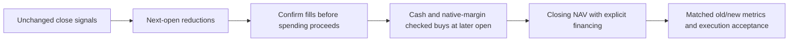

# QuantConnect504: staged execution and explicit financing

User requested a bounded execution/funding fix across all five cases, matching
prior dates and costs. [Prior ablation](2026-10-26-qc504-sleeve-ablation.md) owns
controls, source intake and rejected-order history. This new study follows
[research execution](../research-development.md#experiment-execution) and the
[frozen plan](../../research/plans/qc504-funded-v1.json). It does not reopen prior
budgets or change any sleeve signal, readiness, indicator or available universe.

## Frozen intervention

Five cases: ensemble/T10/T11/S2/S3;2020–2025;USD10,000;25bp slippage per fill;
original IB margin/default fee model. Each standalone retains full budget and the
ensemble four quarter budgets before scaling the aggregate target by90%. This
is a combined execution/allocation/funding intervention, not isolated attribution
to financing. Same starting capital as source study, not the USD300,000 deployment
scenario. Previously inspected development history remains exposed.

The per-sleeve signal-change identity is preserved, including sleeve swaps that
leave aggregate weights unchanged. On an intent change, determine whole-share
90%-budget targets from current close prices. Submit only reductions at next MOO;
a later close recomputes current signals and buy quantities after confirmed fills.
At most one reduction batch for an unchanged intent; changed intent restarts the
process. No buys while an earlier order is outstanding. Purchases use only
current cash less10% of NAV, with25bp price and USD2+.01/share fee reservations.
Native fee model still determines actual fees. Check native initial margin before
submission and halve unaffordable quantities; count clips/deferrals. Complete that
intent after the buy pass; no daily target maintenance or repeated denied-order
submission. Alphabetical ticker order makes budgeting deterministic.

This introduces additional rotation delay and cash exposure. Ten percent is a
sizing reserve, not a guaranteed continuous cash floor or a worst-gap guarantee.
MOO prices remain unknown at submission; remaining rejections fail acceptance and
are retained. Native margin checks are kept, never disabled to manufacture fills.
The [official MOO documentation](https://www.quantconnect.com/docs/v2/writing-algorithms/trading-and-orders/order-types/market-on-open-orders)
explains auction uncertainty and buying-power buffers. Native preflight follows
[buying power](https://www.quantconnect.com/docs/v2/writing-algorithms/reality-modeling/buying-power).

## Financing and accounting

Fixed6% annual debit ACT/360 on previous closing negative USD cash across elapsed
calendar days, including weekends. At each observed session close, debit current
cash before order sizing and NAV observation. Positive cash earns zero. Disable
native per-security margin interest explicitly with its supported null model so
this cash debit is the only additional financing charge. No accrual after the
final close. This is an illustrative common rate, not a historical IBKR schedule,
settlement ledger, monthly-posting replication or financing stress sweep. Margin
plumbing still gives immediate simulated settlement; leveraged fund expenses are
embedded in price histories and are not charged again.

[Cashbook public API](https://www.quantconnect.com/docs/v2/writing-algorithms/portfolio/cashbook)
owns cash operations; [null margin-interest model](https://www.lean.io/docs/v2/lean-engine/class-reference/py/QuantConnect/Securities/MarginInterestRateModel/)
owns native-interest suppression. Record actual debt days and charges; if no debit
balance occurs, zero funding is a valid observed result, not a rate-sensitivity
test. Independent synthetic checks include a Friday-to-Monday debit interval.
Every actual debit must match the same-step NAV reduction. Native asset P&L plus
separately accumulated financing is reconciled to account gain; residual is not
forced to zero. This remains native-book aggregation, not an independent fill ledger.

## Limits and acceptance

Five new cases, maximum seven financial attempts with two technical-only repair
slots and45-minute deadline, reserved by the coordinator. No post-result reserve,
rate, signal or policy tuning. Stop on cap/deadline, input mismatch or invalid NAV.
Zero actual rejected orders in every case and successful explicit funding/NAV
checks are execution acceptance. Preserve and label any failed case; do not silently
repair it. Missing summaries are unranked. Report all prior/new full and annual
return, drawdown, zero-RF daily sample Sharpe, Calmar and underwater measures, plus
financing, stage waits, clipping and pending orders. Hypothesis concerns execution
reliability, not higher returns. All capital-scale, capacity, independent accounting
and predictive-OOS limits remain. No real/paper broker, paid data, orders, commits,
publication or MLflow imports. Export only aggregate summaries; full copied source
and raw/daily data remain private/hosted.

## Status

Completed: five fresh hosted cases and30 new annual rows, with saved prior controls reused. Five financial attempts used; two repair slots unused. All five passed observed zero-rejection and explicit funding debit checks. The generated private source and closed coordinator ledger remain in `.local/qc504-funded-v1/`. Signal/helper AST preservation, pending-order/staging and synthetic weekend/debit checks passed.

## Results and comparison

[Browser comparison](http://127.0.0.1:8765/qc504-funded-v1/index.html) provides
current metrics, a full old/new comparison, financing/staging diagnostics and
annual policy/metric selectors. [Machine-readable receipt](evidence/2026-10-26-qc504-funded-execution.json)
preserves all five source/run identities, code/input hashes and checks. Controls
were reused from the preserved prior report, not freshly rerun or overwritten.

| Case | Prior/new CAGR | Prior/new full drawdown depth | New Sharpe | New Calmar | Prior/new longest underwater sessions | Prior/new rejects |
| --- | --- | --- | --- | --- | --- | --- |
| Ensemble |164.68% /93.88%|66.54% /61.04%|1.597|1.538|115 /157|0 /0|
| T10 |153.93% /117.64%|73.65% /62.89%|1.650|1.870|142 /169|54 /0|
| T11 |159.50% /119.67%|60.78% /51.26%|1.690|2.335|121 /146|22 /0|
| S2 |51.52% /89.23%|65.14% /59.22%|1.355|1.507|798 /214|42 /0|
| S3 |72.57% /73.37%|70.56% /69.55%|1.181|1.055|248 /234|15 /0|

T11 leads current CAGR/Sharpe/Calmar, full drawdown depth and longest underwater
spell. T10 has a smaller underwater fraction than T11, so this is not superiority
on every temporal metric. T11 returned just4.04% in2025 versus84.46% for the
ensemble. The ensemble had shallower annual reset drawdown than T11 in2021–2025,
while T11 had shallower2020/full drawdown. A full-period rank obscures these
regime/year tradeoffs. No case met the aspiration to double in every year; every
full drawdown exceeds the approximate30% reassessment reference. No promotion.

All new cases have at least199 native fill events, all MOO; zero rejected orders
is not an all-cash or zero-trade pass. Final ensemble has six MOO orders pending
beyond the last close; no fill, commission or financing after the endpoint is
assumed. Other cases have zero final pending orders. This is boundary censoring,
not proof all submitted orders filled. Native checks remain enabled throughout.

## Financing and execution diagnostics

| Case | Debit interest USD | Negative-cash calendar days | Sell / buy batches | Deferred-buy decision closes | Cash quantity clips |
| --- | --- | --- | --- | --- | --- |
| Ensemble |0.250785|3|459 /323|459|112|
| T10 |1.693445|16|248 /247|248|173|
| T11 |0.275876|4|268 /254|268|168|
| S2 |0.400538|4|99 /100|99|78|
| S3 |0.215611|4|108 /108|108|84|

No native preflight halving was needed in these hosted paths; its insufficient-
margin branch was checked synthetically. Clipping/staging were active and change
participation. Direct financing charges were small; a combined-policy test cannot
isolate funding's causal effect from allocation, timing and integer sizing.
Minimum closing cash ranged from-$405.54 to-$676.02; the sizing reserve did not
guarantee nonnegative cash through unknown opening gaps. Actual debt periods were
charged by the common model. No historical-rate or rate-sensitivity evidence is
claimed. Underlying ETF leverage is still embedded; fund market-value exposure
is not total economic risk.

Every funding debit matched same-step NAV within1e-4USD (observed errors below
1.6e-11USD). Annual charges sum to full charges. Native holdings P&L plus explicit
funding reconciles to NAV gain within two cents, consistent with rounded asset
P&L; this is not an independent cash/fill reconstruction. All dates match the
prior1,508-session hash;30 new annual rows and30 saved control rows are available.
Vendor price snapshots were not independently frozen/hashed. The matching calendar
hash proves date alignment, not equality of every underlying price input.

Supported: the declared staged policy avoided actual rejections in all five
observed runs and modeled debit financing consistently. Not established: future
order safety, intended source-policy reproduction, liquidity/capacity, independently
validated alpha or a way to combine annual doubling with30% drawdown tolerance.
Lower exposure and changed timing are part of the intervention. S2's large change
with identical signals illustrates why rejected-order paths cannot be treated as
clean strategy-quality measurements. Further isolated timing/reserve/rate tests
would be new hypotheses and were not run here.

## Final verification and closure

`make check` exited0: documentation/dependency checks and293 offline tests passed.
`git diff --check` exited0. All five actual launch messages identify LEAN
2.5.0.0.18209. Source, code, summary and baseline/report manifest hashes were
verified. The preserved prior ablation manifest remains valid. Browser checks
exercised13 annual policy/metric views with complete values and current CAGR/
Calmar sorting. Source strategy, dates, fees/slippage and final policy were not
retuned. The report includes a saved PNG and all original/negative evidence.
The hosted saved default was restored to the funded ensemble and verified by
exact clipboard comparison; no additional backtest followed restoration. Five
fresh financial attempts completed inside the original45-minute deadline; both
technical repair slots remained unused and the ledger is closed. No broker,
paid data/service, paper/live order, commit, publication or MLflow import occurred.
