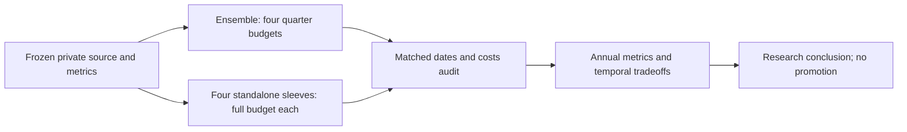

# QuantConnect 504: full-budget sleeve ablation

The user requested a bounded comparison of four components against the ensemble.
[Prior copied-source evaluation](2026-10-26-qc504-evaluation.md) owns source intake
and earlier results. This task follows [research execution](../research-development.md#experiment-execution)
and the [frozen plan](../../research/plans/qc504-ablation-v1.json).

## Design frozen before execution

Five fresh hosted cases: ensemble, T10, T11, S2, S3. Each uses 2020-01-01 through
2025-12-31, USD10,000, explicit25bp constant slippage and the original IB margin/
fee defaults. No explicit funding model is added; financing remains unqualified.
This is the prior source-comparison capital, not the user's USD300,000 deployment
scenario. Previously inspected history is development evidence, not untouched OOS.

Each standalone gets QUARTER=1.0 and only its own weight function; inactive weight
functions return empty. The ensemble retains four25% budgets. This compares full
allocation budgets, not 25%-allocated components with75% idle cash. It does not
hold effective exposure or volatility constant; embedded product leverage differs.
It is standalone ablation, not realized P&L attribution inside the ensemble.

All readiness/helpers/selected signal and rebalance functions retain AST identity.
Original signal-change trading, close-price whole-share sizing and tomorrow-open
MOO orders remain. No protective cash buffer, order-policy repair, parameter search
or post-result tuning. Rejected-order paths are conditional diagnostics.

Hypothesis: ensemble improves downside-adjusted performance or recovery relative
to a high-return standalone. Universal superiority is rejected if a sleeve
dominates across measured dimensions. Report raw metric tradeoffs; no scalar
winner or promotion inferred from CAGR alone. Closing DD30% is the user's
reassessment reference, not a guaranteed limit or a newly tuned stopping rule.

## Bounds and acceptance

Five declared cases, maximum six total financial attempts, one instrumentation/
technical-only retry slot and40-minute execution deadline. Coordinator reserves
before each launch. Stop on cap/deadline, input/case mismatch, numerical failure
or unsupported execution; preserve all attempts. Do not silently repair rejected
orders or use extra hypotheses. The old study's five-attempt budget remains closed.

Expected evidence: six annual rows per complete case, full return/CAGR/drawdown,
zero-RF daily sample Sharpe sqrt252, full calendar-CAGR Calmar, annual return/DD
Calmar, carried-peak underwater counts/fraction, longest underwater sessions and
calendar days, final censoring, fee/cash/exposure/rejection diagnostics. Definitions
remain owned by [the metric contract](2026-10-25-sector-momentum-comparison.md#metric-definitions).
Only aggregate summaries leave QC; daily NAV/raw prices stay inside the hosted
engine. Full third-party sources remain private/ignored, without redistribution.

Independent data/engine accounting, financing, liquidity/capacity, full underlying
leverage and untouched predictive evidence remain outside this study. No broker,
orders, paid service, commits, publication or automatic MLflow imports are included.

## Evidence status

Prepared: private adapters and source identities, allocation/order-policy fixture
tests and actual selected-rule AST checks passed. Completed: five selected cases and30 annual rows. Seven attempts consumed, including two reporting-only reruns; no attempts remain. All selected summaries are captured and consistency-checked.

## Reporting amendment, after attempts1–3

Ensemble custom output captured completely; T10/T11 completed natively but custom
log tables were empty/inaccessible. Visible terminal JSON is truncated. T11 also
showed at least six buying-power rejections, preserved as conditional evidence.
Revision2 preserves the [original frozen plan](../../research/plans/qc504-ablation-v1.frozen.json),
sets seven attempts maximum/two reporting reruns and retains the original deadline.
Only `_audit_emit` changes:145-character chunks with sequence/part counts and
SHA256 digest, omitting asset lists/selection counts while retaining native P&L
residual. All trading/accounting/metric function ASTs are identical. Earlier
sources are retained as `*-source-v1.py`; prior attempt hashes remain unchanged.
This recovers evidence, not a tuned strategy or repaired financial execution.

## Completed results

[Browser comparison](http://127.0.0.1:8765/qc504-ablation-v1/index.html) includes
sortable full metrics, annual return/drawdown/Sharpe/Calmar/underwater selectors,
full underwater duration/censoring and execution diagnostics.
[Evidence receipt](evidence/2026-10-26-qc504-sleeve-ablation.json) preserves selected
attempt identities, all attempts, code and source hashes and artifact identities.

| Case | CAGR | Closing max DD | Sharpe | Calmar | Longest underwater sessions | Rejected orders |
| --- | --- | --- | --- | --- | --- | --- |
| Ensemble |164.68%|66.54%|1.960|2.475|115|0|
| T10 |153.93%|73.65%|1.764|2.090|142|54|
| T11 |159.50%|60.78%|1.752|2.624|121|22|
| S2 |51.52%|65.14%|0.975|0.791|798|42|
| S3 |72.57%|70.56%|1.127|1.029|248|15|

The ensemble has highest CAGR/Sharpe and shortest longest underwater run. T11 has
shallowest full drawdown/highest Calmar. Universal ensemble superiority is not
supported. Every full drawdown exceeds the approximate30% reassessment reference.
All four standalone results are conditional because the unchanged sizing/order
policy encountered rejected orders. Intended full-budget exposure is not proof
of actual intended execution or risk equivalence. Ensemble zero rejects does not
establish a general order-safety guarantee.

Annual return leaders change: T11 in2020/2021/2024, T10 in2022/2023, S3 in2025.
This is retrospective description, not a causal switching rule. S2's longest
underwater spell lasted798 sessions/1,163 calendar days despite strong growth
in some calendar years. All five end below a prior peak; ending censoring means
recovery after the endpoint is unknown, not that a computed longest spell is an
uncensored future recovery estimate. Closing marks do not measure intraday tails.

Full longest underwater sessions/calendar days: ensemble115/166, T10142/207,
T11121/174, S2798/1163, S3248/362. Carried-peak underwater fractions were
82.03%/83.49%/84.02%/89.99%/83.36%, respectively. These fractions describe time
below a high-water mark, not probability of losing money or a future risk score.

## Execution reconciliation and interpretation

The fresh ensemble exactly matched the previous25bp case on ending NAV, CAGR,
DD, Sharpe, Calmar, underwater length, calendar hash, fees and reject count.
Both reporting-only retries matched their original native ending NAV within one
cent. Trading, accounting and metric function ASTs were unchanged by the reporting
amendment. Fragment recovery required every sequence part and its SHA256 digest;
missing/corrupted fragments fail closed. No result was filled in from truncated
text. All selected calendars match1,508 sessions and30 annual rows are present.
Native P&L/account-gain residual magnitudes are below two cents, consistent with
cent-rounded asset aggregation; this is not an independent accounting audit.
All selected fill events were MOO. Maximum fund market-value gross exposure was
about1.13–1.26x; this excludes embedded leveraged/inverse/volatility-product risk.
All cases had negative cash. Financing costs and scale remain unqualified.

Supported: the modeled ensemble and standalone paths exhibit distinct return,
drawdown and recovery tradeoffs. Not established: an independently verified
ensemble alpha/diversification effect or a deployable way to achieve annual
100% growth with30% loss-depth tolerance. Missing aligned daily component paths
also prevent correlation/covariance or causal inside-ensemble contribution claims.

The next useful hypothesis is a separately bounded execution-policy comparison
with explicit funding/cash handling and identical policy across all cases. It
should precede deciding to drop or overweight sleeves based on these scores.
Standalone rejection differences and whole-share/shared-capital netting confound
simple attribution of ensemble gains to diversification. This is a proposal only;
no further runs or financial repairs were performed under this study.

## Final verification and closure

`make check` exited0: documentation checks, dependency consistency and289 offline
tests passed. `git diff --check` exited0. Report consistency, selected source/code/
summary hashes and saved manifest were verified. Browser verification exercised
all six annual metric views (no missing values), full-period sorting and all five
case rows. The PNG is saved with the local report. The hosted project's saved
`main.py` was restored to the ensemble/25bp case and checked by exact clipboard
comparison; no extra financial run followed restoration. Seven attempts closed
within the original deadline. No broker, paid source, MLflow import, commit or
publication was performed. Failures and conditional/negative evidence remain.

Subsequent authorized work: [staged execution and financing](2026-10-26-qc504-funded-execution.md)
completed a separate five-case study using the saved results here as controls.
This original ablation's closed budget and conditional results remain unchanged.
