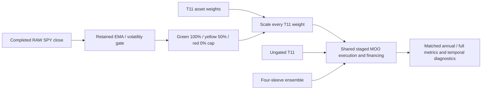

# Bounded T11 traffic-light transfer

Execution is scoped by the [frozen plan](../../research/plans/qc504-t11-gate-v1.json).
This record owns this experiment's results, not portfolio priorities or live readiness.

## Frozen design

Three fresh QuantConnect simulations: ungated T11, the four-sleeve ensemble,
and T11 with the previously retained EMA/volatility-only gate. Same 2020–2025
sessions, USD10,000 starting capital, 25bp slippage, native IB margin/default fees,
90% base allocation target, staged MOO execution and fixed6% debit ACT/360
financing as the [funded study](2026-10-26-qc504-funded-execution.md).
No credit interest; no further charge beyond the final observed close.
Three cases, maximum five attempts, two technical-only retries,45minutes.
No parameter search or threshold changes after observing results.

The price-peak component stays disabled, matching the retained local ablation.
EMA50/200 uses first-close seeding;20-return sample volatility is annualized by
sqrt252. Red at40% volatility; yellow on nonpositive trend or25% volatility.
Recovery: five consecutive closes below35% volatility from red to yellow, then
five positive-trend closes below20% from yellow to green. These stages cannot
share a confirmation close. RAW SPY closes, rounded cents, seed from2004-01-02
through2019-12-31. During2020–2025, only a current-session completed RAW bar is
accepted. The existing adjusted-price subscriptions used by T11 are unchanged.
All three cases compute the same observer; only gated T11 applies the cap.

The cap includes inverse and volatility ETFs. It can suppress helpful hedges.
Colour changes alter allocation intent even with unchanged T11 asset selection.
The staged controller reduces first and waits for fills before buying; a red
close does not imply immediate liquidation or a guaranteed30% drawdown ceiling.

## Evaluation contract

Describe drawdown depth reduction and the remaining distance from30%, CAGR
retention, ending-wealth retention, full/annual Sharpe and Calmar, underwater
fraction, longest underwater sessions/calendar days and unrecovered endings.
There is no arbitrary hidden return-preservation threshold. A risk improvement
with lower returns is reported as a tradeoff. Without an exposure-matched
control this test cannot attribute an improvement to timing skill.

Financial comparisons require all summaries, matching session and gate-input
hashes, exact financial replication of the two prior controls, financing debit
checks and native PnL residual within10cents. Daily mark paths stay hosted;
aggregate fragments are checksummed before local report generation. Full copied
strategy code remains private/ignored; licensing for redistribution is unverified.

## Completed result

Three fresh simulations completed on LEAN2.5.0.0.18209, with three financial
attempts and no retries. The study is closed; both unused repair slots expired.
The [dashboard](http://127.0.0.1:8765/qc504-t11-gate-v1/index.html) includes annual
returns, reset drawdown, Sharpe, Calmar and temporal metrics. The
[receipt](evidence/2026-10-26-qc504-t11-gate.json) records source/code/artifact
hashes, native engine evidence, attempts, control parity and limitations.

| Case | CAGR | Max closing drawdown | Sharpe | Calmar | Longest underwater sessions / calendar days |
| --- | ---: | ---: | ---: | ---: | ---: |
| Ungated T11 |119.67% |51.26% |1.69 |2.33 |146 /214 |
| T11 with traffic-light cap |92.03% |36.90% |1.64 |2.49 |199 /292 |
| Four-sleeve ensemble |93.88% |61.04% |1.60 |1.54 |157 /230 |

The gate reduced T11 drawdown by14.36percentage points, leaving6.90points above
the30% reference. It retained76.90% of ungated CAGR but only44.62% of ending
wealth: USD501,845.82 versus USD1,124,734.59 from USD10,000. Those two retention
ratios answer different questions and must not be substituted for each other.
The longest underwater stretch increased53sessions, or78calendar days. All
three ended below a previous high; final recovery remains censored.

| Year | Ensemble return / reset DD | Ungated T11 return / reset DD | Gated T11 return / reset DD |
| --- | ---: | ---: | ---: |
|2020 |79.99% /61.04% |187.47% /51.26% |109.81% /29.05% |
|2021 |110.14% /12.71% |149.94% /20.07% |137.99% /16.72% |
|2022 |88.18% /30.15% |125.30% /34.21% |60.62% /22.75% |
|2023 |110.86% /16.03% |103.02% /27.94% |91.76% /26.63% |
|2024 |92.03% /21.60% |228.95% /28.16% |228.44% /28.06% |
|2025 |84.46% /25.00% |4.04% /29.68% |-0.64% /29.68% |

Every gated calendar year's reset drawdown was below30%, yet full-period
drawdown was36.90%. Resetting the peak annually hides losses that cross a year
boundary. The gate preserved much of2024's return but reduced every year's
return in this sample;2025 changed from a small gain to a small loss.

## Validation and interpretation

Implemented and verified: all24 summary records were reassembled with fragment
checksums; all cases share1508sessions, identical RAW gate-input hashes and
4027seed bars. Fresh ungated controls exactly reproduce prior ending NAV, CAGR,
drawdown, Sharpe, Calmar, financing and fill counts. All three have zero rejected
orders and zero non-MOO fills. Annual/full financing and same-step NAV debits
reconcile. Native PnL plus explicit financing residuals are within2cents.
Gated T11 stayed cash-positive and accrued no debit interest; this does not test
funding-rate sensitivity. Ensemble has six pending orders at the final boundary;
no post-boundary fills are assumed. Both T11 cases have none.

Gate observations:1095green,345yellow,68red closes,16transitions. These are
signal-close counts, not proof of realized exposure or successful warnings.
Original funded ensemble source was restored in the hosted editor and verified
exactly, without another simulation. Full offline verification passed: `make check` exit0,297tests plus documentation
and dependency checks. All six annual metric selectors and underwater/Calmar
sorting were checked in the browser. Report and private artifact hashes were
verified against the saved manifests.

Conclusion: retain this as a risk/return tradeoff candidate, not a winner or live
promotion. It has the best Calmar of these three but lower Sharpe than ungated
T11, materially lower wealth and longer underwater time. The joint ambition of
roughly30% drawdown while preserving returns is not demonstrated. No untouched
OOS, timing alpha, historical financing parity or deployable advantage is proven.

A possible next separately bounded study would compare an exposure-matched
ungated control and identify whether blanket caps remove useful hedge returns.
That is proposed, not executed; this result does not authorize further tuning.
