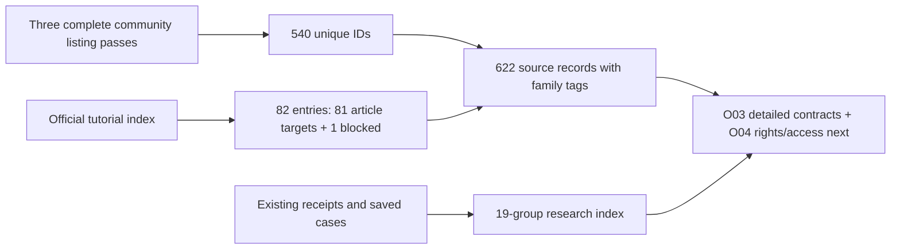

# O00–O03: research inventory and QuantConnect family map

The user requested execution of the first four objectives in the
[master checklist](2026-10-26-quantconnect-research-master-plan.md). This receipt
owns the scoped snapshot outcome, not portfolio priority or investment readiness.
Read the [browser inventory](http://127.0.0.1:8765/qc-inventory-v1/index.html),
[metadata catalog](../../research/catalogs/qc-inventory-v1/catalog.json) and
[research-history index](../../research/catalogs/qc-inventory-v1/research-history.json).

## Objective status

| Objective | State | Evidence and remaining boundary |
| --- | --- | --- |
| O00 Consolidate existing research | Complete scoped index | 19 study groups; 62 pre-existing task receipts, 55 compact evidence receipts, 27 plan/input JSON files and 410 saved research JSON artifacts; 158 selected saved case rows. File identity/parse checks, not repeated financial audits or a complete lifetime trial inventory |
| O01 Define scope | Complete discovery contract | Versioned sources, denominators, exclusions, zero financial budget and bounded acquisition. Later research-cycle budgets remain unset; open investment-policy choices remain in the mandate |
| O02 Inventory accessible sources | Complete observed listing/index coverage | 540 unique community IDs across three complete 108-page listing traversals; 82 tutorial-index entries, with 81 reachable research articles and one soft404. Full detail-page/code access for all 540 listings was not checked |
| O03 Classify families | Initial triage complete; objective partial | All 622 source records tagged by family and evidence level. Detailed instrument/frequency/holding/data contracts and exact code-duplicate/fork equivalence remain unverified |

## Frozen discovery scope and acquisition

Snapshot ID `qc-inventory-v1`; source observations were captured on
2026-10-26 America/Los_Angeles (raw timestamps use UTC). Community source is the
[authenticated All Strategies listing](https://www.quantconnect.com/strategies/)
with empty search and no My Strategies/Following restriction. The separate
[official Strategy Library](https://www.quantconnect.com/docs/v2/writing-algorithms/strategy-library)
is an index of tutorial methods. Prior reviewed sources are reconciled separately;
all 16 unique numeric community/research source references in pre-existing task
receipts match this catalog. Exhaustive forum search and private/deleted/future
strategies are outside the denominator.

Before collection, a local scope receipt set a 90-minute deadline, no financial
attempts, no paid costs, at most 300 catalog pages and 500 metadata article pages.
After observing pagination omissions, the catalog ceiling was explicitly amended
to 350 before a third traversal: 324 captured listing pages plus bounded diagnostic
navigation. The absolute deadline and zero financial scope did not change. There
were no project clones, account/broker operations, strategy execution or agents.
Public article HTML snapshots are raw provenance, not complete versioned strategy
packages or a redistribution-rights review.

### Why one traversal was insufficient

| Listing order | Pages | Raw row slots | Distinct IDs |
| --- | ---: | ---: | ---: |
| OOS 3M Sharpe descending |108|540|532|
| OOS 3M Sharpe ascending |108|540|502|
| Author ordering |108|540|487|
| Union across the three orders |324|1,620 observations|540|

Repeated/missing page-boundary IDs occur in tied ordering. The union reconciles to
the observed 108 × 5 slots. This supports coverage of this observed accessible
listing, not an immutable database snapshot or proof that no strategy changed
while traversing. Search-engine retrieval alone returned an application shell and
would have missed the authenticated list. Failed page-change checks, partial
captures and all three final captures were preserved instead of overwriting them.

The tutorial link **Momentum in Mutual Fund Returns** resolves to
`https://www.quantconnect.com/404` with HTTP200 and no article heading. It remains
an index-only blocked record, not a successful article fetch. All 81 other indexed
targets resolved to distinct `/research/<id>/...` pages with article headings.
No assumption that a numerically missing community ID is a missing public item
was made; IDs need not be consecutive.

## Family classification and confidence

The catalog preserves stable internal IDs (`QC-C-<id>` and `QC-T-<id>`), separate
source populations, upstream URLs, title, author/organization where observed,
source-claim windows/missingness, family tags, matched terms, evidence basis,
provisional decision-layer/instrument hints and next action. The broken tutorial
has an index-derived ID because no research ID was observed.

Classification evidence:

- 473 community entries: title-based provisional tags.
- 64 community entries: public-description-based provisional tags.
- Three community entries: displayed-code family inspection, without execution.
- 82 tutorial entries: official index descriptions, including the blocked article's
  still-accessible index metadata.

The classification rules are explicit in `research/qc_inventory.py`; unknown names
were not guessed from attractive metrics. We read 67 initially ambiguous public
descriptions, then inspected displayed code for the three insufficient descriptions.
Public source claims remain upstream claims. OOS labels are not independently
validated holdouts; unreported trials and author exposure remain unknown.

| Preliminary family / method | Community memberships | Tutorial memberships |
| --- | ---: | ---: |
| Momentum |209|22|
| Allocation / rotation |183|20|
| Trend |151|8|
| Macro / sentiment / regime |120|5|
| Volatility |119|6|
| Mean reversion |113|8|
| Value / quality |68|17|
| Carry / term structure |26|6|
| Statistical / ML methods |23|5|
| Relative value |22|8|
| Liquidity / microstructure |22|3|
| Earnings / events |20|5|
| Ensembles |18|0|
| Options |17|2|
| Seasonality |15|9|
| Monitoring / framework examples |10|0|
| Passive accumulation |5|0|

Counts overlap and are **not** numbers of independent economic profit sources.
Tags can describe an overlay, feature or model class rather than the core edge.
They are discovery labels, not a substitute for O06 code/mechanism inspection.
Exact duplicates are not inferred from family/name similarity; title collisions
and title-based variants are recorded as review leads with equivalence unknown.

Three direct-inspection examples:

| Source | Observed implementation family | Boundary |
| --- | --- | --- |
| [LARGE CAP /553](https://www.quantconnect.com/strategies/553/) | Multi-horizon stock momentum, trend eligibility and breadth-dependent Treasury allocation | Minimal description and author Momentum tag alone do not explain sizing/execution; displayed-code family inspected only |
| [Da Ma /561](https://www.quantconnect.com/strategies/561/) | VIX-dependent QQQ/GLD versus TLT allocation; live branch names different UCITS instruments | Description says all stocks, but displayed backtest is a fixed ETF rotation; unused momentum/stop-related state does not prove implemented signals or stops |
| [Hybrid Model /617](https://www.quantconnect.com/strategies/617/) | ETF momentum/trend eligibility, inverse-volatility allocation and short-pullback boost | Description is primarily contributor attribution; no performance or fill validation follows from family inspection |

Displayed-code hashes and concise derived review notes are saved; no full candidate
source package was exported through this inventory. Code/data/result reuse rights,
free account entitlements and data qualification remain unreviewed per candidate.

## Existing-research consolidation and lessons

The [history JSON](../../research/catalogs/qc-inventory-v1/research-history.json)
indexes every pre-existing file in the stated task/evidence/plan/report namespaces,
with byte sizes/hashes and parse results. It excludes this initiative's own mutable
receipt/checklist to avoid self-reference. The 19 curated study groups link actual
receipts; all referenced receipts exist. The 158 selected case rows combine 46
hosted summary rows and 112 rows in the selected latest local suite/leverage
manifests. They include cached references and related variants, not 158 independent
strategies. Older saved versions remain in the 410-artifact file index.

The local idea catalog remains a separate population: 100 ideas, with 22 SPY
adaptations × four exposures in the selected 88-row suite; the other 78 ideas
retain input/definition blockers. It is neither the QuantConnect denominator nor
100 reproduced algorithms. Prior source mentions, tested adaptations, controls,
overlays, cached cases, input contexts and available attempt-ledger states are
linked separately; missing lifetime search history remains unknown, not zero.
No old budget was reopened and no prior result or negative evidence was rewritten.

The [canonical lessons](2026-10-26-research-lessons.md) remain the synthesis owner.
This consolidation makes five research implications easier to follow:

1. Local SPY exposure variants and nested momentum ensembles provide much more
   evidence about equity participation than about independent return mechanisms.
2. Code/execution/accounting repairs can change results materially; flawed and
   repaired studies retain different identities.
3. Risk gates and concentration caps trade growth, drawdown depth and recovery
   differently. The latest sector cap's modest target-matched benefit is conditional
   on dated sector inference and does not erase long underwater episodes.
4. Low-volatility selection's fixed implementation was rejected; a failed candidate
   is evidence for changing direction, not a reason to hide the run.
5. Many catalog families are outside our audited empirical coverage. A metadata
   catalog exposes that gap; it does not itself supply rights, data or alpha.

No mixed-sample leaderboard is generated. USD10,000 hosted fixtures, USD300,000
local scenarios, distinct windows/costs and tutorial claims remain separate.
File hashing and indexing are not an independent re-audit of prior financial claims.

## Next work and completion boundaries

The master checklist is updated at objective and detailed-checkbox level.
O00/O01/O02 are complete only for their stated discovery/indexing scope; O03 is
partial because complete strategy contracts and code relationships remain open.
O04 should verify access and separate code/data/result rights for the 622 records,
while preserving the broken tutorial blocker. O05 should export permitted complete
packages with dependencies/version manifests before claiming reproducibility.
O06/O07 then qualify actual mechanisms and inputs. No new financial budget is
allocated here; prior closed studies remain closed.

Implementation reuses the existing local report server; no new service or database.
The builder reads saved evidence only. `scripts/build_qc_inventory.py` regenerates
the metadata/report; `scripts/audit_qc_inventory.py` verifies counts, coverage,
source hashes, classification bases, history links and manifests. The raw page
captures remain ignored local evidence; permitted derived metadata is stored in
`research/catalogs/qc-inventory-v1/`.

## Validation and frozen handoff

Five new offline regression checks cover duplicated page slots versus unique IDs,
conflicting identities, ambiguous names versus actual family hints, HTTP200
soft404 rejection and tutorial-index navigation filtering. `make check` passed
331 tests plus documentation and dependency checks. The read-only catalog audit
verifies all 622 IDs and evidence bases, 324 captured listing pages, source hashes,
81 reachable tutorial articles/one soft404, 19 receipt-linked study groups,
158 selected saved case rows, all 16 prior source references and output manifests.

The prior-evidence archive freezes 572 referenced files (the 554-file namespace
index plus hosted summaries, selected manifests and ledgers) in ignored local
storage. Their original-path hashes remain in the public metadata. Future source
edits do not overwrite this archived research snapshot; regeneration uses the
frozen history index. A new collection should get a new snapshot identity.

Browser verification traversed all 25 catalog pages and compared the ordered 622
rendered IDs to the saved inventory. It also checked both source populations,
17 family filters, all four evidence bases, search, the single blocked entry and
all 19 study groups. The final preview and artifact manifest are linked in the
[compact validation receipt](evidence/2026-10-26-quantconnect-inventory.json).
No strategy simulation was rerun to prepare this metadata package.
