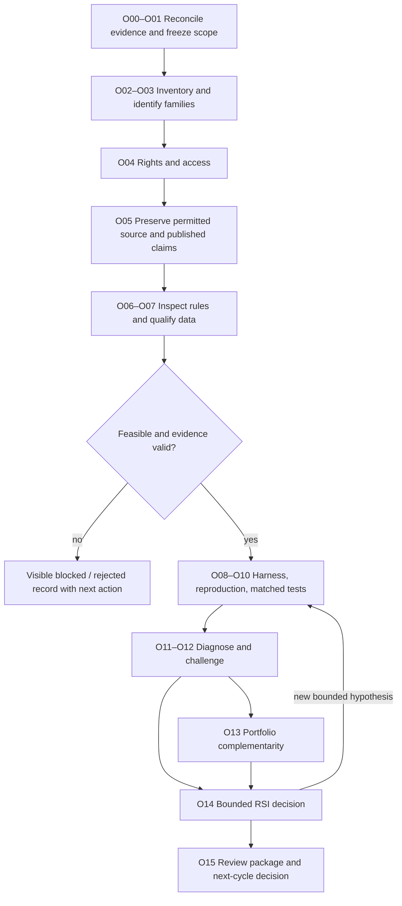

# QuantConnect strategy research: objective checklist

This is the canonical checklist for the user-requested comprehensive QuantConnect
research initiative. The [portfolio roadmap](../roadmap.md) retains platform
priority and readiness authority. [Goals](../goals.md), [intake](../research-intake.md),
[research development](../research-development.md) and [scoring](../research-scoring.md)
own their existing contracts; this checklist applies them rather than replacing them.

**Current state:** O00–O02 discovery/indexing is complete for the observed snapshot.
O03 family tags cover all 622 records; the [licensed-first details review](2026-10-26-quantconnect-source-rights.md)
adds static inspection of 82 tutorial folders and eight manual detail/data cards.
Complete instrument/execution contracts and package equivalence remain blocked.
O04 has started with 622 separate rights dispositions. The [tutorial-source follow-up](2026-10-26-quantconnect-tutorial-packages.md)
searched all 82 tutorial titles and exported four licensed source/example bundles;
78 tutorial package dispositions remain unresolved, with no exact hosted identity
or runtime/data qualification established in that export snapshot. The subsequent
[CAPM alternative study](2026-10-26-capm-spy-comparison.md) passed an order-free
free-data/dependency probe and completed a separately bounded CAPM/SPY comparison,
including the explicitly approved accounting retest. This framework alternative
failed as a SPY improvement under the fixed cost model.
The requested [cost/stock-stop ablation](2026-10-26-capm-cost-stop-ablation.md)
completed nine qualified fresh cases in ten attempts under its separate
11-attempt/90-minute budget, now closed. Both prior controls reproduce. The stop's
effect is cost-sensitive; none of the six CAPM variants improves on matching SPY.
The [next licensed-candidate slice](2026-10-26-dual-thrust-spy-comparison.md)
keeps CAPM unchanged. G-Score stopped after a blocked order-free data probe;
a causal SPY Dual Thrust adaptation completed three audited financial cases
but failed its improvement screen. Its aggregate budget is closed at five of
six attempts, with failures preserved and lessons L29–L32 recorded.
The [stock-pairs slice](2026-10-26-stock-pairs-spy-comparison.md) also completed
three qualified financial cases after free-data/timing qualification, but neither
improvement screen passes; its separate five-attempt budget is closed.
The [earlier inventory receipt](2026-10-26-quantconnect-inventory.md) remains frozen;
all older financial budgets remain closed.

## Intended outcome and scope

Build a reviewable strategy library in which every item in a dated, accessible
QuantConnect catalog snapshot has an identity, mechanism, evidence state and next
action. Export every accessible, permitted strategy source in that scope; document
why any item cannot be exported. Evaluate feasible candidates through bounded
studies and explain what we learned from each. This is broader than choosing three
favorites. Catalog coverage, reproducibility, investment quality and deployment
readiness are separate outcomes.

The existing mandate is USD 300,000, one year, annual doubling as an aspiration,
and approximately 30% drawdown as a reassessment tolerance. These are not promised
returns, a guaranteed loss bound or an instruction to add leverage until a chart
fits. Free/local data and currently available free hosted access remain constraints.
Catalog other asset classes even when their data or execution prerequisites block
reproduction. The separate initial US-stock data-library scope stays unchanged.

“All strategies” means a **frozen discoverable scope**, not a claim to index private,
deleted, inaccessible or future strategies. Initial discovery covers:

- The community Strategies listing, including all accessible pages/filter states
  needed to enumerate its distinct strategy IDs at a recorded time.
- The official Strategy Library tutorial index as a separately counted source.
- Previously reviewed links and projects, reconciled to these sources. Public
  forum examples are supplemental explicit links; searching every forum post is
  outside this initial denominator.

Source counts are unknown until enumeration. Record pages attempted, retrieval
failures, listing totals if available and reconciliation gaps. Refreshes create a
new snapshot/delta; never silently grow the denominator during a research cycle.

## Objective board

Dependencies refer to objective IDs, not automatic permission to execute. Named
roles are responsibilities using the [skills catalog](../skills.md), not a claim
that autonomous teams or an orchestration service are running.

| ID | Objective / deliverable | Current state | Depends on | Responsible role | Completion evidence |
| --- | --- | --- | --- | --- | --- |
| O00 | Reconcile our existing experiments and lessons | Complete scoped evidence index; lifetime trial completeness unknown | — | Director + research history | Every prior case linked to source, interpretation, evidence quality and closed budget |
| O01 | Freeze catalog scope and review contracts | Complete inventory-scope contract; future financial budgets unset | O00 | Director + quant | Dated scope, denominator rule, cohort contexts, budget policy and unresolved mandate choices |
| O02 | Enumerate the complete accessible snapshot | Complete observed listing/index coverage; one broken tutorial retained | O01 | Research intake | Unique source IDs, visited pages, counts and explicit coverage gaps reconcile |
| O03 | Map mechanisms, families and duplicates | Partial: 82 licensed method folders inspected, eight manual cards; complete contracts/package equivalence blocked | O02 | Quant | Every record classified, overlaps linked, uncertain relationships visible |
| O04 | Check access and separate code/data/result rights | Started: 622 rights triage dispositions; source/data/package clearance incomplete | O02 | Research intake + infra | Each artifact has permitted / blocked / unknown status and evidence |
| O05 | Export and pin all permitted accessible source packages | Partial: prior sources plus four licensed tutorial-source/example bundles; 78 tutorial package dispositions unresolved | O04 | Infra + research intake | Per-item file manifest, hash, version/time, dependencies and publication claim snapshot; failures listed |
| O06 | Explain actual code and economic mechanism | Partial: prior studies, CAPM, G-Score, Dual Thrust and stock pairs inspected; source identity and causal range repair explicit | O03, O05 | Algo + quant | Decision card agrees with inspected code; description/code differences identified |
| O07 | Qualify free data, timing, universe and accounting | Partial: CAPM/SPY, causal Dual Thrust and stock-pairs scoped audits pass; G-Score data gate blocked; independent action replay and broader candidate blockers remain | O06 | Data audit + infra | Candidate coverage/rights/timing/action/accounting receipt; substitutions explicit |
| O08 | Establish a reusable comparison/evidence contract | Partial: saved-result reports exist | O01, O07 | Infra + ML infra | Versioned schema, metric definitions, control parity, failure capture and renderer verification |
| O09 | Reproduce each feasible source baseline | Partial: exact versus adapted status varies by case | O05–O08 | Experiment + algo | Frozen source/native run, published-claim reconciliation or explained mismatch |
| O10 | Run fair comparisons with suitable controls | Partial: SPY, T11, selection, CAPM, causal Dual Thrust and stock-pairs controls tested in specific contexts | O09 | Quant + experiment | Matched context, all attempts, annual/full and temporal metrics, accounting audit |
| O11 | Diagnose sources of gains and losses | Partial: gate/stock contribution evidence and completed CAPM cost/stop policy contrasts; event-level causal replay remains unverified | O10 | Performance diagnosis + risk | Decision/outcome attribution, market/sector/exposure contribution and failure episodes |
| O12 | Challenge robustness and independence | Partial: scoped stress tests and nine-case CAPM ablation completed; independent validation unqualified | O10–O11 | Robust evaluation + risk | Frozen stress/ablation plan, trial history, untouched/forward evidence state, pass/fail reasons |
| O13 | Test portfolio complementarity | Planned for broad candidates | O12 | Portfolio analysis + risk | Aligned paths, joint drawdown, turnover/cash/margin feasibility and matched allocation controls |
| O14 | Operate bounded recursive improvement decisions | Partial: journal/scoring slice exists; no unattended optimizer | O11–O12 | Director + candidate evolution | One diagnosed hypothesis per change; budgets, trials, stop/continue decisions and lessons preserved |
| O15 | Publish an internal review package and close the cycle | Planned | All records dispositioned; O13 where applicable | Director | Coverage funnel, filters, reports, decisions, blockers and next work list with evidence links |

“Partial” means related capabilities or scoped evidence exist, not that the full
objective is complete. A blocked or rejected candidate can finish its review
record; it does not count as successfully exported, reproduced or validated.

## Detailed checklist

### O00 — Establish what we already know

- [x] Index source strategy, local adaptation, control and overlay as different identities.
- [x] Link the SPY/EMA/gate, sector momentum, QC504 ensemble/T11, first-three selection,
  stock-risk and sector-matched receipts, sources and artifacts without copying results.
- [x] Record each sample/capital/cost context, viewed-data exposure and closed budget.
- [x] Reconcile stale source-screening statuses against subsequent studies.
- [x] List implemented tooling separately from unavailable inputs and unverified claims.

Start from the [research lessons](2026-10-26-research-lessons.md),
[ten-source shortlist](2026-10-26-quantconnect-shortlist.md),
[selection completion](2026-10-26-selection-completion.md) and latest
[sector-matched review](2026-10-26-sector-matched.md). The last supplies a conditional
sector-label example, not recovered historical vendor truth.

### O01–O03 — Know the entire review population

- [x] Record snapshot timestamp, source indexes, pagination/filter procedure and exclusions.
- [x] Assign stable internal IDs; preserve upstream ID, URL, author and observed name.
- [x] Record headline metrics with original definitions, dates and missingness; never
  merge 1Y Sharpe, 5Y CAGR and shorter OOS metrics into one same-period score.
- [x] Reconcile unique item counts and inaccessible pages before marking coverage complete.
- [x] Tag asset-selection, industry/sector, signal, strategy-selection, allocation,
  aggressiveness, go/no-go and execution layers; allow multi-layer strategies.
- [x] Tag trend, momentum, mean reversion, value, quality, earnings/events, carry,
  volatility/options, relative value, multi-asset allocation, ML and ensembles.
- [ ] Record instruments, frequency, holding period, leverage/shorting and data needs.
- [ ] Distinguish exact code duplicates, forks/overlays and shared economic families.
  Similar family labels alone do not prove code equality or redundant return paths.

Initial metadata triage is complete: 540 community IDs and 82 tutorial-index entries
(81 article targets observed; one soft404 blocked). Of 622 family classifications,
473 use titles, 64 public descriptions, 82 official index descriptions and three
displayed-code inspections. Those evidence levels are distinct. Instrument and
execution hints are provisional, with exact holding periods/data requirements
explicitly unverified. The two unchecked items above remain O03 follow-up. The subsequent
[details and rights receipt](2026-10-26-quantconnect-source-rights.md) adds 82 licensed
method inspections, eight manual data/decision cards and three reviewed fragment
similarity leads. No complete source package or package duplicate is verified;
540 community full-source reviews remain blocked under the licensed-first choice.

O03 bounded progress (2026-10-26):

- [x] Map all 82 tutorial entries to pinned, licensed official repository folders.
- [x] Inspect available method/code fragments; distinguish embedded backtests from source.
- [x] Review three fragment similarity leads and preserve material variant differences.
- [x] Add eight manual detail/data cards; record unknown contracts for every record.
- [ ] Obtain permitted complete implementations and finish all 622 detailed contracts.
- [ ] Verify whole-package equality/fork relationships with complete file manifests.

### O04–O05 — Preserve what can actually be reused

O04 bounded progress (2026-10-26):

- [x] Record acquisition, code, dependency, data and result rights separately for all 622 records.
- [x] Verify Apache-2.0 for pinned Tutorials artifacts; keep it separate from community code/data.
- [x] Record the user's licensed-sources-first choice; stop bulk website extraction.
- [ ] Clear candidate-specific missing rights and dependencies before O05 export.

These are triage completions, not blanket permission. The [rights receipt](2026-10-26-quantconnect-source-rights.md)
owns evidence and blockers. The package-preservation checks below remain open.

- [ ] Inspect code visibility/clone availability and source-specific attribution/license.
- [ ] Separate private research use, redistribution and modification permissions;
  absence of a license is unknown, not permission for public copying.
- [ ] Inspect data-use/export rights independently of code rights.
- [ ] For every permitted accessible package, preserve all relevant files, parameters,
  referenced libraries/custom inputs, engine/environment and capture time/hash.
- [ ] Preserve published result identity, dates, metric definitions and available
  result/log/chart artifacts separately from code. Record unavailable artifacts.
- [ ] Keep an immutable source copy apart from our adaptation and its change log.
- [ ] Keep restricted/private material outside tracked public files; leave metadata
  and evidence pointers where rights permit. Never export credentials.
- [ ] Reconcile expected versus exported files and retry only technical failures
  within an acquisition budget; preserve inaccessible/rights-blocked records.

QuantConnect documents community cloning and result downloads separately. A code
copy is not proof that its displayed backtest and publication history were captured.
Current account access, source visibility and permitted export must be verified per
item; documentation is not an account entitlement receipt. See primary sources below.

Tutorial-source progress (2026-10-26; [receipt](2026-10-26-quantconnect-tutorial-packages.md)):

- [x] Complete 82 bounded GitHub title searches and preserve query/result receipts.
- [x] Inspect 140 candidate files for static dependencies and file-level grants.
- [x] Export four licensed source/example bundles with hashes, notices and data blockers.
- [x] Keep 78 unresolved tutorial-package dispositions visible; preserve negative evidence.
- [ ] Establish exact original source identity and complete packages for remaining tutorials.
- [ ] Lock/test runtime dependencies and qualify exact free data before reproduction.

### O06–O07 — Understand rules and make inputs trustworthy

- [ ] Write a decision card: universe → features → eligibility/ranking → sizing →
  entry/exit/rebalance → execution → risk actions, with causal timestamps.
- [ ] Identify the claimed return mechanism and the conditions under which it fails.
- [ ] Inspect hidden external files, future data, same-bar fills, survivorship,
  restatements, ticker changes, warmup, rejected orders and leverage assumptions.
- [ ] Build each candidate's instrument/date/field/calendar/resolution coverage receipt.
- [ ] Qualify point-in-time membership, fundamentals/sectors and publication lag.
  Label inferred fields explicitly and block material unresolved requirements.
- [ ] Verify splits/dividends/delistings, futures rolls, FX conversions, option
  chains/expiry/assignment and borrow where applicable; do not proxy absent data
  silently with daily SPY or synthetic option payoff returns.
- [ ] Establish whether the source can run hosted for free, locally, both or neither.
- [ ] Separate exact reproduction from a declared adaptation using substitute data.
- [ ] Capture the smallest concrete free-data remediation for each blocker; do not
  buy data or enlarge the local stock-library scope through this plan.

### O08–O10 — Compare under explicit controls

- [ ] Reuse existing engine/report/journal capabilities before creating an importer,
  database, scheduler or dashboard; document the demonstrated gap for any extension.
- [ ] Define one run schema: candidate/version, input identity, context, attempts,
  metrics/units, evidence eligibility, artifacts, failures and final decision.
- [ ] Preserve historical native-capital reproduction first; separately test the
  USD 300,000 mandate scenario. Never mix the USD 10,000 fixture into a qualified
  capital leaderboard without a sizing/accounting test.
- [ ] Freeze dates, warmup, cash/dividend policy, execution, risk-free convention,
  cost/financing/borrow, sizing, controls and primary estimand before a run.
- [ ] Use SPY where relevant, same-universe passive/equal-weight controls, exposure-
  matched controls, unlevered references and existing comparators where suitable.
  T11 is a development reference, not a universal investable benchmark.
- [ ] Group comparable instruments/frequencies into contexts; unlike strategies may
  need different cost models and history windows. Show comparability flags rather
  than force a misleading universal rank or silently truncate coverage.
- [ ] Reproduce the pinned source first where feasible; quantify published-result
  discrepancies before changing the strategy. Record unavailable source inputs.
- [ ] Record every technical/financial attempt, code change and failed control.
- [ ] Audit cash/NAV, net contributions, fees, financing, fills/rejections, annual
  compounding, exposure and hash identities appropriate to the claim.
- [ ] Render and verify annual/full-period results and all negative evidence.

Required measurement dimensions, when supported by evidence:

| Dimension | Measurements |
| --- | --- |
| Profit | Net return, CAGR, annual/monthly and rolling returns, terminal wealth, gains/loss contributions |
| Risk | Maximum drawdown, worst day/month, historical expected shortfall, exposure, concentration, margin/liquidity |
| Temporal | Time underwater, deepest versus longest episodes, recovery/censoring, rolling 21/63/252-session outcomes, drawdown area |
| Efficiency | Sharpe, Calmar, turnover, fees/slippage/financing/borrow and capital utilization |
| Reliability | Source/data integrity, causal availability, coverage, rejected orders, accounting residual, robustness and trial history |
| Diversification | Market/sector/factor dependence, aligned return and drawdown relationships, joint stress and incremental portfolio result |

Unavailable measures stay null with a reason. Native metrics versus independently
reconstructed values must be distinguishable. Drawdown depth and time underwater
are separate objectives; an unrecovered endpoint is not a completed recovery.

### O11–O12 — Explain success and try to falsify it

- [ ] Analyze gains/losses by year, holding, sector, market regime and risk episode.
- [ ] Join decision logs with later-maturing labels; keep future outcomes separate
  from features available when making the decision.
- [ ] Measure protection, missed rebounds, cash warnings, delayed re-entry and
  opportunity cost when relevant to the treatment.
- [ ] Separate accounting contribution, counterfactual ablation and causal attribution.
- [ ] Test removal of components before adding new filters; change one research
  dimension at a time, with explicit exceptions for necessary model repairs.
- [ ] Predeclare cost, signal delay, financing, concentration and leverage stresses.
- [ ] Check parameter neighborhoods and regime/universe sensitivity under counted
  budgets; do not keep searching until a preferred headline appears.
- [ ] Track all variants, correlated families, published-history exposure and
  selection decisions. Apply multiple-testing diagnostics only where their
  assumptions and trial inventory are supportable.
- [ ] Mark already-viewed 2020–2025 history as development. Lock genuinely unseen
  data before inspection where available; otherwise record independent validation
  as unavailable and plan prospective observation separately.

### O13–O14 — Construct and improve candidates responsibly

- [ ] For eligible candidates, align feasible return paths and account for shared
  capital, orders, cash, margin, borrow and joint-stress exposures.
- [ ] Compare a fixed/simple allocation against proposed portfolio allocation.
  A return-series blend alone is a hypothetical portfolio, not an execution proof.
- [ ] Test whether added strategies improve the declared tradeoff after costs;
  avoid stacking multiple leveraged expressions of the same market bet.
- [ ] Log a diagnosis, falsifiable hypothesis, one bounded change, controls,
  stop condition and budget before each recursive improvement step.
- [ ] Apply the canonical scoring contract: hard evidence gates first, raw-unit
  tradeoff/Pareto views second, research-priority score separately.
- [ ] Record retain, revise, reject, blocked or await-independent-evidence decisions.
- [ ] Preserve negative findings and stop exhausted directions; do not rename
  rejected candidates or reset old budgets to continue searching.
- [ ] Keep a visible exploration queue for mechanisms absent from current evidence.
  A director-selected experiment is not trained RL/GAE or a proven optimizer.

### O15 — Make the whole program easy to review

- [ ] Provide catalog filters for family, instruments, data readiness, evidence
  status, original/adapted identity, costs/exposure context and next action.
- [ ] Show separate upstream-claim, reproduced, adapted and independently validated
  views; do not rank publication claims alongside audited local results as equals.
- [ ] Link each row to source, immutable manifest, run/report, decision and lesson.
- [ ] Show coverage funnel and denominators, including blocked/rejected/duplicate
  counts and reasons, plus total consumed attempts and unresolved discrepancies.
- [ ] Close each batch with explicit completed work, failures, information learned
  and the next bounded work list. Refreshing a report does not authorize new trials.
- [ ] Reuse the performance browser/MLflow where suitable; a generic catalog UI and
  importer remain planned until implemented and verified.

## Per-strategy review card

One record per source strategy/version, linked to its family and our adaptations:

| Group | Required fields |
| --- | --- |
| Identity | Internal/upstream IDs, URL, author, observed title, version/capture time, parent/family/duplicate links |
| Claim | Published window, benchmark, capital, metric definitions/values, OOS label and publication time, omissions |
| Reuse | Code/data/results access and separate rights, file manifest/hash, dependencies and missing inputs |
| Mechanism | Targets/universe, decision layers, signal, timing, sizing, exits, risk/execution, expected failure modes |
| Readiness | Hosted/local feasibility, free coverage, PIT/corporate-action/accounting checks, blockers and evidence |
| Experiment | Frozen plan/context, controls, all attempt IDs, code/input hashes, actual/target exposure and cost model |
| Findings | Full/annual/temporal metrics, contributions/episodes, stresses, independent evidence status |
| Decision | Evidence gates, tradeoffs, research priority and reason, disposition, next action, responsible role |

Suggested states: discovered → classified → access-reviewed → source-preserved →
code-understood → data-qualified → reproduced → compared → challenged → dispositioned.
Blocked/rejected exits retain their last completed stage. Evidence status is
claim-specific; a record can have a valid accounting comparison and still lack
independent investment validation.

## Sequence, parallel work and budgets

**Now:** O00–O02 discovery/indexing is complete for the observed snapshot; O03
initial family tags are assigned, with detailed contracts and equivalence still
open. The [licensed-first review](2026-10-26-quantconnect-source-rights.md) advances O03/O04; complete contracts and candidate-specific rights remain open. Use the existing
rights fields to track candidate-specific missing permissions and dependencies. Do not reduce coverage to the
initial ten-source shortlist or declare an arbitrary catalog count.

**Next:** O04–O08 preserve permitted packages and qualify inputs across the whole
snapshot. Every record receives a review disposition; only feasible candidates
advance to simulation. Source export is not restricted to three favorites.

**Then:** O09–O12 run bounded batches until every feasible queued candidate in the
frozen cycle has an evidence-backed outcome or explicit unresolved blocker. Process
families in a disclosed order based on information gain, feasibility and mandate
relevance, not the largest published CAGR. Duplicate code can share a baseline
only with a documented identity argument; overlays still need their own treatment.

**Later within this initiative:** O13–O15 compare complements, propose improvements
and assemble the review. Execution/paper/live qualification is a separate roadmap
lane and does not follow automatically from a research winner.

Potential parallel workstreams: catalog/provenance; code/mechanism inspection;
data/accounting qualification; reporting/diagnosis. Financial jobs and shared cloud
project edits need a coordinator and an aggregate ledger. These are proposed work
splits, not launched agents; parallel delegation requires its own task scope.

Before execution, declare a catalog acquisition page/file/time ceiling, a global
research-cycle attempt/time ceiling and per-study budgets. Their numeric values
are **not yet allocated by this planning task**. Each batch needs a finite stop
and a review point; a large catalog is not an unlimited run budget. As an initial
budget proposal, reuse the recent six-total-attempt/90-minute study pattern, with
at most two technical retries inside that ceiling, where its necessary controls
fit. More cases require an explicit revised frozen budget, not implicit overflow.
All earlier completed budgets remain closed.

Progress checkpoints: after scope enumeration, after source/data triage, and after
each bounded experiment batch. At each checkpoint report denominators, terminal
statuses, evidence failures, budget used and next eligible work. Catalog size and
access cost are unknown, so a completion date is not promised before O02/O04.

## Overall acceptance

- [ ] Every discoverable item in the frozen scope is represented or an explicit
  coverage gap prevents a completeness claim.
- [ ] Every record has family, rights/access/data state and a next action/disposition.
- [ ] Every permitted accessible export has an integrity manifest; all exceptions
  are counted and explained. Export coverage is reported separately from catalog coverage.
- [ ] Every completed comparison has an eligible evidence context, controls,
  counted attempts, annual/full/temporal metrics and reproducible permitted artifacts.
- [ ] Every feasible candidate is dispositioned within the declared cycle or
  remains visibly queued when the aggregate budget ends; budget exhaustion is
  reported as incomplete coverage, not completion of all candidates.
- [ ] Lessons and unresolved blockers are preserved and linked from the review.
- [ ] Portfolio/investment claims remain separate from operational readiness.

## Primary-source check for this plan

Reviewed 2026-10-26; these establish platform features, not completed exports:

- [Community Strategies](https://www.quantconnect.com/docs/v2/cloud-platform/community/strategies):
  describes the listing, following and cloning community strategies.
- [Backtest Results](https://www.quantconnect.com/docs/v2/cloud-platform/backtesting/results):
  describes viewing backtest project code and downloading result information.
- [Strategy Library](https://www.quantconnect.com/docs/v2/writing-algorithms/strategy-library):
  separate tutorial collection; source index is not the community-listing denominator.

No assertion that every item exposes code, downloadable results, adequate rights,
free data or an independently verified out-of-sample history follows from these pages.

## CAPM alternative checkpoint — 2026-10-26

- [x] O06: inspect the licensed framework alternative, fixed29-symbol universe,
  reverse-regression direction and1% per-security stop; preserve identity differences.
- [x] O07, access slice: construct native models and execute source dependencies;
  all29 symbols passed21daily-bar/minute-history and calendar checks at ten annual checkpoints.
- [x] O08–O10, artifact slice: run both cases and save annual/full/temporal summaries
  in the [CAPM receipt](2026-10-26-capm-spy-comparison.md). SPY passed aggregate checks.
- [x] O07–O10, candidate slice: repair and verify CAPM native accounting. The fifth
  job ran stale SPY code and remains a counted failure. The separately approved
  one-run CAPM retest passed native-book/fee checks and exactly reproduced all11
  metric records. CAPM lost against SPY in all10years under the frozen costs.
  Both budgets are closed; independent corporate-action replay and exact hosted
  tutorial identity remain unverified.

These candidate-scoped checks do not complete the catalog-wide objectives or
change the frozen82-tutorial denominator.

## CAPM ablation checkpoint — 2026-10-26

- [x] O10–O12 design slice: freeze three explicit-cost levels, CAPM stop on/off
  and three matching SPY controls in the [ablation receipt](2026-10-26-capm-cost-stop-ablation.md).
- [x] Complete the nine cases, exact prior controls, native accounting/selection
  checks and 90 annual rows with drawdown, Sharpe, Calmar and underwater measures.
- [x] Record cost, stop and interaction [lessons L25–L28](2026-10-26-research-lessons.md#capm-cost-and-stock-stop-ablation-follow-up);
  close at ten attempts, preserving the first instrumentation failure.

This fixed alternative remains a negative development baseline. The bounded
slice does not complete O10–O12 across the catalog or establish unseen alpha.

## Next licensed candidate: G-Score — 2026-10-26

- [x] Keep CAPM as the negative baseline; verify its 77-file artifact manifest unchanged.
- [x] Select QC-T-15267 / `g-score-legacy` for fundamental/quality information,
  with its explicit file grant and preserved source. Alternatives and portability
  differences are in the [G-Score receipt](2026-10-26-gscore-spy-comparison.md).
- [x] Freeze an order-free probe, three matching financial cases and two technical
  retries, with a separate six-attempt/90-minute budget. No score-threshold search.
- [x] Attempt the order-free input gate; record a **blocked** result. Current
  quarterly ROA is retired; the provider identifies look-ahead ratio dates in
  the legacy feed. Legacy compatibility was considered, never launched.
- [ ] G-Score financial comparison remains unexecuted; no return or ranking exists.
- [x] Close G-Score at one failed probe with zero financial cases; preserve evidence.

## Licensed fallback: causal Dual Thrust — 2026-10-26

- [x] Freeze QC-T-15258 / `dual-thrust-fx` as the input-feasible fallback, before
  financial outcomes. Its current-session range look-ahead is repaired explicitly
  in a separately named SPY adaptation; original source/license remain unchanged.
- [x] Keep the same aggregate six-attempt ceiling and original 90-minute deadline,
  counting G-Score's failed probe. See the [fallback receipt](2026-10-26-dual-thrust-spy-comparison.md).
- [x] Complete the fresh SPY gate, intraday long control and causal breakout cases.
- [x] Verify native accounting, borrow/costs, 30 annual rows, temporal measures and
  minute-level risk; update lessons and close the aggregate budget.

  The scoped comparison passes evidence checks but fails the improvement screen:
  Dual Thrust CAGR−3.80%/DD34.06% versus SPY14.65%/33.16%; longest underwater
  2,493 versus488sessions. Keep the fixed adaptation as negative evidence.
- [x] Record [lessons L29–L32](2026-10-26-research-lessons.md#licensed-candidate-readiness-and-causal-adaptation-follow-up),
  preserve the blocked G-Score probe and failed intraday observation path, verify
  the passive retry reproduced all11metrics, and close at five aggregate attempts.

This is one completed O06–O12 candidate slice. The wider catalog's source, data,
independence and robustness checklist remains partial; no automatic next run or
repeated same-history tuning is authorized by closing this slice.

## Next licensed candidate: causal stock pairs — 2026-10-26

- [x] Select QC-T-15300 / `stock-pairs`, preserve source/license, and inspect its
  future-aware sizing and statistical/state defects before execution.
- [x] Freeze the declared causal NVDA/AMD adaptation, SPY and pair-hold controls,
  six aggregate attempts/two technical retries and90minutes. See the
  [candidate receipt](2026-10-26-stock-pairs-spy-comparison.md).
- [x] Pass the zero-order free-data/history/action/dependency gate:2,514sessions,
  twoNVDA splits, complete observed dividend events, raw/PIT modes and actual
  statistical library; one failed early-close probe preserved.
- [x] Run and audit the bounded three-case comparison,30annual rows and temporal
  diagnostics; record lessons, failure dispositions and close its separate budget.

Earlier CAPM and Dual Thrust budgets remain closed and their evidence unchanged.

  Scoped evidence qualifies; both fixed improvement screens fail. Pair CAGR−2.18%/
  DD25.62%and2,341underwater sessions compare with SPY13.64%/31.26%and488.
  The64.66%CAGRstock-hold control has65.70%DD and hindsight selection.
- [x] Record [lessons L33–L36](2026-10-26-research-lessons.md#licensed-stock-pairs-readiness-follow-up),
  preserve the failed probe/amendments, and close at five of six attempts.

Of the four licensed bundles in this bounded source pass, CAPM, causal Dual Thrust
and causal stock pairs now have separately scoped financial findings; G-Score
remains data-blocked without financial results. This does not clear the other78
tutorial records or establish exact current hosted-source equivalence.

## Pipeline component review follow-up — 2026-10-28

The [stage-fit review](2026-10-28-qc-pipeline-stage-fit.md) maps every existing622 source ID to candidate pipeline roles or an explicit unassessed status, preserving original provisional hints. Four public method-description refinements were checked; complete code/data/rights verification was not performed. O03 therefore remains partial. The derived CSV/JSON and receipt own this mapping snapshot; the original inventory and closed research budgets are unchanged. Next review targets are source-verified family representatives and their causal component contracts, not an unbounded rerun of all strategies.

The [first parallel component-review wave](2026-10-28-qc-parallel-review.md) completed three subsessions covering12 representative groups/13 primary IDs. It verified scoped method/fragment evidence and identified version, timing and data blockers. O03 remains partial; no duplicate-code equivalence, source-package clearance or financial promotion follows. Next proposed steps are zero-financial saved SPY transition attribution and a separate stock-selection as-of audit; their execution needs its own finite record.

### Remaining-family review — 2026-10-28

The [second parallel wave and family checklist](2026-10-28-qc-parallel-review-wave2.md) completes a first representative disposition across all17 family tags. Two waves screened25 primary catalog IDs in24 groups;597 records remain outside this primary representative screen. Ten remaining family tags were dispositioned in wave two; monitoring and passive representatives are title-only, while options/volatility methods are held for contradictory leg/expiry definitions. Family-role mappings and source/data/accounting blockers are linked in a separate coverage snapshot. O03 remains partial; O04/O05 rights/package gates are unchanged. No new financial cases, source exports or broker operations occurred.

- [x] First representative screening/disposition pass for every catalog family, including explicit blocked/unverified outcomes.
- [ ] Deep mechanism and duplicate/variant review of remaining records; verify complete source contracts rather than inheriting a family representative's evidence.
- [ ] Resolve identified source-version, availability, data and accounting blockers before separately budgeting any further experiments.

The [RSI readiness follow-up](2026-10-28-rsi-readiness-wave.md) completed saved SPY transition attribution, a blocked historical selector-reconstruction audit and isolated synthetic execution-record audit hardening. Chosen-five logs do not qualify the missing eligible-fifty/score/input history. No new financial strategy cases, source exports or broad O03/O04 completion follows; future direct-runner capture and input export remain prerequisites.

The C02 local sizing follow-up (`../../.local/rsi-calmar-20261028/docs/tasks/2026-10-28-ceiling-capture-study.md`; private/local artifact, not published) integrated execution capture and completed six cases. Smooth sizing below the discrete ceiling slightly lowers drawdown but loses growth and Calmar; unchanged incumbent retained. This local study does not qualify additional QuantConnect source packages, historical selector data or broad O03/O04 completion.
