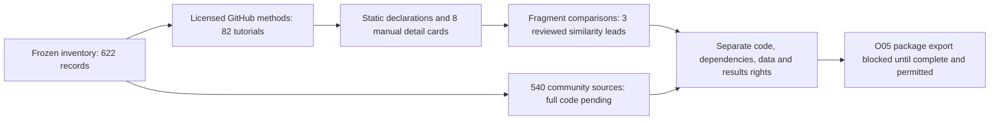

# O03 details and O04 reuse-rights review

This receipt extends the [frozen inventory](2026-10-26-quantconnect-inventory.md)
without changing it. The [master checklist](2026-10-26-quantconnect-research-master-plan.md)
owns objective acceptance; [research intake](../research-intake.md) owns reuse policy.
The user selected **licensed sources first**; no official API/MCP connection or
written bulk-access permission was supplied. This is a static review, not a new
financial experiment or source-package export.

**O03 remains partial/blocked. O04 has started: all 622 records have a rights
triage disposition, but complete-package reuse is not cleared.** Unknowns remain
visible instead of being converted to assumed permission or strategy details.

## Reviewed population and reproducibility

| Evidence | Result | Limit |
| --- | --- | --- |
| Original population | 540 community IDs + 82 tutorials = 622 records | Observed prior listing/index scope; not every private or deleted strategy |
| Official source | QuantConnect/Tutorials at `4a341890296f7e79e095508f06170c72ccaa629c` | Repository revision is not the current website implementation |
| GitHub inspection | 341 English core HTML files; Git blob and SHA-256 verified | 337 map to the frozen 82; four belong to supplemental Time Series Momentum Effect, excluded from population |
| Method inspection | All 82 matched tutorial folders processed; eight manually detailed cards | Most entries still need full implementation, exact universe and execution review |
| Source completeness | 354 observed code blocks, 201 pass meaningful-fragment threshold; five records contain candidate algorithm-class snippets | No complete dependency/file package verified; 85 in-scope files contain iframe embeds |
| Relationships | Zero cross-record raw/AST identity groups under declared fragment filters; three lexical similarity leads manually reviewed | This does **not** mean there are no duplicate strategies |
| Rights | 622 separate triage dispositions | A disposition can be unknown or blocked; no blanket clearance |
| Operation | Zero financial attempts, orders, new source-package exports or publication | No performance, compatibility or free-data entitlement validation |

The licensed folder for *Momentum in Mutual Fund Returns* provides an alternate
method source. The earlier website soft404 remains preserved as historical evidence.
Title matches (all scores at least 0.95) locate repository folders; they do not
establish code identity with similarly named community strategies.

The read-only inspector preserves code whitespace, parses Python syntax without
executing it, and retains constants and identifiers when comparing ASTs. Exact
comparisons require at least five lines and 50 tokens; lexical comparisons require
at least 100 tokens and similarity of 0.80. Similarity scores measure text overlap,
not financial independence. Code blocks, methods and complete packages are distinct.

## What the detail review changes

Eight manual cards in the [metadata review](../../research/catalogs/qc-detail-rights-v1/review.json)
link their pinned source files and distinguish method declarations from runtime proof.

| Candidate | Declared approach | Data/accounting requirement before reproduction |
| --- | --- | --- |
| Asset Class Momentum | Five asset-class ETFs, top three by 12-month momentum, monthly equal weights | Full ticker list, adjusted prices/actions and pre-signal history |
| Sector Momentum | Ten sector ETFs, top three by 12-month momentum, rebalance at month start | ETF inception/availability and full configuration; shares mechanism with asset-class rotation, not universe |
| Gradient Boosting Model | SPY minute bars, 10-minute prediction horizon, monthly training | Method explicitly omits training implementation; minute coverage, model versions and causal labels unresolved |
| Commodity Futures Momentum | Daily continuous settlement series; monthly long/short momentum quintiles | Legacy Quandl series, tradable-contract mapping, rolls, multipliers, margin and financing |
| Forex Carry Trade | Monthly long highest-rate / short lowest-rate currency | Publication-time interest rates, FX prices, rollover and actual financing |
| Fundamental Stock Selection | Monthly composite of six factors, highest-ranked 20 stocks | Point-in-time financial statements, historical universe, actions and delistings |
| Gaussian Naive Bayes | Largest ten technology stocks, historical return features | Historical sector/capitalization data and strict timing of forward-shifted labels |
| Drug-Manufacturer News Sentiment | Industry/PE screen, intraday Tiingo news, Wednesday signal | News/dictionary rights and timestamped fundamentals; overview says long but code emits signed insights, so execution needs inspection |

No price-only catalog establishes these additional inputs. Static API detections
are lower bounds on observed declarations, not an exhaustive requirements count.
A margin-account setting does not establish realized leverage; a monthly schedule
does not prove a one-month holding period.

## Duplicate and variant findings

| Pair | Observed common code | Material distinction / disposition |
| --- | --- | --- |
| Earnings Quality Factor / Accrual Anomaly | Balance-sheet accrual formula | Different output property names; shared signal implementation, whole-portfolio equality unknown |
| Ichimoku Energy / Gaussian Naive Bayes | Monthly fundamental-universe selection scaffold | Energy versus Technology; reusable infrastructure, different alpha logic |
| Momentum/Reversal/Volatility / Momentum with Volume | Staggered long/short cohort rebalancing | Six cohorts with 1/6 sizing versus three with 1/3; holding and sizing changes are substantive |

Prior title-based links, including QC504 overlays and Gold Miner variants, remain
**unverified leads**. No community algorithm inherits repository licensing or
identity because it shares a title or economic family. No new comparison proves
whole-package duplicates, fork ancestry or identical return paths.

## O04 rights gates

| Gate | Licensed Tutorials artifacts | Community strategies |
| --- | --- | --- |
| Acquisition | Official GitHub API, pinned repository | New bulk website extraction stopped; use licensed source first |
| Inspect / modify / redistribute code | Apache-2.0 conditional on attribution, license, applicable notices and change marking; repository artifacts only | Source-specific rights unknown |
| External dependencies / embedded backtests | Separate inspection required | Unknown |
| Dataset cloud access | Candidate-specific entitlement unverified | Candidate-specific entitlement unverified |
| Dataset download / redistribution | Separate license required; not established | Separate license required; not established |
| Other authors' result artifacts | Republication clearance not established | Republication clearance not established |
| Complete O05 package export | Blocked by missing files/dependencies/rights | Blocked by source access and rights |

Primary references: [pinned Apache license](https://github.com/QuantConnect/Tutorials/blob/4a341890296f7e79e095508f06170c72ccaa629c/LICENSE),
[QuantConnect Terms](https://www.quantconnect.com/terms/) v1.5 (October 8, 2026),
[dataset licensing](https://www.quantconnect.com/docs/v2/cloud-platform/datasets/licensing),
and [security/IP guidance](https://www.quantconnect.com/docs/v2/cloud-platform/security-and-ip).
Terms section 3.3 restricts website extraction and distinguishes supported official
interfaces. No interface entitlement or bulk-source endpoint was verified here.
A Clone control alone does not establish public redistribution rights.

## Deliverables and acceptance evidence

- [Browser review](http://127.0.0.1:8765/qc-detail-rights-v1/index.html): searchable records, source links, detail cards, unresolved fields and separate reuse gates.
- [Review metadata](../../research/catalogs/qc-detail-rights-v1/review.json), [manual cards](../../research/catalogs/qc-detail-rights-v1/manual-detail-cards.json), [input hashes](../../research/catalogs/qc-detail-rights-v1/inputs.json) and [manifest](../../research/catalogs/qc-detail-rights-v1/manifest.json).
- Raw licensed inspection evidence and acquisition receipts remain ignored under `.local/qc-detail-rights-v1/`. No downloaded strategy was executed or integrated.
- Rebuild offline with `.venv/bin/python scripts/build_qc_source_review.py`; audit with `.venv/bin/python scripts/audit_qc_source_review.py`.
- Validation: all 339 offline tests (including eight new regressions), documentation/dependency checks, overlay audit and unchanged prior-inventory audit passed. Browser filtering and evidence disclosures passed. The exact receipts are recorded in the [acceptance receipt](evidence/2026-10-26-quantconnect-source-rights.json).

To finish O03, obtain a permitted complete source package per candidate, record
missing contracts and dependencies, and compare full packages. Under the chosen
licensed-first constraint, the next feasible slice is to locate explicitly licensed
implementations for the most relevant tutorial mechanisms and qualify their data.
O04 must keep unknown records blocked; O05 follows per-package clearance rather
than waiting for or assuming blanket rights across the entire population.
