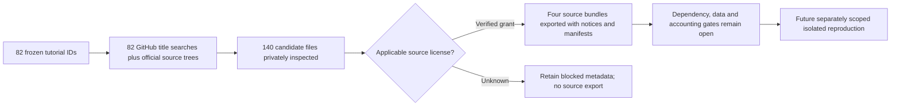

# Licensed implementation search and source export for 82 tutorials

This receipt continues the [method/rights review](2026-10-26-quantconnect-source-rights.md).
The [master checklist](2026-10-26-quantconnect-research-master-plan.md) owns O03–O07
acceptance; [intake](../research-intake.md) owns reuse policy. The population is the
same frozen 82 tutorial IDs. Existing evidence and unrelated work are preserved.

**Four permitted source/example bundles exported; 78 tutorial records still lack a
qualified licensed implementation bundle in this review. No exact current hosted
implementation was verified, and no package is runtime/data qualified.** Exporting
an unchanged source file does not reproduce its results or port it to NautilusTrader.

## What was searched and what coverage means

- Reused the pinned Apache-2.0 Tutorials method snapshot, its 82 folder mappings
  and prior code-fragment evidence. Its strategy folders contain HTML methods and
  embedded result wrappers, not a complete 82-algorithm source tree.
- Inspected official LEAN and Research repository trees and selected files.
  `QuantConnect/StrategyLibrary` returned 404; this is a failed repository-name
  probe, not proof that all possible historical sources were searched.
- Completed 82 official GitHub code-search API queries, one exact title phrase
  per tutorial. Stored each query and its first 30 returned results. These searches
  can miss differently named code and do not exhaust every result or repository.
- Pinned and inspected 140 candidate Python files from
  `paperswithbacktest/awesome-systematic-trading` and
  `santoshlite/StrategyLibraryQC`. Their repository metadata has no license grant.
  One file retains an explicit Apache grant; other inspected files do not establish
  their own grant. Unknown rights are not a claim that copying is categorically
  prohibited; they block our export until clarified.
- Reviewed MIT-licensed collector wrappers and other mirrors separately. A wrapper
  that downloads another repository's strategy files does not establish rights for
  those payloads. Later adapted projects are not assumed to equal these tutorials.
- No QuantConnect bulk website extraction, strategy execution, dependency
  installation, financial experiments, paid downloads, account/broker changes,
  commits or publication were performed.

Candidate filename comparisons and curated aliases produce **leads**, not proof
of source identity. Per-candidate imports and input declarations have source/line
references in the [review metadata](../../research/catalogs/qc-tutorial-packages-v1/review.json).
The browser separates available packages from records without qualified packages.
Missing method imports do not mean a strategy has no dependencies.

## Exported packages

Each ZIP contains unchanged source bytes, the Apache-2.0 license text, an added
README and a source manifest. No market data, credentials, ObjectStore state,
third-party performance artifacts or engine binaries are included. Apache headers
are retained; no upstream NOTICE file was identified for the selected sources.
Frameworks and libraries remain declared external dependencies, not vendored code.

| Package | Tutorial relationship | Dependency/data findings | Readiness |
| --- | --- | --- | --- |
| CAPM framework | Official LEAN alternative explicitly references CAPM tutorial | Pinned LEAN engine, AlgorithmImports/CLR, NumPy/Pandas; historical Dow symbols, minute subscriptions and daily history | Source exported; exact tutorial identity, Python version lock, runtime and legacy-symbol coverage unverified |
| Dual Thrust FX | Independent implementation cites tutorial rules; GBPUSD and five-day range differ from SPY/four-day example | NumPy/Pandas/Matplotlib; local `gbpusd.csv`; top-level `os.chdir('D:/')` | Complete observed signal/plot example exported; equivalent data schema, portfolio accounting and execution integration missing |
| Stock pairs | Independent Engle–Granger mechanism alternative | NumPy/Pandas/Matplotlib/statsmodels/yfinance; NVDA/AMD 2013–2014 default | Source exported; future-aware full-sample maximum-price sizing makes current accounting unsuitable for comparison |
| Legacy G-Score | Single-file candidate with explicit QuantConnect Apache-2.0 header | Legacy QC-injected globals; stdlib statistics/pickle/deque; point-in-time fundamentals and stored ROA history | Source exported; original engine version, field sufficiency and trusted state contract unverified |

The G-Score grant applies to that file even though its repository has no license.
It does not clear neighboring scripts. Its code uses a lowest book-to-market
quartile (`//4`) despite a comment calling it a quintile. This and the stock-pairs
look-ahead sizing finding are preserved rather than silently repaired.

All four files parse statically. Their non-standard imports are disclosed.
Upstream full dependency locks are absent; no modern version combination is
claimed compatible. LEAN's pinned `Common/AlgorithmImports.py` supplies the
CAPM example's implicit NumPy/Pandas names; reference inspection is not a working
local LEAN runtime. G-Score's legacy injected globals remain a separate blocker.

Pinned source revisions and file hashes are stored in each bundle. The sources are:

- [LEAN CAPM](https://github.com/QuantConnect/Lean/blob/22404ea28b8d3f3c9eb74d6ed9f0444426f8e417/Algorithm.Python/CapmAlphaRankingFrameworkAlgorithm.py)
- [Dual Thrust](https://github.com/je-suis-tm/quant-trading/blob/611b73f2c3f577ac5b28aaa19ac8c43d3236c7a5/Dual%20Thrust%20backtest.py)
- [Stock pairs](https://github.com/je-suis-tm/quant-trading/blob/611b73f2c3f577ac5b28aaa19ac8c43d3236c7a5/Pair%20trading%20backtest.py)
- [G-Score](https://github.com/santoshlite/StrategyLibraryQC/blob/6b406477afce2a12724dbf1031a99fbc1e1fee4d/G-Score%20Investing.py)

## Free-data findings

These are provider-documentation findings, not new authenticated input probes.
See [provider review](../../research/catalogs/qc-tutorial-packages-v1/data-provider-review.json)
for the separate evidence register. No exact tutorial reproduction input contract
was qualified in this task.

| Input | Documented route | Remaining constraint |
| --- | --- | --- |
| US equity/ETF prices and actions | QuantConnect lists free cloud [equity](https://www.quantconnect.com/data/algoseek-us-equities) and [security-master](https://www.quantconnect.com/data/quantconnect-us-equity-security-master) access | Local downloads are separate; historical symbols, periods, adjustments and runtime behavior need validation |
| Historical fundamentals | Morningstar lists free [cloud access](https://www.quantconnect.com/data/morning-star-us-fundamentals) | Our local price catalog does not supply the same point-in-time financial statements or classifications; dataset export is not cleared |
| Independent US prices | [Alpaca Basic](https://docs.alpaca.markets/us/docs/about-market-data-api) advertises free stock/ETF history from 2016, with plan/feed limits | Cannot reproduce a 2013–2014 default sample; historical delisted-symbol and field coverage need candidate-specific checks |
| Intraday GBPUSD | [HistData FAQ](https://www.histdata.com/f-a-q/) documents free FX files | Minute OHLC are bid-based and timestamps use fixed EST without daylight-saving adjustment; not a validated midpoint CSV |
| Yahoo prices through yfinance | [Library README](https://github.com/ranaroussi/yfinance) distinguishes code from Yahoo data rights | Personal-use/underlying terms and actual output/adjustment compatibility remain open; no download performed |
| Fama–French factors | [French library](https://mba.tuck.dartmouth.edu/pages/faculty/ken.french/data_library.html) supplies research factor series | Not substitute holdings/fundamentals; version and publication timing matter. CIZ/FIZ changes require explicit vintage handling |
| Legacy custom endpoints | Candidate methods/code reference Quandl, Dropbox, VIX, futures and alternative feeds | Saved URL/import existence is not current free access, data quality, tradability or redistribution permission |

Source exports are code-only. Their permission can be clear while data access and
runtime readiness remain blocked. No cloud-data entitlement was converted into
local download permission.

## Deliverables and validation

- [Browser review and package downloads](http://127.0.0.1:8765/qc-tutorial-packages-v1/index.html).
- [All four permitted bundles](http://127.0.0.1:8765/qc-tutorial-packages-v1/permitted-sources.zip); individual links are in the browser.
- [Review metadata](../../research/catalogs/qc-tutorial-packages-v1/review.json), [package decisions](../../research/catalogs/qc-tutorial-packages-v1/package-plan.json), [input hashes](../../research/catalogs/qc-tutorial-packages-v1/input-manifest.json) and [artifact manifest](../../research/catalogs/qc-tutorial-packages-v1/manifest.json).
- Offline build: `.venv/bin/python scripts/build_qc_tutorial_packages.py`.
  Existing ZIPs refuse byte-changing replacement; preserve a new version rather than silently overwriting them.
- Read-only audit: `.venv/bin/python scripts/audit_qc_tutorial_packages.py` checks
  all 82 IDs/search receipts, source fidelity, applicable grants, allowed archive
  members and hashes. Strategy code is parsed, never imported or executed.
- [Acceptance receipt](evidence/2026-10-26-quantconnect-tutorial-packages.json) records
  actual offline and browser verification. All 345 offline tests (including six new regressions), documentation/dependency checks,
  source/ZIP audits and prior unchanged-snapshot audits passed. Five download routes
  returned matching ZIP hashes; browser filters/disclosures passed. Initial builder
  failures and superseded draft archives are retained privately, with corrections
  and hashes. One unlicensed candidate also retains a syntax error; it was not repaired
  or exported.

## Checklist disposition and next work

This finishes the bounded 82-record source-discovery pass and exports the four
permitted bundles identified. It does **not** finish O03, O05, O06 or O07 for all
tutorials or the larger 622-record population.

- [x] Search every tutorial title and inspect licensed official-source routes.
- [x] Record candidate dependencies/input declarations without executing code.
- [x] Distinguish file grants, repository grants and unrelated wrapper licenses.
- [x] Export four permitted source/example files with unchanged bytes and notices.
- [x] Preserve 78 unresolved package dispositions and all prior negative evidence.
- [ ] Locate additional explicit source grants or independently licensed implementations for the remaining tutorials; do not equate a title match with replication.
- [ ] Confirm complete helper/configuration files and original source identities.
- [ ] Build isolated pinned environments and qualify exact free inputs before execution.
- [ ] Repair accounting or portability defects only in separately identified adaptations.

The cheapest next execution-readiness slice is a separately scoped CAPM alternative
review: it has an official explicit grant and a pinned engine reference. G-Score
can exploit documented free cloud fundamentals later, but requires more legacy
runtime/state validation. Neither recommendation authorizes a new experiment.
