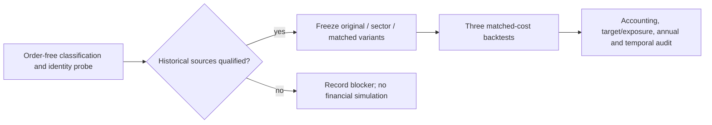

# Historical sector resolution and target-exposure-matched ablation

Status: complete as conditional development evidence; exact historical vendor
classifications remain unavailable. User requested resolution of the27missing historical
sector observations from [stock-risk-v1](2026-10-26-stock-risk-ablation.md), then a
bounded comparison with original momentum and an exposure-matched control.
The [new machine plan](../../research/plans/sector-matched-v1.json) owns the six
launch/90minute ceiling and absolute deadline. Earlier budgets remain closed.

One fixed diagnostic case plus three fixed financial cases and at most two
technical-only retries. Dates2020–2025,USD10000whole shares,25bp slippage,
native IB fees, staged MOO,90%base allocation, flat6%debit ACT/360 and zero credit
interest remain unchanged. No market traffic-light overlay or parameter search.
The sector target cap stays36%NAV; residual is cash, with no replacement picks.

The equal-stock control uses the same original five and the sector strategy’s
causally computed total target allocation at each monthly decision. It spreads
that total equally across the five; no future realized exposure path is imported.
This matches intended total allocation, not exact realized closing gross exposure,
which can diverge through returns, rounding and fees. Both are measured separately.

The order-free probe compares universe-sector, industry group, industry and SIC
fields with security fundamentals and records dated display tickers. Contemporary
classification fields are preferred; any public historical fallback needs source
identity, publication/availability date and an explicit effective-date/mapping
contract before financial execution. Today’s sector label cannot fill an earlier
decision. Unresolved required classifications block the financial stage.

No paid data, agents, broker/account/order operations, services, imports, commits
or publication. Raw vendor histories stay hosted; only necessary derived audit
and research evidence is saved locally. The sample is viewed development history,
not untouched OOS orUSD300000capacity qualification.

## Classification finding and modeling choice

The native order-free diagnostic (`6a941850ca1cc97ec5ff7394a1400f3f`) found all27
missing selection observations also lacked industry-group, industry, SIC and
security-level alternate fields. It verified the decision-date display tickers,
including permanent identifier `GEVW` representing GEV. Historical vendor truth
was **not recovered**. The frozen [classification registry](../../research/plans/sector-matched-v1.classifications.json)
instead defines conditional research-sector inferences from public filings
available strictly before each affected decision, expiring after365calendar days.
This is an explicit modeling assumption made after viewing development history.

| Issuer | Sector inference | Missing selections | Historical source versions |
| --- | --- | ---: | --- |
| JD | Consumer cyclical102 |7|2019annual filed2020-04-15|
| PLTR | Technology311 |12|2023annual filed2024-02-20;2024annual filed2025-02-18|
| BABA | Consumer cyclical102 |5|2024annual filed2024-05-23;2025annual filed2025-06-26|
| GEV | Industrials310 |3|2024annual filed2025-02-06|

All27are covered under this conditional contract; no unknown selection is silently
excluded as cash. The full registry preserves primary filing links, mapping
rationale, identities, availability and effective dates. Native classifications
remain preferred whenever available. This test cannot establish exact historical
Morningstar classification, independent OOS alpha or live readiness.

The first financial source could not be saved because it exceeded the hosted
32000character limit. That counted attempt and the oversize sources are preserved.
The technical amendment embeds only the six registry fields read by the resolver
and shortens indentation; otherwise AST-equivalent logic remains frozen.

Acceptance:

- [x] Diagnose all27missing monthly selections and freeze qualified resolution.
- [x] Run the three fixed financial cases only after the data gate passes.
- [x] Reproduce original controls; match cohort/feature/calendar identities and
  monthly target exposure between sector and control.
- [x] Report actual exposure deviations, costs, all annual/full risk metrics,
  underwater duration and security contributions with native accounting checks.
- [x] Preserve failed/missing evidence, restore cloud source, close the ledger,
  verify offline/browser/artifact outputs and record lessons.

## Results and decision

The [browser review](http://127.0.0.1:8765/sector-matched-v1/index.html) contains
18 annual rows, 1,080 monthly chosen-security rows (216 case-month decisions),
and 171 full-period native security contribution rows. The [evidence receipt](evidence/2026-10-26-sector-matched.json)
links frozen source hashes and artifact hashes. No prior report was overwritten.

| Case | CAGR | Max drawdown | Sharpe | Calmar | Longest underwater sessions / calendar days | Average gross |
| --- | ---: | ---: | ---: | ---: | ---: | ---: |
| Original |29.62%|29.66%|1.0491|0.9986|585 /847|87.02%|
| Sector cap |24.52%|25.48%|1.0521|0.9622|583 /843|75.34%|
| Target-matched control |24.27%|27.03%|1.0378|0.8980|584 /846|75.06%|

Primary estimand: sector minus target-matched Calmar **+0.0643**. Sector CAGR
increases **0.24 percentage points** and drawdown decreases **1.56 points** versus
that control. Terminal wealth is $37,279.16 versus $36,848.26, a $430.90 difference
on the $10,000 fixture. Sector annual return exceeds the matched control in only
2020 and 2022; it trails in the other four years. There is no consistent annual
return dominance and no independent OOS claim.

The target hashes match for all 72 decisions. Actual average gross is 75.3421%
versus 75.0556%, a **0.2865 percentage-point difference**; matching intended
allocations does not make realized exposure paths equal. Peak observed sector
gross is 41.64% versus 49.21% (original 73.16%). A 36% decision target does not
provide a continuous exposure cap. The repaired classifications also change the
measurement of original sector exposure; its financial results exactly reproduce
the previous original control.

Longest underwater periods barely improve, and all three finish below a previous
peak. Full-sample underwater fractions are 90.38%, 89.72% and 89.85%. These count
any close below the prior peak; the terminal episode is right-censored. Annual
metrics reset the high-water mark to the previous year-end; they do not replace
continuous full-period drawdown and recovery measurements. Annual Calmar uses
the year's return divided by annual-reset absolute drawdown. Sharpe uses daily
returns, zero risk-free rate, sample deviation and 252-session annualization;
raw daily moments were not exported, so it is not independently reconstructed.

Retain this fixed cap as a **modest risk-control research alternative**, not a
replacement for original momentum or a deployed improvement. Lower exposure
also improves drawdown in the control, and the remaining allocation benefit is
small and conditional on inferred sector labels. Exact vendor history, independent
validation and the mandate's $300,000 sizing remain unqualified. No further test
is authorized by this receipt.

## Execution and validation

Five counted attempts out of six: one zero-order diagnostic, one save-size
failure with no native financial dispatch, and three completed financial cases.
The remaining retry is expired; the ledger is closed. Native financial run IDs:

- Original: `ae06ba0d0356d04e057ad3a6239cdf7b`
- Sector: `3c75e395f44a3fa584beeb6e1dc33aef`
- Matched: `8177e5657f2c8e8595b48aa93d2f5c48`

All use LEAN 2.5.0.0.18209 and the same 1,508-session calendar, universe, feature
hashes and selected-five identities. All 27 inferred observations match the frozen
diagnostic. Source-method comparison confirms unchanged execution, financing and
feature construction. No rejected, non-MOO or pending orders; no future, invalid
or unordered features; no financing debit error. Native PnL plus financing
reconciles within 4 cents, not an independent fill-level cash reconstruction.
Fees differ with trading: original $434.895, sector $429.935, matched $443.625.
The same 6% debit-financing rule accrued $0 in each case. Matching cost assumptions
does not imply identical fees or turnover.

`make check` passed 326 tests plus documentation and dependency checks. The browser
was verified for all six years, all 216 case-month views, all 57 contribution rows
per case and a PLTR search. The original 26,210-character cloud source was restored
and build-checked without another backtest. Temporary browser display settings
were restored. Raw derived packets, checksums, oversize failure evidence, source
versions, registry and the closed attempt ledger remain in ignored local storage.

Final read-only audit: `scripts/audit_sector_matched.py` passed all source/input,
packet, accounting, target-match, control, annual/temporal, browser, restoration
and seven-artifact manifest checks.
