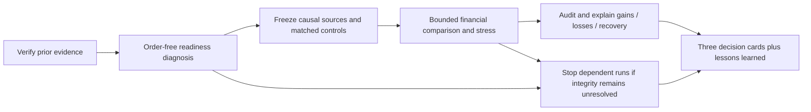

# Goal: close the first three strategy research questions

Work status: **scoped research completed; see the [final review](2026-10-26-selection-completion.md)**. User requested a
goal to complete research and record lessons. Scope is the first three methods
just tested: asset-class momentum, stock momentum and low-volatility stocks.
The other seven [shortlist candidates](2026-10-26-quantconnect-shortlist.md) remain
queued. Completion means a bounded, evidence-backed development decision for each
method, including negative or inconclusive findings. It does not mean proving
profitability, completing all possible research, or achieving annual doubling.

[Goals](../goals.md) owns the mandate; [research development](../research-development.md)
owns procedure; [roadmap](../roadmap.md) owns portfolio priority. This task is a
user-requested research lane, not a replacement infrastructure roadmap.

## Starting evidence

The [completed five-case study](2026-10-26-qc-selection-comparison.md) owns source
inspection, eight closed attempts and provisional results. Minimum ready count
was zero for each new method, with 5/51/52 short symbol-month histories. Dates/reasons were initially unidentified; the new diagnosis below resolves them. First fix understanding and causal data use;
do not optimize rules to make these scores larger. The
[baseline preflight](evidence/2026-10-26-selection-goal-preflight.json) verifies
saved report manifests and the closed old ledger. No new hosted run was launched
while setting up this goal. Original failures and source snapshots stay intact.

## Workflow and bounded scope

The [initial machine design](../../research/plans/selection-completion-v1.design.json) is preserved. The [executable protocol](../../research/plans/selection-completion-v1.json) is now frozen, including exact source hashes and eligibility/timing rules. The absolute deadline is 2026-10-26 23:18:40 UTC. The new coordinator must enforce a maximum 14 hosted launches total:

- Up to 2 order-free diagnostic runs, counted before launch.
- Nine predeclared financial cases listed below.
- Up to 3 technical-only retries; no strategy parameter search.
- One 120-minute execution window, starting before the first new hosted launch.
  Preserve all failures; no budget extension or reopening `qc-breadth-v1`.

| New case | Purpose |
| --- | --- |
| Repaired asset-class momentum | Qualify the original five-ETF economic rule |
| Repaired stock momentum | Qualify percentage-momentum stock selection |
| Repaired low-volatility stocks | Qualify return-volatility selection with target subscription retention |
| SPY holding control | Verify common account/execution parity |
| Equal-weight five ETFs | Asset-selection control for ETF momentum |
| Equal-weight momentum stock universe | Separate stock ranking from historical universe construction |
| Equal-weight low-volatility stock universe | Match its daily-universe/monthly-decision lifecycle |
| Stock momentum adverse execution | Fixed 50 bp slippage plus one extra observed-session decision delay |
| Equal-weight momentum universe adverse execution | Same stress as its paired stock strategy |

Reuse the verified saved funded T11 case as an explicitly **cached** comparison,
not a new trial. Its prior results were freshly reproduced in the preceding epoch.
Reuse is allowed only if engine, dates, capital and common execution/funding
identity remain compatible; otherwise label it unavailable, without silently
adding a tenth financial case. Main cases retain 2020–2025, USD 10,000, 25 bp slippage,
native IB fees, 90% nominal target and fixed 6% debit ACT/360/zero credit interest.
Adverse cases are a separate matched context, not mixed into base-cost rankings.
No claim to isolate cost from delay in that combined stress.

## Required questions and acceptance evidence

- [x] Verify previous manifests and closed attempt budget.
- [x] Identify dates and reasons for zero/short-history eligibility using permitted
  aggregate diagnostics. Distinguish listing age, factor normalization, timestamp,
  subscription and initialization causes; do not assume any one explanation.
- [x] Verify strictly available observations: finite positive prices, unique and
  ordered session/time stamps, full declared lookback and no future data. Legitimate
  short listings stay explicitly ineligible; no requirement to invent missing data.
- [x] Freeze a reviewed executable revision and reservation ledger. Correct only
  diagnosed data/execution faults, preserving the intended signal definitions.
- [x] Run the nine declared cases when integrity/access gates pass; mark missing
  or failed cases unranked. Preserve old and new policy/cost contexts separately.
- [x] Reconcile calendar/annual NAV, daily-return moments, Sharpe, Calmar, continuous
  and annual drawdown, underwater duration/fraction and recovery censoring. Check
  funding, actual orders/rejections and source identity. Native PnL consistency is
  not an independent cash/fill ledger.
- [x] Analyze year/regime differences, exposure/turnover and available aggregate
  asset profit/loss concentration. Mark unavailable beta/sector or causal attribution
  unknown. Do not infer diversification or combine portfolios from headline scores.
- [x] Deliver one evidence-linked decision and lesson card per strategy, plus a
  consolidated research review, browser comparison, CSV and hashed receipt.
- [x] Pass `make check`, document/link checks and artifact verification; exercise
  annual browser selectors and label conditional/missing evidence visibly.

Primary mechanism tests are fixed in the machine design: asset/stock momentum
must improve net CAGR over their respective equal-weight eligible-universe
controls; low volatility must reduce full-period drawdown against its matched
control while retaining nonnegative CAGR. These are descriptive research hurdles,
not statistical alpha tests or user-approved investment-selection thresholds.
Always report return sacrifice, drawdown and underwater disagreements. A passing
mechanism test with failed evidence gates is inconclusive. A failed mechanism test
stops this fixed variant; it does not disprove an entire strategy family.

## Completion and stopping

Each decision card must contain: hypothesis, exact variant and controls, source
and input identities, all attempts, supported findings, contradictory evidence,
readiness limitations, lessons, and retain/stop/inconclusive disposition with a
specific next evidence requirement. Retain means eligible for independent
validation, never broker promotion. The chosen stock stress is motivated by the
already viewed first-round winner; disclose that selection history.

No new paid data, subscriptions, broker/account actions, orders outside simulation,
publication, commits, deployment, personal-memory writes, new agents or new
services. Raw vendor data remain hosted; export only permitted aggregate research
outputs. USD 300,000 capacity, options/futures/FX, ML/RL training, arbitrary parameter
search and the remaining seven candidates are outside this epoch.

All prior 2020–2025 outcomes have been inspected. Future evidence or demonstrably
unviewed data require a separate protocol; a chronological slice cannot be called
untouched merely by renaming it. Unknown historical search counts stay unknown.

At a technical/resource stop, preserve partial results and identify remaining
required work. Do not mark the overall goal complete solely because the budget
expired or a dashboard rendered. Completion requires the requested research
review and honest accounting of each acceptance item; external blockers remain
explicit and may require user input before further work.

## Verified diagnosis and current execution

Two order-free diagnostics and one preserved logging retry have been used. Checksummed summaries locate the artificial eligibility loss at the July 3, 2023 early close: the 253-count request returned 210 bars for each ETF and zero-ready stock selection. A 600 calendar-day request restores the declared 253 completed closes. No future, invalid or unordered bars were observed; no orders were submitted. This is observed hosted history behavior, not a proven root-cause fix to LEAN internals.

Remaining low-volatility exclusions are legitimate short post-listing histories: ABNB 54 closes on March 1, 2021 and SNOW 243 on September 1, 2021. Their first available dates match the [Airbnb filing](https://www.sec.gov/Archives/edgar/data/1559720/000155972021000010/airbnb-10k.htm) and [Snowflake IPO announcement](https://www.snowflake.com/en/news/press-releases/snowflake-announces-pricing-of-initial-public-offering/). These remain ineligible. The momentum cohort is also checked in its financial runs.

The corrected adapters require positive finite prices, unique ordered timestamps and a final feature timestamp matching the current completed slice. The intended 252-return ranking is unchanged. Controls use the identical eligible historical universe; missing ranked slots stay cash. Stress costs also increase the executor's cash reservation from 1.0025 to 1.005 times price; base financing/controller code is unchanged.

Local guard, delay, controller-identity and evidence-fragment tests pass. Financial results and final acceptance remain pending. Preserve all prior results and the failed truncated log.

## Preserved control failure and technical-only amendment

Broad stock equal weight stopped on 2020-03-03 with `Target price unavailable` in the shared staged executor (attempt 9,`6047dd04f6b571de39b09a1a2337400d`). Its partial performance is excluded. The existing low-volatility study had already demonstrated the subscription-lifetime class of failure; the technical correction retains current and pending delayed targets as subscriptions while leaving `_selected` as the historical feature universe. This is an inferred lifecycle diagnosis; the retry must establish whether it resolves this failure in the scoped path.

Only `select_universe` changes in the affected control/unrun stress adapters, plus a target-retention helper. Ranking/history/funding functions are unchanged, verified by AST comparison. The completed stock-momentum run remains unchanged. Paired membership and eligible-feature hashes must match before comparison acceptance. Source snapshots and the original plan remain preserved in the ignored study folder; the executable plan records old/new hashes and the amendment. One additional technical retry is reserved; the original 14-launch deadline/cap is unchanged.

## Completion

The [final review](2026-10-26-selection-completion.md) owns all results, three
decision cards, lessons, attempts and remaining research limits. Nine accepted
financial cases and three usable order-free cohort receipts were obtained within
14total launches; the final technical retry closed missing momentum-cohort
diagnostic coverage without changing any financial source. The execution ledger
closed at2026-10-26 22:02UTC before its original deadline.

Stock momentum is retained for independent validation; ETF momentum is low-priority
retained research; this low-volatility variant stops. These decisions do not select
an investment strategy or establish annual doubling, unseen alpha or a30%loss
ceiling. Final offline/browser/manifest evidence is linked from the result record.
