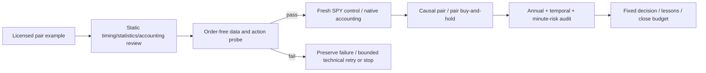

# Licensed stock-pairs comparison against SPY

This task implements the user's next bounded candidate request. The
[master checklist](2026-10-26-quantconnect-research-master-plan.md) owns the wider
initiative; [intake](../research-intake.md) and [research development](../research-development.md)
own source/evidence policy. Earlier CAPM and Dual Thrust records remain unchanged
negative baselines, with closed budgets. This task has a separate six-attempt,
90-minute budget, frozen before the input probe and financial results.

## Selection and rights

Select QC-T-15300 / `stock-pairs`, the remaining untested licensed mechanism bundle
from the [four-source export](2026-10-26-quantconnect-tutorial-packages.md).
It adds a relative-value/relationship-breakdown hypothesis beyond SPY exposure
and directional breakout. This is a research priority based on mechanism diversity,
explicit grant and free input feasibility, not a performance prediction.

Preserve unchanged [je-suis-tm/quant-trading source at611b73f2](https://github.com/je-suis-tm/quant-trading/blob/611b73f2c3f577ac5b28aaa19ac8c43d3236c7a5/Pair%20trading%20backtest.py)
and its [Apache-2.0 license](https://github.com/je-suis-tm/quant-trading/blob/611b73f2c3f577ac5b28aaa19ac8c43d3236c7a5/LICENSE).
`research/quantconnect/sources/stock_pairs_original.py` has SHA256
`d3088cbee0bc494513075d8f79ec4a9e940e17f432b9e2a86977f639a1e9d471`.
The original plotting/yfinance script is parsed, never imported or executed.
Our source-informed adaptation is not an exact QuantConnect tutorial reproduction,
nor a replication of the original 2013–2014 sample.

## Input and look-ahead review

- Original `portfolio()` sizes shares from each asset's maximum price over the
  entire evaluated series. Replace that future-aware quantity with known prices
  and a 98% gross target, hedged by the estimated shares ratio.
- Original ordinary ADF p-value on estimated residuals is not a properly calibrated
  cointegration test. Use [statsmodels.coint](https://www.statsmodels.org/stable/generated/statsmodels.tsa.stattools.coint.html),
  with its cointegration-specific reference distribution and explicit fixed options.
- Original trigger bands mix dimensionless z with price residual SD and reinitialize
  holdings each row. Use dimensionless ±1 entry, zero-crossing exit and explicit
  persistent state. These are material declared repairs, not accounting-only fixes.
- Fit only 250 strictly prior aligned sessions. The current completed close scores
  the residual, then queues an order for the next session at9:32. No same-close fill.
- [QuantConnect normalization documentation](https://www.quantconnect.com/docs/v2/writing-algorithms/securities/asset-classes/us-equity/requesting-data#08-Data-Normalization)
  says ordinary adjusted modes use the entire action history. Execute on RAW bars;
  request SCALED_RAW daily history, which uses actions known before current time.
  Exclude all history rows dated at or after the decision day from fitting.
- Native RAW-mode split/dividend handling includes short dividend debits. Add
  explicit3%ACT/365 short borrow and6%ACT/360 prior-close cash financing; disclose
  assumed historical stock availability, recalls, capacity and tax omissions.
- The pair is fixed by the published example, not selected by a new search. It is
  nevertheless an ex-post surviving pair; viewed2016–2025history and new symbols
  do not provide an untouched selection test. Cointegration assumes I(1), and
  rolling testing can misclassify unstable relationships.

The [provider dataset page](https://www.quantconnect.com/data/algoseek-us-equities)
currently lists free cloud access; downloads are separately priced. This study
requests no local market-data download or paid resource. Actual input entitlement,
API compatibility and corporate-action events must pass the order-free probe.
Only our aggregates, counts and hashes leave the hosted data environment.

## Frozen specification

[Machine plan](../../research/plans/stock-pairs-spy-v1.json) owns exact source hashes,
engine18209, dates, constants, controls, decision criteria and reservation limits.
USD300000;2016–2025; native IB commissions plus5bp/fill for all three financial
cases. RAW-mode dividends/splits,6%cash debit/zero credit and3%short borrow are
common policies. All subscribe to SPY, NVDA and AMD and evaluate identical features.

Regress AMD(Y) on NVDA(X) plus constant using prior250sessions. Require
cointegration p<.05 (`trend=c,maxlag=5,autolag=aic`), positive beta and a negative
lag-residual coefficient in the source-inspired error-correction regression.
Score current residual with prior mean/sample SD. Flat enters longNVDA/shortAMD
at z>=1, inverse at z<=−1; retain direction until zero crossing or failed gate,
then cash. Refit and target/rebalance daily, with no threshold/asset search.
Absolute weights sum98%; actual exposure can drift. No forced terminal liquidation.

SPY control buys98%once; pairhold buys49%NVDA+49%AMD once. Both execute at the same
first eligible next-session9:32 after Jan4's closing decision. Pairhold measures
long-asset opportunity cost, not a net/beta/exposure-matched control. Equal initial
targets do not establish equal realized exposure.

Primary estimand: pair Calmar minus SPY Calmar, conditional on positive pair CAGR.
Growth screen: pair CAGR>SPY,Calmar>=SPY,longestUW<=SPY. Separate risk-alternative
screen: positive CAGR,Sharpe>=SPY,DD<SPY,longestUW<=SPY. Passing permits only further
independent validation. If neither screen passes, stop this fixed adaptation.
Closing/minuteDD>30% flags reassessment; no guaranteed loss bound or deployment.

Full and annual metrics: returns, closing DD, sample-daily zeroRF Sharpe√252,
Calmar, underwater fraction, longest sessions/calendar days and terminal censoring.
Add minute-mark DD, actual mean/max gross, mean net, short minutes, eligible days,
action counts, native dividends, fees/borrow/funding and daily book residual.

## Checklist

- [x] Select a licensed, distinct mechanism; preserve original and license.
- [x] Inspect future-aware sizing, calibration/band/state defects and action timing.
- [x] Implement/test causal fit/sizing/state boundaries; freeze plan before runs.
- [x] Pass order-free input/dependency/action gate over all2514sessions.
- [x] Pass fresh SPY accounting gate before running remaining financial cases.
- [x] Complete three financial cases under six total attempts/two technical retries.
- [x] Verify matched hashes/calendars, all30annual rows, costs/accounting and browser.
- [x] Update checklist/lessons and close the bounded budget; preserve every failure.

The adaptation is now **completed and scoped-audit qualified, with a negative improvement result**; see the closure below.
The new study does not complete the broad catalog or qualify local500-stock data.

## Preserved early-close probe and amendment 1

Attempt1 stopped on2016-11-25at13:00 with `Short/invalid prior history`. The
probe placed zero orders and produced no financial result. A prior
[selection study](2026-10-26-selection-completion.md#readiness-and-technical-findings)
had already found count-request truncation on early closes; reusing its bounded
600-calendar-day request resolves that interface issue without changing the
250-observation modeling window. The original count request, plan, source, tests,
status and failed budget entry remain under `.local/stock-pairs-spy-v1/superseded/attempt1/`.

Amendment1 was frozen before any financial case: request600calendar days, then
retain exactly250strict-prior aligned sessions. No threshold, trading rule, cost,
state or decision criterion changes; six-attempt ceiling and original deadline
remain fixed. This is one consumed technical retry. Statistical outcomes from
the partial probe were not used to choose a new setting.

## Qualified free input gate and pre-financial review

Attempt2 (`c1733a7de803db89c96fb2c128ee2d40`) completed the order-free probe.
All2514sessions pass250strict-prior aligned observations; the ten annual
checkpoints end before each decision date. Native RAW mode, IB fee model,
NVDA2actual splits, NVDA41dividend events and SPY40events are observed.
There are zero fills/rejections. Runtime: engine2.5.0.0.18209,statsmodels0.14.6,
NumPy1.26.4,Pandas2.3.3. The common fitted-input hash is
`a5918a95543224185a4b7434a0e650c7a811585e0a8254578ae41c7de32c39fa`.
Actual free access and scoped data readiness pass; independent vendor/action
validation and historical shortability remain unverified.

Two local review amendments followed, with no additional hosted attempts. The
audit normalizes enum display capitalization (`RAW` versus `Raw`) while every
generated source remains byte-identical. Before any financial launch, financial
borrow clocks were corrected to UTC elapsed time to include daylight-saving hours;
the actual zero-order probe source remains byte-identical and inputs/fits unchanged.
Pre-amendment modules/plans and unrun financial sources remain archived under
`.local/stock-pairs-spy-v1/superseded/`. Original deadline and retry limit remain fixed.

Dividend cash follows native ex-date accounting, not actual payment dates. SPY
and pair-hold retain cash distributions; the pairs strategy reinvests only through
its specified rebalances. These policies differ from prior adjusted-price reports,
so their returns are not concatenated into one leaderboard.

## Fresh SPY control gate

Attempt3 (`2c54feac1f3e462db259954ff6b278ab`) completes and passes. All2,514daily
book checks reconcile to emitted zero, as do lifetime book, fees and last mark;
zero rejected/pending orders. Fit hash matches the input probe;976,680minute
observations and the common2016–2025calendar are present. Under this exact RAW
cash-dividend policy, CAGR13.64%, closing DD31.26%, Sharpe0.860,Calmar0.436,
longest underwater488sessions/708calendar days and native dividendsUSD84,891.69.
This authorizes the remaining frozen finance cases, not a candidate verdict.

## Candidate execution observation

Attempt4 (`d533a19a2b3f9da0443c389ca1ee49a7`) completes with the same fit hash,
calendar/action counts and minute clock, zero daily/lifetime book residual,
zero rejected/pending orders and confirmed native IB fees. The native minimum-order
guard visibly skipped tiny rebalance recommendations. Its frozen default is
retained; no setting changes or rerun followed that warning. The skipped
recommendation count is not emitted, so its isolated effect remains unknown.

Native strategy state was attempted daily, but only218fills occurred; a target
evaluation is not a fill. Full CAGR−2.18%, closing DD25.62%, minuteDD26.37%,
longest underwater2,341sessions/3,401calendar days. At that checkpoint the preplanned hold control was still pending; the completed
three-case disposition is recorded below.

## Completed comparison and closed decision

[Browser report](http://127.0.0.1:8765/stock-pairs-spy-v1/index.html) ·
[Redacted receipt](evidence/2026-10-26-stock-pairs-spy-comparison.json).
All three financial cases qualify for this scoped comparison. Both frozen
improvement screens fail for the pair; keep this fixed adaptation as negative
evidence and stop without tuning it on the same history.

| Case | CAGR | Closing DD | Sharpe | Calmar | Time underwater | Longest sessions / days |
| --- | ---: | ---: | ---: | ---: | ---: | ---: |
| Causal NVDA/AMD pairs | −2.18% | 25.62% | −0.41 | −0.09 | 94.19% | 2,341 / 3,401 |
| NVDA/AMD hold | 64.66% | 65.70% | 1.27 | 0.98 | 89.14% | 407 / 592 |
| SPY hold | 13.64% | 31.26% | 0.86 | 0.44 | 84.25% | 488 / 708 |

Pair CAGR trails SPY by15.82points and Calmar by0.5214; the positive-CAGR condition
fails. Ending equities areUSD240,659.70,43,981,455.43and1,077,768.59respectively.
The pair remains below30%observed closing/minute DD, but that alone does not make
it a useful strategy. Its minute DD26.37%, mean gross3.98%, mean net0.098%and
peak gross1.1392x describe a sparse but imperfectly bounded hedge. Of2,514input
sessions,156pass the relationship gate;39,990minutes contain a short.

The pairs path has one positive year(2016,+3.37%), three negative years and six
flat years(2018–2021,2023–2024). It beats SPY annual return only in2018and2022.
Flat-year annualDD/UW reset tozero and Sharpe/Calmar are undefined, while full
underwater duration continues across those years. Charts leave genuine gaps,
with24defined Sharpe/Calmar points across30annual rows; zero is not substituted.

Pair commissions areUSD2,577.505,modeled borrow1,707.457737,native net dividends
265.83and cash-debit financing0;218fills occur. Costs and short-side responsibility
are not isolated counterfactuals. Historical borrow/locates, recalls and independent
action/cash replay remain unverified. The hold control is a hindsight-selected
pair, not a demonstrated stock-selection process; its65.70%DD far exceeds the
reassessment reference. Its strong growth does not establish annual doubling or
license using future winning stocks as a prospective universe.

All financial cases have2,514closes,976,680minute observations, equal fitting,
calendar and action hashes/counts, zero native daily/lifetime book and fee/mark
residuals to emitted precision, no rejected/pending orders and actual IB model
confirmation. The zero-order probe uses the same feature path. These checks
establish scoped consistency, not independent alpha or future fill/borrow safety.

The separate budget closes at **5/6 attempts**: one failed early-close probe,
its successful technical retry and three successful financial cases. The last
case completed06:26:15UTCand was recorded06:27:03UTC, before the original
07:33:00UTCdeadline. Local enum/UTC review amendments did not add hosted attempts.
No parameter grid, additional market data, paid resource, broker operation,
new service, MLflow import, agent, commit or publication followed.

Offline `make check` passes372tests plus dependency/documentation checks. Browser
checks cover all four tables,30annual rows and all seven chart metrics, including
12undefined ratio cells and three disjoint pair-Sharpe segments. The read-only
manifest audit qualifies all four completed cases and preserves the failed probe.
CAPM's77-file and Dual Thrust's43-file audits still pass unchanged.

[Lessons L33–L36](2026-10-26-research-lessons.md#licensed-stock-pairs-readiness-follow-up)
and the master checklist record the result. The broader catalog stays partial.
