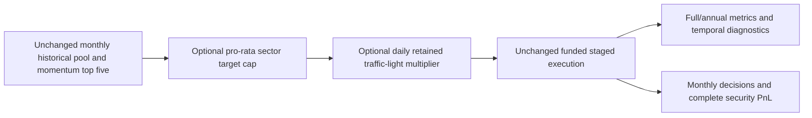

# Stock momentum: gate and sector ablation

Work status: completed scoped development research. The user requested a bounded comparison and
complete monthly selections and individual-stock accounting contributions.
The [machine plan](../../research/plans/stock-risk-v1.json) owns fixed configuration,
source hashes, launch bounds and the absolute UTC deadline. This opens a new
study; the completed selection-completion-v1 budget remains closed.

Five fresh cases: original stock momentum, gate only, sector limit only, both,
and modeled SPY holding. Same 2020–2025 dates, USD10,000 whole-share fixture,
25bp slippage, native IB fees, 90% base allocation, staged MOO execution,
flat6% debit ACT/360 financing and zero credit interest as the completed controls.
This is not USD300,000 capacity qualification or an untouched holdout.

The sector treatment scales weights of the original five, without selecting
replacement stocks or redistributing the residual. Each Morningstar sector has
a36% portfolio target cap before the gate: equivalent to two18% base positions.
Historical classifications are observed in the monthly fundamental selection;
unclassified stocks receive zero sector-treatment weight, disclosed in logs.
This is a decision-time target limit; price drift and staged fills can exceed it.
Actual closing sector exposure is separately measured using latest observed
classifications, with unavailable classifications grouped as unknown.

The existing retained gate is transferred unchanged: RAW SPY EMA50/200 and
20-return sample annualized volatility, green/yellow/red multipliers1/.5/0.
The price-peak component is disabled. Exact thresholds, seeding and recovery
are inherited from the [prior transfer](2026-10-26-qc504-t11-gate.md).
All five compute the same observer, including ungated controls. Gate transitions
change allocation intent between monthly selection dates; execution remains staged.

Hypothesis: sector concentration reduction and market-wide exposure control may
reduce loss depth, with possible lost returns and longer recoveries. Report each
ablation and their interaction; no hidden return-retention threshold, threshold
search, exposure-matched alpha inference or automatic deployment decision.

Maximum seven hosted launches: five fixed cases plus two technical-only retries,
within90minutes of freeze. No agents, paid data, services, broker operations,
orders, imports, commits or publication. Preserve all failures and originals.

Free-tier Object Store writes require a paid organization. The first export
implementation used compression, which the QC editor rejected before saving or
starting a native backtest. That attempt and source are preserved. The amended
implementation uses readable checksummed JSON within a9KB message-byte budget,
with no compression or encoding. It exports chosen security identifiers and
historical sector codes, native PnL/fees and aggregate metrics. Targets are
deterministically reconstructed from the fixed rule and recorded gate color;
pretrade holdings and raw vendor prices/fundamentals are not exported.
Sources: [sector classification](https://www.quantconnect.com/docs/v2/writing-algorithms/universes/equity/fundamental-universes),
[Object Store permissions](https://www.quantconnect.com/docs/v2/cloud-platform/organizations/object-store),
[free backtest log quota](https://www.quantconnect.com/docs/v2/cloud-platform/backtesting/deployment).

Acceptance:

- [x] Complete five fixed cases, or explicitly mark blocked/failed cases.
- [x] Reproduce prior original/SPY financial metrics; stock feature/universe and
  selected-five identity match across treatments; all gate/session hashes match.
- [x] Verify no rejects, non-MOO fills, open orders or invalid/future features;
  native PnL plus financing residual at most10cents.
- [x] Save72monthly selections per case and every contributing security PnL/fee.
  Decision targets are not proof of immediate fills; actual exposure summaries
  are measured separately.
- [x] Compare full/annual returns, DD, Sharpe, Calmar, underwater duration and
  recovery censoring; average gross exposure and peak closing sector exposure.
- [x] Run offline checks, verify report and artifact manifest, restore cloud source,
  close the new launch ledger, and record lessons including negative findings.

## Completed comparison

Five native LEAN2.5.0.0.18209 backtests completed with zero rejected orders,
non-MOO fills, pending orders or invalid/future/unordered features. Six dispatch
reservations were counted: one save rejected before native execution, one technical
retry of that export, and four other fixed cases. The remaining seventh slot is
expired and the ledger is closed. The first innerText capture dropped a trailing
space inside a security identifier; exact DOM textContent recapture restored the
original checksum without rerunning or guessing the missing character.

[Browser comparison](http://127.0.0.1:8765/stock-risk-v1/index.html) owns interactive
full/annual tables,72monthly top-five decisions per stock case and every contributing
security’s full-period PnL/fees. There are30annual rows,1512selection rows across
360case-months, and221contribution rows. The full50-stock candidate names and
raw momentum values were not exported; their eligible-universe/feature hashes
match across stock cases. The actual original top-five IDs and sector observations
also match at every monthly decision.

| Case | CAGR | Max DD | Sharpe | Calmar | Longest underwater sessions / days | Average gross | Peak sector bucket |
| --- | ---: | ---: | ---: | ---: | ---: | ---: | ---: |
| Original momentum |29.62% |29.66% |1.05 |1.00 |585 /847 |87.02% |71.97% |
| Momentum + gate |19.65% |26.67% |0.86 |0.74 |606 /878 |72.30% |71.89% |
| Momentum + sector limit |21.07% |22.87% |0.98 |0.92 |573 /828 |70.52% |41.33% |
| Momentum + both |14.35% |20.68% |0.80 |0.69 |586 /848 |58.35% |40.96% |
| SPY holding (90% initial target) |13.62% |29.79% |0.79 |0.46 |488 /708 |91.03% |N/A: no look-through |

Sector buckets use latest observed monthly classifications and retain unknown as
one bucket; SPY is not assigned a look-through sector exposure. The36% decision
cap did not produce a36% maximum observed exposure: sector-only peaked41.33%,
combined40.96%, with drift and execution timing. A hard continuous/intraday cap
was neither implemented nor tested. All five ended below a prior full-period
high, so final recovery is right-censored.

| Year | Original return / reset DD | Gate only | Sector only | Both | SPY |
| --- | ---: | ---: | ---: | ---: | ---: |
|2020 |92.16% /24.23% |41.54% /13.88% |76.67% /14.99% |36.47% /10.95% |16.05% /29.79% |
|2021 |-0.14% /22.82% |-1.11% /22.93% |-0.24% /19.97% |0.26% /19.71% |25.72% /4.67% |
|2022 |2.49% /21.39% |-1.97% /15.42% |4.29% /16.69% |-1.09% /12.75% |-16.66% /22.47% |
|2023 |38.30% /10.72% |36.58% /10.39% |28.38% /9.41% |26.54% /9.40% |23.56% /9.13% |
|2024 |53.81% /13.65% |55.33% /13.48% |40.92% /12.42% |39.54% /11.97% |22.87% /7.83% |
|2025 |13.39% /25.14% |0.82% /22.27% |-5.26% /18.25% |-6.40% /18.87% |16.55% /17.57% |

Annual Calmar uses that year’s return divided by annual-reset drawdown. Full Calmar
uses CAGR divided by continuous full-period drawdown. Sharpe uses daily simple
returns, sample variance,252annualization and zero risk-free return. Longest full
underwater calendar duration is peak-to-last-underwater mark, excluding recovery
day; yearly metrics reset their peak and cannot substitute for full-period risk.

## What the decisions and contribution logs add

The first2020decision selected AAPL, NVDA, MSFT, MA and TRV. Original targets were
18%each. The sector rule scaled the three technology names to12%each, kept the
two financial names at18%each, and left28%in cash. The gate was green at that
monthly snapshot; daily changes later in the month are not represented by that
one snapshot. The stock universe contains US-listed equities, including ADRs;
it is not an exclusively US-domiciled or S&P500-membership universe.

Original full-period accounting contributors include NVDA+$9844.62, PLTR+$6855.94,
AVGO+$4378.66 and FB’s permanent security ID+$3869.94; the largest detractors
were ZM−$1496.05 and GEVW’s ID−$1048.80. These are net native accounting PnL,
including remaining holdings, not each asset’s standalone return or causal alpha.
Native PnL plus funding reconciles to ending NAV within10cents in every case.
Per-security fees are displayed separately but already included in net contribution.

Four selected identifiers had unavailable sector codes: JD7monthly selections,
PLTR12, BABA5 and GEVW3, totaling27/360. The frozen sector rule gave those zero
target weight and did not replace them. Its results therefore combine sector
budgeting with classification-availability exclusion. Do not fill historical
classifications using today’s label or claim a clean sector-only causal effect.
PLTR disappears from sector-treatment contributions, but subtracting its original
PnL from another portfolio is not valid counterfactual attribution: paths, capital
and other positions also change.

The permanent IDs may retain older ticker prefixes. A contemporaneous display-
ticker map was not exported; do not interpret the prefix as the ticker actually
used on each decision date. See [QuantConnect’s identifier contract](https://www.quantconnect.com/docs/v2/writing-algorithms/key-concepts/security-identifiers).
The logs provide full-period security PnL, not monthly or year-specific security
attribution. Monthly target weights are reconstructed exactly from the frozen
rule; daily fills/marks stay hosted and independent fill/cash reconstruction is
still unavailable. Matching observed-input hashes do not freeze the complete
hosted vendor price/fundamental snapshot.

## Decision and lessons

- Original momentum retains the best full-period growth, Sharpe and Calmar among
  these five cases; it has material stock/sector concentration. This is viewed
  development evidence and not a promoted strategy.
- Gate-only gives up9.97percentage points of CAGR for2.99points less drawdown,
  while adding21underwater sessions and lowering Sharpe/Calmar. Stop treating this
  fixed transfer as an automatic improvement. No retuning follows this result.
- Sector-only is the more useful risk-control research alternative:6.79points
  smaller drawdown and12fewer underwater sessions versus original, but8.55points
  lower CAGR and lower full-period Sharpe/Calmar. It dominates gate-only on those
  observed metrics, not on unmeasured future behavior or independent alpha.
- Both controls cut drawdown8.98points versus original but CAGR falls15.26points;
  end equity is$22365.71 versus$47437.96. Compared with SPY, CAGR is only0.74points
  higher and drawdown9.11points smaller, but underwater duration is98sessions
  longer. More safeguards did not produce overall dominance.
- All overlays reduce actual average exposure. Classification exclusions and cash
  retention are material confounds, and no exposure-matched timing control was run.
  No annual-doubling capability or hard30%loss guarantee is established.

Next work is proposed only: qualify historical sector availability and decision-date
names, separate unknown-data exclusions from sector concentration, and define an
exposure/capital-matched independent-validation design. No new variants, unseen-
data claims, real-money selection or broker operations are authorized by this review.

## Final verification

Final receipt: [redacted evidence](evidence/2026-10-26-stock-risk-ablation.json).
Final verification passed: `make check` exit0 with321tests; all six annual views,
360browser case-month views,221contribution rows and security search matched saved
results. The original cloud source was restored exactly and successfully rebuilt
without another simulation. Saved comparison
and CSV artifacts have their own SHA256manifest. Sources and raw summaries remain
private under.local; prior completed experiments and failures are preserved.
