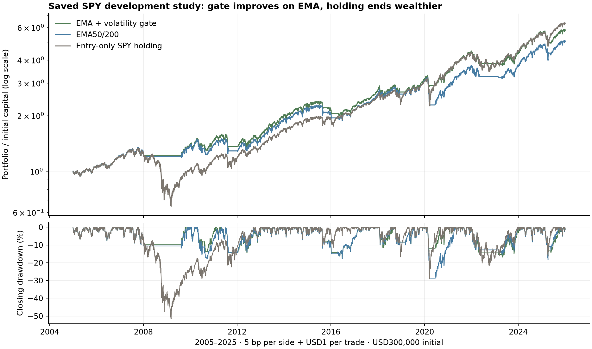

# Does a volatility gate earn its place above an EMA strategy?

**Classification: development technical report.** Report ID **GRS-R001** under
[GRS-1.0](../research-standard.md). Prepared with Codex for quant-trading-lab;
not peer reviewed, independently validated alpha, or an externally published paper.
This is a retrospective experience report on a closed study, with a new read-only
verification. It is **not** the result of the blocked [GRS-C001 continuous-sizing cycle](2026-10-27-grs-c001-continuous-sizing.md).

## Abstract

We examine whether a fixed EMA/volatility exposure gate improved a daily SPY
EMA 50/200 policy under an already declared research ledger. The closed experiment
compared three policies across three execution contexts on viewed 2005–2025 history.
At 5 bp per side, gated EMA produced 8.734% CAGR, 17.770% maximum closing drawdown and a
513-session longest recovery interval, versus 8.013%, 29.062% and 531 for EMA. Its
joint growth/depth/duration screen also passed at 25 bp and with one additional
session of signal delay. Entry-only SPY holding nevertheless earned 9.161% CAGR at
5 bp, exceeding gated growth while suffering 51.680% drawdown. A fresh audit of nine
saved paths reproduced 47,547 Decimal account sessions and 792 financial metric
checks without running another financial simulation. The experience supports a
scoped development improvement over EMA, not superiority to holding, isolated
timing alpha, an annual-doubling strategy, or future profitability.

## 1. Question and contribution

Adding a stage is worthwhile only if it resolves a specific weakness under fair
controls. The question was whether the previously retained, unchanged gate offered
better net growth, drawdown depth and recovery duration than plain EMA across
fixed cost/timing challenges. The report contributes a reproducible account of
that observed tradeoff and a worked example for the golden pipeline's reporting
standard. It makes no claim of a novel algorithm or a newly discovered result.

The original primary criterion required no worse CAGR, drawdown and longest
recovery duration, with a strict improvement on at least one, in all three
contexts. The original decision was retain for independent validation. The current
report does not replace those criteria, optimize parameters or reopen the budget.

## 2. Prior work and provenance

The local gate emerged from an earlier bounded ablation that removed expanding
raw-price peak conditions after the original combination produced long recoveries.
That prior inspection and selection are part of development history. The later
[robustness protocol](2026-10-25-rsi-gate-robustness.md) froze the surviving rule
before nine new paths; its [completion review](2026-10-25-rsi-gate-robustness-review.md)
owns the original results. This report reuses that evidence rather than claiming
an exact reproduction of a published investment product or outside paper.

Full prior project search exposure has not been exhaustively reconstructed. The
nine-path stress experiment is finite and accounted for; it is not nine independent
strategy discoveries. Aggregate portfolio outcomes and this figure are our modeled
outputs. The retail source snapshot and restricted third-party material are not
redistributed by this report.

## 3. Data and information timing

The saved SPY source has 5535 daily rows including 2004 warmup; evaluation covers
2005-01-03 through 2025-12-31 and 5283 sessions per path. Initial portfolio capital is
USD 300,000. All this history had been viewed in project research; later blocks
are diagnostics, not untouched test sets. Source SHA 256 is
`992d9f62de93aa860ae00fc81d3810dbe0ac302a55102886fc5c50545130a8ba`.

Signals use completed closes and are shifted exactly once to next-session open.
The delayed context adds one more session to dynamic decisions on warmup-inclusive
data. It does not delay market-price observations or standing buy-and-hold orders.
The source's raw-price and corporate-action limitations remain. Dividends are
credited as modeled ex-date cash, with no qualification of real payment-date
availability. No new data collection or model training occurred in this report.

## 4. Methods and experimental design

**Plain EMA.** Target long when recursively seeded EMA 50 exceeds EMA 200; otherwise
cash. **Gated EMA.** Preserve EMA eligibility, but cap target exposure using the
frozen EMA/volatility state recurrence with its price-peak input disabled. Green,
yellow and red caps are 1,.5 and 0. Volatility is 20 raw-close simple returns' sample
standard deviation annualized by sqrt(252). Red is triggered at 40% volatility;
yellow by nonpositive trend or 25% volatility. Recovery from red requires five
eligible closes below 35% volatility; return to green requires five eligible closes
with positive trend and volatility below 20%. Recovery stages cannot reuse one
confirmation close. Exact inequalities, readiness and state persistence are owned
by the frozen [implementation](../../research/risk_gate_ablation.py).

**Standing holding control.** Buy SPY once and retain it. Its different daily
maintenance/turnover pattern is intentional, not an exposure-matched timing control.
All paths use whole shares, a 99% target allocation budget (1% sizing reserve),
USD 1 per nonzero trade, adverse per-side modeled fills, zero credit interest,
6% ACT/360 debit financing and declared margin checks. This is a custom research
ledger with independent Decimal replay; it does not establish Nautilus/native
broker fill, funding or settlement parity.

Contexts are 5 bp, 25 bp, and 25 bpwith one additional dynamic-decision delay. The
historical epoch consumed 9/9 attempts and is closed. No case was added to improve
a rank, and the standing 25 bpcontrol repeats identically in the delayed context.
CAGR uses calendar span from the first evaluation date to the last divided by
365.25, preserving the original denominator. Drawdown includes initial capital.
Sharpe uses daily simple returns, sample variance, 252 annualization and zero
risk-free rate. Full Calmar is CAGR/absolute full-path DD; yearly Calmar uses annual
return/reset drawdown. Longest duration runs from a peak to recovery or observation end,
including its explicit censoring state. It differs from counting only strictly
underwater closes.

## 5. Results

| Context | Policy | CAGR | Max closing DD | Sharpe | Calmar | Longest recovery sessions |
| --- | --- | ---: | ---: | ---: | ---: | ---: |
| 5 bp | EMA + gate | 8.734% | 17.770% | 0.769 | 0.492 | 513 |
| 5 bp | EMA | 8.013% | 29.062% | 0.643 | 0.276 | 531 |
| 5 bp | Entry-only SPY | 9.161% | 51.680% | 0.608 | 0.177 | 1243 |
| 25 bp | EMA + gate | 8.435% | 18.584% | 0.745 | 0.454 | 531 |
| 25 bp | EMA | 7.753% | 29.201% | 0.625 | 0.266 | 684 |
| 25 bp | Entry-only SPY | 9.150% | 51.676% | 0.607 | 0.177 | 1243 |
| 25 bp + signal delay | EMA + gate | 8.489% | 19.208% | 0.745 | 0.442 | 517 |
| 25 bp + signal delay | EMA | 7.769% | 31.199% | 0.626 | 0.249 | 558 |
| 25 bp + signal delay | Entry-only SPY | 9.150% | 51.676% | 0.607 | 0.177 | 1243 |

The gate's CAGR improvement over EMA is 0.721 percentage points in the base context,
0.682 points at higher cost and 0.719 points with added delay. Corresponding drawdown
depth reductions are 11.291,10.617 and 11.990 points; longest intervals shorten by 18,
153 and 41 sessions. These comparisons reproduce the original frozen decision.
The 9 longest episodes recovered within observation; this does not mean every
shorter loss or future episode must recover quickly.

Figure 1. Own saved account paths, including initial capital. Top panel uses a log
wealth scale; bottom panel uses continuous closing peaks. No new simulation is
embedded in the figure. Exact figure identity is recorded in the [audit receipt](evidence/2026-10-27-grs-r001.json).

At 5 bp, ending wealth isUSD 1,739,775.65 for gate,
USD 1,512,939.21 for EMA, andUSD 1,888,761.76 for holding.
Mean closing exposure is 0.776,0.799
and 0.887 respectively. Fees plus modeled slippage total
USD 11,747.22, USD 9,112.84
andUSD 147.52. Net results include those
modeled costs. The gate trades more than EMA and the standing holding control;
lower drawdown is not a free reduction in complexity or turnover.

### Annual return / annual-reset drawdown, base context

| Year | EMA + gate | EMA | Entry-only holding |
| --- | ---: | ---: | ---: |
| 2005 | 4.12% / 6.89% | 4.12% / 6.89% | 4.10% / 6.87% |
| 2006 | 15.66% / 7.52% | 15.66% / 7.52% | 15.29% / 7.38% |
| 2007 | 4.94% / 9.83% | 5.08% / 9.83% | 4.94% / 9.46% |
| 2008 | -3.95% / 4.03% | -4.87% / 4.94% | -34.41% / 44.44% |
| 2009 | 13.46% / 5.62% | 12.86% / 5.62% | 23.03% / 24.22% |
| 2010 | 5.84% / 13.99% | 1.42% / 17.60% | 13.28% / 14.06% |
| 2011 | -6.69% / 17.15% | -6.49% / 17.15% | 1.64% / 16.54% |
| 2012 | 12.75% / 9.59% | 13.35% / 9.59% | 13.92% / 8.55% |
| 2013 | 31.92% / 5.50% | 31.92% / 5.50% | 27.86% / 4.90% |
| 2014 | 13.31% / 7.20% | 13.31% / 7.20% | 11.79% / 6.40% |
| 2015 | -5.58% / 11.79% | -5.92% / 11.79% | 1.08% / 10.42% |
| 2016 | 2.76% / 9.12% | 3.22% / 8.71% | 10.23% / 8.88% |
| 2017 | 21.46% / 2.58% | 21.46% / 2.59% | 18.45% / 2.25% |
| 2018 | -0.61% / 11.62% | 1.55% / 10.00% | -3.83% / 16.71% |
| 2019 | 17.25% / 6.55% | 17.23% / 6.55% | 26.10% / 5.68% |
| 2020 | 10.02% / 13.72% | -5.59% / 29.06% | 15.40% / 29.14% |
| 2021 | 28.41% / 5.06% | 28.41% / 5.06% | 24.70% / 4.50% |
| 2022 | -13.97% / 15.03% | -12.27% / 13.35% | -15.99% / 21.52% |
| 2023 | 15.30% / 9.88% | 15.13% / 9.88% | 21.97% / 8.57% |
| 2024 | 24.62% / 8.32% | 24.61% / 8.32% | 21.33% / 7.36% |
| 2025 | 5.49% / 16.31% | 7.81% / 18.57% | 15.38% / 16.46% |

Annual resets can hide losses spanning year boundaries. Full continuous risk and
recovery remain the primary path diagnostics. Complete annual ratios, other
contexts and rolling/tail/episode views remain in the preserved
[browser package](http://127.0.0.1:8765/gate-robustness/20261025-v1/index.html).

## 6. Robustness and contradictory evidence

The cost and stale-signal comparisons support the scoped primary screen. They do
not test every plausible implementation change, financing schedule or regime.
Entry-only holding has higher full-period CAGR in **all three contexts**. The gate
also trails EMA on cumulative return in the already viewed 2012–2018 block in all
contexts. Full-period improvement is not annual or regime-by-regime dominance.

Lower market participation is a plausible explanation for loss reduction; no
exposure-matched control in this study isolates timing skill. Higher costs or
later signals need not worsen every realized statistic monotonically because
whole-share sizing and entry prices change. Those observations do not recommend
higher costs or deliberate delay.

The old block helper reports cumulative-block-return/absoluteDD under a`calmar`
column. That is not annualized Calmar. Raw evidence is preserved, while the current
qualified block export excludes this column. Full and annual Calmar calculations
were independently checked and remain usable.

## 7. Interpretation and limits

The defensible result is an in-model development improvement over plain EMA under
three declared contexts. It does not resolve acceptable growth sacrifice versus
holding, isolate an ML forecasting benefit, cover a market-wide stress model,
prove stock/options portability or establish an unseen strategy-selector advantage.
The numerical drawdowns are realized modeled outcomes, not loss guarantees.

Evidence verification is algorithmically independent arithmetic and account
replay, not an independent human scientific review or untouched evaluation.
Retail data, action payment timing, exchange-calendar qualification, execution
realism, taxes, market impact and prospective risk remain limitations. This
report does not select an investment or change broker state.

## 8. Reproducibility and evidence

The new audit checked 105 original artifact hashes, 9 saved paths, 47,547 Decimal
account sessions and 792 full/annual metric comparisons. Maximum account difference
wasUSD 6.98 e-10. Rolling, tail and episode fields were
also independently recomputed. Original manifest/plan identities are in the
[audit receipt](evidence/2026-10-27-grs-r001.json); source bytes and all original
results remain unchanged.

New audit command: `.venv/bin/python scripts/audit_grs_experience.py`.
This is a one-time exclusive audit/figure output and rejects an existing identity;
use saved receipts for ordinary reading. It never calls the portfolio simulator.
Private audit package: `.local/grs-r001/`; original path:
`.local/gate-robustness/1ddd9c98521e5498/`. Do not rerun closed financial plans.
The new output's own manifest can be checked read-only with
`verify_artifacts('.local/grs-r001')` from the existing review helper.

## 9. Lessons and next question

1. Keep an addition only when its declared comparison supports it; the gate's
   retained status is relative to EMA, not every possible investment.
2. Show displaced growth, extra turnover and recovery duration alongside shallower
   losses. A single ratio does not express every consequence.
3. Evidence should remain executable and auditable: known incorrect diagnostic
   names must not silently become financial claims.
4. The next research need is a compatible simpler/exposure-control test and
   independent evidence. The separate continuous-sizing cycle stopped on a control
   diagnostic mismatch and supplies no challenger performance. Preserve that failure
   rather than use this older successful result to conceal it.

The incumbent remains a research reference. Prospective qualification and a new
explicit budget are required for any further financial comparison or stronger
claim. No automatic publication or deployment follows this report.

## References

- [Golden research standard](../research-standard.md).
- [Original robustness protocol](2026-10-25-rsi-gate-robustness.md) and [completion review](2026-10-25-rsi-gate-robustness-review.md).
- [Frozen robustness plan](../../research/plans/spy-gate-robustness-v1.json).
- [Gate implementation and ablation](../../research/risk_gate_ablation.py).
- [Local leverage/account contract](../../research/leverage-model.md).
- [GRS-R001 read-only evidence receipt](evidence/2026-10-27-grs-r001.json).
- [GRS-C001 failed-control lesson](2026-10-27-grs-c001-continuous-sizing.md).
