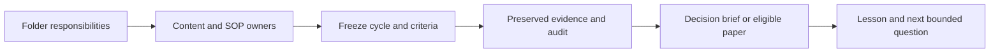

# Project foundation adoption

Work status: documentation and template adoption validated for publication. Scope: adopt the agreed folder responsibilities,
content conventions and report formats through a focused documentation PR based
on main at `4999ec5767eccdd6f61863b14a05e459855f95e3`.

The primary research checkout contains additional unpublished implementation and
studies. This PR is prepared from an isolated clean snapshot; its capability
claims refer to this branch. Those local files are preserved separately.

## Outcome and ownership

- [Architecture](../architecture.md#repository-structure) owns current folder
  responsibilities and future extraction boundaries.
- [Documentation conventions](../README.md#content-structure) own narrative order,
  status dimensions and template discovery.
- [GRS-1.0](../research-standard.md) owns research evidence, stage disposition and
  paper readiness. Its exact local standard bytes are preserved on publication.
- [Research development](../research-development.md) owns scientific procedures;
  [scoring](../research-scoring.md) owns metric meanings; the
  [catalog](../skills.md) owns skill discovery and readiness.
- [Roadmap](../roadmap.md) retains M1–M5 priority. This task is supporting scope.

## Acceptance checklist

- [x] Inspect current main, existing templates, owners and publication dependencies.
- [x] Isolate the branch from unrelated dirty/untracked research work.
- [x] Update current folder/content maps without moving frozen code or evidence.
- [x] Prepare GRS and cycle/paper templates as required documentation dependencies.
- [x] Adopt the short decision brief alongside existing task/intake/incident forms.
- [x] Verify local links, metadata, catalog parity and complete offline checks.
- [x] Review the exact diff for scope, claims and source/secret boundaries.
- [x] Prepare the focused PR content and description; live publication/check state
  is reported on the associated PR rather than inferred from this receipt.

## Reporting handoff

Use a cycle record for every study; a short decision brief summarizes saved
comparisons; a paper-style report is reserved for GRS-ready substantial lessons.
The brief records context, controls, overall/annual/temporal results where
applicable, failures, missing evidence, disposition and reproducibility links.
Synthetic process reports use process measures rather than invented returns.

Current skills already support intake, design, audit, execution, diagnosis,
robust evaluation, disposition and history. Use the catalog and existing research
procedure. This documentation change installs no new skill or automatic dispatcher.

## Foundation follow-ups

- [ ] Trial the brief on one saved complete result and one failed/blocked result,
  with claim-to-source checks and zero new financial runs.
- [ ] Choose new study package boundaries from actual reuse needs; create groups
  with their first implementation and verify imports/test discovery.
- [ ] Under M3, verify a disposable restore of ignored evidence and tracking state;
  the existing manual storage SOP is not a proven general restore mechanism.
- [ ] Resolve top-level licensing, contribution-entrypoint and security-reporting
  contact gaps with actual maintainers. Preserve third-party notices and separate
  market-data rights; this task chooses no new license or contact identity.
- [ ] Consider shorter README historical navigation through existing owner records,
  preserving original receipts and links.

Before any later code move, map imports, command entrypoints, frozen hashes and
parent manifests. Preserve executable historical source or verified compatibility
paths; demonstrate rollback and representative report regeneration. Future
package grouping remains a proposal, not an adopted physical reorganization.

## Validation and limitations

Validation and the publication boundary are recorded in the
[machine receipt](evidence/2026-10-27-project-foundation-adoption.json).
No strategy, dataset, score implementation, dependency, workflow configuration,
financial run, service or broker behavior is changed by this task. Publication of
a template/standard does not implement automatic enforcement or establish alpha.

Observed pre-publication validation: isolated `make check` passed dependency
consistency, documentation targets/metadata/catalog parity and **221 offline
tests** using the existing local Python environment. This count is the proposed
branch's suite, not the larger unpublished checkout's suite. Separate source/scope
reviews found no remaining blocker. GRS source bytes match the local frozen
standard; primary branch/index/worktree changes remain preserved. Hosted CI and
fresh-environment installation remain separate observations on the PR.
