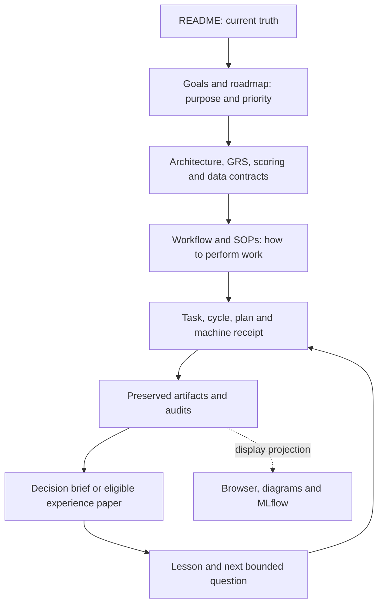

# Project foundation structure proposal

Proposal status: ready for review. Scope: folder responsibilities, content
organization, report presentation and the next foundation gaps. This is a
supporting proposal, not an adopted package migration, another research standard
or a replacement roadmap. No source, dataset, frozen plan, report or journal was
moved; no experiment, service or broker operation was launched.

The [documentation map](../README.md) retains content ownership,
[architecture](../architecture.md) retains code/state boundaries,
[GRS-1.0](../research-standard.md) retains research/adoption/report rules,
[the catalog](../skills.md) retains skills and readiness, and
[the roadmap](../roadmap.md) retains portfolio priority. The completed
[RSI engineering foundation](2026-10-27-rsi-foundation-implementation.md) is scoped
infrastructure evidence; its remaining scientific/financial gaps stay open.

## 1. Folder structure

Retain the established top level. This map describes current responsibilities;
it does not imply every integration is configured or every dataset qualified.

```text
quant-trading-lab/
├── README.md                  current capabilities and starting points
├── AGENTS.md                  agent instructions and routing
├── Makefile                   supported verification/operations entrypoints
├── requirements*.txt          pinned engine and tracking environments
├── .github/workflows/         project CI configuration
├── .agents/skills/            installed workflows; catalog owns discovery
├── research/                  research logic, data checks and bounded control
│   ├── plans/                 versioned study definitions; frozen means immutable
│   ├── catalogs/              strategy/source inventory and rights metadata
│   └── quantconnect/          hosted-study code and permitted source snapshots
├── reporting/                 shared metrics, saved-result adapters and renderers
├── paper_trading/             paper adapters, observation tools and fixtures
├── scripts/                   operator-facing commands
├── tests/                     offline behavioral and integration checks
├── docs/
│   ├── README.md              canonical owners and documentation conventions
│   ├── operations/            SOPs, entry conditions and recovery procedures
│   ├── decisions/             architectural decision records
│   ├── templates/             reusable task, intake, incident and research forms
│   ├── tasks/                 dated plans, outcomes and lessons
│   │   └── evidence/          compact safe-to-share machine receipts
│   ├── diagrams/              presentation exports
│   └── history/               preserved historical context
├── reports/                   preserved run evidence; tracking varies by family
├── data/                      ignored provider inputs/catalog material
├── .local/                    ignored journals, raw evidence, views and local state
├── vendor/                    ignored pinned dependency source
└── archive/lean/              retired implementation
```

Code location follows responsibility: shared research rules/checks belong in
`research/`; shared metrics/presentation in `reporting/`; broker integration in
`paper_trading/`; command argument handling and orchestration in `scripts/`.
Avoid implementing the same account, metric or promotion rule in each command.
NautilusTrader/MLflow boundaries remain those in architecture.

Current inventory found 54 top-level Python research modules, 77 Python commands
and 66 test files. The layout is usable, but new study-specific scripts should
not indefinitely expand a flat command directory. Package grouping is proposed
only when the next concrete implementation justifies it:

| Proposed group | Responsibility | Migration boundary |
| --- | --- | --- |
| `research/studies/<study>/` | New study-specific preparation, execution and audit adapters | Keep reusable controls outside the study; retain frozen historical modules |
| `research/features/` | Shared causal features and their registry/validation | Extract from actual repeated use; keep timing/label contracts explicit |
| `research/policies/` | Position proposal and portfolio risk/sizing rules | Preserve GRS's minimal decision stages; do not add layers merely to fill packages |
| `research/evaluation/` | Shared accounting/causality checks and comparison adapters | Preserve existing metric owners and qualified historical account models |
| `research/control/` | Future common contracts/coordinator/version tools if a package extraction becomes useful | Existing `rsi_*.py` stay in place until a separately tested compatibility change |
| `reporting/templates/` | Shared presentation assets when renderer changes need this seam | Preserve old renderer/source identities and output evidence |
| Mirrored test packages | Group tests with the module boundary they exercise | Prove test discovery/imports and coverage before moving tests |

These paths are proposals, not newly created empty directories. A wholesale
`src/` migration is unnecessary for the present task. Do not repurpose
`research/README.md`: it owns the original SPY methodology and is part of
historical reproducibility context.

## 2. Content structure and authority



Use a reader-first outline for new narrative documents: purpose/outcome → scope
and status → governing owner → inputs/contracts → method/steps → actual evidence
and counterevidence → decision/limitations → lesson/next action. Omit sections
that do not apply. Frozen machine schemas and historical records keep their
existing field order and identity.

Keep four status dimensions separate:

| Dimension | Meaning and owner |
| --- | --- |
| Document maintenance | `draft`, `active`, `proposed`, `superseded`; conventions in the documentation map |
| Work/cycle state | Planned, attempted, failed, blocked, closed or complete under its actual contract |
| Evidence classification | Development technical report, independently validated research report or negative-results technical report under GRS; synthetic engineering labeled explicitly |
| Capability/metric availability | Implemented/unverified/blocked/planned for capabilities; value, missing, undefined, not applicable or incomparable for metric cells |

A maintained document is not proof of implemented behavior; a completed task can
have a negative result. New narrative records should identify owner, local date,
scope, exact cycle/run/parent references and evidence location. Use existing
machine schemas for executable records; the proposal does not invent a second
receipt format or a new universal run-ID scheme.

For new records, retain the established pairing:
`docs/tasks/<date>-<topic>.md` plus a compact JSON receipt in `docs/tasks/evidence/`.
Plans remain in `research/plans/`; authoritative raw output stays in its named
`reports/` or ignored `.local/` bundle. The receipt identifies the exact locations,
hashes, audit, access restrictions and relevant code/data/environment versions.
The cycle register is a pointer index, not another results database. Existing
hash/date run IDs and historical layouts remain valid.

The README should gradually become a shorter capability/entrypoint view. Dated
results should be reached through the existing cycle register and historical
lessons index, preserving original receipts. This content consolidation is proposed;
the historical digest has not been removed in this task.

## 3. Report templates

Reuse existing forms rather than create overlapping protocols:

| Deliverable | Template / procedure | Purpose |
| --- | --- | --- |
| Infrastructure change | [Task record](../templates/task.md) | Scope, acceptance, failure/recovery, actual checks and remaining limits |
| External idea/source | [Research intake](../templates/research-intake.md) | Mechanism, provenance, reuse rights, dependencies and reproduction gaps |
| Every research cycle | [Cycle record](../templates/research-cycle.md) | Frozen question, bounded attempts, all outcomes and lesson |
| Operational failure | [Incident record](../templates/incident.md) | Containment, evidence, reconciliation and verified recovery |
| Short comparison/decision | [Proposed decision brief](../templates/research-decision.md) | Reader-facing summary derived from authoritative cycle/evidence |
| Substantial research lesson | [Experience paper](../templates/research-paper.md) | Full scientific narrative when GRS report-readiness criteria are met |

The proposed brief adds a short presentation layer. Its order is decision and
classification → one question/change → comparability/gates → results →
counterevidence/failures → disposition/lesson/next evidence → reproducibility links.
Full annual tables may be linked, keeping adverse periods visible in the summary.
No new score or adoption rule is introduced. A brief is not a fresh experiment,
an independent validation or a license to alter the underlying result.

Financial tables use the frozen metric/context definitions and preserve units,
undefined ratios, missing paths and censored recovery periods. Infrastructure
reports use process correctness/resolutions/resources; synthetic fixtures do not
receive invented CAGR or Sharpe values. MLflow and generated pages remain views.

## 4. Other foundations and gaps

This is an activity-oriented gap list, not a second portfolio roadmap. Priority
labels order this proposal's follow-ups within their separately bounded scope.

| Foundation | Observed readiness | Proposed next evidence / owner |
| --- | --- | --- |
| Mandate and measurable goals | Existing [mandate](../goals.md) and GRS; financial aspirations are not promises | Keep each experiment's primary criterion/materiality and guardrails explicit |
| Ownership and interfaces | Existing architecture, catalog and SOPs; broader algorithm wiring remains partial | Use supported dependency interfaces and one canonical owner per concept |
| Reproducible environments | Direct/lock files and local checks exist | Fresh-checkout/environment proof when dependencies change; [local SOP](../operations/local.md) |
| Evidence identity and access | Scoped hashes/journals implemented; qualified data and authenticated access history remain partial | Parent/input/output manifests, rights and viewed-data exposure; data-library and RSI owners |
| CI and contribution flow | CI configuration and local checks exist; no hosted state refreshed here | Retain offline checks; consider a thin contribution entrypoint linking the existing workflow |
| Repository license and attribution | Licensed third-party snapshots exist; no top-level project license found in this inspection | P1: resolve project licensing/ownership separately; preserve third-party attribution and data-rights distinctions |
| Backup and restore | Storage/incident SOPs exist; general automated restore is unverified | P1: disposable restore proof covering ignored evidence, code/locks and tracking artifacts under M3 |
| Secret/data boundaries | Ignore and SOP rules exist; no new comprehensive security audit performed | Keep credentials/private material out of shared receipts; resolve a public reporting/contact process before adding a security document |
| Repeatable reports | Native/local reporting and paper/cycle templates exist | P0: trial the proposed brief against one saved complete result and one failed/blocked result |
| Research effectiveness | Bounded synthetic RSI foundation demonstrated; no general process or alpha advantage established | Separately bounded withheld-task and qualified-financial evaluation from the RSI checklist |

No new database, service, scheduler or agent team is needed merely to adopt a
clear folder/content convention. Add infrastructure only for a demonstrated gap.

## 5. Adoption and migration checklist

- [x] Inspect current folders, canonical owners, templates, ignore rules and Git state.
- [x] Prepare this proposal and a complementary decision-brief template.
- [x] Correct existing navigation maps to describe current research/reporting roles.
- [x] Check document links, metadata, skill parity and protected historical bytes.
- [ ] P0: trial the brief on saved positive and negative/blocked evidence; verify every quantitative claim against its source, without new financial runs.
- [ ] P0: decide the forward-only grouping for the next new study; identify its actual reusable seams before creating directories.
- [ ] P1: shorten the README's historical digest using pointers to existing owner indexes, preserving all original records and links.
- [ ] P1: specify and test backup/restore of ignored evidence and tracking state in a separate bounded task under M3.
- [ ] P1: resolve top-level license/contribution/reporting-contact gaps with the actual maintainers; do not invent ownership or rewrite third-party notices.
- [ ] Before any code move: map imports, commands, frozen hashes and parent manifests; preserve an executable frozen source bundle or tested compatibility paths.
- [ ] For a separately scoped migration: verify imports, test discovery, exact entrypoints, hashes, documentation links and representative report rendering; record rollback evidence.

The package migration remains proposed. This task creates no directories for
future packages and does not reopen any financial study. Validation and changed
paths are recorded in the [proposal receipt](evidence/2026-10-27-project-foundation-proposal.json).
