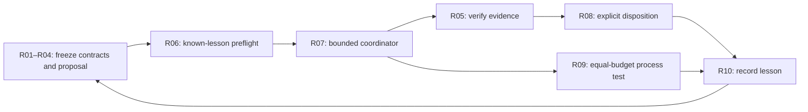

# Bounded RSI foundation implementation

Goal status: scoped offline foundation completed; later financial/generalization
work remains open below. This is the implementation checklist for the user's requested
recursive self-improving (RSI) research foundation. It operationalizes the
[requirements review](2026-10-27-rsi-requirements-review.md) under
[GRS-1.0](../research-standard.md). It is a supporting infrastructure task, not
a new financial study, a replacement roadmap or evidence of improving returns.

## Frozen scope and completion

Build one local, offline path that freezes a research change, checks known lessons,
coordinates finite work, verifies artifacts and records an explicit disposition.
Use synthetic tasks and saved C001 evidence. Complete means the checklist below
has observed acceptance evidence, the same path survives failure/restart tests,
and `make check` passes. Financial automation and independent economic validation
remain separate deliverables even if this foundation is complete.

- Free/local inputs only; zero new financial simulations, model fitting, data
  acquisitions, services, broker actions, deployment or publication.
- One writer per program, fixed cases and aggregate bounds across its cycles.
  No automatic retry or reopening C001. Demo bounds are frozen before launch.
- New modules wrap existing behavior. Preserve historical source, plans, raw
  outputs, failed gates, manifests and GRS-1.0 bytes.
- Three implementation work packages may proceed in parallel: contracts and
  lesson preflight; execution coordinator; evidence/adoption records. Integration,
  review and task closure remain sequential.
- One saved-evidence demo and one finite synthetic process comparison. A tie or
  negative process result is retained; passing fixtures cannot establish alpha.

## Implementation checklist

The checkboxes mean the scoped engineering acceptance below was demonstrated.
They do not mean the full requirement is solved for arbitrary financial research.

| ID | Engineering acceptance in this goal | Dependency | Status / evidence |
| --- | --- | --- | --- |
| R01 | Versioned, strict cycle contract freezes objective, criteria, controls and finite bounds; changed criteria invalidate identity | None | [x] Contract tests and frozen demo contracts |
| R02 | Exact parent/incumbent and one changed stage; explicit field timing/meaning; malformed contracts fail | R01 | [x] RSI-CYCLE-1; typed interface and chronology tests |
| R03 | Record evaluation period and previous access; reject contradictory protected-forward declarations | R01 | [x] Declaration checks; actual access-history authentication and broader qualification remain open |
| R04 | Proposal handoff includes hypothesis, prior lesson, falsifier and simpler control before execution | R01–R03 | [x] Required contract fields, SOP and frozen demo; automatic scientific proposer is not implemented |
| R05 | Missing/tampered/traversing artifacts and inconsistent evaluator contexts fail closed | R01–R03 | [x] Adversarial artifact/context tests; no general financial truth oracle implied |
| R06 | Saved C001 mismatch is recognized before launch; unrelated monetary changes above the explicit `1e-7` tolerance and any changed fills fail; original failed gate and consumed attempt survive | R02, R05 | [x] Live saved preflight and negative regressions; zero extra financial launches |
| R07 | Single coordinator pins cases, accounts actual allowed launches globally, retains timeout/failure output and stops ambiguous recovery | R01, R05, R06 | [x] 32 coordinator tests; two-launch/two-cycle demo and authenticated restart; financial adapters disabled |
| R08 | Frozen evidence gates produce explicit retain/adopt/rollback records with exact prior/new identities | R01, R05 | [x] 20 registry tests and synthetic adopt/rollback demo; financial passes remain provisional |
| R09 | Finite adaptive/fixed policy comparison at equal information/budget reports errors, resolutions, redundancy and costs, including ties | R06–R08 | [x] Known-fixture comparison and separate reference grading; aggregate tie, generalization unverified |
| R10 | Every attempt/disposition/lesson has a traceable receipt; full checks and historical preservation audit pass | R01–R09 | [x] Demo manifest, source snapshots, 143-file preservation check and 449 passing offline tests |

## Skills and SOP handoffs

The [teams and skills catalog](../skills.md) remains the discovery owner. The
[RSI operating sequence](../operations/recursive-research.md) links existing
skills through one SOP. No new skill roster or automatic dispatcher was created.
Use `trade-infra-change` for this implementation and its offline regression tests.

Required handoff artifacts are: prior-evidence references → frozen cycle/plan →
input/preflight receipt → bounded execution receipt → verified evaluation →
version disposition → lesson and next eligible question. A missing handoff stops
dependent work while preserving everything already attempted.

## Validation and closure

Evidence will be summarized in the
[machine receipt](evidence/2026-10-27-rsi-foundation.json). Raw local execution
evidence belongs in a new ignored `.local/` directory. Tests use disposable
directories and synthetic subprocesses. Do not rerun immutable historical study
paths merely to refresh a report.

Observed validation:

- `.venv/bin/python scripts/rsi_foundation.py preflight`: passed, no research
  artifact writes or financial launches. It verifies pinned historical receipts,
  manifests, source and saved outputs before recognizing the known transition.
- One explicit demo in `.local/rsi-foundation-20261027/demo`: passed, exactly two
  allowed subprocesses (synthetic fixture and existing runner's read-only
  preflight), zero financial slots, fixed 120-second program ceiling. A third
  case was refused by the shared budget; reopening reused verified evidence.
- Synthetic version adoption and rollback passed. The exact frozen incumbent and
  candidate are engineering fixtures; no financial version was adopted.
- Three known development policy scenarios at equal information/limits: priority
  resolved 3/1/2 versus breadth-first 2/2/2. Both totaled six resolved questions,
  six actions and six fixture units, with zero observed reference-grading errors
  or repeated selected observations. Elapsed times were recorded but do not
  support a speed advantage. These are viewed fictional tasks, not withheld tests.
- `make check`: exit 0; **449 tests passed**, dependency check passed, documentation
  targets/metadata/skill parity passed. New foundation coverage comprises 70 tests;
  the remaining suite checks existing offline project behavior.
- Integrity audit: 24 demo artifacts and 162 frozen source paths verified;
  167 source/test snapshots retained. **143 protected historical files unchanged**,
  including GRS-1.0, C001 failure/plan/raw evidence and the earlier experience audit.
- Independent source review found and repaired contract-budget/artifact gaps,
  mutable spec/journal checks, late deadline launch and interrupted-stop recovery.
  A focused coordinator test initially exposed an exception-type mismatch; it was
  corrected before the single demo. Failed review findings are retained in the
  machine receipt; no financial retry occurred.

## Engineering lesson

Stored lessons must become executable preflight checks. C001's saved effective
versus nominal target semantics can now be recognized without accepting unrelated
changes or reopening its failed gate. Source review also showed that durable
reservation alone is insufficient: the stop decision must survive the exact crash
boundary following a failed audit. The fixture comparison gives no reason to claim
that the priority policy is generally better than its simple baseline.

## Remaining checklist before broader RSI claims

- [ ] Integrate a separately bounded real financial runner through a reviewed
  adapter with actual account/causal/cost audits; financial execution is currently
  unsupported by this coordinator.
- [ ] Authenticate historical data-access records and qualified inputs across
  cycles/programs; the strict contract currently validates declarations.
- [ ] Expand known-lesson retrieval beyond C001 and prove it prevents repeated
  failures on independently authored tasks.
- [ ] Evaluate process choices on withheld tasks with equal information/resources
  and predefined useful-effect thresholds. Preserve ties and failures.
- [ ] Establish independent financial evidence before any financial candidate
  adoption. A verified JSON metric/check declaration is insufficient.
- [ ] Consider an automatic proposer or scheduler only as a later bounded goal;
  neither is required to operate this manual evidence-driven loop.

These open items do not silently extend this completed goal or displace the
[platform roadmap](../roadmap.md). The next financial study keeps its own qualified
inputs, immutable criteria and finite authorization.
