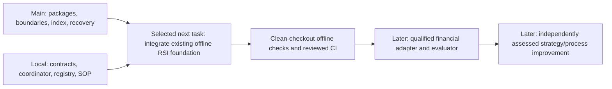

# RSI foundation review after PR #6

Review complete; next task selected and specified, implementation not started.
This is a supporting assessment of the [foundation checklist](2026-10-27-rsi-foundation-implementation.md),
not a replacement for [GRS](../research-standard.md), the [operating SOP](../operations/recursive-research.md)
or [portfolio roadmap](../roadmap.md). Scores are engineering judgment, not return forecasts.

## Verified baseline and scope

Remote main is `4fc663164434e15b68324d8266ff421294af717b`, PR #6's merge commit.
The reviewed head was `e1bf72db08f08089754570045e4f907aa84bfd3a`; its tree
`0fb6e0f750805deedfdffdf97ac2961d7c597738` is identical to the merge tree.
The prior handoff records 428 passing offline tests, exact-head PR/push success,
and [successful post-merge CI](https://github.com/kenfuliang/quant-trading-lab/actions/runs/40615761527).
This review refreshed remote main and checked the tree inventory; it did not rerun that suite.

Main provides canonical research packages, CI dependency boundaries, an evidence
index for 13 registered studies/diagnostics and 12 published plans, and copy-only
recovery of closed file bundles. The main structure score stays **8.2/10**, using
the unchanged nine-dimension rubric in the [recovery review](https://github.com/kenfuliang/quant-trading-lab/blob/4fc663164434e15b68324d8266ff421294af717b/docs/tasks/2026-10-27-evidence-recovery.md).
The final bug fixes earned no additional score.

The later strict RSI contracts, coordinator, adoption registry, foundation command,
SOP and implementation checklist are local unpublished work. They are absent from
that main tree. Their saved receipt reports 449 tests and a two-launch synthetic/
read-only demo, with zero financial launches. Fresh byte verification matched all
8 pinned implementation/test artifacts and all 7 pinned evidence artifacts.
This authenticates the saved receipt's inputs, not a new behavioral run or compatibility
with the merged packages. Neither 449 nor 428 is a test count for their union.

## Checklist reassessment

The original checked boxes retain their narrow historical engineering meaning.
They do not establish merged availability, general financial readiness or monotonic
improvement. Scores below assess the broad RSI requirement including the local
work: 0 absent, 3 partial design/limited proof, 5 scoped implementation with major
gaps, 8 tested reusable engineering, 10 integrated independent evidence for the
stated requirement. Equal weighting is used only to make this review reproducible.

| ID | Requirement | Score /10 | What we have and what remains |
| --- | --- | --- | --- |
| R01 | Frozen objective and evaluator | 8 | Strict local cycle contract tested; integrate with main and keep evaluator outside proposal authority |
| R02 | Incumbent and stage interfaces | 8 | Local typed contract/version identities; shared package integration and actual financial seam remain open |
| R03 | Qualified data and evaluation exposure | 4 | Declarations and scoped input audits; authenticated cross-cycle access history and unseen evidence missing |
| R04 | Bounded proposal and diagnosis | 7 | Manual skill/SOP handoffs with falsifiers and controls; no automatic scientific proposer, which is not yet necessary |
| R05 | Trustworthy evaluator | 6 | Hash/context/accounting checks in scoped studies; no general independent financial evaluator or alpha proof |
| R06 | Lessons change behavior | 5 | Saved C001 semantic lesson preflight; wider failure corpus and independently authored prevention tests missing |
| R07 | Global bounds and recovery | 7 | Local synthetic/read-only coordinator, durable reservations and restart tests; not integrated or financial-runner eligible |
| R08 | Adoption and rollback | 6 | Local synthetic registry proof; financial adoption deliberately unsupported |
| R09 | Research-process improvement | 3 | Known fictional fixtures tie six resolutions versus six; no withheld useful-effect result |
| R10 | Evidence and lessons | 8 | Main index/recovery and local cycle receipts; broader runner completeness, dependency closure and reproducibility gaps |

Broad RSI foundation score: **6.2/10** (62/100; a new rubric, not comparable to the
8.2 structural score). Shared integration is incomplete; autonomous financial
self-improvement and independent alpha remain **unestablished**, not scored as zero
financial performance. No requirement's remaining scientific acceptance is closed
by documentation or synthetic tests alone.

## Selected next bounded task: integrate the offline foundation

Priority: make the already-built foundation reproducible and enforced on main
before adding another execution capability. This is an RSI supporting task; native
platform M1–M5 priorities remain with the roadmap and do not become complete.

One change: port the existing offline RSI foundation to PR #6's canonical package,
command, evidence-index and CI contracts. Do not add new trading behavior, a
financial adapter, an optimizer, ML training, or another family of strategies.

Scope/bounds: one isolated checkout from the verified main revision; three existing
RSI libraries, one current CLI and their four test modules; minimum required C001
saved-preflight dependency closure plus canonical documentation/routing. Inventory
all dependencies before editing; stop and record a split if that closure requires
unrelated study publication. Preserve the original local implementations, frozen
source identities, original 449-test receipt, C001 failure and all consumed budgets.
No arbitrary imports from the dirty primary checkout are eligible.

Finite verification budget: one port candidate; at most two full offline integration
check runs and one fresh demo with at most two registered subprocess launches,
zero financial slots, one writer and 120 seconds total. Focused unit checks use
synthetic disposable fixtures and launch no financial work. No automatic retry of
the real demo. A third full check or second demo requires a new explicit bound.
No network data access, fitting, services, broker operations or new dependencies.
Hosted CI, if a later PR is requested, remains offline; it must not require private
raw bundles. Preparing this plan does not publish or merge a PR.

Acceptance checklist:

- [ ] Pin main and a full inventory/hash snapshot of the local foundation and its dependencies; identify all private/missing evidence before porting.
- [ ] Add current implementations under `research/control/` and current command under `scripts/current/`; resolve exact placement with architecture and satisfy dependency-layer checks.
- [ ] Preserve historical originals; record new code identities rather than overwriting frozen hashes. Distinguish the old receipt from the new integration evidence.
- [ ] All existing foundation test behaviors have traceable coverage in the current graph: contract tampering, exhausted bounds, concurrent writers, timeout/crash ambiguity, retained failures and explicit rollback.
- [ ] Fresh checkout `make check` passes without importing primary local files or silently skipping missing evidence. Do not predeclare an additive test count; discovery overlaps must be measured.
- [ ] Synthetic fixtures cover CI mechanics. Real saved C001 preflight separately verifies a complete local dependency closure; absent private evidence is explicitly unavailable and does not become a pass or trigger a financial run.
- [ ] One bounded fresh demo, only after preflight, proves shared exhaustion, restart evidence reuse, synthetic adoption/rollback and unchanged historical bytes. Zero financial launches; ambiguous interruption stops without retry.
- [ ] Link the new receipt into the evidence index and update existing capability/SOP/catalog owners. Close with failures, actual checks and remaining scientific gates. Exact-head CI is required for any later publication readiness claim.

Exit: retain the old foundation if integration fails; preserve partial outputs and
close the finite task. No financial version is adopted by completing this work.

## Alternatives and decision triggers

A financial adapter addresses an important later gap, but would combine new execution
with unresolved shared integration and input/evaluator qualification. Broader data
acquisition does not fix the reproducibility gap. Offsite/database recovery matters
for M3 but does not make the current RSI components usable from main. Withheld
process-policy evaluation should follow a stable integrated execution path.

Change this priority if a newer main revision already includes and verifies the
foundation, or the dependency inventory shows that porting it requires a larger
independent data-rights/accounting project. In the latter case, split a standalone
synthetic coordinator integration from the blocked real saved-preflight closure;
do not weaken the gate or claim the full task complete.

## Evidence and validation

[Review receipt](evidence/2026-10-27-rsi-post-pr6-review.json) records scores and
fresh verification scope. This task preserves the original checklist and receipts.
No new research, financial simulation, demo, model fitting or broker operation was
performed in this review. The 449-test evidence is historical local validation;
the 428-test evidence belongs to the merged PR. Documentation validation is
recorded separately in the review receipt.
