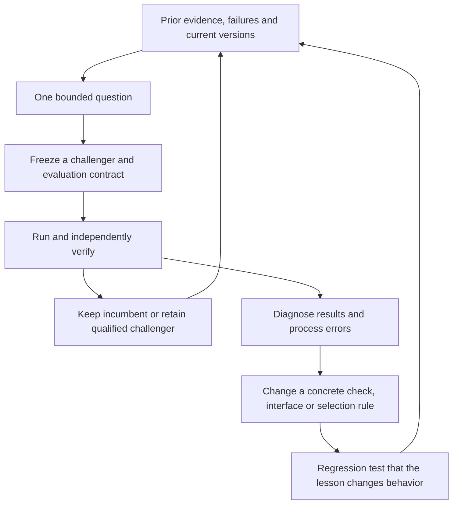

# Requirements review for recursive self-improving research

Review status: completed consultation; requirements and implementation sequence
are proposed. This is supporting evidence under [GRS-1.0](../research-standard.md),
not a second standard, portfolio roadmap, new financial cycle or implementation
claim. Existing mandate, metric meanings, frozen study budgets and pipeline
ownership remain unchanged. No simulations, training, package/service/broker
operations or automatic continuation were performed.

## What improvement means

The algorithm loop proposes a stage change and evaluates the resulting portfolio.
The process loop changes how the next question is selected, implemented or checked.
They require different evidence. More recorded cycles or a higher selected backtest
score alone establishes neither unseen financial improvement nor a better research
policy. Weight training or RL/GAE is optional and currently unnecessary to test a
finite, evidence-driven development loop.

## Requirement checklist and actual readiness

| ID | Requirement | Current evidence / gap | Observable acceptance example |
| --- | --- | --- | --- |
| R01 | Fixed objectives, scope and evaluator | GRS and raw-unit scoring exist; required-check truth remains partly caller supplied; return/risk tradeoffs must be frozen per study | A challenger cannot weaken its own checks or change the success definition after outcomes; evaluator revisions retain prior versions |
| R02 | Exact incumbent and typed component boundaries | Plans/hash identities exist; generic common interfaces and adoption registry are incomplete | Each candidate declares parent, changed stage, field meanings, units, horizon, availability and execution times; known schema incompatibility is caught before a launch |
| R03 | Qualified data and honest evaluation exposure | Scoped data/account checks exist; broader qualification and independent forward evidence remain partial | All fitting/labels use past-available information; every evaluation access is recorded; viewed history is never silently relabeled untouched |
| R04 | Bounded proposal and diagnosis mechanism | Current skills and agent coordination support manual one-change proposals; no generic automatic proposer/critic is integrated | A proposal cites a prior result, mechanism, falsifier, simpler controls, finite attempts and expected costs; duplicate dead ends need a genuinely new reason |
| R05 | Trustworthy financial and scientific evaluator | Scoped Decimal, causal, metric and temporal audits exist; a valid replay does not establish economic edge | Tampered/missing artifacts fail; frozen controls reproduce declared semantics; exposure/cost effects and adverse eras remain visible |
| R06 | Memory that changes actions | Cycle receipts, failures and journal branch state exist; cross-cycle retrieval and prevention are partial | A known failure creates a regression/preflight rule used by the next plan; renaming a resolved question earns no new progress |
| R07 | One bounded execution coordinator and safe recovery | Durable logical controller exists; financial runners still manage separate limits/state | Failures/retries/concurrent plans cannot exceed aggregate financial/time budgets; interruption cannot reset usage or cause automatic duplicate execution |
| R08 | Explicit research adoption and rollback | Dispositions and incumbent-unchanged records exist; general version adoption/rollback is not integrated | A development pass stays provisional until declared gates pass; exact prior/new versions and decision are recorded; failed claims cannot silently replace the parent |
| R09 | A test of research-process improvement | Prior matched synthetic replay totals6versus6resolved questions; no aggregate benefit established | Adaptive versus fixed-order policy receives equal information and resource limits; measure critical errors, independently checked resolutions, redundant trials and actual cost on withheld tasks |
| R10 | Complete evidence and scoped reports | Standard, templates, receipts and one retrospective paper-style report exist; automatic completeness/claim verification across runners is planned | Every cycle closes with evidence and a lesson; substantial reports show controls, negative findings, trial history and validation status without claiming peer review or alpha |

Status is based on inspected sources and existing receipts, not fresh runtime
checks in this review. Separate agents supplied engineering and evaluation
perspectives; these are not independent financial replications or human peer review.

## Concrete first proof: C001

[GRS-C001](2026-10-27-grs-c001-continuous-sizing.md) is closed after one failed
control attempt, zero eligible comparisons and seven unexecuted cases. All
monetary fields and trades match; historical effective0/1 target diagnostics differ
from current nominal1-budget reporting. The mismatch was previously documented
but was not carried into the new preflight contract. A narrow saved-output adapter
and regression checks now exist, but the frozen closed runner does not use them.

The next engineering acceptance is specific: a new declared contract/version must
recognize this known semantic difference using saved evidence, reject changed
cash/fills/unrelated fields, and do so before another financial launch. It must
preserve C001's failed gate and consumed attempt. This tests whether a lesson
actually changes behavior. It does not make continuous sizing financially assessed.

## Proposed smallest implementation sequence

1. Complete the existing sizing/ledger semantic seam and a preflight regression
   corpus from saved failures. No market download or new financial path is needed.
2. Connect one existing runner to the existing ResearchController, with explicit
   program/cycle identities and accounting of every actual financial launch.
   Preserve output/logs before higher-level checks and on timeouts; reconcile
   ambiguous interrupted work before considering another launch.
3. Add cross-cycle references to the actual incumbent, known failures, data
   exposure and resolved observations, with explicit research-version adoption.
   Reuse existing files/journal; a new database or feature platform is not assumed.
4. Test the coordinator and adaptive choice policy against a fixed baseline at
   equal limits. Include failures, interruption, ties, blocked inputs and negative
   results; predeclare what meaningful process improvement would mean.
5. Only then run another explicitly bounded stage-improvement experiment and
   pursue independent financial evaluation under its own qualified inputs.

This is a proposed local research-controller sequence, not a reprioritization of
infrastructure M1–M5 or a promise of monotonic returns. A useful rejection can
improve research decisions while the financial incumbent stays unchanged.

## Prior systems and inference for this project

Microsoft's [RD-Agent](https://github.com/microsoft/RD-Agent) and
[RD-Agent(Q) paper](https://arxiv.org/abs/2505.15155) provide a useful prior for
research/development/evaluation feedback. DeepMind's
[AlphaEvolve overview](https://deepmind.google/blog/alphaevolve-a-gemini-powered-coding-agent-for-designing-advanced-algorithms/)
separates program proposals from automated verification/evaluation. No code,
dataset, reported return or paid service from these systems was adopted here.

Our inference: reuse the separation between proposer, evaluator and retained
state, while separately qualifying trading-data chronology and financial claims.
A deterministic accounting checker can verify modeled arithmetic; it cannot by
itself certify future trading performance. Do not let proposal generation modify
protected outcomes, evidence requirements or resource/permission boundaries.

## Evidence

- [Machine review receipt](evidence/2026-10-27-rsi-requirements-review.json).
- [GRS readiness](../research-standard.md#readiness-and-maintenance).
- [Research-controller source](../../research/research_controller.py).
- [Bounded-runner boundary](../../research/bounded_study.py).
- [Actual policy replay](2026-10-25-recursive-research-policy-evaluation.md).
- [C001 outcome and adapter follow-up](2026-10-27-grs-c001-continuous-sizing.md).

Validation in this review: read-only source/document inspection and local
document-link/metadata checks. No behavioral tests or financial runs were launched;
previous test counts remain historical evidence under their original receipts.
