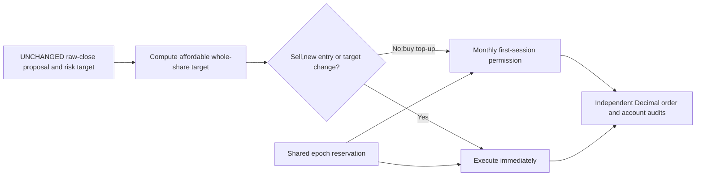

# C06: discretionary buy-topup execution study

Status: closed,fixed improvement target rejected; postseal receipt-export failure
recovered read-only. This is the second and final cycle of
[epoch2](2026-10-28-rsi-epoch2.md). [GRS](../research-standard.md) owns acceptance.
The proposed contract (`../../.local/rsi-calmar-20261028/research/plans/execution-c06.proposed.json`; private/local artifact, not published),
frozen design (`../../.local/rsi-calmar-20261028/research/plans/execution-c06.design.json`; private/local artifact, not published) and
executable (`../../.local/rsi-calmar-20261028/research/plans/execution-c06.executable.json`; private/local artifact, not published) remain historical.

## Frozen question,controls and bounds

Test execution permission,not signal/risk sizing. Monthly candidate suppresses
only discretionary buys at unchanged target outside first observed session of
new calendar month. No-topup control suppresses all those buys. All sells,new
entries/re-entry and target changes execute immediately; current/previous session
month is known without next-date/calendar lookahead. Actual cash/holdings may
therefore differ even though every intended target and source bar stays identical.

Same saved SPY source SHA992d9f62de93aa860ae00fc81d3810dbe0ac302a55102886fc5c50545130a8ba,
2004warmup/2005–2025,5283evaluation sessions,300000USD,0.99allocation,whole shares,
5/10bp per side,$1commission,6% debit financing,zero cash interest and ex-date
cash dividend credits. All history is viewed development. Six new attempts,
one worker,zero retries,300seconds/case and1800seconds financial wall,within
original epoch deadline2026-10-28T23:38:05Z and total12attempt ceiling.

Require≥10% netCalmar lift at both costs,CAGR no lower,daily-close maxDD no deeper,
longest underwater sessions/calendar days no longer,and no simpler-control
domination on growth,depth and both durations. CAGR/DD tolerance1e-9percentage
points; unrounded ratios. No parameter or threshold changed after outcomes.

Counterevidence was recorded before outcomes: the saved incumbent's466unchanged-
target buy topups cost only719.21USD directly at5bp. Savings alone were unlikely
to establish a large edge; cash drag and missed participation could offset them.
No historical simulation or cost-free counterfactual was used for that count.

## Audited results and tradeoffs

All six child case processes exited0,completed and passed financial audits.
The parent driver later exited1 during receipt export; that separate failure is
preserved below and does not disappear because the case results are available.

| Rule | Cost/side | Calmar | CAGR | Max loss | Longest underwater sessions/days | Sharpe |
| --- | --- | --- | --- | --- | --- | --- |
| incumbent | 5bp | 0.491514 | 8.7343% | 17.7701% | 513/746 | 0.7689 |
| incumbent | 10bp | 0.481692 | 8.6590% | 17.9762% | 514/749 | 0.7630 |
| monthly buy topups | 5bp | 0.491462 | 8.7220% | 17.7470% | 513/746 | 0.7688 |
| monthly buy topups | 10bp | 0.481810 | 8.6492% | 17.9515% | 514/749 | 0.7631 |
| no buy topups control | 5bp | 0.495563 | 8.6231% | 17.4006% | 513/746 | 0.7703 |
| no buy topups control | 10bp | 0.485900 | 8.5521% | 17.6005% | 514/749 | 0.7647 |

Monthly candidate Calmar changes−0.0106%/+0.0245% at5/10bp,far below+10%.
CAGR falls0.01228/0.00975percentage points. Drawdown improves only0.02310/
0.02463points and longest underwater durations are unchanged. Thus depth,
duration and simpler-control guards pass; headline and growth guards fail.
No-topup control does not dominate monthly across all guards because its CAGR
is lower,despite higher Calmar and shallower drawdown.

Monthly costs fall826.19/1019.08USD; trades fall from967/976 to356/365.
No-topup costs fall1457.72/2040.80USD and trades to112/113. Those savings differ
from the719.21USD original-path count because order sizes,subsequent cash and
compounding change. They are not a causal decomposition of return differences.
Average close exposure is77.566%monthly and76.471%no-topup versus77.633%incumbent.
Actual financing charges remain zero under the unchanged6% debit rule.

No-topup Calmar rises0.824%/0.874%,with maximum loss shallower0.3695/0.3756points,
but CAGR lower0.1112/0.1069points. Record this modest growth/downside tradeoff
without promoting it as the campaign success. Overall Calmar uses CAGR/full-path
DD; annual ratios are not averaged. Drawdown is daily-close sampled; all longest
underwater episodes are recovered,not right-censored. Sharpe uses daily returns,
252-session annualization and zero risk-free rate. All21annual rows and temporal
summaries per case are in the [receipt](evidence/2026-10-28-execution-c06.json).

## Model qualification and financial audits

NEW versioned `execution_rebalance.py` preserves old account/fill/margin math;
`execution_audit.py` independently derives affordable quantities with descending
Decimal feasibility search and permission with Date month/prior target. It
compares expected orders,not just accounting on observed trades. Original
simulator and auditor remain unchanged. Six synthetic model checks include
original daily parity,nonvacuous sell/target-increase checks,new entry with
unchanged target after zero holdings,month changes,dividends,gaps,prefix behavior
and invalid policies. Wrong-policy auditing is a tested rejection.

Eleven fixed capture/policy/child-reservation checks and persistent failure/
restart checks pass. Full622-test offline check passed before exact source freeze.
Both actual incumbent replays match original saved trades exactly and ledger
values within1e-7USD. All six Decimal execution/account audits and independent
full/21annual-row metric and temporal audits pass. Auditor suppression counters
count repeated daily topup opportunities,NOT distinct avoided orders or broker
messages; use actual trade counts above for order comparisons.

Each financial case has actual UTC reservation,intent,start,capture and finalized
result. Shared journal and local capture map one-to-one; total epoch usage12/12,
all completed,zero financial failures,retries or unused slots. Closed cached
verification with process launch patched to fail returns all six cached and
leaves the94-artifact manifest unchanged. No further financial execution is allowed.

## Preserved postseal failure and recovery

The fixed driver inherited C05's closing export filename. After all six cases,
sealing the financial manifest and retiring C06,it attempted exclusive creation
of `c05-shared-receipt.json`. FileExistsError stopped the parent driver(exit1)
and prevented overwrite of the earlier evidence. The full failure traceback
is retained in `.local/execution-c06-qualification/financial-execution.log`.
This exposes a gap in multi-cycle export-path qualification; passing child tests
and financial audits did not prove a clean parent workflow.

Read-only recovery reopened the existing shared controller,verified12completed
attempts and both retired cycles,confirmed the journal and C05as-of receipt were
unchanged,and exported to NEW `c06-shared-receipt.json`. It added zero financial
launches or journal decisions. Completion receipt preserves driver exit1 and
six actual child exits0 separately. Exact failure UTC is not emitted in the
traceback; financial case timestamps and shared retirement are durable,while
file modification time is only filesystem metadata. No timestamp was backfilled.

The frozen C06 source STILL contains the rejected postseal filename. It was not
edited after outcomes and must not be advertised as repaired or reusable. The
closed financial experiment and separate recovered evidence are valid within
their audited scope; a future launcher version needs unique per-cycle export
paths and a specific multi-cycle integration test before use. No financial rerun
was used to repair bookkeeping. Source identity and negative evidence stay intact.

## Lesson and disposition

**Reducing execution churn can be useful engineering without delivering a
material investment edge.** Hundreds fewer orders saved modest costs and changed
cash/exposure,but did not meet the no-lower-growth and10%Calmar screen. The
simpler no-topup control illustrates a small return/risk tradeoff,not a free
performance gain. Keep incumbent unchanged and reject the fixed monthly target;
retain the control's tradeoff and the parent-workflow failure as lessons.

- [x] Freeze a distinct execution-stage question,controls and counterevidence.
- [x] Independently qualify quantities,permissions,no-go and recovery behavior.
- [x] Pass full checks and freeze source/model/shared bounds before finance.
- [x] Execute six reserved cases and audit all outcomes.
- [x] Preserve/recover postseal export failure without overwrite or rerun.
- [x] Update single leaderboard and close epoch with all slots accounted.

Raw financial bundle `.local/execution-c06/`,manifest SHA
`9b5f4d911e58a98bc17099ec7e433e6d5d12c9ca5311f5dbccc4fe8291449361`;
qualification/source snapshots and recovery proof `.local/execution-c06-qualification/`.
All source is uncommitted in the isolated checkout. No paid/network data,
credentials,brokers/orders,services,installation,MLflow import or publication.

Final verification:624 offline tests passed in full `make check`(exit0). All549financial artifacts across C01–C06 match original manifests;455prior artifacts remain preserved. C06source/model/qualification identities are unchanged,including its documented postseal export defect. Shared epoch usage12/12,two retired cycles,zero retries/unused slots. All73prior leaderboard rows and links remain; six C06rows added. Final verification introduced zero financial runs.
