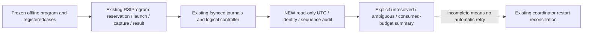

# Execution-record hardening: synthetic infrastructure evidence

**Implemented a strict read-only lifecycle audit over the existing RSI journal.** Eight focused tests and the final full offline check passed546tests. Six logged check commands completed with exit0; no failed checks were discarded. Zero financial runs, broker operations, network calls or financial-adapter additions. The [receipt](evidence/2026-10-28-execution-record-hardening.json) records exact commands, timestamps, hashes and retained fixture paths.

This task follows [development workflow](../workflow.md) and [GRS](../research-standard.md). It extends a project evidence interface, without changing NautilusTrader, MLflow or the frozen Calmar experiment. The owner for ongoing architecture/capability status remains the canonical architecture/README; parent integration is separate from this receipt.

## Acceptance frozen for this task

Reuse the durable coordinator rather than introducing a generic process launcher or a competing journal. Bind event records to frozen program/case/executable identities. Enforce reservation-before-start-before-result chronology using explicit UTC and epoch values, retain failures in consumed budgets, reject duplicate/retry records and fail closed for incomplete or ambiguous restarts. Use only fixed synthetic fixtures. Preserve all historical evidence. Bounds:45minutes and at most10logged check commands, zero financial runs. Exact start of the initial inspection was not independently timestamped; check records preserve measured execution intervals rather than inventing a full-task timer.

## Reused versus new behavior

The existing `RSIProgram` already owns its durable hash-chained journal, fsync/atomic snapshots, frozen commands/code/interpreter, fixed offline adapters, aggregate budgets and interrupted-launch reconciliation. `ResearchController` already owns the logical reservation ledger and single-writer lock. These modules were read and reused unchanged.

New `research/control/attempt_records.py` audits a quiescent execution journal without opening a writer or changing evidence. It verifies plan hash, each registered case/argv/adapter identity, current frozen source/interpreter digests, chain order and explicit UTC timestamps. UTC and epoch may differ by at most1second, while both sequences must independently be nondecreasing. It rejects ordering/identity contradictions and reports incomplete states explicitly, with no fabricated start/result time. Failures consume reservations; an exhausted/expired/stopped or unresolved program cannot be marked eligible for a next request. This summary is not launch authorization and does not replace the coordinator's logical gates.

New `scripts/current/check_attempt_records.py` writes only into an exclusive fresh directory and launches only the coordinator's fixed synthetic children. It preserves source-bound plans, logs, output and audits. No arbitrary executable or strategy command is accepted. `tests/test_attempt_records.py` validates the public audit interface and exercises existing recovery behavior through disposable synthetic programs.

## Actual checks and preserved evidence

- Check01: seven initial focused tests passed.
- Check02: persistent syntheticfixture-v1 passed, retained as intermediate evidence.
- Check03: full offline check passed545tests.
- Check04: eight focused tests passed after adding an observed-process/missing-sealed-result case.
- Check05: persistent syntheticfixture-v2 passed; three fixed synthetic child processes within that demonstration.
- Check06: final full offline check passed546tests, including documentation, dependency boundaries, evidence-index freshness, dependency consistency and offline regressions.

The final persistent fixture demonstrates success, exit7failure, authenticated cached restart without relaunch, failed-attempt budget consumption, interruption after launch intent, and a process whose start was observed but whose result was not sealed. The latter injects interruption before durable capture after the fixed child finishes: restart still marks it ambiguous and blocks another launch. It does not infer outcome from a dead process or existing stdout. Before-intent interruption consumes its slot without retry. Rehashed UTC/epoch/timezone, executable, duplicate reservation, changed-plan, missing-start and partial-log fixtures are rejected. Read-only audit leaves journal files byte-identical.

Private synthetic evidence is retained under `.local/execution-record-hardening-20261028/`; originals and intermediate versions remain. The receipt provides a manifest rather than duplicating those journals into public documentation. No profitability, forecast or Calmar improvement follows from synthetic success.

## Integration boundary and remaining work

**Future direct financial-runner capture remains unimplemented.** This does not fix the frozen `calmar_epoch.py` timestamp omission or enable any financial adapter in `rsi_coordinator.py`. A prospective direct runner must freeze a supported capture integration and demonstrate it before another financial cycle. Missing historical times remain missing.

The new audit authenticates chronology/declared identities, not financial accounting, adapter output correctness or the full logical ledger; the existing coordinator performs its own artifact/outcome checks. Read while the writer is quiescent; this audit neither acquires its lock nor repairs/reconciles records. Local fsync/flock assumptions remain, and hash chains are not protection against coordinated rewriting of all evidence. Observed-process-start time is not an exchange fill or exact kernel birth timestamp. Parent updates canonical capability/docs and chooses any next bounded integration work.

Lesson: durable execution capture already existed in the controller path. The useful addition is a strict chronology/export check and preserved failure/restart evidence, while keeping the missing direct-runner integration visible.
