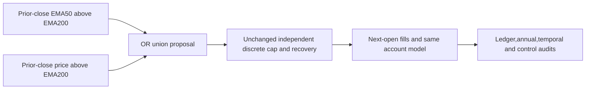

# C04: no-veto eligibility under the unchanged risk gate

Status: closed; fixed improvement target rejected. [GRS](../research-standard.md)
owns acceptance. This is a new user-authorized six-case cycle; no old budget
is reopened. The proposed-only precursor (`../../.local/rsi-calmar-20261028/research/plans/proposal-c04.proposed.json`; private/local artifact, not published)
remains unchanged as a historical record of the earlier zero-execution scope.

## Question and frozen scope

The [saved decision diagnosis](2026-10-28-proposal-decision-diagnosis.md) found
exit-origin missed participation was the largest net timing drag in C03.
It also found slightly negative extra-entry timing before costs. This is a
mechanism ablation,not a promise that the observed loss is recoverable.
Union eligibility preserves incumbent proposals and can add earlier entries
or retain positions when the slower proposal turns off; it is not entry-only.

Design (`../../.local/rsi-calmar-20261028/research/plans/no-veto-c04.design.json`; private/local artifact, not published): incumbent EMA50>EMA200,
union `(EMA50>EMA200) OR (close>EMA200)`,and always-long proposal as a gate-only
exposure control. Every rule passes through the SAME independent discrete
EMA/volatility cap,recovery and no-go; price-peak remains disabled. Change only
position proposal. No-veto cannot override a zero risk cap.

Original saved SPY source SHA
`992d9f62de93aa860ae00fc81d3810dbe0ac302a55102886fc5c50545130a8ba`:
5535daily rows,89dividends,0splits;2004warmup and5283evaluation sessions in
2005–2025. Same300000USD capital,0.99allocation,whole shares,next-open daily
resizing,$1commission,5/10bp per side,6% debit financing,zero cash interest
and ex-date cash dividend credit. Provider timestamps identify session opens;
only completed preceding-close features enter proposals. No data download,
new rights,universe,financing change or broker operation.

Six attempts including failures,one worker,zero retries,300seconds/case,
1800seconds financial wall,and a separate two-hour absolute deadline frozen
in the design. Both incumbents precede all other financial cases. Stop on
parity,accounting,integrity or resource failure; no automatic repair/rerun.

Require≥10% netCalmar lift at both costs,CAGR no lower,daily-close full-path
maxDD no deeper,longest underwater sessions AND calendar days no longer,
and no domination by gate-only control on growth,depth and both durations.
CAGR/DD tolerance1e-9percentagepoints; use unrounded Calmar. Include full/annual
returns,DD,Sharpe,Calmar and rolling/underwater diagnostics,costs and exposures.
Sharpe uses daily returns,252-session annualization and zero risk-free rate.
The entire sample is viewed development; no fitting/split creates unseen evidence.
Broader historical trial count remains unknown; C01–C03 each had six closed cases.

## Qualification and checklist

Reuse durable coordinator reservations and UTC lifecycle capture through a NEW
fixed adapter/source/version. Keep old modules/plans/output unchanged. Default
registry continues to reject arbitrary financial execution. Qualification covers
prefix/future invariance,one lag,unchanged cap,no-veto/red,warmup/equality/invalid
inputs,fixed argv,consumed failures,missing/tampered output,ambiguous restart,
sealed-cache restart,deadlines and finite budgets. Synthetic checks run no finance.
Exact source/qualification snapshot must pass full offline checks before freeze.

- [x] Freeze one-stage design,criteria,dates/accounting and finite bounds.
- [x] Verify saved inputs,old manifests and causal/no-veto contract.
- [x] Pass focused and persistent failure/restart capture qualification.
- [x] Pass full checks and freeze exact executable/source identities.
- [x] Execute six cases with reservation before each financial launch.
- [x] Reconcile ledger,control,annual and temporal results.
- [x] Update single leaderboard,cycle pointer,index and evidence-backed lesson.

## Results and lesson

All six new cases completed with zero financial failures; all six attempts are
consumed,zero retries and no automatic next study. The [completion receipt](evidence/2026-10-28-no-veto-c04.json)
contains unrounded metrics,21annual rows per case,rolling/underwater diagnostics,
independent audits,exact identities and actual UTC lifecycle timestamps.

| Rule | Cost/side | Calmar | CAGR | Max loss | Longest underwater sessions/days | Sharpe |
| --- | --- | --- | --- | --- | --- | --- |
| incumbent | 5bp | 0.491514 | 8.7343% | 17.7701% | 513/746 | 0.7689 |
| incumbent | 10bp | 0.481692 | 8.6590% | 17.9762% | 514/749 | 0.7630 |
| union eligibility | 5bp | 0.396796 | 8.5623% | 21.5786% | 542/788 | 0.7491 |
| union eligibility | 10bp | 0.382449 | 8.4325% | 22.0485% | 546/794 | 0.7391 |
| gate only control | 5bp | 0.444106 | 9.6930% | 21.8259% | 567/822 | 0.7961 |
| gate only control | 10bp | 0.438939 | 9.6309% | 21.9414% | 571/828 | 0.7916 |

Union netCalmar falls19.27%/20.60%,rather than improving≥10%. CAGR falls
0.1720/0.2265percentage points; maximum loss deepens3.8085/4.0724points;
longest underwater grows from513/514 to542/546sessions and746/749 to788/794days.
The full-path drawdown is measured on daily-close portfolio equity,not every
intraday peak/trough. Overall Calmar uses CAGR/full-path drawdown,not an annual
average. All six longest underwater episodes are recovered,not right-censored.

The no-veto invariants passed:210 additional target sessions,zero lower targets
and zero zero-cap breaches. Average close exposure rises from77.63% to79.60%.
Extra modeled commission/slippage is7430.38/14084.83USD. Both use the same6%
debit-financing model; actual interest is zero because neither path borrows.
These are observed-account comparisons,not a causal decomposition of the
candidate's performance change. Actual share/cash paths can differ after costs
and compounding despite identical proposals on most sessions.

Gate-only control has higher CAGR9.6930%/9.6309%,but deeper loss21.8259%/
21.9414% and longer underwater567/571sessions than incumbent. Its Calmar
0.444106/0.438939 also trails incumbent,though it exceeds union Calmar.
Gate-only does not dominate union across all frozen metrics: at5bp union has
slightly shallower depth,and at both costs shorter underwater duration.
The simpler-control guard therefore passes; it does not rescue union's failure
of Calmar,growth,drawdown and recovery guards.

## Lesson and disposition

**Preserving successful eligibility is necessary for this mechanism test,but
additional eligibility still did not earn its risk and cost.** Removing C03's
price-exit veto improves its saved growth and Calmar in the same modeled context,
but not enough to beat the incumbent; drawdown becomes deeper. A retrospective
attribution can locate losses without promising a profitable counterfactual.
Do not interpret exit-origin log contributions as recoverable dollars or tune
EMA lengths/thresholds after this failure.

Keep the fixed incumbent unchanged. Reject this union proposal against the
preregistered target; retain gate-only as a growth/downside tradeoff control.
No algorithm promotion,unseen-alpha claim,broker deployment or annual-return
guarantee follows. This is the fourth six-case local Calmar cycle after three
related failures; total wider historical trials remain incompletely reconstructed.
The next research question should establish incremental information or a clearly
specified portfolio objective before another eligibility/sizing permutation.
No new financial task is launched by this lesson.

## Capture,provenance and verification

Both fresh incumbent replays match original saved trades exactly and ledger
values within1e-7USD. All six Decimal reconciliations,independent overall and
21annual-row metric checks,and independent temporal audits pass. Every financial
case has UTC reservation,intent,observed start,captured exit and finalization.
The sealed bundle includes94 artifacts; completed restart with process launch
patched to fail returns all six cached,zero new launches and unchanged manifest.

582 offline tests passed before executable freeze,including ten fixed synthetic
capture/policy tests; persistent failure/missing/tamper/ambiguous/cached restart
proofs remain local. No qualification or financial failure occurred in this cycle.
Exact source snapshot and passing qualification hash bind the executable.

Raw evidence: `.local/no-veto-c04/`; qualification/source snapshot:
`.local/no-veto-c04-qualification/`. Source and new studies remain uncommitted
in the isolated checkout. The [single leaderboard](../leaderboard.md) includes
all six C04 rows with separate5/10bp contexts. No new data,dependency install,
service,MLflow import,broker access,order,commit or publication occurred.

Final verification:583 offline tests passed in full `make check`(exit0),including receipt and one-table leaderboard preservation. All361 artifacts across C01–C04 match their original manifests;267 prior artifacts were preserved. Old C02/C03 study modules and the new frozen source snapshot are unchanged. Both leaderboard views preserve all61 prior rows/scores/evidence links and add six C04 rows. Documentation,boundaries,evidence index,dependencies and whitespace checks pass. Final verification added zero financial runs.
