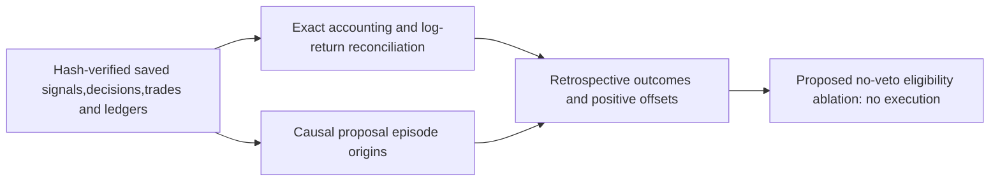

# Saved proposal decisions: exit losses, rebound misses and failed entries

Completed read-only diagnosis of C03 EMA200 and SMA200 proposals against their
unchanged incumbent at5/10bp. **Four saved comparisons,zero new financial runs.**
[GRS](../research-standard.md) owns research acceptance; the
[C03 report](2026-10-28-proposal-c03.md) retains original financial authority.

## Finding and units

The largest net timing drag is **exit-origin missed participation**. C03's price
proposal vetoed the slower incumbent while it remained eligible. Extra-entry
losses and gains nearly offset before costs; those entries are not established
alpha. Both results persist at10bp and the SMA control has the same leading exit
weakness. This ranks the saved accounting contribution,not a causal estimate of
how much a hypothetical modified strategy would recover.

The following table uses **100×additive log-relative-wealth contributions**.
These are log points over the full2005–2025 sample,not annual return percentages.
Gross loss rows and their positive offsets illustrate both sides; do not sum
those rows again with the net subtotals. The five net rows reconcile to total.

| Observed-account attribution · EMA challenger vs incumbent |5bp|10bp|
| --- | --- | --- |
| Lost gains during exit-origin gaps | -224.4409 | -224.4472 |
| Losses avoided during those gaps | +198.1216 | +198.1318 |
| Net exit-origin market contribution | -26.3192 | -26.3153 |
| Losses during extra-entry gaps | -60.6268 | -60.6278 |
| Gains during extra-entry gaps | +57.9590 | +57.9581 |
| Net extra-entry market contribution | -2.6678 | -2.6697 |
| Commission + slippage + financing | -5.5979 | -11.2651 |
| Dividend contribution difference | -0.6305 | -0.6311 |
| Equal-proposal exposure/rounding residual | +0.0483 | +0.0473 |
| Total log-relative-wealth change | -35.1671 | -40.8339 |

Exit-origin net market contribution accounts for about74.8%/64.4% of the total
negative log gap at5/10bp; extra commission/slippage/financing accounts for
15.9%/27.6%. Those are signed accounting shares,not causal treatment effects.
Actual extra commission/slippage is26630.30/50596.85USD; financing is zero in
both saved paths. The entire observed terminal-equity gap is−515823.72/
−574834.88USD. Its dollar decomposition also reconciles,including holdings,
dividends,overnight/intraday moves and costs; dollars are affected by account
scale and compounding and are not labeled recoverable missed profit.

## Episode and rebound evidence

The EMA challenger has63 exit-origin and34 extra-entry disagreement episodes.
Proposal changes are88 entries/87 exits versus incumbent13/12; these are binary
proposal transitions,not the actual daily resizing order counts. Low gate caps
can make a proposal transition produce no order.

Worst EMA exit episode is2020-02-28–2020-03-03: net log contribution−0.06938 at5bp
including assigned actual cost differences. Other large exit episodes are
2007-08-15–2007-08-23 (−0.03253),2023-10-23–2023-11-03 (−0.03240),and
2025-03-11–2025-03-25 (−0.03173). Dates include the holding-leg/cost assignment
convention described below. Do not infer that these dates predict future exits.
Annual net relative gaps are concentrated particularly in2007,2018,2012,and2020
for EMA at5bp; the full21-year component distribution is in the receipt.

**Rebound misses overlap with premature exits.** The predefined descriptive
subset selects negative lower-exposure legs after a negative five-session close
return available at the preceding close. It totals−1.84274/−1.84279 log units for
EMA,already included in the gross harmful-exit/participation rows. Its much
larger magnitude than the net gap reflects many offsetting gains; it is never
added as another loss category. The label uses the realized next leg outcome
and therefore cannot serve as an earlier trading signal.

Forward21-session open-to-open price labels flag45of88 EMA proposal entries
followed by negative returns,and41of87 exits followed by positive returns.
Incumbent labels flag4of13 and7of12 respectively. SMA has32of72 and44of71.
All these windows mature in the saved sample. Windows overlap,proposals may
be blocked by the gate,and labels exclude dividends/costs: these are descriptive
counts,not independent observations,net trade wins/losses or predictive accuracy.

The SMA control's net exit-origin market contribution is−0.16422/−0.16419 log
units versus EMA−0.26319/−0.26315; SMA extra-entry contribution is+0.02139 at
both costs. SMA nevertheless trails the incumbent. These comparisons reinforce
preserving the incumbent's successful participation rather than choosing a faster
average from its retrospective best episodes.

## Method,checks and limitations

The design was fixed before diagnostic outcomes; a pre-outcome clarification
expanded rebound misses to include exit-driven gaps,with design-v0 retained.
No financial policy,positions,fills,prices or original artifact was regenerated.
The source manifest and all94 artifacts were verified before and after reads.

Each saved account's daily equity change reconciles to prior shares×overnight
move,current shares×intraday move,dividends and signed commission/slippage/
financing. Normalize each component by that account's preceding equity and use
an exact daily log link; linked differences sum to log(candidate ending wealth /
incumbent ending wealth). This distinguishes observed returns from account-scale
USD gaps. Reconciliation tolerances are1e-5USD and1e-10log units.

Episode origins use only current/prior binary proposals. A candidate exit while
incumbent stays long starts an exit-origin gap; an incumbent entry while candidate
stays flat starts a missed-entry gap. Extra candidate entry and incumbent-exit
origins are separate. Proposal-disagreement episodes continue across cap changes;
zero cap is enforced when reconciling intended targets. Intraday uses today's
execution proposal; overnight belongs to yesterday's holdings/proposal. A new
open exit cannot avoid the preceding overnight gap. Positive and negative market
legs receive their retrospective outcome labels within these causal origins.

Cost differences attach to current disagreement episode or the closing previous
episode; dividends attach to prior holdings' episode. Unassigned equal-proposal
costs/dividends and exposure/rounding effects remain explicit,not forced into an
exit label. Episode sums plus their recorded unassigned remainder reconcile to
the full account gap. No counterfactual cost-free path or causal Shapley treatment
was estimated. Labels and annual diagnostics are descriptive viewed-history
analysis,not untouched evaluation. Daily-close data cannot resolve intraday paths.

## Lesson and chosen next bounded experiment

**Preserve the incumbent's eligibility while testing extra participation
separately.** Removing a successful long position whenever price dips below an
average was the dominant observed net timing weakness; it is not evidence that
all exits should be delayed or risk controls weakened. Extra-entry timing was
slightly negative for EMA,so its usefulness remains a serious contrary result.

Choose a **no-veto proposal ablation**: prior-close `(EMA50>EMA200) OR
(close>EMA200)`,under the unchanged independent traffic-light cap. This union
preserves baseline eligibility; it can add early entries or retain positions
longer when baseline turns off. It is not honestly called an entry-only change.
An always-long proposal under the SAME gate is the simpler exposure control:
any improvement must beat a simpler policy rather than just more exposure.

Proposed C04 design (`../../.local/rsi-calmar-20261028/research/plans/proposal-c04.proposed.json`; private/local artifact, not published) is
**non-executable and authorizes zero financial attempts now**. A future separately
approved bounded study proposes six cases,one worker,zero retries,5/10bp and the
same costs/dates/accounting. Require≥10% netCalmar lift at both costs,no lower
CAGR,deeper daily-close DD,longer underwater sessions/days,or domination by the
gate-only control. No length/threshold sweep. Reconcile exact incumbent first,
qualify new frozen capture/source identities and no-go/prefix invariance,and stop
on integrity or budget failure. All2005–2025 data remains viewed development.

- [x] Freeze diagnostic scope,labels and zero-financial bound.
- [x] Verify saved artifacts and reconcile dollars,log contributions and cap/timing.
- [x] Report positive offsets,costs,rebound overlap,annual and episode concentration.
- [x] Preserve negative evidence and choose one non-executable next experiment.
- [ ] Separately authorize,qualify and freeze any future financial execution.

[Receipt](evidence/2026-10-28-proposal-decision-diagnosis.json) owns exact diagnostic
aggregates and provenance. Raw design,per-session attribution,all episode/action
labels and logs remain in `.local/proposal-decision-diagnosis-20261028-v2/` in the
isolated checkout. Source modules are uncommitted; no dependency installation,
services,MLflow import,broker access,orders,commit or publication occurred.

Qualification history: the first full check rejected an opaque dynamic import in the diagnostic helper. The original source,results and failure log were sealed in the initial directory; the corrected helper uses a statically checked import. A second read-only pass reproduced every result exactly across the same four saved comparisons. This engineering correction added zero financial runs and changed no label or economic rule.

Final verification:572 offline tests and full `make check` passed(exit0),including six synthetic diagnostic tests. Both analysis passes are identical; all267 financial artifacts and three original manifest hashes remain unchanged. Both leaderboard views retain61 rows with no financial score added or recalculated. Zero financial runs and no prior budget reopened.

The finalization assertion initially expected573 tests rather than the actual572. The count was corrected from the passing log; the assertion failure is retained in the raw bundle. No financial execution or result changed.

Later authorized follow-up: [C04 no-veto study](2026-10-28-no-veto-c04.md) executed the proposed mechanism under a NEW frozen budget. It failed the incumbent target; the earlier proposed-only design and zero-run diagnostic record remain historical and unchanged.
