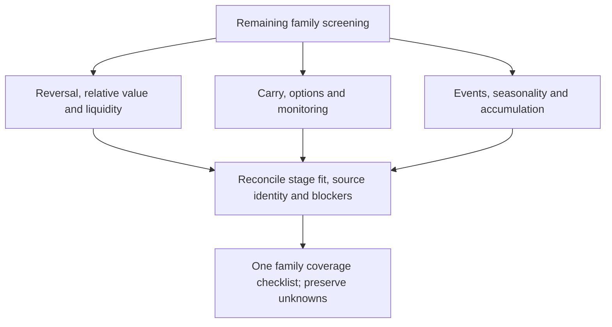

# Parallel QuantConnect component review — wave two

Status: completed representative screening, with held and unverified dispositions. This wave follows the [first review](2026-10-28-qc-parallel-review.md) and [stage-fit map](2026-10-28-qc-pipeline-stage-fit.md), under the [intake SOP](../research-intake.md) and [GRS](../research-standard.md). The [dispatch receipt](evidence/2026-10-28-qc-parallel-review-wave2.json) owns lane scopes, input identities and finite bounds. It does not reopen financial budgets or grant source reuse rights.

Each of three subsessions may review at most four representative groups in25minutes and ten web calls. No nested agents, financial simulations, dataset downloads, source exports, package/service changes or broker operations. Reports use separate owned files; parent reconciliation updates shared checklists after evidence arrives. A title-only record can receive a screened/blocked disposition but cannot count as a verified implementation.

- [x] Freeze remaining-family scopes and three disjoint review lanes.
- [x] Launch the three subsessions in parallel.
- [x] Validate source/evidence boundaries and immutable input hashes.
- [x] Reconcile family-to-stage mapping, uncertainty and overlaps.
- [x] Update the initiative checklist with actual coverage and remaining blockers.

Coverage refinement during dispatch: the original thirteen wave-one primary IDs carry seven distinct catalog-family tags; HMM discussed volatility without a volatility tag on that record. This leaves ten catalog families to disposition. The existing volatility-risk-premium options representative also covers the volatility family, with no new lane, representative or budget. Family tags remain hints, not verified mechanisms.

## Completed lanes and source findings

- [Reversal, relative value and liquidity](2026-10-28-qc-wave2-relative-components.md): four representatives, two web calls. Reversal/pairs contribute selection and position proposals; turnover liquidity is an alpha factor, not an execution model. Distance similarity does not establish cointegration. The copula article's pair identity is inconsistent; its model-family selection is not adaptive trading-policy selection. Existing negative pairs evidence is retained.
- [Carry, options, volatility and monitoring](2026-10-28-qc-wave2-carry-components.md): four representatives, four web calls. Forex rates are discontinued; commodity maturities and option-leg/expiry choices differ between descriptions and snippets. Option/volatility implementation remains held. Monitoring157 is inaccessible/title-only; generic logging documentation is separate supporting context.
- [Events, seasonality and passive allocation](2026-10-28-qc-wave2-event-components.md): four groups, four web calls. Earnings needs point-in-time quarter/release identities. Calendar exits need explicit sessions rather than callback counts. The expiry-week example trades OEF shares, not option contracts. Passive158 is inaccessible/title-only. DCA deposits require a separate cash-flow ledger and time-weighted/unitized return index before calculating Calmar.

Twelve distinct primary IDs were screened in wave two; combined with wave one this is25 primary IDs across24 representative groups. Source catalogs and prior outputs were preserved. No new financial cases or performance rows were generated. The options strategy has no cleared signed-leg contract; discussing it does not establish adoption or runnable payoff/accounting behavior.

## Family coverage checklist

The [CSV](../../research/catalogs/qc-family-coverage-v1/coverage.csv) and [JSON](../../research/catalogs/qc-family-coverage-v1/coverage.json) preserve candidate stage roles, primary IDs, family counts, blockers and report links. Counts overlap. A checked row means a representative **disposition exists**, including an explicit hold/title-only block; it does not mean every item in the family was source-reviewed or approved.

| Disposition recorded | Family | Catalog memberships | Candidate pipeline roles | Evidence / remaining blocker |
| --- | --- | --- | --- | --- |
| [x] | allocation_rotation | 203 | Target eligibility / allocation / risk sizing | Screened representative methods; runtime unqualified; Separate eligible-set renormalization and budget rules |
| [x] | carry_term_structure | 32 | Currency or contract ranking / proposal / funding-aware sizing | Screened representative methods; held for data/source contracts; Retired rate feed, roll/maturity ambiguities, individual contract chains and financing |
| [x] | earnings_event | 25 | As-of event feature / target score / proposal | Screened method and fragment; data blocked; Quarter identity, public/vendor release times, revisions and PIT eligibility |
| [x] | ensemble | 18 | Multiple proposals / fixed sleeve allocation | Prior scoped mechanism evidence; adaptive selector unverified; Exact shared-capital source/accounting; fixed combination is not policy selection |
| [x] | liquidity_microstructure | 25 | Turnover feature / target ranking / proposal | Screened representative method; execution interpretation corrected; Turnover units, PIT shares/universe and market impact; not an order-book execution model |
| [x] | machine_learning | 28 | Features / forecast-to-proposal; optional context only with explicit target | Screened representative methods; model/runtime unqualified; Return predictor differs from risk-state classifier; mature labels and chronological fitting |
| [x] | macro_sentiment | 125 | Optional market context / conditional allocation | Screened representative methods; data blocked; Discontinued proxy or sentiment-series identity and publication timing |
| [x] | mean_reversion | 121 | Target ranking / signed position proposal | Screened representative method; not runtime qualified; Historical universe, short availability, turnover and costs |
| [x] | momentum | 231 | Target ranking / position proposal | Screened representative methods; runtime unqualified; Original history/universe and MOM versus MOMP definitions unresolved |
| [x] | monitoring_framework | 10 | Observability across stages; no alpha score | Blocked: community representative title only; Exact source/rights inaccessible; generic logging docs do not verify listing157 |
| [x] | options | 19 | Signed-leg proposal / Greeks and margin / lifecycle accounting | Held: method and displayed snippet contradict; Option-leg directions and expiry policy unresolved; chains and assignment accounting unqualified |
| [x] | passive_accumulation | 5 | Baseline allocation / external cash-flow accounting | Blocked: community representative title only; Exact holdings/rebalance unknown; contributions separated using unitized/time-weighted returns |
| [x] | relative_value | 30 | Pair formation / spread proposal / multi-leg risk | Screened representative methods; identity ambiguity; Formation timing, pair identity, borrow and legs; similarity is not cointegration |
| [x] | seasonality | 24 | Calendar position proposal / explicit execution schedule | Screened methods; timing unqualified; Callbacks differ from sessions; 09:31 fills require appropriate data; expiry-week example trades OEF shares |
| [x] | trend | 159 | Position proposal / exposure eligibility | Screened representative methods; runtime unqualified; Trend filter is not broad-market forecast; leveraged path/accounting required |
| [x] | value_quality | 85 | Point-in-time score / target selection / proposal | Screened representative methods; data blocked; Historical fundamentals, revisions, universe and factor definition |
| [x] | volatility | 125 | Volatility feature / risk sizing or option-premium proposal; scope-specific | Held representative: contradictory option method; HMM identity remains separate; Variance state is not crash probability; exact option policy/source unresolved |

All17 family names now have a representative review/disposition; monitoring and passive accumulation remain title-only. The other families have differing method/fragment/prior-study evidence, not uniform qualification. The597 records outside the25 primary representatives have not been individually screened by these two waves. Related title leads and prior studies may add context but do not silently expand this denominator. Full O03 mechanism/duplicate/source contracts and O04/O05 rights/package gates remain partial.

## Next bounded work and remaining checklist

- [x] Complete the first family-level disposition pass across all17 catalog families.
- [ ] Resolve source contradictions and inaccessible representative packages, preserving both versions.
- [ ] Verify duplicate/variant groups by complete code and timing/accounting semantics; title matches are insufficient.
- [ ] Deep-review remaining records by evidence-driven priority; do not treat family inheritance as individual verification.
- [ ] Qualify inputs, local accounting and causal component contracts before assigning any new financial budget.

Recommendation: retain the wave-one zero-financial diagnostics as the near-term priority—saved SPY exposure-transition attribution and historical stock-selection readiness. A small independent engineering follow-up can specify month-turn session timing and audit log completeness. Fundamental, futures, FX and options financial studies stay held behind their data/source/accounting gaps. This is prioritization from the reviews, not a claim that price-only strategies will outperform or a new execution authorization.

Original GRS pipeline and the622-record stage-fit-v1 map remain unchanged. Family roles are proposed interpretations; no optional stage is made mandatory. The supporting master checklist has been updated with this pass's coverage and blockers without declaring O03/O04/O05 complete.

## Verification

Parent reconciliation verified dispatch input hashes, six agent report/receipt files, JSON parsing, all twelve wave-two IDs and the25-ID combined set against the622-record snapshot. Their catalog-family union matches all17 family names. Family CSV/JSON files include all17 once. Per-agent source/hash verification stays scoped to their receipts; current mutable web revisions and exact community identities remain unknown where declared. Documentation/link and scoped whitespace checks are recorded in the completion receipt. No full test suite or financial simulation was needed for this documentation-only intake wave.
