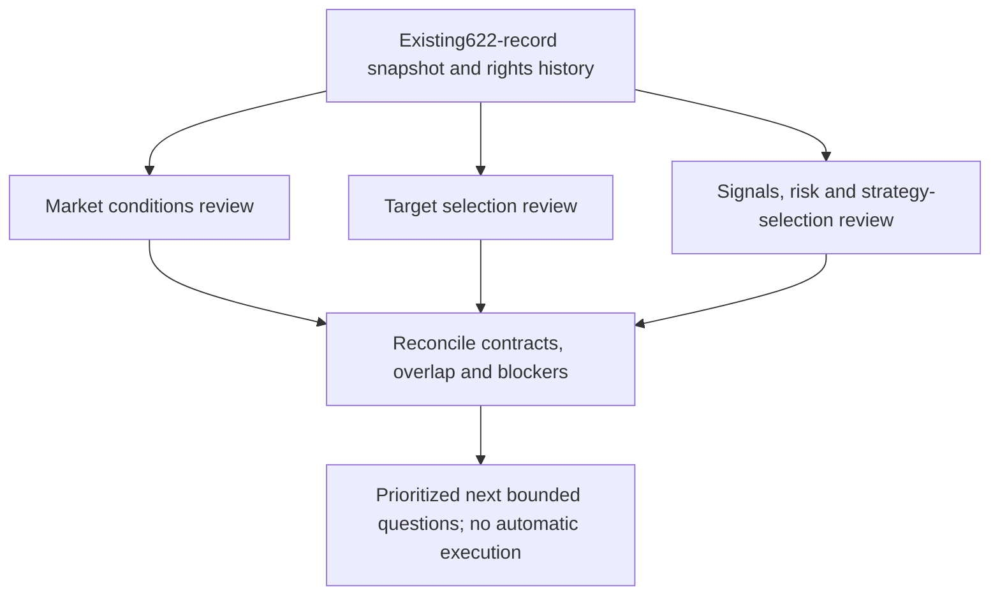

# Parallel QuantConnect component review — wave one

Three delegated subsessions completed under [research intake](../research-intake.md) and [GRS](../research-standard.md), following the [stage-fit review](2026-10-28-qc-pipeline-stage-fit.md). This is the first representative-family wave, not completion of all622 source reviews. The [dispatch receipt](evidence/2026-10-28-qc-parallel-review.json) freezes input identities, ownership and bounds. No financial or broker action is authorized by this review.

Each agent may review at most four representatives in25minutes, with at most eight web calls; zero nested agents, financial runs, dataset downloads, package installs, source exports or broker operations. Each owns a separate task and JSON receipt. Original catalog data and prior experiments are preserved. The parent reconciles findings and links the checklist after all three return; missing or failed reviews stay visible.

- [x] Freeze three disjoint review lanes and launch them in parallel.
- [x] Validate returned artifacts and source/evidence distinctions.
- [x] Reconcile stage contracts, conflicting suggestions, blockers and next priorities.
- [x] Update the master initiative checklist without declaring O03/O04 complete.

## Consolidated findings

All three subsessions completed within their assigned scope:12 representative groups spanning13 distinct primary catalog IDs, eight web calls in total, and zero financial runs, data downloads, source exports, package/service changes or broker operations. This does not complete the622-record code/rights/data review. Original inventory/mapping/package-review input hashes were rechecked unchanged.

| Subsession | Owned report | Main contribution | Key blocker |
| --- | --- | --- | --- |
| Market conditions | [Market review](2026-10-28-qc-market-components.md) | Broad-index trend context is distinct from instrument forecasts; HMM provides a variance-state hypothesis | Discontinued Wilshire input; retrospective HMM smoothing and sentiment-series identity need auditing |
| Target selection | [Target review](2026-10-28-qc-target-components.md) | Separate relative-strength ranks, absolute trend eligibility, universe selection and factor scores | Legacy dollar MOM versus current percentage MOMP; historical membership/fundamentals and source-version ambiguity |
| Proposal, risk and selection | [Policy review](2026-10-28-qc-policy-components.md) | Distinguish policy targets, fixed sleeve allocation, portfolio sizing and adaptive selection | No adaptive selector verified; local T11 inputs/accounting and ML label/training contracts unqualified |

### Reusable proposed contracts

- Market context: proxy identity, as-of timestamp, state/probability, fit cutoff, confidence/freshness and missing status. A proxy is not complete market breadth or a calibrated crash forecast.
- Target selector: permanent IDs, as-of eligible universe, score/rank, eligibility/exclusion reasons and next review time. Empty/unready is distinct from bearish.
- Position proposer: signed target, horizon, reason and decision availability. Predictor probabilities need an explicit policy mapping.
- Sleeve allocator: budget/netting/contribution contract. Fixed weights do not choose the best policy by regime.
- Risk/sizing: portfolio targets, gross/net and embedded leverage, concentration and limit reasons. A named defensive instrument is not universally protective.

These are design proposals, not installed common interfaces. GRS still owns the minimal pipeline; no additional stage is mandatory or adopted here.

### Next priorities and disagreement

The lanes agree on diagnosing saved evidence before adding model complexity. Their preferred first tasks differ by stage:

1. **Immediate policy/risk diagnostic:** attribute saved SPY continuous-versus-discrete exposure transitions, including protective cuts, missed rebounds and cash warnings. Market lane additionally asks whether simple broad-index context duplicates existing EMA/volatility information. Freeze retrospective outcome labels separately from causal inputs; zero financial runs.
2. **Independent target audit:** reconstruct saved stock-momentum eligible-fifty/top-five decisions, ranks, exclusions and point-in-time readiness. Stop with missing-field evidence if the saved bundle cannot support reconstruction. Current constituents cannot replace historical membership.
3. **Later:** after either audit establishes a specific mechanism and qualified inputs, freeze one stage change and its simpler controls in a new bounded experiment. Multi-ETF ranking, HMM or role-aware T11 gating remain candidates with named prerequisites; no new financial allocation is granted by this recommendation.

Prior negative baselines, T11 growth/recovery tradeoffs and the closed continuous-sizing failure remain in their original reports. No performance rows were added to the leaderboard because this intake wave generated no financial comparison. The master initiative retains partial O03/O04/O05 status; title matches and licensed fragments do not establish complete source equivalence or runtime readiness.

## Verification

The coordinating lane checked all frozen input hashes, six output files/JSON receipts, and all13 primary IDs against the622-record snapshot. Source/license and mechanism checks are scoped as declared by each agent, not an independent reimplementation. The [completion receipt](evidence/2026-10-28-qc-parallel-review.json) hashes each report and agent receipt. Documentation/link checks and a scoped whitespace check are recorded after reconciliation. No broad test suite or financial run is necessary for this document-only intake wave.
