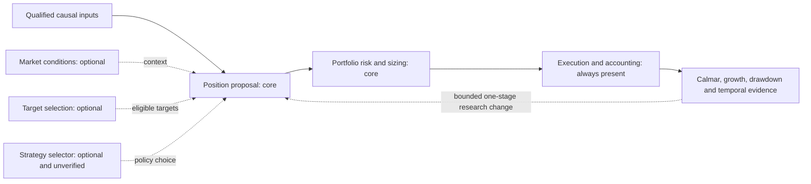

# QuantConnect strategy-to-pipeline review

Completed: provisional component mapping for the existing622-record snapshot, plus four targeted public method-description refinements. This is not a complete code, licensing, data or performance review of all QuantConnect strategies. The [master checklist](2026-10-26-quantconnect-research-master-plan.md) retains O00–O15 ownership; [GRS](../research-standard.md) owns pipeline stages and adoption. [Research intake](../research-intake.md) owns reuse rights. No financial runs, source exports, package installation or broker operations occurred.

## What already exists and what changed

The [frozen inventory](../../research/catalogs/qc-inventory-v1/catalog.json) contains540 community records and82 tutorials. Original family tags are overlapping and mostly provisional:473 classifications use titles,64 use public descriptions,3 use displayed-code inspection and82 use official index descriptions. These are source records, not622 unique implementations. Duplicates, variants and source equivalence remain unresolved.

This review preserves that inventory and adds a derived [622-row CSV](../../research/catalogs/qc-stage-fit-v1/mapping.csv), [machine-readable map](../../research/catalogs/qc-stage-fit-v1/mapping.json) and [verification receipt](evidence/2026-10-28-qc-pipeline-stage-fit.json). Every ID is retained once, with its original family/layer hints and the new stage-fit interpretation alongside them. Mapping does not promote a component or clear reuse rights. The public unauthenticated community URL returned an Algorithm Lab page, so this review does not claim a fresh enumeration of the live community catalog.

## Component view

A strategy can supply several components. Sector momentum, for example, can contain an ETF universe, a ranking signal, equal weights and a monthly rebalance schedule. Extracting its ranking requires a new contract and a matching control; it does not require importing its entire portfolio or switching every stage at once. An instrument trend filter is not necessarily a whole-market indicator. A return predictor is not automatically a risk classifier. An ensemble with fixed weights is not a learned strategy selector.

QuantConnect itself separates Universe Selection, Alpha, Portfolio Construction, Risk Management and Execution in its [Algorithm Framework](https://www.quantconnect.com/docs/v2/writing-algorithms/algorithm-framework/overview). Our optional market-context/strategy-selection components are project choices, not extra mandatory QuantConnect modules or a change to GRS.

## Representative component review

These entries are examples, not a claim of full source qualification. The [Strategy Library index](https://www.quantconnect.com/docs/v2/writing-algorithms/strategy-library) supplies method descriptions; our existing study receipts own local results.

| Candidate family / example | Candidate pipeline contribution | Useful output contract | Readiness / missing evidence |
| --- | --- | --- | --- |
| Momentum and State of Market Filters, QC-T-15357 | Optional market context + target ranking + proposal + allocation | Market-return state and eligible ranked stocks, each with as-of times | Public method reviewed. Broad-market12-month return gates stock momentum with Treasury fallback. Original Wilshire/FRED dataset is discontinued; substitution is an adaptation, not reproduction. |
| Asset Class Momentum, QC-T-15338 | Optional target selection + proposal + sizing | Ranked ETF set and relative weights | Official index reviewed; multi-ETF local actions/calendar/accounting still need qualification. Prior readiness failure remains. |
| Asset Class Trend Following, QC-T-15339 | Proposal + target eligibility + sizing | Trend-qualified ETF targets | Description-level lead; moving-average eligibility can be reused separately from equal weights. Exact package/data checks remain. |
| Sector Momentum, QC-T-15308 | Optional sector/target selection + proposal + sizing | Ranked sectors, intended holdings and rebalance date | Description reviewed; prior sector adaptation is not exact hosted-source reproduction. Compare with fixed universe/equal weights and original selector. |
| Fundamental factors / CAPM / G-Score | Optional target selection and/or proposal | Point-in-time scores and selected symbols | Existing CAPM adaptation is a negative baseline; G-Score input semantics blocked. Historical fundamentals, universe membership and delistings are prerequisites. |
| Mean reversion / pairs / Dual Thrust | Alternative position-proposal policies | Signed targets and holding/exit policy | Existing pairs and breakout adaptations failed scoped screens. Preserve those lessons; economic family membership does not make a new variant profitable. |
| Temporal CNN / boosting / Naive Bayes | Features or predicted-return proposal; possibly optional context if explicitly retrained for that target | Prediction, horizon, availability and uncertainty | A price-direction model does not already classify risk regimes. Needs mature labels, chronological fitting and incremental-value evidence. |
| Leveraged ETFs with Systematic Risk Management, QC-T-15351 | Proposal + risk/sizing | Trend-conditioned exposure budget | Official index reviewed; model-specific leverage paths and costs required. A leveraged product is not itself a sizing algorithm. |
| QC504 ensemble and variants | Multi-sleeve proposal/allocation; potential strategy-selection research lead | Sleeve targets, contributions and selection decision if present | Prior sleeve studies exist; source snapshot only provisionally tags selection. Fixed combinations do not prove adaptive selection. Verify exact source and rights. |
| Intraday arbitrage / execution examples | Proposal and possibly execution | Target deltas, order timing and fill assumptions | Daily OHLC cannot establish executable intraday arbitrage. Quotes, venue rules, spread and latency evidence needed. |

The source for the discontinued Wilshire dependency and method details is [Momentum and State of Market Filters](https://www.quantconnect.com/research/15357/momentum-and-state-of-market-filters/). It is an informative market-context example, but cannot be called ready to run unchanged.

## Coverage and interpretation

The derived hints map286 records to position proposal,199 to optional target selection and167 to risk/sizing. Ten have execution hints and six have unverified strategy-selection hints.203 remain unassessed from the existing layer hints. Four selected descriptions were refined; one explicitly reviewed broad-market context example is marked. Counts overlap and depend on what the old classifier detected: they do not establish the actual number of market classifiers, distinct algorithms or runnable modules in the catalog.

## Bounded review checklist and recommended sequence

- [x] Reconcile622 source IDs without changing the old inventory.
- [x] Preserve original classification basis and unknowns; generate stage-fit CSV/JSON.
- [x] Check current official framework/index documentation and four method leads; record the discontinued-input blocker.
- [ ] Review the mechanism and source of each remaining family representative; expand to its variants only after verifying shared structure.
- [ ] For each reusable component, record source revision/license, input/output fields, as-of time, horizon, missing-data behavior, costs and stage placement.
- [ ] Identify duplicates by code/mechanism rather than title; retain variants when timing, sizing or execution differs.
- [ ] Qualify free/local inputs and simpler controls before any separately bounded financial experiment.
- [ ] Evaluate one stage change against a frozen incumbent; keep failures and lessons on the single leaderboard.

First priority is extracting explainable price-based target-ranking or market-context ideas from the momentum/trend families, with the original strategy retained as a reference. This priority is a research judgment based on smaller input requirements, not a claim that those families have better returns. Data qualification still gates multi-asset work. Strategy selection comes later: it needs several independently qualified policies, comparable paths and causal allocation labels, rather than selecting the best backtest retrospectively.

For Calmar-oriented research, compare a new component with unchanged policy, simpler fixed allocation, and appropriate exposure/universe controls. Record annual and rolling behavior, drawdown depth, recovery and time underwater, turnover, costs and displaced returns. Calmar remains headline; integration requires the guardrails in the frozen cycle. Do not rerun failed baselines simply because their family appears in the map.

O03 remains partial and O04/O05 reuse gates remain open. This review creates no new experiment budget and does not reopen the closed Calmar epoch.

## First parallel representative review

The [three-lane wave-one review](2026-10-28-qc-parallel-review.md) is complete:12 representative groups across13 primary IDs, with source-version/data/causality blockers and proposed component contracts. This advances the representative-review checklist but does not complete every remaining family or source. The frozen622-row mapping remains unchanged; detailed lane reports are subsequent evidence, not silent upgrades to its provisional statuses.

## Remaining-family parallel review

The [wave-two review and family checklist](2026-10-28-qc-parallel-review-wave2.md) adds ten remaining catalog-family dispositions, including volatility through the existing option-premium representative. Across two waves, all17 families have candidate stage roles and an explicit representative evidence/blocked status;25 primary IDs were screened. This does not resolve the597 other records, complete source/licensing/data verification or O03 acceptance. The original622-row provisional map is preserved; the new family coverage CSV/JSON is a separate dated interpretation with its own receipt.
