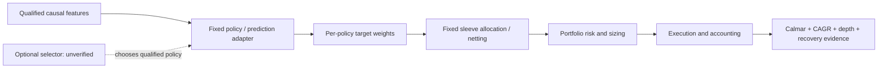

# QuantConnect policy, sizing and selector components

Completed a bounded research-only screen of **four representatives** from the existing 622-record inventory. These are component candidates, not approved modules or new performance results. [Intake](../research-intake.md) owns reuse rights; [GRS](../research-standard.md) owns stage adoption; the [stage-fit review](2026-10-28-qc-pipeline-stage-fit.md) and [master checklist](2026-10-26-quantconnect-research-master-plan.md) retain catalog/work-plan ownership. This receipt does not reopen any financial budget.

A **policy** proposes positions; **sleeve allocation** combines simultaneous target streams; a **strategy selector** changes which qualified policy/budget is active using information available at that decision. Fixed quarter budgets and retrospective annual winners do not establish a causal selector. QuantConnect's [framework overview](https://www.quantconnect.com/docs/v2/writing-algorithms/algorithm-framework/overview) provides useful separation between alpha, portfolio construction, risk management and execution. Our contracts below are proposed project interfaces, not claims about native upstream interfaces.

| Representative | Verified mechanism and stage fit | Proposed causal boundary | Reuse/readiness decision |
| --- | --- | --- | --- |
| **QC-T-15258 Dual Thrust**; related QC-C-12 | Public tutorial describes prior-range opening breakouts. Fits position proposal. Licensed FX alternative is not exact tutorial reproduction. | Prior completed OHLC and observed intraday bars → signed intent, bands and exit reason; next eligible fill follows decision availability. | Preserve licensed mechanism and existing negative causal SPY adaptation. No new unchanged replay or parameter search. |
| **QC-T-15351 Leveraged ETFs with Systematic Risk Management** | Public method rotates between SSO and SHY using SSO's 200-day SMA. Fits trend-conditioned proposal/exposure eligibility. An individual ETF filter is not a verified broad-market forecast. | Completed closes/action policy → ETF eligibility and reason; portfolio exposure budget remains separate. | Method inspiration screened; complete licensed source and local SSO/SHY inputs unqualified. Embedded leverage/accounting required. |
| **QC-C-504 Multi-Model Tactical ETF Rotation**, T10/T11/S2/S3 | Prior private evaluation established four quarter-budget sleeves. Fits multi-sleeve proposal and fixed allocation; does not establish learned strategy selection. | Sleeve targets/as-of times → allocated/net targets; preserve shared-capital order policy and log actual contributions separately. | Use prior lessons and conceptual decomposition. Full-source redistribution unknown; current public detail retrieval failed. T11 local qualification still blocked. |
| **QC-T-15263 Temporal CNN** | Public method predicts up/down/stationary movement from 15 OHLCV steps against a five-future-step target. Fits prediction feeding proposal. | Inputs available at decision → probabilities/horizon/model-fit cutoff; labels mature only after their future window. A separate rule maps forecasts to positions. | Not a red/green classifier or selector. No complete qualified licensed package, locked runtime or independently trained result. |

Public method sources: [Dual Thrust](https://www.quantconnect.com/research/15258/dual-thrust-trading-algorithm/), [leveraged ETF rotation](https://www.quantconnect.com/research/15351/leveraged-etfs-with-systematic-risk-management/), [Temporal CNN](https://www.quantconnect.com/research/15263/forecasting-stock-prices-using-a-temporal-cnn-model/). Their page revisions are unknown. Method descriptions support mechanism screening only; public performance displays were not used as our financial evidence.

## Rights, dependencies and duplicate checks

The unchanged local Dual Thrust alternative hashes to `58971b1adc9416803338f973a9064b8cfc813f7b8929c2eb9a27a927c2657555`, matching [je-suis-tm/quant-trading at611b73f2c3f577ac5b28aaa19ac8c43d3236c7a5](https://github.com/je-suis-tm/quant-trading/blob/611b73f2c3f577ac5b28aaa19ac8c43d3236c7a5/Dual%20Thrust%20backtest.py). Its Apache-2.0 grant does not license market data or neighboring unlicensed implementations. It imports NumPy/pandas/matplotlib, changes directory at top level, and lacks complete portfolio accounting. Never import it to inspect it. Its current-session range creates look-ahead at the opening decision; the existing separately named causal adaptation repairs that dependency. FX/session/five-day parameters differ from the tutorial's SPY/four-day example. Same-title community/tutorial records are not proven code duplicates.

The existing package receipt found no qualified complete licensed package for 15351 or 15263. The name-matched 15351 candidate's grant is unestablished. Historical SSO/SHY actions, calendars and executable timing remain unqualified. Model ETF daily-reset paths and fund expenses; do not double-count embedded leverage costs as broker debit financing. Treasury fallback carries its own price risk.

CNN dependency hints include TensorFlow/Keras, NumPy and scikit-learn; versions and current compatibility are unknown. Before modeling, audit label alignment, five-step maturity, chronological split boundaries and train-only preprocessing. Direction accuracy is not a loss-depth score or strategy-selection target. A new risk/selector label would be a separate research design.

QC504's prior inspected source was V1.1.0; upstream immutable commit is unknown. Prior [evaluation](2026-10-26-qc504-evaluation.md) owns source identity evidence; no full private source was newly exported. QC-C-529/755 are title-linked variants without code-equivalence proof. **All six selector hints**—429,504,529,698,755,769—are title-based and remain unverified as adaptive selectors. Fixed sleeve budgets can diversify or duplicate exposure; shared instruments and correlated losses need measurement.

## Existing counterevidence we must carry forward

- [Causal Dual Thrust adaptation](2026-10-26-dual-thrust-spy-comparison.md): its fixed SPY implementation failed the preregistered improvement screen. Preserve it as a negative baseline; do not conclude every breakout strategy failed. Intraday-short borrow/locates and source/vendor replay remain limitations.
- [QC504 sleeve ablation](2026-10-26-qc504-sleeve-ablation.md): standalone full-budget results were not within-ensemble P&L attribution; rejected orders and financing limitations confounded interpretation. Prefer the later qualified financing context when forming a new comparison.
- [T11 traffic-light transfer](2026-10-26-qc504-t11-gate.md): capped T11 Calmar 2.49 versus 2.33 ungated, but CAGR 92.03% versus 119.67%, drawdown 36.90% versus 51.26%, and longest underwater 199 versus 146 sessions. This is a historical tradeoff with no exposure-matched timing proof; suppressing inverse/volatility positions may matter but is not yet established causal attribution.
- Closed local Calmar epoch (`../../.local/rsi-calmar-20261028/docs/tasks/2026-10-28-calmar-rsi-epoch.md`; private/local artifact, not published): continuous sizing trailed discrete-gate Calmar by 11.89%/11.21% at 5/10 bp, with worse growth, depth and duration. No candidate promoted. Its missing per-attempt UTC timestamps are an execution-record limitation to repair before another financial runner version. This separate SPY result does not evaluate 15351 or reject all smooth sizing.

## Bounded next question and simpler controls

**Best immediate question:** using saved SPY decisions/outcome labels only, where did continuous sizing reduce exposure or restore it at disadvantageous times versus the discrete incumbent? Freeze the attribution taxonomy, read saved paths, preserve hashes and record ambiguous episodes. Labels are post-decision analysis, never inputs to those historical decisions. This needs **zero financial runs** and addresses an identified failure before choosing another stage change.

For subsequent component designs, controls should isolate mechanism: breakout versus matched intraday-long/SPY holding; ETF trend eligibility versus fixed SSO/SHY and unleveraged trend; T11 role-aware sizing versus ungated/blanket-cap and signal-independent exposure; CNN versus constant/linear forecasts and fixed EMA policy. Match dates, costs, financing and timing. A whole-period ex-post exposure match is descriptive, not an implementable policy. T11 role-aware gating remains interesting only after local multi-asset/accounting/rights qualification.

## Evidence and validation

[Machine receipt](evidence/2026-10-28-qc-policy-components.json) records exact IDs, input hashes, source URLs, rights/runtime blockers, proposed contracts and next gates. Inventory and mapping each contain 622 records; all four IDs occur once. The licensed source hash was checked; all local document links and JSON structure were checked. Public descriptions and the official framework were checked in two web calls; QC504 detail retrieval failed explicitly. No shared catalog, master checklist, frozen evidence or leaderboard was edited. No financial runs, dataset downloads, packages, services, broker operations or subagents. This is screening, not implementation or independent performance replication.
