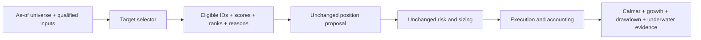

# QuantConnect target-selection component review

**Screened, not implemented:** four representative families, using five current official method pages and six previously captured licensed method files. No new code export, data acquisition or financial run. This is one parallel intake lane of the [pipeline review](2026-10-28-qc-pipeline-stage-fit.md), not a new experiment budget. [GRS](../research-standard.md) owns stage adoption; [intake](../research-intake.md) owns rights. The [receipt](evidence/2026-10-28-qc-target-components.json) pins reviewed local artifacts and findings.

The useful reusable unit is the **selector**, with allocation and execution kept separate. A top-ranked asset can still have negative momentum. Absolute trend eligibility and relative ranking answer different questions; neither is a whole-market risk classifier.

## Reviewed methods and source identities

| Family / exact records | Public method finding | Reusable role and disposition |
| --- | --- | --- |
| Sector momentum: QC-T-15308; community QC-C-19 is a title-related lead | Ten sector ETFs; strongest three by trailing twelve-month momentum; equal weights and monthly rotation. [Official method](https://www.quantconnect.com/research/15308/sector-momentum/) | Cross-sectional sector ranking. Screened for selector design; exact current source/runtime unverified. |
| Asset-class relative strength and trend: QC-T-15338 / QC-T-15339; community QC-C-18 / QC-C-17 | Momentum chooses three of five asset-class ETFs; trend uses price above a ten-month SMA and cash otherwise. [Momentum](https://www.quantconnect.com/research/15338/asset-class-momentum/), [trend](https://www.quantconnect.com/research/15339/asset-class-trend-following/) | Two distinct components: ranking and eligibility. Do not merge them into one change. |
| Stock momentum: QC-T-15364 | Price/fundamental filtering, largest fifty by capitalization, percentage momentum and monthly selection. [Official method](https://www.quantconnect.com/research/15364/momentum-effect-in-stocks/) | Historical-universe ranking; promising prior adaptation but local readiness blocked. Article alone does not establish the top-five count. |
| Fundamental ranking: QC-T-15370; community QC-C-15 is a title-related lead | Factor screening precedes a composite rank and top-twenty monthly portfolio. Four named factors conflict with later six-factor wording. [Official method](https://www.quantconnect.com/research/15370/stock-selection-strategy-based-on-fundamental-factors/) | Candidate factor-composition research. Hold implementation until factor identity/direction, fitting boundary and input semantics are fixed. |

The licensed reference is `QuantConnect/Tutorials` revision `4a341890296f7e79e095508f06170c72ccaa629c`, under its [Apache-2.0 license](https://github.com/QuantConnect/Tutorials/blob/4a341890296f7e79e095508f06170c72ccaa629c/LICENSE). Six saved method files were read and their SHA-256 values matched prior capture receipts. The receipt lists exact paths, Git blobs and hashes. These HTML methods are **not complete qualified implementation packages**. The four permitted packages in the [previous export review](2026-10-26-quantconnect-tutorial-packages.md) do not license unrelated embedded/current community code.

Version drift matters: the pinned momentum methods describe dollar-price differences/MOM; current stock and asset-class pages describe percentage momentum/MOMP. A common title therefore does not pin the economic signal. No embedded backtest or restricted source was extracted in this lane.

## Proposed causal component contracts

These are our proposed interfaces, not assertions about upstream implementation. All selectors return `decision_at`, `input_cutoff`, `universe_version`, permanent instrument ID, score, rank, eligibility, rejection reason and next review time. Weights belong to the unchanged downstream policy. Empty/unready is explicit and distinct from a bearish signal. Deterministic tie breaking and stale/missing behavior must be frozen before testing.

- **Sector ranking:** inputs are a dated fixed ETF universe, completed adjusted signal prices, raw execution prices/actions and a common calendar. Output ranked sectors/ETFs and readiness, without a market-red label. Freeze ETF inception rules, sector reorganizations and whether income is included in ranking. A current sector basket is not an immutable historical industry definition.
- **Asset-class ranking:** same contract across the selected ETFs, with no hidden absolute-return filter. **Trend eligibility** instead emits an independent eligible flag per instrument; specify monthly versus daily sampling, warmup and close-to-next-fill delay. Separately settle whether cash is retained per rejected asset or eligible assets are renormalized; the method description does not fully settle that portfolio rule.
- **Stock momentum:** dated historical eligible cohort, contemporaneous liquidity/price/cap fields and complete adjusted windows; output ranks for every eligible stock and exclusions. Preserve stable security identities through ticker changes/delistings. Current 500-stock membership cannot supply the historical selection universe.
- **Fundamental composition:** filing/vendor availability timestamps, fiscal period, restatement vintage, field units and missingness, plus a separate chronological factor-selection artifact. Output component ranks and combined score with factor-version identity. Fit factor choices/directions only before evaluation, with mature labels. Same-sample factor selection, selection of sign from outcomes and ambiguous four/six-factor instructions prevent a clean reproduction claim.

[Fundamental universes](https://www.quantconnect.com/docs/v2/writing-algorithms/universes/equity/fundamental-universes) and [corporate actions](https://www.quantconnect.com/docs/v2/writing-algorithms/securities/asset-classes/us-equity/corporate-actions) are relevant engine contracts. They do not independently qualify our local data or accounting. Explicitly audit action dates, dividend treatment and the normalization basis available at each decision; never execute on a completed close before its information is available.

## Free/local readiness and preserved counterevidence

Free hosted access is distinct from a qualified local dataset. The [data library](../data-library.md) records current-member bars, not historical membership or fully qualified actions. No new data-access probe was performed here. Existing source/coverage receipts remain authoritative; zero financial runs here does not update those entitlements.

- **Sector ETFs:** a prior hosted adaptation completed 2017–2025: momentum Calmar 0.459 versus equal-sector 0.320 and SPY 0.437, but CAGR 13.630% versus SPY 13.950%. Its longest underwater spell was 195 sessions versus SPY 488, while total underwater fraction was higher. This is a risk/return tradeoff, not universal dominance. [Original study](2026-10-25-sector-momentum-comparison.md) owns assumptions and limits. Local multi-ETF price/action/accounting qualification remains open.
- **Asset-class momentum:** prior source-informed 2020–2025 adaptation returned CAGR 6.01%, Calmar 0.23, longest underwater 802 sessions; matched SPY was 13.62%, 0.46 and 488. Missing-readiness periods and legacy/current differences remain. [Five-case study](2026-10-26-qc-selection-comparison.md) does not reject every trend/relative-strength variant.
- **Stock momentum:** that study's adaptation achieved CAGR 28.78%, Calmar 0.97, but longest underwater 585 sessions versus SPY 488. Later readiness repair and [sector-matched study](2026-10-26-sector-matched.md) produced original Calmar 0.9986, cap 0.9622 and target-exposure control 0.8980. The cap helped versus its matched control but not original; historical sector labels were conditional filing-based inferences. Preserve these costs of concentration control.
- **Fundamentals:** no exact QC-T-15370 reproduction is claimed. CAPM is a separate negative selection baseline; [G-Score](2026-10-26-gscore-spy-comparison.md) is blocked by retired quarterly API and historical timing semantics, with zero financial cases. Neither result directly tests this four-factor method. Qualified local point-in-time fundamentals are not established.

These studies use differing dates, capital and models and cannot be ranked against each other as one economic context. Their original reports preserve metrics, costs, failures and censoring. No headline upstream performance was independently reproduced in this review.

## Overlap, controls and next question

Sector and asset-class momentum share a relative-ranking template but have different opportunity sets; stock momentum adds a dynamic point-in-time universe. Trend eligibility is an absolute filter, and fundamental ranking is a different information source. Community/tutorial title pairs are **possible relatives, not verified code duplicates**. No complete-source hash pair or code-equivalence claim was established. An external backtest link is not pinned by the method-repository commit.

For a future one-stage test, use the same eligible cohort, downstream sizing, execution, dates and costs. Include unchanged selector, equal-weight full eligible universe, and a predeclared signal-independent selection/allocation control. For a trend filter, include a causal fixed-exposure control; do not match exposure using the future realized path. Compare Calmar with CAGR, drawdown, longest underwater duration/fraction, terminal censoring, turnover, concentration and displacement of winners. Preserve failed controls.

**Recommended next bounded question: can the already-studied stock-momentum selector be reconstructed from saved monthly selection evidence with complete as-of readiness, before changing any signal?** Start with zero financial runs: reconcile each decision's eligible fifty, selected five, ranks, exclusions and timestamp provenance against frozen source identities. If only aggregate snapshots are saved, record the exact missing fields and stop; do not fabricate historical fundamentals or silently fall back to today's constituents. This resolves whether apparent outperformance rests on correct opportunity sets. Price-only multi-ETF ranking is the smaller subsequent alternative once local actions and accounting qualify. Fundamental model search is lower priority until point-in-time inputs and the source inconsistency are resolved.

## Validation and limits

Reviewed the 622-row mapping and original inventory; examined current official methods in three web-tool calls; verified six licensed-file hashes against existing receipts; read prior positive/negative study records. JSON parses and its reviewed-file hashes are checked. No suite was run for this documentation-only slice, and no claim of runnable component adoption follows. This review writes only its task and receipt; shared catalog/checklist changes belong to the coordinating lane.
