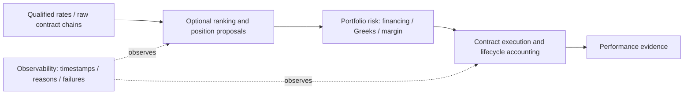

# Wave2: carry, options and monitoring components

**Four representative records reviewed; no financial runs or performance reproduction.** Coverage is partial: carry/term structure, options and cross-cutting volatility have public method evidence; monitoring157 remains title-only. Volatility is screened through the existing15382card, which retains its carry/options/volatility tags and is held because method and snippet conflict. This adds no representative or execution budget. This follows [intake](../research-intake.md) and [GRS](../research-standard.md), builds on the [market-context lane](2026-10-28-qc-market-components.md), and preserves overlapping inventory tags and previous evidence. It does not change the master checklist or source catalog.

| Representative | Pipeline fit | Current result / simplest useful control |
| --- | --- | --- |
| QC-T-15264 Forex Carry Trade | Currency selection + proposal; financing always explicit | Original rate feed discontinued; spot-only versus complete-carry accounting diagnostic, fixed basket control. |
| QC-T-15372 Term Structure Effect in Commodities | Contract-curve ranking + proposal | Prose/code disagree on selected maturities; fixed basket with identical roll/contract choices. |
| QC-T-15382 Volatility Risk Premium Effect | Multi-leg option proposal requiring portfolio Greeks/margin | Material order-direction and expiry conflicts; no implementation adoption. |
| QC-C-157 Futures Price Monitoring and Reporting Framework | Possible observability, not alpha | Exact listing inaccessible; inspect existing local logs and metadata fixtures instead. |

## Carry is not spot price return

The [forex method](https://www.quantconnect.com/research/15264/forex-carry-trade/) ranks currencies by central-bank rates, rebalancing monthly, and explicitly says its original Nasdaq Data Link rate data ended2016. Pinned legacy snippets use Quandl. They do not establish complete financing or source compatibility. A causal interface needs rate publication time, pair orientation, exposure direction, settlement calendar and funding-model identity. Inference for our design: a spot implementation needs actual cash interest/funding or broker rollover; a forward implementation needs dated forward quotes/points and settlement. Do not accrue the same carry twice or substitute a policy-rate spread for an executable forward price. Current free/local rates, quotes and accrual inputs remain unqualified. The [San Francisco Fed discussion](https://www.frbsf.org/research-and-insights/publications/economic-letter/2006/11/interest-rates-carry-trades-and-exchange-rate-movements/) provides economic background; it is not this implementation's evidence.

## A futures curve needs individual contracts

The [commodity method](https://www.quantconnect.com/research/15372/term-structure-effect-in-commodities/) ranks an annualized log-price slope for monthly long/short selection. Prose says use the firsttwo maturities, but code chooses first/last and trades the second contract. Freeze those identities before comparison. Require co-observed raw quotes, expiries, multipliers, currencies, bid/ask, roll rules and delivery cutoffs; logs cannot use nonpositive prices without an explicitly different signal. Qualified historical chains and variation-margin accounting are absent. [Official futures documentation](https://www.quantconnect.com/docs/v2/writing-algorithms/universes/futures) distinguishes adjusted continuous signals from raw mapped/tradable contracts. A stitched series cannot reconstruct simultaneous near/far prices. Fixed basket and equal-gross controls need the same contract and roll choices, including roll costs, margin changes and currency conversion.

## Option source intent is currently contradictory

The [volatility-premium method](https://www.quantconnect.com/research/15382/volatility-risk-premium-effect/) describes selling an ATMstraddle and buying a15%OTMput, but the displayed snippet buys the straddle and sells the put. Current expiry selection uses nearest within0–31days; the pinned fragment uses25–35days and closest30. These differences change risk and prevent claiming exact reproduction. Complete historical chains, timestamped executable bid/ask, contract adjustments and lifecycle accounting are unqualified locally. The intended protectiveput limits the far-downside tail after its strike; an uncovered shortcall still has unbounded upside loss. [Short-straddle documentation](https://www.quantconnect.com/docs/v2/writing-algorithms/trading-and-orders/option-strategies/short-straddle) supports the call-tail/assignment concern. A future portfolio contract needs signed legs, multiplier, cash debit/credit, delta/gamma/vega/theta, margin, assignment/exercise and resulting stock-financing behavior. [Pricing documentation](https://www.quantconnect.com/docs/v2/writing-algorithms/reality-modeling/options-models/pricing) distinguishes previous-day universeGreeks from model-derived data-eventGreeks: preserve availability and model version. Payoff diagrams alone do not establish fills, interim equity or Calmar. No expiry-week equity strategy is relabeled as option trading merely from its timing theme.

## Monitoring is supporting infrastructure

The [157 listing](https://www.quantconnect.com/strategies/157/) was inaccessible via the current web tool. Its inventory title is the only exact-listing evidence; code identity, rights and behavior remain unknown. [Official logging guidance](https://www.quantconnect.com/docs/v2/writing-algorithms/logging) supplies generic capability reference, not verification of157. A reusable local contract would append instrument/contract IDs, event and processing times, availability, run ID, decision reason, failures and bounded counters. Validate completeness, stale/missing events and ordering; no return score applies. Respect dataset restrictions in [official security/IP guidance](https://www.quantconnect.com/docs/v2/cloud-platform/security-and-ip): a monitoring label does not authorize exporting restricted quotes or prices into cloudlogs. Existing local decision logs may already cover these requirements; source duplication remains unverified.

## Provenance, scope and next action

The [receipt](evidence/2026-10-28-qc-wave2-carry-components.json) retains all family tags, exact IDs, typed inputs/outputs, control candidates, blockers and source references. Three Apache2.0 method fragments from `QuantConnect/Tutorials` revision `4a341890296f7e79e095508f06170c72ccaa629c` were hash-verified. These are fragments, not qualified complete packages; existing candidate-repository matches have no established applicable grant in the saved review. Source fragments, attached backtests, data and result rights stay separate. Mutable official pages have no pinned live revision here. Four web calls used; zero downloads, installations, services, brokers or simulations. Original inventories and earlier receipts preserved.

**Best next bounded task:** zero-financial gap analysis of existing decision logs against contract identity, freshness and lifecycle fields. Keep financial carry/options studies held until exact source ambiguities, free input coverage and accounting are resolved. Lesson: “carry” can mean rate accrual, curve slope or option risk premium; a shared family name does not supply interchangeable targets or execution models, and a monitoring framework does not supply alpha.
