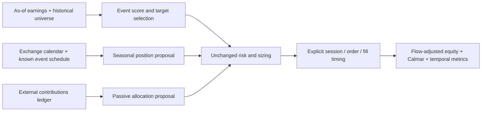

# Wave 2: earnings, seasonality and passive components

**Research-only screening:** four representative groups cover three requested families. Earnings and seasonality have description/licensed-fragment evidence; the passive community example remains title-only and unverified. No financial runs, downloads, exports, installations, services or broker operations. This follows [intake](../research-intake.md), [GRS](../research-standard.md), the [pipeline review](2026-10-28-qc-pipeline-stage-fit.md) and [wave-one target review](2026-10-28-qc-target-components.md). The [receipt](evidence/2026-10-28-qc-wave2-event-components.json) owns exact source/hash and usage records. This does not complete every record in these families.

## Family coverage

| Family | Representative group / IDs | Evidence and stage fit | Disposition |
| --- | --- | --- | --- |
| `earnings_event` | Standardized Unexpected Earnings, QC-T-15369 | Official method plus pinned licensed method fragment; earnings score → optional target selection / proposal | Screened; point-in-time EPS/universe and current field compatibility unverified; not executable-ready |
| `seasonality` | Turn of the Month in Equity Indexes, QC-T-15377 | Official method plus pinned licensed method fragment; calendar entry/exit proposal | Screened; callback-count and fill-time semantics need repair/qualification |
| `seasonality` | Option Expiration Week Effect, QC-T-15295 | Official method plus pinned licensed method fragment; expiry-calendar-conditioned equity proposal | Screened; option-calendar versus equity execution contract unverified |
| `passive_accumulation` | Static Equal-Weight Multi-Asset Buy-and-Hold, QC-C-158 | Frozen title only; current public URL failed in this review | Unverified; instruments, cash flows, rebalancing, source rights and exact implementation unknown |

### 1. Earnings: independently timestamp the information

The [SUE method](https://www.quantconnect.com/research/15369/standardized-unexpected-earnings/) ranks year-over-year quarterly EPS changes standardized by historical changes, selects the top 5% of an initial liquid thousand-stock cohort, and rebalances monthly following a 36-month warmup. The saved method appends EPS monthly, not only when a new distinct quarter arrives. Its current field access and statistical-window interpretation require verification; no current-engine probe occurred. The public historical Sharpe claim is not reproduced here.

**Proposed component contract:** permanent security ID, fiscal-quarter ID, original EPS value/vintage, public release timestamp, vendor-available timestamp, universe-as-of identity, score, denominator readiness, eligible rank and reason. Emit a score only after both availability gates, and orders only after the decision. Retain revisions as new versions; do not replace an earlier decision's value with a restatement. Release date, fiscal period end and filing date differ. Unknown before/after-close time prevents an exact event-time claim. Zero variance, stale repeated periods and insufficient distinct-quarter history must return unready, not infinity or zero-risk status.

Current [Morningstar migration documentation](https://www.quantconnect.com/docs/v2/writing-algorithms/universes/equity/morningstar-migration) says historical reporting dates and universe coverage changed, and some fields/periods are retired. Legacy ratio/per-share data could precede public filings. This compounds the prior [G-Score blocked-input lesson](2026-10-26-gscore-spy-comparison.md); it does not establish that SUE's specific EPS property is retired. Qualified local filing-time EPS, revisions, historical membership and delistings are absent from this review. Free hosted sample fundamentals or current-member stock prices are insufficient. Hold new earnings simulations pending those gates.

### 2. Month-turn: calendar proposal, not market-risk label

The [method](https://www.quantconnect.com/research/15377/turn-of-the-month-in-equity-indexes/) buys SPY at month-end shortly after open and later exits using an invested callback counter. The descriptive three-trading-day interval is not an exact fill contract: `OnData` increments are data events, so changing resolution can change holding time. No minute-resolution implementation or timing parity was verified.

**Proposed contract:** calendar revision, symbol/session ID, decision time, explicit entry order deadline/fill convention, exit session and order type. Count exchange sessions independently of callbacks. Freeze holiday/early-close/DST rules, missing observations and whether a month-end open or prior close begins exposure. Daily close-only inputs cannot reproduce a 09:31 market fill. If a daily open/close adaptation is chosen later, name it separately and retain the method as reference. Overnight returns must come from the specified close-to-next-open interval with split/dividend treatment, not a daily close-to-close proxy. [Scheduled-event documentation](https://www.quantconnect.com/docs/v2/writing-algorithms/scheduled-events) explicitly warns about stale intraday fills from daily subscriptions.

### 3. Expiry week: an equity timing strategy

The [expiry-week method](https://www.quantconnect.com/research/15295/option-expiration-week-effect/) trades OEF shares, consults option expiration/calendar information, enters in the relevant Monday week and exits on the expiration date. Its saved fragment liquidates in `OnData` when that date matches; it does not establish a close-of-expiration fill. This is **not option-premium trading**. The catalog's `options` family hint must not imply option positions, Greeks, assignment returns or option-chain execution performance.

**Proposed contract:** exchange-published expiration schedule as known before the decision; standard monthly versus weekly/other-series convention; holiday adjustment; corresponding OEF sessions; explicit entry/exit deadlines and latest data timestamps. Monday holidays need a frozen rule. A dated calendar can support a named calendar-only adaptation, but cannot silently replace the original subscription/expiry-selection semantics. Current option listings are not historical chain membership. OEF price/actions and minute timing are not locally qualified here. No option-chain purchase or download is needed merely to discuss the idea.

### 4. Passive allocation and contributions need separate ledgers

[QC-C-158](https://www.quantconnect.com/strategies/158/) was inaccessible through the public tool. The frozen inventory contains only title-based classification and no verified mechanism. We cannot infer its asset list, maintenance rebalances, leverage, deposits or fees from “static” and “equal-weight.” No general buy-and-hold documentation proves this community source. Its reuse rights and complete source identity remain unknown.

As an independent design reference, QuantConnect's [cashbook DCA example](https://www.quantconnect.com/docs/v2/writing-algorithms/portfolio/cashbook) adds simulated cash on a schedule and buys SPY. This documents a possible contribution mechanism, not QC-C-158 or QC-C-97. Our proposed allocation interface separates fixed policy weights and allowed rebalance actions from an external-cash-flow ledger containing time, currency, amount and source classification. DCA funded from initial cash and DCA funded by later deposits are different experiments.

Evaluate manager returns on a unitized/time-weighted equity index that removes external flows at their actual times; compound subperiod returns between flows. Compute CAGR, drawdown, Calmar and underwater duration from that return index, not deposited account value. Report contributions, investor wealth and optionally money-weighted return separately. A deposit is neither trading profit nor recovery from drawdown. Cash interest, cash drag and funding availability need explicit treatment. A contribution-matched passive benchmark gets identical deposits at identical times; a lump-sum comparator must disclose earlier capital availability. No claim is made that existing runners correctly implement every flow convention.

## Source rights, overlap and prior evidence

Three saved method files were read, hashed and matched against prior receipts at `QuantConnect/Tutorials` revision `4a341890296f7e79e095508f06170c72ccaa629c`; exact paths/Git blobs/SHA-256 are in this lane's receipt. The Apache-2.0 grant covers those reference files, not externally linked backtests or all community source. No complete licensed implementation package for these representatives was qualified. Original files and failures remain unchanged.

Calendar effects share sparse exposure but differ in event definition and holding interval; this is economic overlap, not verified source duplication. SUE overlaps stock ranking by interface, but uses different causal inputs. Passive allocation is a useful simpler control and may have no predictive signal. No complete-code identity comparison occurred. Wave-one stock/sector findings cannot validate earnings or seasonality. No scoped earnings/seasonality performance was reproduced in this lane; prior suite results, if any, retain their own evidence and cannot be assumed equivalent by title.

## Controls and next bounded question

Future studies require a new frozen single-change plan. SUE needs same eligible cohort/equal-weight control, price-momentum comparator, release-timing stress and chronological selection boundaries. Seasonal signals need entry-only buy-and-hold plus a predeclared calendar-independent exposure control, identical execution/costs and turnover accounting. Passive/DCA needs identical contribution flows, costs and availability. Report net Calmar beside CAGR, DD, underwater fraction/duration/censoring, exposure and annual outcomes; do not improve Calmar by injecting cash into NAV.

**Prioritize a zero-financial month-turn timing contract:** using saved calendar metadata and synthetic event traces, establish exact session transitions for ordinary, holiday and early-close month ends, and prove resolution-independent exits without stale fills. This is a prerequisite proposal, not a test performed here or an authorized financial budget. It has lower new-data requirements than SUE. If a later daily-data adaptation is tested, keep it separate from the original intraday claim and preserve all controls.

## Actual review and validation

Four web-tool calls reviewed three official methods and official scheduling, cashbook and migration documentation. Two URL probes failed (community158 and a guessed migration-forum slug); neither was retried through restricted interfaces. Three licensed method files matched frozen hashes; receipt JSON, input hashes, local links and whitespace checked. No full suite was run for this documentation-only lane. Only this task and its JSON receipt were written; shared catalog/checklist reconciliation belongs to the coordinator.
