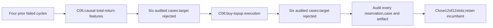

# RSI Calmar epoch2: bounded research closure

Status: complete bounded research epoch; no qualifying improvement. Two distinct
one-stage cycles completed,twelve unique financial cases consumed all allotted
slots,and neither challenger met the frozen joint improvement target. Incumbent
unchanged. [Mandate](../goals.md) owns objectives; [GRS](../research-standard.md)
owns evidence and disposition. No financial alpha or independent validation was
established. The completion audit verifies every requirement; no research work remains in this bounded epoch.

## Original goal and fixed bounds

Immutable epoch contract (`../../.local/rsi-calmar-20261028/research/plans/rsi-epoch2-20261028.json`; private/local artifact, not published) was created
2026-10-28T20:38:05Z with absolute deadline2026-10-28T23:38:05Z. It was not reset
by continuations or the interrupted turn. Maximum TWO cycles,TWELVE financial
attempts including failures,one worker,zero automatic retries,300seconds/case
and1800seconds financial wall per cycle. Every real case and cycle completed
inside these bounds. Guard-only requests for a third cycle and thirteenth
attempt reject without a launch or a new journal decision.

Seek≥10% netCalmar improvement at BOTH5/10bp versus the exact same-context
discrete EMA/volatility incumbent,with no lower CAGR,deeper daily-close drawdown,
longer underwater sessions/calendar days,or simpler-control domination. Same
2005–2025,2004warmup,300000USD,raw fills,whole shares,ex-date cash dividends,
$1commission,6%debit and zero cash interest. All history is viewed development.
The annual-doubling aspiration was never treated as an achieved or required result.

The contract's original `status:active` is immutable creation metadata; current
closure belongs to this task,mutable epoch state and the terminal receipt.
Completed research can honestly conclude with no improvement; this does not
redefine negative financial findings as successful strategies.

## Results and lessons

[C05 total-return feature representation](2026-10-28-total-return-c05.md) qualified
a causal dividend-consistent feature index while leaving fills/cash accounting
unchanged. Full-transform Calmar0.439857/0.433653 trails incumbent0.491514/
0.481692; CAGR,depth and recovery worsen,and eligibility-only partial control
dominates full transform. Six cases completed,audits passed,fixed target rejected.
Lesson: sound feature arithmetic does not automatically improve a fixed policy.
It also does not justify preferring distorted data solely because it backtests
better; preserve the feature-consistency question and the negative evidence.

[C06 execution/rebalancing](2026-10-28-execution-c06.md) preserved every signal
and intended risk target,while allowing discretionary buy-topups monthly versus
a daily incumbent and no-topup control. Monthly Calmar0.491462/0.481810 changes
−0.0106%/+0.0245%,far below+10%,and CAGR dips. Drawdown improves slightly and
underwater duration is unchanged. Actual trades fall from967/976 to356/365,
with cost savings826.19/1019.08USD. Six cases completed and audited; target rejected.

No-topup control improves Calmar0.824%/0.874% but CAGR falls0.1112/0.1069points.
This is a small growth/downside tradeoff,not the campaign target or a new
financial incumbent. Lesson: reducing churn is useful engineering but these
savings did not establish a material investment edge. Do not tune month or
threshold choices from these outcomes to rescue the candidate.

The [single leaderboard](../leaderboard.md) retains every earlier metric/link
and adds twelve epoch rows,including repeated controls and unfavorable findings.
It now has75financial comparison rows plus4unranked outcomes,79total—not79unique
strategies. No row represents a simulated improvement that was not actually run.

## Actual execution,budget and recovery evidence

Shared ResearchController/EpochBudget journal reserved each slot BEFORE local
capture launch. The final audit maps12shared reservations to12unique children,
all exit0/statuscompleted/financialslots1. Both cycles are retired. All global
and local UTC reservation/intent/start/capture/finalization chains reconcile;
child intervals do not overlap. No retries,financial failures,unused slots or
remaining cycle slots. Both costs and all5283sessions match across cases.

Twelve independent Decimal account/conformance audits,252annual metric rows,
1056independent overall/annual metric comparisons,and twelve independent temporal
audits pass. Four fresh incumbent cases match original trades exactly and
ledgers within1e-7USD. Source/design/executable/qualification identities and
snapshots match; cases were frozen before their first shared reservation.
Completed-study cached verification produced zero new financial launches.

C06 parent driver exit1 is preserved separately from its six successful case
exits. A postseal naming bug tried to create C05's existing receipt filename;
exclusive-create protected the old evidence. Read-only recovery exported a NEW
C06 receipt,changed no journal event or original manifest,and ran no finance.
The frozen C06 driver still contains this defect; it was not repaired in place
or advertised as cleanly reusable. Future launcher reuse needs a new version
with unique per-cycle export names and integration qualification. Exact exception
UTC was not logged; no timestamp was fabricated. See the full C06 failure lesson.

## Completion evidence and checklist

[Final epoch receipt](evidence/2026-10-28-rsi-epoch2-final.json) owns terminal
counts,per-case UTC/evidence,guard rejections,scope checks and the completion audit.
[Startup/progress receipt](evidence/2026-10-28-rsi-epoch2.json) retains the earlier
qualification and links to final status. Machine plans and financial manifests
remain immutable; mutable state is `.local/rsi-epoch2-20261028/state.json`.
Actual journals—not declared state counters—establish usage.

- [x] Create bounded goal and preserve failed-cycle history.
- [x] Qualify free/local inputs and a different upstream feature representation.
- [x] Freeze C05 and enforce shared reservations,serial execution and deadline.
- [x] Execute/audit C05;reject fixed target and update leaderboard/lesson.
- [x] Freeze/independently qualify distinct C06 execution-stage change and control.
- [x] Execute/audit C06;preserve and recover parent export failure without finance.
- [x] Reconcile twelve attempts,two cycles,zero retries and zero unused slots.
- [x] Update one leaderboard,cycle register,lessons and current goal/status docs.
- [x] Pass final full checks,verify all preserved artifacts and prepare goal closure.

No paid/network data,credentials,broker/account operations,orders,services,
dependency installations,commits or publication. Source changes remain uncommitted
in the isolated checkout. No further financial execution is authorized under this
epoch. A later task must define new scope rather than extend exhausted bounds.

Final closure verified at2026-10-28T21:21:44.254615+00:00,before the original deadline. Full `make check` passed624offline tests(exit0); all549financial artifacts and original manifests match. Twelve fresh cases,zero financial retries/failures,one preserved/recovered postseal parent failure,zero unused slots. Every completion requirement is marked passed in the terminal receipt. Incumbent retained; the research target was not achieved. No further financial run or automatic extension follows.
