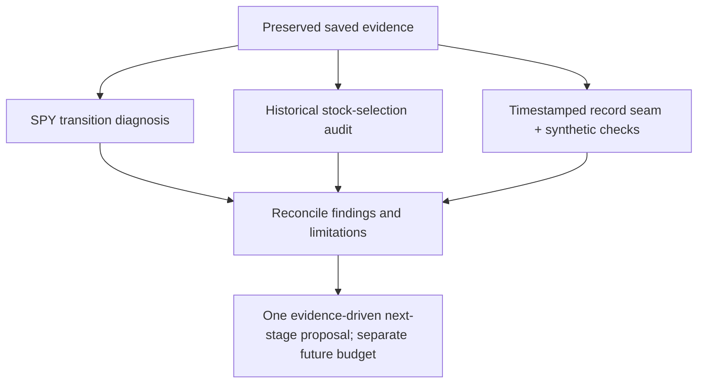

# Parallel RSI diagnosis and readiness wave

Status: completed with explicit data and integration blockers; incumbent unchanged. User authorized the three follow-ups recommended after the [QuantConnect family reviews](2026-10-28-qc-parallel-review-wave2.md). This is an offline diagnostic/infrastructure wave, not a strategy experiment, financial budget or broker operation. [GRS](../research-standard.md) and the [RSI SOP](../operations/recursive-research.md) retain authority. The [dispatch receipt](evidence/2026-10-28-rsi-readiness-wave.json) records input identities, ownership and limits.

- SPY lane: at most40minutes/eight logged analysis or check commands. Diagnose saved continuous/discrete paths at both fixed costs; reconcile accounting contributions, retain ambiguous causes and future labels as retrospective outcomes. No counterfactual simulations.
- Stock-selection lane: at most40minutes/eight logged analysis or check commands. Reconstruct one saved study context if possible; identify missing eligible cohorts, ranks, inputs and information times rather than importing today's universe or refreshing data.
- Record-hardening lane: at most45minutes/ten logged checks. Prefer existing execution-journal primitives; implement the smallest new future-runner seam and test UTC identities, failed/ambiguous restarts, duplicates and bounds synthetically. Preserve the frozen financial adapter and unsupported coordinator status.

All lanes use free/local files with zero network, financial runs, services, package installs or broker operations. New analysis/infra code is isolated under `.local/rsi-calmar-20261028` in disjoint paths; original study source/results and the primary dirty checkout's unrelated files are preserved. Each lane owns its own task/receipt and new private output directory. No promotion or Calmar improvement follows from these tasks alone.

- [x] Freeze disjoint lanes, inputs, resource limits and zero-financial boundary.
- [x] Launch three agents in parallel.
- [x] Review returned evidence, implementation and uncertainty.
- [x] Run relevant offline checks and verify original identities remain unchanged.
- [x] Reconcile the checklist, lessons and next eligible bounded task.

## Results

| Lane | Actual outcome | Evidence / next boundary |
| --- | --- | --- |
| [Saved SPY diagnosis](2026-10-28-spy-transition-diagnosis.md) | Exact observed wealth deficits of USD153,155.59/154,458.95 at5/10bp; most dollar difference is overnight P&L, not extra transaction costs | Account-scale attribution is not causal timing skill. Worst relative losses include March2020 when smooth exposure remained positive versus discrete zero. Relative-log identities also reconcile. |
| [Historical selector audit](2026-10-28-stock-selection-evidence-audit.md) |72 monthly chosen-five lists,360 picks and57 unique IDs preserved; exact eligible50/top5 reconstruction blocked | Missing full candidate lists, scores, input windows, exclusions and information timestamps. Feature hash covers ready IDs/date, not prices. Chosen-list intent replay is conditional, not independent selector or financial replay. |
| [Execution-record audit](2026-10-28-execution-record-hardening.md) | New read-only audit reuses existing durable journal;8 focused and546 full offline tests pass, with persistent synthetic failures/restarts | Implemented in isolated checkout only; no new launcher or financial adapter. Future direct-runner capture integration remains unimplemented and old missing timestamps remain missing. |

The SPY diagnosis also observes protective cuts and missed gains. It cannot identify warnings while already cash because the effective target drops the underlying colour/cap when EMA is flat. The1,019 shared EMA-ineligible cash sessions are not verified warnings. Source and output manifests are preserved; no new returns were added to the leaderboard because no financial policy was tested.

## Lessons and next bounded task

1. A smooth risk cap can remain exposed while a discrete no-go gate is flat. The evidence supports a new hypothesis—smooth sizing beneath the unchanged discrete ceiling—but does not establish that the combined policy wins. Displaced gains, growth and recovery remain guardrails; do not retune20% to this history.
2. Exporting selected names and hashes is insufficient for independent selection audit. A future log must retain as-of candidate/rejection sets, numeric scores and input/window/availability identity within data-rights constraints. Missing history cannot be reconstructed from a digest or today's constituents.
3. The durable execution lifecycle already exists in the coordinator. Audit/export hardening is implemented; reusing that capture in a future direct financial study is still a separate integration task. Synthetic audit success is not permission or evidence for a financial launch.

Recommended next work is a bounded **zero-financial direct-runner capture integration and decision-log contract**. It should use fixed fixtures, preserve UTC reservation/start/result and interrupted-state handling, and demonstrate the future adapter's exact seam before any separately frozen financial comparison. The selector input-archive blocker stays visible; no download or access upgrade is selected here. The stock audit can close with a blocked readiness result without claiming that the algorithm failed economically.

## Failures and final verification

Two technical failures were preserved: the SPY analyst initially ran with the wrong working directory, then reran the same read-only analysis from the proper evidence root; the stock auditor's eighth/final batch failed a whitespace assertion because `git diff --no-index` returned1 for differing files despite empty diagnostics. The parent did not authorize a ninth agent analysis command or rerun the stock audit. It preserved the returned files/journal, independently checked whitespace, rehashed239 original files and finalized documentation only. Neither action is a financial retry.

Parent `make check` in the isolated code checkout passed546 tests, documentation, dependency boundaries, evidence-index freshness and dependency consistency. Primary documentation/link checks passed152 files. Parent rechecked93 declared agent artifact hashes, all dispatch input identities, and new/reused infrastructure code hashes. Six focused saved-account analysis tests and eight lifecycle tests use synthetic fixtures only. Raw original study bundles, code, plans and results remain unchanged. No financial runs, network, package/service changes, broker operations, commits or publication occurred.

The [completion receipt](evidence/2026-10-28-rsi-readiness-wave.json) records output identities and preserved failures. Source code is uncommitted in the isolated `.local/rsi-calmar-20261028` checkout; this is not a merged-release or primary-checkout availability claim. Current GRS adoption rules and financial budgets remain unchanged.
