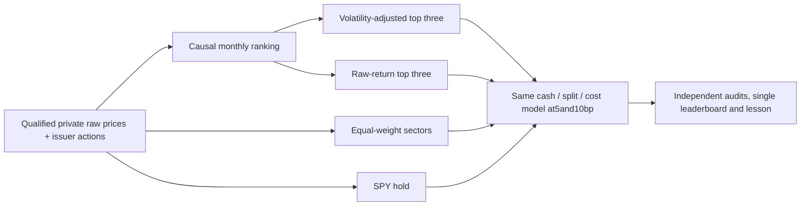

# Fresh bounded sector-selection comparison: issuer-v2

Status: eight cases completed and independently audited; joint target rejected.
All eight slots consumed, no retries or financial failures; terminal closure verified. [Input/accounting qualification](2026-10-28-sector-issuer-qualification.md)
resolves the preceding data task. [GRS](../research-standard.md) owns adoption,
[mandate](../goals.md) owns objectives and [scoring](../research-scoring.md) owns
metrics. This is prospective; it is not an executable machine-plan freeze.

## One question and fixed context

Does changing target ranking from raw252-session total return to that return
scaled by63-session annualized sample volatility improve portfolio Calmar?
One target-selection change; no cash veto, SPY risk gate, tuning, extra strategy
or leverage. Select three of XLB/XLE/XLF/XLI/XLK/XLP/XLRE/XLU/XLV/XLY; equal slots,
ascending-symbol tie break. Missing/zero/nonfinite required input stops execution,
rather than silently changing eligible assets. XLC stays excluded.

Fresh controls: raw-return top-three (scientific incumbent), monthly ten-sector
equal weight, SPY entry-only hold. Four policies at5/10bp adverse fills per side
plus USD1/nonzeroorder. USD300000,98%target allocation, whole shares, no borrowing,
zero cash interest; no tax, spread/impact calibration or liquidity-capacity claim.
A98%target is not a continuous exposure guarantee. Same ledger and timing for all.

Period2017-02-01–2025-12-31;2016–January2017warmup.2016has252observations, while
252-sessionreturn needs253closes. The first fully eligible common month-end is
2017-01-31. This availability-based date revision was made before portfolio
outcomes;2017annual result must be labeled partial. Old2017-01-03hosted summaries
are motivation only, not same-context controls. Old SPY-gate scores stay in their
original context. History is restated/viewed development, not protected OOS.

Monthly signals use completed month-end data available by the following New York
midnight. Next-session quantities must be based on prior completed marks/NAV;
actual opens only determine modeled fills/cash feasibility, not ranking or future
signals. Sell first, cash-feasible buys in deterministic symbol order, retain
unspent residual. Freeze precise affordability, cents rounding and order clipping
before any outcome. Same-day dividend payments enter closing cash; unpaid
receivables are not financing. All2016portfolios stay flat; noncash XLFwarmup
enters feature values only. Five2025splits change shares without artificial fills.

## Scientific decision and required outputs

Require at least10%net full-path Calmar gain at BOTH costs over fresh raw sector
momentum; no lower CAGR, deeper closing-NAV drawdown or longer longest underwater
sessions/calendar days; no simpler-control domination across primary measures.
Use unrounded Calmar,1e-9percentage-point tolerance for CAGR/DD and exact duration
counts. Undefined ratios remain null and cannot pass. Failed growth/risk guards
are explicit tradeoffs, not a quietly relaxed target. No annual-doubling claim.

Audit full/annual returns, DD, Sharpe, Calmar; longest underwater sessions/days,
underwater fraction and censored recoveries; rolling21/63/252-session returns and
worst losses; cash/receivables/positions/fees/NAV, turnover, costs and exposure;
monthly picks and contributions (including cash, fees, rounding and residuals).
Use the same initial-capital/annual-boundary/temporal conventions across cases.
Full Calmar is CAGR/full-path loss magnitude, not the mean of annual ratios.
Every actual financial case and failure gets evidence; update the one existing
leaderboard table only after audited results, preserving prior rows and contexts.
Close with an evidence-linked lesson even when the challenger is rejected.

## New bounds and execution prerequisites

New goal created2026-10-28T21:59:52Z; absolute deadline2026-10-29T01:15:00Z
(October28,6:15PM America/Los_Angeles). One study, one candidate, eight maximum
financial attempts including failures, one worker, zero retries.300seconds/case,
2400aggregate financial seconds. Previous feasibility stop branch stays closed;
these are newly authorized limits, not carryover.

Before any financial reservation: freeze exact private bundle plus source manifest,
code/dependencies/interpreter/config, chronology and evaluator; implement/freeze
a versioned runner with independent full account/metric replay; qualify unique
cycle-specific output and receipt paths. A bounded two-cycle synthetic lifecycle
proof must cover reserve, child, seal, retire, export and cached restart without
changing prior evidence. Default coordinator registry must not become a generic
financial launcher. Freeze one explicit adapter and at most six synthetic child
launches/120aggregate seconds, zero financial slots, for this engineering proof.

No further downloads, credentials, services, broker/order operations, paid inputs,
dependency changes, commits or publication. Stop on failed accounting, integrity,
controls, capture, deadline or eight-attempt exhaustion. No second candidate,
lookback rescue, hidden retry or automatic extension. No simulated improvement
can be promised. Native engine/broker parity remains outside this ledger study.

## Checklist

- [x] Resolve issuer payment dates, omissions, units and split evidence.
- [x] Verify data identities, scoped source use and synthetic accounting.
- [x] Create fresh goal, controls, strict criteria and finite new bounds.
- [x] Implement and qualify runner, independent audits and capture lifecycle.
- [x] Freeze executable machine plan; reserve before every case during execution.
- [x] Run/audit eight cases; all passed integrity/accounting checks.
- [x] Update canonical leaderboard and evidence-linked lessons.
- [x] Finish terminal preservation/closure audit and final offline checks.

## Execution qualification and immutable freeze

[Qualification receipt](evidence/2026-10-28-sector-execution-qualification.json)
binds the [executable plan](../../research/plans/sector-comparison-issuer-v2.frozen.json)
and private actual lifecycle proof.489offline tests passed, including eight
invented-price policy accounts with zero difference against independent Fraction
account and selection replay. Four actual synthetic children then qualified two
successful unique exports, a deliberate failure and forced timeout. Both negative
fixtures preserved partial artifacts and denied retries. Cached positive restarts
launched zero children and preserved all bytes. Shared six-launch budget recorded
fourchildren; two unused synthetic slots are retired, not available for finance.
No market portfolio was simulated in qualification. Default RSI registry unchanged.

The fixed child adapter uses a project ledger, separately implemented Fraction
replay, independently reconstructed rankings and independent full/annual/temporal
metrics. Each financial case must pass them before sealing. Runtime sources,
interpreter bytes, inputs, source evidence and evaluator are hash-bound; case
reservations precede actual Popen, stdout/stderr, UTC lifecycle and exits. The
single financial controller counts failures, forbids ambiguous restart and seals
a cycle-specific final receipt. No C05/C06filename is reused.

## Completed findings and lesson

[Completion receipt](evidence/2026-10-28-sector-comparison-issuer-v2.json) and
[negative-results technical report](2026-10-28-sector-selection-experience-report.md)
retain the favorable Calmar/growth/duration result and the failed joint screen.
Calmar rises18.03%/18.18%; at10bp DD29.67450%exceeds raw29.67088%, so strict joint
acceptance fails. Both5bp and10bp challenger durations are170sessions/248days,
versus raw301/439and307/448. The candidate is a research lead, not a new adopted
incumbent. No threshold is changed and no rescue variant follows.

Eight captures and independent audits completed,72annual rows,904independent
annual/full/rolling metric comparisons,zero account discrepancy,serial execution,
about29financial child seconds and0unused slots. Cached verification launches
zero cases; invalid ninth-case plan stops before journal mutation. Per-sector
contributions reconcile to NAV. All549prior financial artifacts are preserved.
The [one leaderboard](../leaderboard.md) retains79old rows and adds8new rows in
S2-5bp/S2-10bp contexts. Final checks and goal closure are recorded below when done.

## Verified closure

Bounded comparison complete; financial target rejected, incumbent unchanged.
Final `make check` passed489offline tests, documentation and scoped whitespace
checks passed, every financial/source hash matches, and all549prior artifacts
remain intact. All79old leaderboard rows are unchanged within the87row single
table. Original input snapshots and negative probes remain preserved. No finance
case was rerun; final cached verification and invalid ninth-case guard add zero
launches. All8slots are consumed; no work or automatic extension remains in this
study. The closure receipt records the exact UTC and dirty-checkout/source state.
