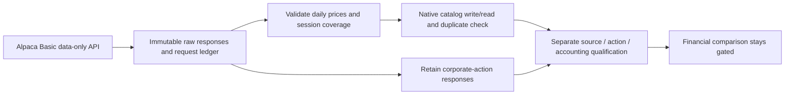

# Bounded free sector-ETF data acquisition

Status: bounded download complete; price structure/catalog verified, corporate
action completeness failed qualification. No financial comparison was run. User explicitly
requested a download after the [sector-selection study](2026-10-28-sector-selection-rsi.md)
was blocked. This newly authorized acquisition permits local credential use and
historical-data requests. It does not resume the blocked financial goal, change
its deadlines, authorize orders, or expand into paid data. The
[data library](../data-library.md) owns input policy and the acquisition procedure.

## Frozen acquisition scope

Plan (`../../.local/sector-acquisition-20261028/plan.json`; private/local artifact, not published) freezes collector,
helper/calendar/dependency/test identities before networking. New exclusive
dataset ID: `alpaca-sector-etfs-2016-2025-v1`. Ten fixed sector ETFs
XLB/XLE/XLF/XLI/XLK/XLP/XLRE/XLU/XLV/XLY plus SPY. Raw daily SIP OHLCV,
2016-01-01–2025-12-31, fixed symbol mapping as of2025-12-31. Corporate-action
query2016-01-01–2026-01-31 uses provider process dates, with all-quality records;
this buffer is not proof of complete ex-date coverage or original availability.

Maximum16aggregate requests including four official documents,50MB,600seconds,
one worker,zero retries; stop on transport/auth/schema/size/time failure and
preserve partial bytes. Neither existing stock/pilot collector supports this
full fixed scope, so the [new narrow collector](../../research/sector_etf_acquisition.py)
reuses their credential, calendar, validation and native catalog helpers. No
installed NautilusTrader/MLflow code or dependency versions changed.

The [Alpaca Basic documentation](https://docs.alpaca.markets/us/docs/about-market-data-api)
lists free US-stock/ETF historical access since2016. Its
[bars API](https://docs.alpaca.markets/us/reference/stockbars) distinguishes raw
and adjusted bars and paginates by total rows. The
[corporate-action API](https://docs.alpaca.markets/us/reference/corporateactions-1)
warns creation/availability can be delayed and filters by process date. These
are documentation observations, not proof of this account's endpoint entitlement.
The [official terms](https://files.alpaca.markets/disclosures/alpaca_terms_and_conditions.pdf)
describe personal/noncommercial use and additional agreements. Intended scope is
private personal research; no data redistribution or commercial-use grant is
inferred. Corporate-action completeness, rights qualification and historical
account parity remain separate gates.

## Evidence and validation

Raw/normalized data and native catalog stay in ignored `data/`; private logs and
the frozen plan stay under `.local/sector-acquisition-20261028/`. Credential values
are read only by the existing owner-only loader and never printed, included in
arguments or request receipts. Authentication is attached only to two fixed
`data.alpaca.markets` routes; redirects are refused, public document requests
have no keys. No trading/account/order API is called.

Ten new offline checks cover endpoint allowlisting, documentation credential
isolation, pagination, malformed responses, retained HTTP failures, exclusive
outputs, size/request/time caps and redirect refusal. Full `make check` passed
459tests before acquisition; its log is retained locally. Download, action audit,
catalog round-trip and later qualification findings must be recorded after the
process finishes; no financial performance result exists at this initial record.

## Completed result and remaining qualification

[Completion receipt](evidence/2026-10-28-sector-etf-acquisition.json) links the
private manifest, quality audit, method and frozen acquisition plan by hash.
Eight collector requests succeeded,5,176,145response bytes, within all frozen
limits; no retry. This count covers the collector's four document requests and
four data requests; browser-tool discovery was separate. Raw bytes are preserved.

Each of eleven ETFs has2514daily rows,2016-01-04–2025-12-31,27654total. Exact
calendar coverage, chronological timestamps, duplicate/finite-value/OHLC checks
passed. Native catalog write/read matched all values and instrument metadata;
repeat import was identical/read-only.33raw/catalog/normalized artifact hashes
were independently verified, plus collector/plan/helper/dependency identities.
The native catalog is `data/catalog/alpaca-sector-etfs-2016-2025-v1/`; the
manifest and audit live in `data/manifests/` and `data/quality/` with that ID.
All market data remains Git-ignored. No redistribution qualification is claimed.

The action response reported436cash distributions and5forward splits, with no
duplicate action IDs.160cash distributions lack payment dates. Against the
previously saved issuer SPY action history, the API omits2016-03-18and2018-06-15;
one matched SPY amount differs. Both sources remain unchanged, with exact joins
and discrepancies retained in the quality audit. This shows why a successful
price download cannot yet qualify total-return signals or cash accounting.
Same-date corrections and noncash events require a policy; all eleven ETFs need
issuer reconciliation. Native historical split/payment parity remains unverified.

The issuer's [split notice](https://www.ssga.com/library-content/products/fund-docs/etfs/us/information-schedules/ap-notice/notice-to-aps-stock-splits-11-21-25.pdf)
confirms the five named sectors changed share units effective2025-12-05; historical
raw-price trading cannot ignore those actions. Its
[XLF2016tax form](https://www.ssga.com/library-content/products/fund-docs/etfs/us/tax-documents/US-Form-8937-XLF-Signed-New.pdf)
identifies another event requiring explicit review. These web-reviewed references
are leads for reconciliation, not additional collector acquisitions or a complete
action dataset. No hand-edited correction or blended series was substituted.

The original goal stays blocked: its missing-price condition has progressed,
but action/source/accounting gates remain unpassed. This acquisition does not
replenish attempts, reset deadlines or establish a new incumbent. Next bounded
work is issuer action reconciliation and accounting qualification, not strategy
tuning. Acquisition is complete; financial eligibility is false.
