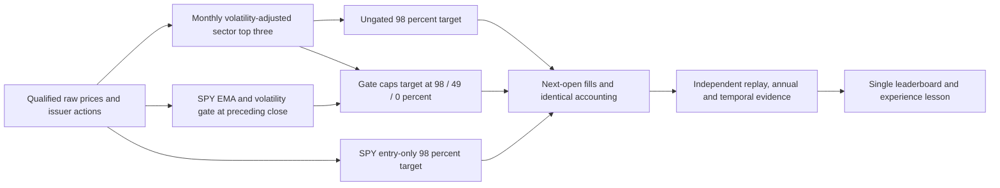

# Bounded sector momentum risk-gate overlay

Status: completed; six of six financial cases audited, joint target rejected at
both costs. Zero historical cases had launched at specification time. The [golden standard](../research-standard.md)
owns adoption, [scoring](../research-scoring.md) owns definitions, and the
[parent study](2026-10-28-sector-comparison-issuer-v2.md) remains frozen and closed.
This cycle changes risk/sizing only, not target ranking.

## Frozen question, rule and data

Can the retained EMA/volatility-only traffic-light gate improve Calmar by at least
10% at both costs versus ungated volatility-adjusted sector momentum, without
lower CAGR, deeper drawdown or longer underwater duration? Also report SPY and
reject strict dominance by that simpler control. Percentage-point comparison
roundoff tolerance is 1e-9; integer durations have no tolerance. This is a demanding
screen that can fail despite a useful individual risk benefit. A 30% drawdown is
a reported user preference, not a guaranteed gate ceiling or automatic pass.

Three policies at 5/10bp adverse fills per side plus USD1 per nonzero order:
`gate`, `vol`, `hold`. Same USD300000, zero cash yield, no shorting/borrowing,
no external financing charge; exact parent cash/dividend/split accounting.
Fresh controls must match saved parent ledger/trades exactly. Period2017-02-01–
2025-12-31, anchor2017-01-31, source warmup2016-01-04 onward. First year is partial.
Use only qualified private local Alpaca bars and reconciled issuer actions;
no network requests, new paid data, credentials, broker actions or imports.

Monthly selection: ten fixed sector ETFs, rank252-session economic total return
by63-session annualized sample volatility; equal top-three weights, symbol ties.
Retain the last monthly picks and scores between monthly closes, including while
in cash. No off-cycle reranking on reentry. Monthly selection updates even in red.

Gate: raw SPY closes, EMA50/EMA200 (adjust=False, min_periods50/200), rolling20-return
sample volatility annualized sqrt252. Red at volatility>=40%; yellow if fast<=slow
or volatility>=25%. Green otherwise. Enter red immediately. Leave red only after
five consecutive closes with volatility<35%, first to yellow. Leave yellow for
green after five further consecutive closes with fast>slow and volatility<20%.
A yellow condition cuts green immediately. Nonfinite warmup is unassessed, cap0;
first finite state initializes yellow. Caps green1/yellow.5/red0. The previously
removed price-peak/drawdown component stays disabled. No tuning or training.

Warmup starts at the first available 2016 bar, not the older SPY fixture's2004
seed. This explicitly versioned initialization is not an exact reproduction of
that older gate study. Gates use the preceding completed close; fills next open.
Rebalance at the first evaluation open, monthly, or on cap changes. Quantities use
prior-close NAV and raw marks, adjusted for known same-day splits, whole shares;
sell first, then lexicographic cash-feasible buys. Between such events, positions
drift: these are target caps, not continuous exposure limits. Red liquidates all
positions at the execution open; dividends already entitled remain receivables.

## Bounds and evidence

New budget: six financial attempts including failures, one worker, zero retries,
300seconds/case,1800aggregate child seconds; hard deadline2026-10-29T02:00:00UTC.
Any failure/integrity breach stops execution; no rerun of a failed financial case.
Synthetic lifecycle qualification is separate, maximum six child launches/120s,
planned four (two successes, failure, timeout). Failed probes are intentional
negative fixtures, preserved with logs. No financial study launches until the
exact source-bound synthetic qualification and frozen machine plan exist.

Artifacts: complete decision timelines, monthly picks, trades, raw cash/share/
receivable ledgers, per-asset contributions, actions, full/annual metrics,
underwater episodes,21/63/252-session returns, hashes, PID/timestamps/exits and
independent Fraction replay. No native NautilusTrader or broker parity claim.
Window is restated, already viewed development; no protected holdout, financial
alpha or trained ML/RL advantage is established. No automatic promotion.

## Checklist

- [x] Inspect retained gate, parent protocol and qualified local coverage.
- [x] Define one change, controls, strict criteria and finite bounds before outcomes.
- [x] Test causal gate, staged recovery, red exits and reentry on invented inputs.
- [x] Qualify capture failure/timeout/cache and freeze code, inputs and plan.
- [x] Run at most six captured historical cases and independently audit each.
- [x] Compare annual/temporal/cost results; preserve all failures and parent evidence.
- [x] Update single leaderboard, lesson and completion receipt; run offline checks.

## Completion and lesson

Calmar improves109.74%/108.15%, drawdown falls to12.475%/12.520%, CAGR falls
1.726/1.743pp and longest recovery grows130sessions/188days. No promotion.
[Paper-style lesson](2026-10-28-sector-gate-experience-report.md) and [receipt](evidence/2026-10-28-sector-gate-v1.json) preserve
the complete results, annual paths, failures and verification. All six slots used,
zero financial failures/retries; execution closed. Prior eight-case budget stays closed.
