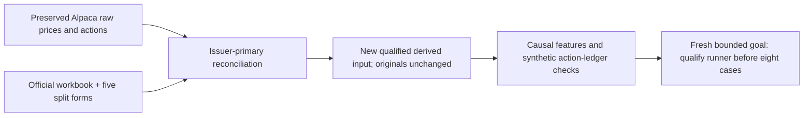

# Sector issuer reconciliation and accounting qualification

Status: issuer actions and scoped synthetic accounting verified; financial runner
qualification and comparison remain pending. [Evidence receipt](evidence/2026-10-28-sector-issuer-qualification.json)
links private source bytes, derived events, qualification bundle and all failures.
This follows the [free acquisition](2026-10-28-sector-etf-acquisition.md);
[data library](../data-library.md), [GRS](../research-standard.md) and the
[new comparison goal](2026-10-28-sector-comparison-issuer-v2.md) retain authority.

## Source evidence and resolved records

Retained the freely downloadable [issuer historical distributions workbook](https://www.ssga.com/library-content/products/fund-data/etfs/us/spdr-etf-historical-distributions.xlsx)
linked from its [distribution page](https://www.ssga.com/us/en/institutional/resources/documents/etf-dividend-distributions).
Verified its header, all eleven symbols/CUSIPs, unique ex-dates, positive cash
components and payment dates. Sum dividend and short/long capital-gain components;
do not ignore non-dividend cash. The original workbook and API responses are
immutable. The new derived action file is separate and hash-bound.

Result:442cash distributions,1typed in-kind event and5splits. Issuer dates fill
all160missing provider payment dates and restore11omitted distributions, including
SPY2016-03-18and2018-06-15. Three duplicate provider dates are consolidated under
issuer event identity; two provider payment-date conflicts use issuer dates.
Four provider amount differences are0.0000001USD/share precision discrepancies;
retain both values, use issuer amounts. No provider-only date remains unexplained.
One explicit zero XLRE2016-09-16row is preserved as a nonpayment exclusion.
Final derived cash records have no missing payment date.

Five downloaded issuer Form8937PDFs were rendered and visually reviewed for fund,
ticker, CUSIP, effective2025-12-05and2:1ratio. For example,
[Energy's form](https://www.ssga.com/library-content/products/fund-docs/etfs/us/tax-documents/us-tax-form-state-street-energy-select-sector-spdr-etf-2025.pdf).
All five agree with provider events; raw split-day open/previous-close ratios
also lie between0.4and0.6. Quantity doubles before that session's trading rather
than inventing a fill, fee or50%loss. This is a structural/action consistency
check, not an exact prediction of overnight economic returns.

XLF2016-09-19is0.139146XLREshares per XLF, not0.139146USDcash. The issuer workbook
and [tax form](https://www.ssga.com/library-content/products/fund-docs/etfs/us/tax-documents/US-Form-8937-XLF-Signed-New.pdf)
are retained; a [primary SEC filing](https://www.sec.gov/Archives/edgar/data/1419828/000110465916148813/a16-17821_38424b3.htm)
corroborates the share units. The latter is GS Finance's filing quoting SSGA,
not a fund-issuer filing. Its web-reader observation is labeled a derived source
review; a direct download403remains preserved. No challenge bypass occurred.

Warmup total-return features value this noncash entitlement using that day's XLRE
close. They do not use a later tax valuation as an ex-date cash dividend. No
portfolio holds2016positions in the proposed study. The account ledger rejects
held in-kind events; support for trading through arbitrary spinoffs is not claimed.

## Accounting model and actual validation

[Project action ledger](../../research/sector_corporate_actions.py) explicitly owns
this offline model. The existing native three-asset adapter rejects splits; it was
not modified. These results do not establish native engine/broker corporate-action
parity. The fresh study must use the declared project ledger consistently and
independently audit each historical account before comparing performance.

Entitlement uses shares owned before ex-date open, with supported split adjustment
first. Selling on ex-date retains the receivable; buying that day does not create
one. Unpaid receivables enter NAV but never buying power. Payments due before a
session enter opening cash; same-day payments enter at close, conservatively
preventing open purchases using that payment. Each action rounds half-even to
cents, recording rounding PnL. A split changes quantities, leaves preexisting
receivable dollars intact and incurs no trade fee. Unsupported fractional split
or held in-kind events fail before state mutation.

Seventeen new synthetic checks passed, including literal expected cash/quantity/
NAV cases, same-day/ex-date/weekend/terminal payments, split continuity, concurrent
split/distribution ordering, double-payment prevention, held-in-kind refusal,
missing marks, issuer schema/duplicates/zero rows and causal features. Full
`make check` passed476offline tests.22observed-prefix checks compare11asset feature
series at2016noncash and2025split cutoffs; no future price/action affects the past.
No historical portfolio, Calmar score, broker request or order was produced.

## Bounds, failures and limitations

Source collection initially allowed6requests/20MB/600seconds. The old split FAQ
redirect failed. Before follow-up, a preserved amendment selected distinct issuer
forms and primary corroboration sources, setting aggregate10requests with the
same byte cap and original deadline. Actual10requests:8successes, FAQ redirect
failure and direct SEC403, all retained; no automatic retries or paid source.
All completed within the original deadline. Public web discovery is separate
from the direct collector request count. Sources remain private; no redistribution
grant or original point-in-time vintage is inferred from public access.

Three offline preparation failures remain recorded: initial import-path failure,
overstrict rejection of an explicit zero distribution, and a relative-path error
before final bundle export. A new recovery method verified partial calendar/source
artifacts unchanged, then exclusively created the final bundle. No network retry,
financial run or old-evidence overwrite was used to hide them.

Lesson: data access was only one blocker. An API may omit distributions, misdate
payments, duplicate events and describe a share distribution in a cash category.
Issuer-primary typed actions plus separate entitlement/cash accounting resolve
this dataset's observed gaps. They do not establish strategy profitability,
broad action completeness, native runtime equivalence or original-vintage alpha.

The previous goal's explicit failed-input stop branch is closed with an
[audit](evidence/2026-10-28-sector-feasibility-closure.json), not a completed
financial comparison. Its goal tool recorded214seconds of active-goal time,
not the later acquisition/reconciliation wall time. The fresh goal is separate;
no old budget or deadline has been silently reset.
