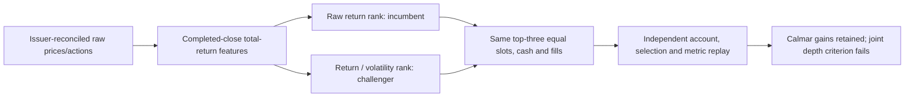

# Volatility-adjusted sector selection: improved Calmar, failed joint screen

Report classification: **negative-results technical report** about a strict joint
screen, with favorable development findings retained. GRS-1.0; issuer-v2 cycle;
prepared with Codex assistance on2026-10-28. [Study](2026-10-28-sector-comparison-issuer-v2.md),
[immutable plan](../../research/plans/sector-comparison-issuer-v2.frozen.json) and
[completion receipt](evidence/2026-10-28-sector-comparison-issuer-v2.json) own exact
rules, identities and evidence. This is not independently validated research,
peer review, a deployment recommendation or publication permission.

## Abstract

We changed sector target ranking rather than SPY participation. A monthly
volatility-adjusted252-session momentum rank improved modeled portfolio Calmar
18.03%/18.18% versus raw momentum at5/10bp, raised CAGR by2.23/2.20percentagepoints,
and shortened the longest underwater episode from301/307sessions to170.
The5bp joint screen passed. At10bp, drawdown increased from29.67088%to29.67450%,
a0.00362percentage-point difference. The frozen criterion required no increase;
therefore the joint target is rejected. Eight reserved cases completed and all
independent accounts, selections, attribution and metric audits passed. This is
viewed restated development history, not evidence of future alpha.

## 1. Question and contribution

C01–C06 refined SPY eligibility, sizing, features or execution without meeting
their joint improvement screens. The new question is whether selecting different
sector leaders improves net return per drawdown while retaining growth and
recovery. One stage changed: rank return relative to recent volatility. Position
weights, opportunity set, timing and account assumptions stayed matched. The
finding is specific to this policy and window, not exhaustion of every SPY idea
or invention of risk-adjusted momentum.

## 2. Related work and provenance

The [prior hosted sector study](2026-10-25-sector-momentum-comparison.md) motivated
this family; an earlier synthetic target-selection prototype explored adjusted
ranking. No third-party algorithm source was copied. The project implementation
and new account/audit modules are frozen in the source snapshot. Alpaca Basic
supplied raw daily prices; issuer workbook and tax forms supplied primary actions.
Sources remain private; personal local use does not grant redistribution or
commercial rights. [Issuer qualification](2026-10-28-sector-issuer-qualification.md)
records access, corrections, unit exceptions and retained failures.

## 3. Data and information timing

Ten fixed sectors XLB/XLE/XLF/XLI/XLK/XLP/XLRE/XLU/XLV/XLY, plus SPY benchmark.
All eleven have2514daily observations over2016–2025. Derived actions include
442cash distributions, five2:1splits and one separately typed2016XLF/XLREshare
entitlement. No2016positions exist; the noncash event affects warmup features
using contemporaneous child prices. Raw fills and reinvested feature indexes
remain separate. No adjusted fill or double-counted distribution is used.

2016provides252closes, insufficient for252returns. The first complete common
month-end is2017-01-31, so all cases evaluate2017-02-01–2025-12-31;2017is partial.
Month-end features use completed data available by the next New York midnight;
quantities use prior NAV/marks, not tomorrow's close. All dates, prices and actions
are restated/viewed; original publication vintages and actual executable quotes
are unverified. Changing symbols or dates does not create an untouched holdout.

## 4. Methods, controls and preregistered criteria

Monthly top-three by252-session total return is the scientific incumbent. The
challenger divides that return by63daily-return sample volatility annualized with
sqrt252. Equal-weight all ten sectors and SPY entry-only hold are simpler controls.
Ties resolve alphabetically. No absolute-momentum veto, SPY gate, fitted model,
lookback search or leverage. Invalid required input stops rather than drops assets.

Each case uses USD300000,98%target allocation, whole shares, no borrowing, zero
cash interest, USD1/nonzeroorder and5/10bp adverse cent-rounded fills. Sales precede
lexicographic cash-feasible buys. Same-day payment cash becomes spendable at close;
unpaid entitlements contribute NAV without financing purchases. Splits adjust
shares without artificial fills or fees. This is a project ledger, not native
engine/broker parity. Exposure drift, liquidity, spread/impact and tax realism are
limitations. Financing is consistently zero because modeled cash never goes negative.

Eight cases were frozen before any portfolio outcome, reserved serially and
captured with300seconds/case,2400aggregate financial seconds, no retries, one
worker and01:15UTCdeadline. The fixed screen requires at least10%Calmar gain at
both costs, no lower CAGR/deeper closing drawdown/longer underwater duration,
and no simpler-control domination. Tolerance is1e-9percentagepoints for CAGR/DD;
no materiality band may be invented after seeing the0.00362point failure.
Prior C01–C06include36local financial attempts; older hosted/catalogue trials
also informed project direction. The exhaustive project-wide trial total is not
established here. This cycle is four policies at two costs, not eight independent
strategy discoveries.

## 5. Results and temporal behavior

All source values below resolve to sealed case summaries and independent audits.
Drawdown is positive loss depth; underwater duration includes recovery as specified
by `reporting.temporal`v1.2. Full Calmar uses calendar CAGR/full-path drawdown.

| Policy | Cost per side bp | Calmar | CAGR | Max DD | Sharpe | Longest underwater sessions / days |
| --- | --- | --- | --- | --- | --- | --- |
| Volatility-adjusted sector momentum | 5 | 0.492530 | 14.6128% | 29.66890% | 0.8632 | 170 / 248 |
| Raw sector momentum | 5 | 0.417307 | 12.3823% | 29.67197% | 0.7313 | 301 / 439 |
| Equal-weight sectors | 5 | 0.319509 | 11.5603% | 36.18137% | 0.7325 | 314 / 457 |
| SPY buy and hold | 5 | 0.434733 | 13.8848% | 31.93866% | 0.8517 | 489 / 709 |
| Volatility-adjusted sector momentum | 10 | 0.482229 | 14.3099% | 29.67450% | 0.8481 | 170 / 248 |
| Raw sector momentum | 10 | 0.408050 | 12.1072% | 29.67088% | 0.7178 | 307 / 448 |
| Equal-weight sectors | 10 | 0.318978 | 11.5395% | 36.17656% | 0.7314 | 315 / 460 |
| SPY buy and hold | 10 | 0.434540 | 13.8829% | 31.94848% | 0.8514 | 489 / 709 |

[Standalone review](../../reports/bounded-study/sector-issuer-v2-20261028/index.html)
contains the NAV chart and full annual/temporal table. The
[72-row annual CSV](../../reports/bounded-study/sector-issuer-v2-20261028/annual-comparison.csv)
includes return, year-reset DD, Sharpe, Calmar, underwater sessions/days/fraction,
opening/ending equity and partial-year flags for all eight cases. The
[summary CSV](../../reports/bounded-study/sector-issuer-v2-20261028/comparison.csv)
adds exposure, fees, slippage, turnover and ranks within each cost context.
Authoritative per-case ledgers, daily rolling diagnostics, decision records and
monthly/yearly per-sector contributions are under the sealed financial bundle
linked in the completion receipt. Contribution dollars reconcile to NAV changes;
they are observed-account attribution, not isolated counterfactual alpha.

At5bp the challenger has higher annual returns in six of nine years; it trails
raw momentum in2020(-0.50points),2023(-1.18)and2024(-1.11). The same three losing
years occur at10bp. Selected sets differ in44of107months. Observed5bp dollar
contributions are largest for XLK206827, XLY166814 and XLI104541 in the challenger;
these amounts include position sizes and compounding, and are not factor-skill
estimates. Annual reset drawdowns cannot replace full-path risk.

Both momentum policies' deepest drawdown peaks2020-02-19and troughs2020-03-23.
Both held XLK/XLU/XLP entering that episode. The main improvement is growth and
longest recovery elsewhere, not a new COVID crash-avoidance mechanism. Candidate
underwater fraction/censoring and all episodes remain in the saved diagnostics.

## 6. Robustness, failures and counterevidence

At5bp every frozen guard passes. At10bp the Calmar, CAGR, duration and simplicity
guards pass; only no-deeper-drawdown fails. The candidate still leads Calmar over
both simpler controls at both costs. Its trade counts389/387versus raw384/384
show the result is not simply fewer orders. Cost sensitivity is informative but
covers two declared constants, not empirical execution or arbitrary stress levels.

All eight children and the parent exit0, with no rejected model buys, clipping,
financial failure, timeout or retry. Independent Fraction replays verify17936
session accounts,3638fills,6400action events,644decisions and197296daily asset
contributions.720annual,112full and72rolling metric comparisons pass. A cached
restart produces zero launches; an invalid ninth-case plan is rejected without
journal mutation. Four separate synthetic children had earlier tested success,
unique exports, intentional failure and forced timeout; negative fixtures are
retained and must not be counted as financial failures. Issuer parsing/path/source
failures remain in their earlier qualification report.

## 7. Interpretation and limitations

Volatility-adjusted asset ranking is a useful research lead beyond SPY exposure
tweaks. This scoped result supports material historical Calmar/growth/duration
gains, while contradicting the strict claim of no worse drawdown at both costs.
Do not call the small failure economically catastrophic, and do not silently
round it into a pass. Raw sector momentum remains the scientific incumbent under
this joint adoption rule; a numeric leaderboard lead is not operational promotion.

This window omits2008, comprises a fixed hand-chosen sector universe and follows
many prior family reviews. Basket classifications evolve. There is no protected
holdout, calibrated capacity/market impact, historical original-vintage guarantee,
fund tax model, native action-handler parity, broker test or live evidence.
No annual doubling, trained RL advantage or persistent alpha has been established.
Old hosted sector and2005–2025SPY gate metrics are different contexts and cannot
be interpreted as exact reproductions or globally ranked scientific winners.

## 8. Reproducibility

The frozen plan binds20runtime/test/dependency sources, interpreter bytes,
qualified input/source manifests and execution qualification. Eight reservations
precede child Popen; hashes, UTC start/exit, stdout/stderr, actual wall time and
all case/audit artifacts are retained. Independent replay does not import the
runner's selectors, feature implementation or ActionLedger. Maximum account
difference is exactly0USD.2400financial seconds allowed; about29seconds consumed.
All549prior C01–C06artifacts match their original manifests.

Use manifest/cache verification for recovery; do not restart an exhausted plan.
Inputs and detailed results stay ignored/local. The canonical
[leaderboard](../leaderboard.md) preserves every prior row and adds only these
eight audited cases, with separate5/10bp contexts. No account, network data,
service, dependency installation, commit or publication occurred during this goal.

## 9. Lessons and next question

1. This sector-ranking change produced material18%Calmar gains in its own context;
   earlier SPY sizing studies failed their own screens in different contexts. This
   supports a distinct research direction, not a universal cross-context winner.
2. Volatility-normalized ranking changes which sectors are selected; it is not
   a guarantee of crash protection or lower risk in every era.
3. Preserve meaningful favorable evidence and a narrow failed constraint together.
   Prospective risk materiality or protected validation could be a later research
   question; neither is retroactive permission to pass this screen or run again.
4. Typed issuer actions and independent account/policy attribution matter. Dividend
   cash, share distributions and split units cannot be interchangeable inputs.
5. Stop with the audited decision. All eight financial slots are consumed; no
   new lookback, cash veto or risk gate is automatically authorized.

## References

- [GRS and report requirements](../research-standard.md)
- [Frozen plan](../../research/plans/sector-comparison-issuer-v2.frozen.json)
- [Input and accounting qualification](2026-10-28-sector-issuer-qualification.md)
- [Execution qualification](evidence/2026-10-28-sector-execution-qualification.json)
- [Completion receipt](evidence/2026-10-28-sector-comparison-issuer-v2.json)
- [Prior hosted sector comparison](2026-10-25-sector-momentum-comparison.md)
- [Earlier SPY epoch closure](2026-10-28-rsi-epoch2.md)

Closure verification: final489offline tests, documentation/whitespace checks,
original input hashes, all549prior financial artifacts and87row single-table
reconciliation passed. No financial slot remains. Dirty working-tree code is
identified by the frozen source snapshot, not a claim that this is merged code.
