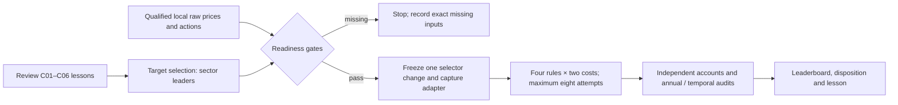

# Next bounded RSI goal: sector target selection

Status: goal BLOCKED after three consecutive goal turns with the same missing
local sector inputs. The financial comparison is incomplete and unrun.
No new financial run or Calmar result. This record owns this study's scope and
checklist; [GRS](../research-standard.md) owns adoption, [mandate](../goals.md)
owns objectives, and [scoring](../research-scoring.md) owns metric meaning.
The [team-review receipt](evidence/2026-10-28-sector-selection-rsi.json) preserves
recommendations, disagreement, local evidence identities and the initial state.
This is a prospective design, not an executable frozen plan or a qualified dataset.

## Lessons and team decision

Six recent six-case SPY cycles tested continuous sizing, ceiling-smooth sizing,
faster proposals, union eligibility, total-return features and buy-topup frequency.
None met its frozen joint improvement target. The
[epoch2 closure](2026-10-28-rsi-epoch2.md) and linked C01–C06 records preserve all
negative evidence. This does not prove every SPY policy has been exhausted.

- Quant: change the opportunity set. Favor volatility-adjusted sector relative
  strength, compared directly with raw sector momentum. Sound feature arithmetic
  in C05 did not establish an edge; C06 cost savings barely changed Calmar.
- Risk: favor sector selection, but proposed an absolute-momentum cash veto and
  an exposure-matched control. That introduces a different eligibility mechanism.
  Defer that proposal rather than combine two changes. Retain strict growth,
  depth and duration guards; no retrospective relaxation of acceptance.
- Infrastructure: SPY/IEF/GLD has the nearest existing implementation and local
  files, but price-use qualification remains blocked. Sector daily inputs are
  less ready: prior results are hosted summaries. Today's 500-stock cache is
  explicitly financially ineligible and cannot supply historical membership.

Director decision: select Quant's sector-ranking experiment for scientific
priority despite Infrastructure's lower-cost three-asset alternative. Both face
input gates; neither justifies pretending data is ready. There is no automatic
fallback to SPY or the previously blocked three-asset epoch. Company earnings
signals and pairs would add PIT or borrow/leg dependencies and are deferred.
These advisory reviews are separate perspectives, not independent market validation.

[Prior sector study](2026-10-25-sector-momentum-comparison.md) found Calmar0.459
versus SPY0.437 and longest underwater195 versus488sessions, with lower
CAGR13.630% versus13.950% and more closes underwater. Those historical hosted
summaries motivate the question; they are not qualified local financial inputs.
The earlier synthetic selector (`../../.local/stage-wave1-20261027/target_selection/docs/tasks/2026-10-27-wave1-target-selection.md`; private/local artifact, not published)
already explored risk-adjusted ranking. Novelty here is the prospective matched
sector financial test, not invention of volatility-adjusted momentum. Exhaustive
absence of duplicates across every project experiment is unverified.

## One changed stage and prospective comparison

Change target selection only. Fixed ten-sector universe:
XLB, XLE, XLF, XLI, XLK, XLP, XLRE, XLU, XLV, XLY. XLC remains excluded.
Sector baskets evolve; ETF symbols do not establish immutable industry exposure.
SPY is a separate benchmark, not a candidate sector.

At each completed calendar-month final trading close, rank all ten sectors:

- Scientific incumbent: trailing252observed-session total return.
- Challenger: that same return divided by annualized sample standard deviation
  of the latest63daily total returns, multiplied by sqrt252 in the denominator.
- Select top three; deterministic ascending symbol tie-break; equal one-third
  slots within the same98%portfolio allocation budget. Volatility changes ranks,
  not position weights. No absolute-return veto, additional SPY gate, ML fit,
  parameter search, variable number of picks or financing change.
- A return requires253index closes; volatility requires64. Missing/nonfinite data,
  nonpositive prices or zero volatility stop qualification rather than silently
  change the universe or grant one selector a different eligibility pool.

Four policies: challenger, fresh raw-return top-three, monthly ten-sector equal
weight, and SPY entry-only hold. Each at5/10bp adverse slippage per fill side plus
USD1/order. Exactly eight conditional financial attempts, including failures.
No old hosted result substitutes for a fresh control. The old2005–2025 SPY gate
remains incumbent in its original context; this study has a sector incumbent.

Proposed context:2017-01-03–2025-12-31 evaluation, complete preceding warmup for
all inputs, USD300000, whole shares, long-only, no borrowing or leverage,
zero cash yield. Completed-close signals execute next session open through a
cash-feasible sales-before-buys allocator. Initial hold/equal-weight allocations
use only information available before their first execution. Rights, exact
session coverage, splits, distribution entitlement and payment-date cash/receivable
handling, sequencing and rounding must qualify before these become executable
assumptions. Do not spend unpaid receivables or silently use adjusted fills.
No intraday loss or live-execution claim follows from daily prices.

The full history is development/viewed history; introducing new symbols does not
make it protected evaluation. No trained RL advantage or alpha claim is planned.
Freeze exact features, raw fills, action policy, timing, code/data/dependency hashes,
evaluator and source snapshot in a new machine plan before any reservation.

## Calmar decision and diagnostics

Seek at least10% net full-path Calmar improvement at BOTH costs versus fresh raw
sector momentum. Require no lower CAGR, no deeper closing-NAV maximum drawdown,
no longer longest underwater sessions OR calendar days, and no domination by the
simpler equal-weight or hold controls across those primary measures. Use unrounded
ratios,1e-9percentage-point numerical tolerance on CAGR/DD and exact duration
counts. Report all benchmark comparisons; do not compare0.459 or0.491514 from
incompatible historical contexts as if they were the same run.

Report annual return/DD/Sharpe/Calmar; full-path closing NAV, CAGR/DD/Calmar/Sharpe;
underwater fraction, censored recovery, longest duration in sessions/days; rolling
21/63/252session returns and worst losses; turnover, costs, realized exposure,
sector selections and per-sector contributions. Use the existing temporal contract
consistently in all fresh cases, including initial capital. Document reconciliation
of cash, shares, actions, fees, receivables and NAV with an independent replay.
Thirty-percent drawdown remains a reassessment preference, not a hard guarantee.
Any growth/downside tradeoff is reported as a tradeoff and fails this strict target.

## Bounds and readiness gates

Goal created2026-10-28T21:28:57Z. Qualification deadline2026-10-28T22:30:00Z;
absolute all-work deadline2026-10-29T00:30:00Z. One study, one candidate, at most
8financial attempts including failures, one financial worker, zero automatic
retries. Each financial case maximum300seconds; aggregate financial wall maximum
2400seconds, within the absolute deadline. Every attempt requires a fresh shared
budget reservation and actual child capture. Old budgets stay closed.

Current executable financial allowance is ZERO: the eight slots are conditional
on all gates and an immutable executable freeze. Existing evidence establishes
no ready local ten-sector dataset. No acquisition, credentials, brokers, services,
dependency installs, paid resources, commits or publication are in scope. Do not
silently switch to cloud data access under this local-only goal.

Mandatory gates:

1. Actual retained local raw daily open/close inputs for eleven symbols, independent
   session coverage, identities and completed-bar availability; no invented bars.
2. Permitted-use evidence for the intended local experiment, price/action semantics,
   split/distribution completeness and a qualified derived total-return series.
3. Native-compatible shared-cash/actions and allocator qualification, independent
   accounting audit including relevant splits, prior holdings, ex/pay ordering,
   terminal unpaid distributions, fees, adverse fills and missing-mark stops.
4. New capture version: unique per-cycle outputs/receipts. A two-cycle synthetic
   lifecycle test must cover reserve, child, seal, retire, export and cached restart,
   preserving earlier evidence. The frozen C06 driver remains defective and intact.
5. Frozen same-context controls, chronology, source/interpreter/evaluator identities,
   bounds and passing appropriate offline checks before first financial launch.

Stop at failed source/timing/accounting/control/capture integrity or missing inputs.
At the qualification deadline, produce an evidence-backed ready/blocked decision.
If blocked, close this bounded feasibility study with comparison unrun; do not
repeat the same missing-data search on continuations or run another SPY tweak.
If ready, execute only the frozen eight cases within remaining bounds; reject or
retain on fixed criteria and preserve all failed/partial outcomes. No automatic
second cycle, budget extension or rescue lookback follows.

## Checklist and current handoff

- [x] Review lessons with Quant, Risk and Infrastructure in parallel.
- [x] Preserve disagreement; select one genuinely different financial mechanism.
- [x] Create bounded goal and fix conditional controls/criteria/stopping rules.
- [x] Finish focused local input audit with an actual artifact manifest (blocked).
- [x] Record blocked verdict; absence is not a qualified input bundle.
- [ ] If ready: qualify synthetic ranking/accounting and new capture lifecycle.
- [ ] If ready: freeze executable machine plan, register its ownership, reserve cases.
- [ ] If ready: run at most eight cases and audit annual/full/temporal outcomes.
- [ ] Close with lesson and exact usage; update leaderboard only for actual evidence.

No new financial result belongs on the leaderboard at setup. Existing studies,
source snapshots, negative findings and raw artifacts remain unchanged.

## Qualification result: missing local sector inputs

The [readiness receipt](evidence/2026-10-28-sector-selection-readiness.json) links
a saved, read-only audit method, artifact inventory and verification. It searched
the two declared local dataset manifests, normalized stock filenames, pilot
symbol declaration and the20saved sector-study artifacts. All22source artifacts
were hashed and rechecked unchanged. This is a bounded inventory of declared
research locations, not an exhaustive search of the user's disk.

None of the ten required sector ETF series exists in those declared inputs. SPY
appears in the four-symbol pilot, but only in two separated months; the other
500normalized series are individual stocks. Corporate actions and financial-use
qualification are absent. The20sector-study files contain source and summary
evidence, not a retained daily input panel. The older three-asset qualified bundle
also remains absent and is not a substitute for this universe.

Therefore source rights, action-consistent features, historical account parity,
new capture lifecycle and executable freeze cannot be marked passed. No financial
reservation, child run, import or leaderboard result was created. Synthetic checks
would not close missing historical input; no broad infrastructure rebuild follows.
A request for an existing authorized export's path/source is pending. Downloads
and cloud simulation are outside this goal. This is the second consecutive goal
turn retaining the same input blocker (the first established scope and bounds);
it is not yet the three-turn blocked-status threshold.

Readiness lesson: diversify the scientific question without confusing a new
strategy design with new data availability. The sector-ranking hypothesis remains
untested. A completed readiness audit is not a completed Calmar comparison or an
improved strategy. Original conditional limits and deadlines remain unchanged.

## Terminal blocked-state audit

The [third-turn audit](evidence/2026-10-28-sector-selection-blocked.json) freshly
verified the same two dataset manifests, zero required sector symbols, missing
qualified sector bundle and unchanged22source artifacts. No authorized export
path/source arrived. The goal tool returned `blocked`; it was not marked complete.
No further useful financial work is possible under the local-only/no-download
scope without new input. The previous two turns made review/audit progress but
retained this same blocker; the third meets the required blocked-status threshold.

The original hypothesis and strict criteria remain untested. Zero attempts were
reserved or run; eight conditional slots remain unusable, not automatically
carried forward. Leaderboard unchanged because no performance evidence exists.
Resume requires an authorized local panel and all original gates/deadlines to
pass. After expiry, define a separately bounded scope rather than reset this one.
All setup, negative readiness and historical financial evidence is preserved.

## Later acquisition evidence (original blocked audit preserved)

The user's subsequent download request produced a separate
[eleven-ETF acquisition](2026-10-28-sector-etf-acquisition.md). Required prices now
exist as a conditional dataset; historical absence in the original audits remains
true at their timestamps. Corporate actions contain missing payment dates and
known SPY omissions, so this goal has not resumed or passed its financial gates.
No financial attempt, new Calmar result or deadline reset follows acquisition.

## Explicit stop-branch closure and separately authorized successor

After the user requested issuer reconciliation and a fresh goal, the original
explicit failed-input stopping branch was audited and closed. Its earlier blocked
observations remain historical. [Closure audit](evidence/2026-10-28-sector-feasibility-closure.json)
records zero financial attempts and no Calmar improvement. The financial
comparison was not relabeled completed. The separately authorized
[issuer-v2goal](2026-10-28-sector-comparison-issuer-v2.md) has new bounds, updated
availability-based dates and data/accounting gates. No old deadline was reset.
