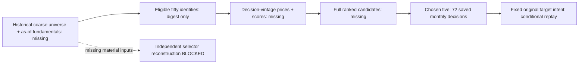

# Historical stock-selection evidence audit

**BLOCKED for independent reconstruction of the historical eligible-fifty → top-five selector.** We can conditionally replay the saved chosen-five target intent, but cannot recompute or verify the complete ranking from its original inputs. This is a completed zero-financial data audit, not a failed financial strategy test. [Data-audit policy](../research-development.md#data-audit) and [GRS](../research-standard.md) govern its scope. The [receipt](evidence/2026-10-28-stock-selection-evidence-audit.json) identifies checks, hashes and missing fields.

## Scope frozen before audit analysis

Private scope: `.local/stock-selection-evidence-audit-20261028/scope-frozen.json`. It freezes 239 existing files (3,907,556 bytes), their original SHA-256 values, required fields, canonical context and stop rules. Inputs cover four scoped bundles, associated plans/receipts, own source adapters and supporting scripts. No original file was changed; all 239 hashes were checked after analysis. No strategy or third-party code was imported/executed. Source inspection was textual/static AST inspection only.

Canonical context: **sector-matched-v1, original stock-momentum case**, native backtest `ae06ba0d0356d04e057ad3a6239cdf7b`, engine 2.5.0.0.18209. Requested evaluation is 2020-01-01 through 2025-12-31; historical summaries contain 1,508 sessions, from 2020-01-02 through 2025-12-31. The saved monthly decisions run 2020-01-02 through 2025-12-01. USD 10,000, original 90% nominal allocation, whole shares, 25bp slippage, native IB fees, staged MOO and 6% ACT/360 debit financing are historical assumptions, not a newly executed test.

## Keep the successive contexts separate

There are three conceptual phases, with two distinct studies in the final phase. No rows or fundamental values were spliced across them.

| Phase / saved study | Observed evidence | Qualification boundary |
| --- | --- | --- |
| Initial comparison: `qc-breadth-v1:momentum` | 72 reported decisions, 3,600 requested symbol-month histories, 51 short-history requests, minimum ready zero; summaries but no monthly chosen-ID ledger | Earlier 253-bar-count history path; zero-readiness periods are missing inputs, not forecasts |
| Readiness repair: `selection-completion-v1:stock` | 72 decisions; 600-calendar-day request supplies 253 completed closes; one remaining short window, minimum ready 49; source/summary identities retained | Repaired historical path is a different result context; diagnostic stock and low-volatility cohorts are not interchangeable |
| Overlay phase: `stock-risk-v1:original` | 72 monthly chosen-five rows, 360 picks; all fifty readiness counts except one at 49; aggregate cohort/ready-ID hashes | Chosen-ID and sector observations now exported; complete candidate names, score inputs and raw histories still not exported |
| Overlay follow-up: `sector-matched-v1:original` **canonical** | Same 72 ordered chosen-ID lists and readiness counts as stock-risk original; 27 conditional sector inferences | Original financial path retained; classification assumptions differ. Not exact historical vendor-sector recovery |

Owners: [initial comparison](2026-10-26-qc-selection-comparison.md), [readiness repair](2026-10-26-selection-completion.md), [stock-risk study](2026-10-26-stock-risk-ablation.md), [sector follow-up](2026-10-26-sector-matched.md). Their budgets remain closed. Readiness fixes and subscription-retention repairs do not retroactively replace earlier results.

## What the saved canonical cohort actually contains

All 72 dates are increasing, unique and cover exactly one record in each calendar month of 2020–2025. Each has five distinct valid symbol indices: **360 chosen occurrences, 57 unique permanent IDs**. Ready counts are fifty on 71 dates and forty-nine on **2021-09-01**. This is calendar-month coverage, not an independent exchange-calendar certification.

The compact monthly schema is only `[YYYYMMDD, gate_state_code, ready_count, chosen_symbol_indices]`. Symbol records provide permanent ID plus sector code. The ordinal in the chosen list follows source insertion order; it is not an independently recomputed momentum score or proof those names really outranked every alternative. The first chosen list names AAPL, NVDA, MSFT, MA and TRV. A private normalized CSV preserves all 360 occurrences, ordered-list ordinal and readiness without inventing scores. Fixed original equal-target intent is 18% each before rounding/execution. No fill or economic replay is performed.

The canonical source SHA-256 is `8d79902fc14c818ab3805803fc1ad40b9366fd65c33267673e63b89263a78af9`; its historical receipt/ledger identity matches. Saved packet SHA-256 is `3bcb20985b7a5e3298b1f7f3f3c262dccf6b69babc0da5e81601f332d86c0fe8`. Its 51 terminal fragments reassemble with the recorded digest prefix and match the parsed packet exactly. Native launch/completion identifiers match. The stock-risk packet independently reassembles and its monthly dates/chosen IDs/ready counts match; sector-code changes are not treated as equal vendor truth.

## What the hashes do—and do not—prove

Static source inspection finds exactly two relevant rolling-hash updates:

- `membership_sha256`: decision-date text plus selected-fifty ID text, in order. The digest cannot reconstruct the absent membership list, market-cap values, dollar-volume values or exclusions.
- `feature_sha256`: decision-date text plus **ready IDs**, in order. It does **not** hash the 253 close values, momentum values, bar timestamps, adjustments, corporate actions or scores.

Matching these hashes is useful evidence about the producer's observed memberships/readiness. It is not a complete frozen price/fundamental snapshot, nor an independent score audit. Source guards check finite positive prices, no future bars and strict ordering during the original run; saved counters report zero violations. Those counters cannot now be recomputed without the original windows. Prior descriptions of matching “feature hashes” must retain this narrower meaning.

Source code explicitly requests SCALED_RAW history over 600 calendar days and filters a fifty-stock cohort using contemporaneous supplied fundamentals. We can inspect that intended algorithm and tie-breaking, but cannot establish original vendor/public availability of every input from source code alone.

## Required-field coverage

| Required evidence | Saved observation | Eligibility consequence |
| --- | --- | --- |
| Monthly chosen IDs and decision date | Complete chosen lists for 72 months; date precision only | Conditional replay of saved target intent |
| Entire historical eligible fifty and coarse cohort | Aggregate rolling membership digest and counts; full lists absent | Cannot verify opportunity set or redo alternative selection |
| All scores/ranks and tie-break inputs | Chosen order only; no numeric momentum or complete ranking | Cannot independently establish top-five optimality |
| Decision-vintage prices/actions/normalization | Source requests and runtime counters; no complete input windows | Cannot recompute momentum or audit action handling independently |
| Exclusions by symbol/month/reason | One canonical ready-count reduction; separate limited diagnostic snapshots | No complete per-decision exclusion ledger |
| Public and vendor availability | No complete dual availability timestamps; observation `end_time` in selected classification probe only | Point-in-time causal input qualification blocked |
| Decision instant and identity mapping | Source contracts suggest completed SPY close; monthly packet stores date and permanent IDs | No complete timezone-aware decision/availability ordering or dated display mapping |
| Fill/cash/action history | Aggregate financial/attribution records only | Independent financial replay remains unqualified |

The saved classification probe has 27 selected-name rows with dated observations and some display tickers. These address missing sector labels; they are not an eligible-fifty fundamentals archive or a public/vendor availability audit. The separate readiness diagnostic identifies legitimate short-history exclusions, including the stock-momentum SNOW window, but must not be promoted into a complete canonical decision log. No contemporary constituent list or freshly fetched history was substituted.

## Validation and preserved limitations

Eight bounded read/analysis/check command batches were used within the forty-minute ceiling. Checks: source identities against historical receipts/ledgers for all four study contexts; two exact packet reassemblies; monthly dates/indices/uniqueness/counts; static hash semantics; 128 JSON-container field inventories; all 239 frozen inputs unchanged; negative copied-packet checks rejecting a missing fragment and a corrupted fragment. These copies were held in memory; originals remain intact. The JSON-container inventory is supplementary and is not a search of nonexistent raw hosted datasets.

Only the new task/receipt and private output folder were written. No full test suite, financial simulation, cloud contact, data download, import, service or broker action occurred. No historical accounting audit, raw corporate-action reconstruction or data-use permission was newly established. Raw vendor fundamentals/prices remained hosted under the historical study boundary. Derived selection/audit output is private; a matching hash supplies integrity, not a new redistribution grant.

## Lesson and next bounded action

**Recording winners is insufficient to audit a selector.** Preserve chosen lists and existing favorable/unfavorable results, but do not label them a reproducible historical opportunity set. These missing inputs cannot be recovered by reversing a hash, resampling today's constituents, or merging later diagnostic rows.

Next proposed task is a **zero-financial decision-log contract and synthetic export fixture**, with one record per eligible/rejected symbol and decision: versioned universe membership, causal availability metadata, price-window identity with permitted input retention, score, tie-break, readiness/exclusion reason and selected flag. Test that incomplete inputs produce blocked status and external/restricted data stay out of published artifacts. An eventual data-source/access task must separately establish permissions and historical coverage; it would create a new study context. This audit creates no financial budget and supplies no Calmar improvement claim.

### Parent documentation finalization

The agent stopped at its eight-command bound. Command8 wrote this report/receipt and completed the audit checks, but failed its final assertion: the no-index Git whitespace invocation returned1 because `/dev/null` and the new file differ, with no diagnostic output. The assertion incorrectly required0. Parent preserved the returned versions and original pending-status journal, verified both files explicitly have no trailing whitespace, rehashed all239 frozen inputs and finalized documentation only. No audit, strategy or data acquisition was rerun. Private `parent-finalization.json` records the correction; this technical error does not change the blocked reconstruction finding.
