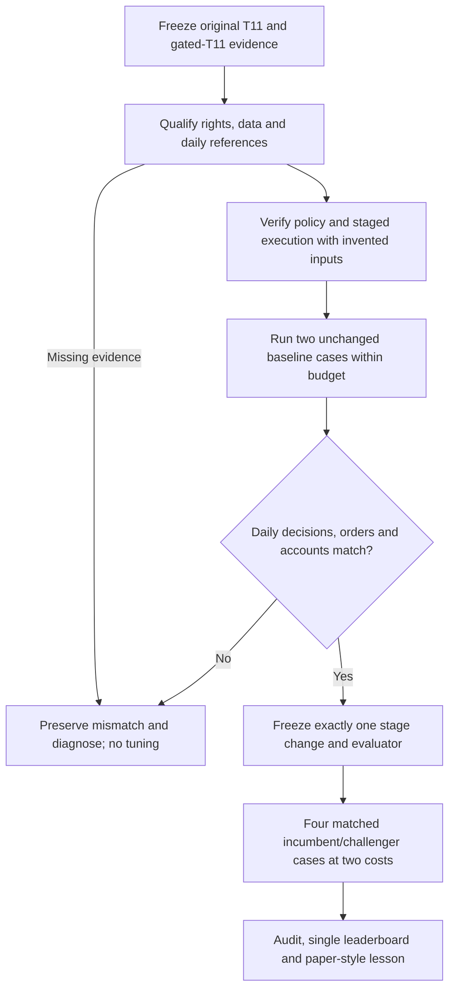

# Bounded T11 reproduction and first RSI cycle

Current checkpoint (2026-10-29): **blocked for local reproduction/optimization**.
The [new official reference-pair review](2026-10-29-t11-export-validation.md)
resolves the download blocker: both18215 exports are preserved, and candidate
close paths match saved aggregate/year summaries within explicit precision
limits. Original18209 daily decisions/account transitions, qualified full-universe
features/gate seed and native staged execution remain unverified. The separate
reference refresh used its two approved cloud attempts; this original program's
six-attempt budget was not used or renewed. Its elapsed deadline does not reopen.

Historical starting status: blocked pending original daily reference and qualified execution inputs/route.
Preparation and private synthetic policy conformance are verified; faithful
financial reproduction is not ready. No financial runs or optimization have started. This is the canonical
plan/checklist for this goal. [GRS](../research-standard.md) owns incremental
adoption, [SOP](../operations/recursive-research.md) owns handoffs, and the
[leaderboard](../leaderboard.md) remains the single result table.

## Outcome and boundaries

Reproduce the saved ungated and gated T11 faithfully before claiming another
strategy improvement. Produce auditable completed-close decisions, target and
actual positions, controller intent, staged orders/fills, cash, corporate actions,
fees and financing, then compare with the original evidence. An attractive
aggregate score or similar ending NAV does not establish daily-path parity.
No fabricated/synthetic historical prices, shortened seed or substituted sector
policy is accepted as a reproduction. Invented inputs are engineering checks only.

Use free/permitted sources and existing local evidence. Raw QuantConnect vendor
prices and indicator traces stay hosted; ordinary result/equity/order downloads
use official interfaces and retain provenance. Original source remains private;
inspection, modification and redistribution rights are separate gates. No strategy
source is copied into tracked code by this preparation task. No paid services,
broker/paper orders, account changes, services, publication or commits are authorized
by this goal. The previous sector and SPY budgets stay closed.

## Program bounds frozen before any financial launch

- Six new financial attempts **total**, including failed starts; one worker,
  zero automatic retries,300seconds/case and1800aggregate childseconds.
- Hard deadline2026-10-29T07:45:00UTC (00:45October29America/Los_Angeles).
  There is no automatic renewal or budget reset if readiness is delayed.
- Phase A reserves at most two cases: unchanged ungated T11 and unchanged gated
  T11,USD10000,2020-01-02–2025-12-31,25bp adverse fill friction and the original
  native fee/margin model. Both require complete actual capture and independent
  accounting; no launches until an executable code/data/engine freeze is eligible.
- Only after both baseline cases pass, phase B can spend at most four cases:
  incumbent gated T11 and **one** challenger at25/50bp. The challenger changes
  exactly one stage; its rationale, implementation, controls, evaluator and source
  identities must be frozen before its outcomes. No adaptive threshold grid.
- First-stage research asks for at least10%Calmar improvement at both costs while
  preserving CAGR and not increasing drawdown or longest underwater sessions/days;
  1e-9percentagepoint roundoff tolerance, zero integer-duration tolerance.
  Report tradeoffs even on rejection. No automatic paper/live promotion.
- Stop financial execution on source/input/engine mismatch, missing required
  evidence, stale/future input, unsupported action, invalid NAV, audit failure,
  deadline or exhausted budget. Preserve failed/partial output; repair needs a new
  scope, not an unrecorded retry. Synthetic tests do not consume financial slots.

The machine program file records this inactive financial envelope. It is **not**
an executable runner plan. A supported reservation/capture adapter and exact source,
input and evaluator hashes must be frozen after qualification, inside these same
six slots and deadline. No generic optimizer or scheduler is installed here.

## Baseline contract

Original references: [gate-transfer study](2026-10-26-qc504-t11-gate.md),
[receipt](evidence/2026-10-26-qc504-t11-gate.json),
[frozen original plan](../../research/plans/qc504-t11-gate-v1.json), and
[funded execution](2026-10-26-qc504-funded-execution.md).
Preserve original source bytes, asset availability,215bar indicator warmup,
Wilder RSI/SMA readiness, adjusted subscription semantics and RAW-SPY gate seed
from2004-01-02–2019-12-31 (4027seed bars). KMLM is late-available; do not fabricate
pre-inception history or require its readiness before the original does.
The source subscribes37unique ETFs;24are required by the T11 decision path.
Other subscriptions may be removed only after a separately demonstrated parity
check, not silently as an implementation convenience.

Keep90%allocation, whole shares, original intent-change identity, confirmed MOO
reductions before buying, next-close causal recomputation, pending-order guards,
lexicographic cash feasibility and native margin checks. No daily target maintenance
after completed intent. Native IB/default fees remain actual fees;USD2+.01/share is
only an affordability reservation, not the fee charged. The sector runner'sUSD1
fee, monthly rebalancing and immediate red liquidation are not substitutes.

Explicit6%ACT/360 funding uses previous closing negative cash across calendar days,
debited at the current close before sizing, zero credit interest, null native
interest and no accrual beyond the last observed close. Embedded leveraged ETF
expenses stay in their price histories; do not charge them again. Qualification
must resolve splits, reverse splits, cash-in-lieu, dividends and adjusted-price
semantics without double counting. Current sector accounting cannot be assumed
compatible with these events or the original native engine.

Daily evidence distinguishes causal decisions from execution and retrospective
outcomes. Each record identifies economic session, observed/available/decision UTC
timestamps, frozen policy/input identities, readiness, base/target weights, gate
state/counters, cap, controller intent/phase, pending order IDs, desired and actual
positions, actual fees/slippage, cash, receivables, explicit funding and closing NAV.
Record explicit no-action/wait reasons on every evaluation session, not just trades.
Red describes allocation intent; pending reductions may still leave positions.
Raw feature values are retained only in a permitted environment. A hash does not
replace an independently auditable in-environment comparison.

## Verification levels and reproduction screen

1. Source/contract identity: verify both frozen sources, engine/environment,
   universe, normalization, indicator seeding and timing. Current observed cloud
   master18215 differs from original LEAN2.5.0.0.18209. Do not silently change
   engine or claim bitwise parity. An engine-migrated result requires explicit
   provenance and daily output comparison before any financial improvement claim.
2. Aggregate compatibility:1508evaluation sessions, exact calendar/input hashes,
   source-specific fill/rejection/fee/funding and gate counts; final NAV within
   USD.01 and original full/annual rounded statistics within1e-8ratio units.
3. Daily path and policy: independently compare each original daily NAV, order,
   fill and any recorded decision. NAV difference at mostUSD.01 per close; symbols,
   integer quantities, order phases and gate decisions must match. Missing original
   decisions cannot be reconstructed from annual summaries or falsely certified.
4. Accounting: independent complete cash/share/action/fee/funding replay, with
   documented native rounding; closing residual at mostUSD.01. Cash identity alone
   does not prove cash transitions, margin, settlement or policy parity.
5. Metrics: reproduce original **legacy** score definitions for saved-result
   compatibility, and separately report today's canonical temporal-v1.2 metrics.
   The old longest-underwater implementation excludes the recovery close, whereas
   canonical v1.2 includes it. No silent replacement or cross-definition ranking.

Only source/contract, aggregate, daily/policy and independent account checks together
permit a faithful reproduction claim. Matching aggregate summaries alone is a weaker
result. Comparison helpers intentionally cannot authorize financial execution.

## Current inventory and concrete gaps

- Implemented: static original-source hash/AST inventory, saved-reference parser,
  timezone-aware daily-decision envelope checks, staged-red contract, ACT/360
  funding checks, closing NAV identity, and a separate legacy metric comparator.
  These are preparation tools, not a T11 port or full account replay.
- Available: original private source and six annual/full summaries for each case,
  source hashes, calendar/gate input hashes, trade counts and native evidence.
- Missing locally: original daily decision, order/fill and NAV reference package.
  Official built-in result/order downloads are the permitted next reference path.
- Qualified local coverage:SPY,XLK,XLF of24decision symbols;21missing symbols and
  a qualified2004–2019RAW gate seed. New free data acquisition needs its own bounded
  qualification contract within this goal; hosted vendor raw data is not exported.
- Hosted project is accessible; engine master has advanced. Saved-results table
  is visible, but automated pagination hit stale/pointer/focus errors; no reference
  export or new cloud backtest has been performed in this goal.
- Private pure-policy port is source-conformant on invented states only; historical indicator parity, native fee/margin/MOO/action replay,
  and source reuse-rights review remain unverified. Optimization is not eligible.

## Checklist

- [x] Create the active bounded goal and preserve previous research budgets.
- [x] Verify original source hashes and parse original annual/full reference metrics.
- [x] Inventory decision/subscription universes and qualified data gaps.
- [x] Define daily decision/account evidence and legacy/canonical metric boundaries.
- [x] Test preparation contracts using invented data, with zero financial runs.
- [ ] Retrieve permitted original result/order evidence through official controls.
- [ ] Resolve engine, source-use and input normalization/availability gates.
- [ ] Implement faithful policy/staged execution and full independent account replay.
- [ ] Freeze executable program, capture and reserve two eligible baseline cases.
- [ ] Verify baseline daily and aggregate parity; preserve all mismatches.
- [ ] Freeze one stage challenger; run at most four matched25/50bp cases.
- [ ] Update the single leaderboard and paper-style lesson with final disposition.

## Source/access references

The [official data-use guidance](https://www.quantconnect.com/docs/v2/cloud-platform/security-and-ip)
distinguishes hosted dataset restrictions from normal result/order exports.
[Download Results](https://www.quantconnect.com/docs/v2/cloud-platform/backtesting/results#18-Download-Results)
and [orders API](https://www.quantconnect.com/docs/v2/cloud-platform/api-reference/backtest-management/read-backtest/orders)
are reference-acquisition interfaces, not raw-data entitlements. Checked2026-10-28
America/Los_Angeles. No third-party AI instructions change this project's scope.

## Setup verification receipt

[Goal setup evidence](evidence/2026-10-28-t11-reproduction-rsi-goal.json) records
the immutable program-envelope identity, original source/reference identities,
37subscription/24decision-symbol inventory,21missing qualified local decision
inputs, verified setup source hashes, official-access limits and ten passed
invented-state tests. Final `make check` passed508tests plus documentation and
dependency checks; `git diff --check` passed. Zero historical financial attempts,
zero broker operations and no new leaderboard rows. This setup result does not
complete the active reproduction goal. Remaining checklist items are substantive.

## Policy-source conformance progress (same goal; zero financial attempts)

[Conformance receipt](evidence/2026-10-28-t11-policy-conformance.json) records an
ignored/private framework-neutral policy port compared with the two exact frozen
original sources using3000invented indicator snapshots, all three caps, and18000
source evaluations. All eight top-level decision reasons were exercised and
matched exactly on those snapshots, including unready and late-KMLM behavior.
The restricted oracle loads only hash-pinned decision methods, not initialization,
imports, broker code or the cloud runtime. The first oracle setup probe failed
on an overly strict values-call allowlist before any policy evaluations; its
contract, source snapshot and failure log remain preserved. Version2passed.
This is a synthetic engineering repair, not a financial retry.

The original strategy/derivative port remains private. Tracked code contains the
generic comparison harness and independently written indicator prototypes.
The locally available Apache-2.0LEAN sources clarify SMA/Wilder seed/readiness
and flat-seriesRSI100 behavior. No .NETSDK is available; PythonDecimal28and the
current vendor checkout do not prove native18209binary or historical feature
parity. No new source grant, data entitlement or live readiness is inferred.

Official page-level tools are unavailable, and the refreshed nested results
controls still produce pointer/stale-focus errors. No result/order download was
verified. Local paths to the two ordinary official DownloadResultsJSONs were
requested; raw vendor/indicator data must not be exported. All six financial
slots remain unused and optimization remains ineligible.

## Blocked requirement audit

[Requirement-by-requirement blocker audit](evidence/2026-10-28-t11-reproduction-blocker-audit.json)
revalidates the preserved source/proof bundle and distinguishes completed
preparation from missing historical decisions, input qualification, native staged
execution/account replay and baseline/RSI results. The same essential reference
and input/route barriers have persisted across three consecutive goal turns.
The goal is not complete. No financial attempts or retries occurred, and all six
slots remain unused under the unchanged deadline. No financial worker or waiting
background job is inferred from a status file or UI session.

To resume, supply the two official result-export paths or restore supported
result access, then resolve the qualified data/engine/accounting route. Original
backtest IDs are89a43cf6901a6d40877f5045a1d63ceb (ungated) and
0f58294f8b09ea6cd4383773a7d70c9a (gated), project38484741. Built-in results and
orders are appropriate exports; raw vendor prices/indicator traces stay hosted.
Neither ordinary exports nor a new aggregate score can create an original daily
decision trace that was never logged. Any unresolved provenance remains explicit.
If the frozen deadline has passed on resume, a new bounded scope is required;
blocking does not reset the budget or automatically extend the deadline.

## Official exports received and inspected (2026-10-29)

[Export validation and next checklist](2026-10-29-t11-export-validation.md) is the
latest scoped checkpoint. Both downloads and private manifests are verified;
1508-session candidate closing paths are descriptively compatible with the old
summary, including annual precision checks. They are new-engine references, not
original daily decision traces. Do not request these same downloads again.
No new financial simulations, paper orders, engine/account reproduction or
optimization occurred in this saved-artifact review. Qualified feature production
and native execution/account transitions are the next material implementation
gates; further financial tests require fresh finite bounds.
