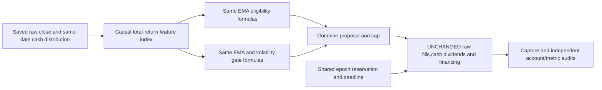

# C05: total-return feature representation

Status: closed; fixed target rejected. This is cycle1 of
[active epoch2](2026-10-28-rsi-epoch2.md); [GRS](../research-standard.md) owns
acceptance. [Design](../../.local/rsi-calmar-20261028/research/plans/total-return-c05.design.json) freezes
one upstream feature-representation change,not a new portfolio cash-flow model.

## Hypothesis,controls and information boundary

Raw ex-dividend price drops are not necessarily investor losses. Test whether
using a causal cash-distribution total-return feature index improves the same
EMA/volatility policy after costs. This changes one upstream representation for
all close-derived EMA/volatility features; its coupled effects on proposal and
gate are declared,not attributed to one indicator. Keep formulas,thresholds and
recovery counters unchanged; price-peak component remains disabled.

Cases: original raw-close incumbent; full total-return feature transform; partial
control using total-return EMA eligibility with the original raw-close independent
cap. Partial control isolates eligibility-only application; report if it dominates
full transform. No lookback,parameter,threshold or era selection after outcomes.

Index starts100 and updates `I[t]=I[t-1]*(close[t]+distribution[t])/close[t-1]`.
Each ex-date distribution enters only that completed close's feature. All features
lag once to next open. Feature reinvestment is not cash-account reinvestment:
raw OHLC fills,whole shares,ex-date cash dividend credits and financing remain
unchanged. Source distributions have vendor-vintage/rights/calendar limitations;
no unseen information or independent accuracy is established.

Same saved SPY SHA992d9f62de93aa860ae00fc81d3810dbe0ac302a55102886fc5c50545130a8ba,
5535rows,89dividends,0splits,2004warmup and5283sessions2005–2025. Capital300000USD,
allocation0.99,$1commission,5/10bp per side,6% debit financing,zero cash interest.
All history is viewed development; no fit,new holdout or predictive-alpha claim.
Four previous related local cycles used24 financial cases and failed; broader
historical trial count is unknown. The initial pure-feature arithmetic qualification
used no financial run or outcome-label fit.

## Frozen acceptance and bounds

Require≥10% net full-period Calmar lift at BOTH costs,no lower CAGR,no deeper
daily-close full-path maxDD,no longer underwater sessions/calendar days,and no
simple-control domination on growth,depth and both durations. CAGR/DD tolerance
1e-9percentagepoints; use unrounded Calmar. Show overall/21annual-row metrics,
Sharpe,rolling returns/recovery,costs and exposure. These gates do not guarantee
future returns or a maximum possible loss. Sharpe uses daily returns,252sessions
and zero risk-free rate. Calmar is CAGR divided by full-path drawdown magnitude.

Six finite cases including failures,one worker,zero retries,300seconds/case,
1800seconds financial wall and a cycle deadline no later than the immutable
2026-10-28T23:38:05Z epoch deadline. The epoch maximum is TWO cycles/TWELVE
attempts. Existing ResearchController-backed EpochBudget holds the epoch writer
lock,reserves each slot BEFORE local capture,counts failures,and refuses another
case after any outstanding or failed reservation. Child execution requires its
active shared reservation and fixed epoch/plan identity. A crash cannot authorize
a repeated launch; sealed local evidence must be reconciled manually.

Both unchanged controls precede challenger cases. Stop on identity,control,
accounting,integrity,resource or deadline failure. Default coordinator remains
financial-unsupported; this fixed adapter registers only these exact commands.
No network,credentials,broker/order,service,installation,commit or publication.

## Qualification checklist

- [x] Freeze one upstream transform,partial control,criteria and finite bounds.
- [x] Verify saved inputs,prefix/future invariance,raw fill preservation and incumbent.
- [x] Pass synthetic shared-budget,deadline,failure,ambiguity and no-retry checks.
- [x] Pass fixed capture/child-reservation/policy tests and persistent restart checks.
- [x] Pass full offline checks and freeze exact executable/source identities.
- [x] Run reserved financial cases and audit control/accounts/annual/temporal metrics.
- [x] Update leaderboard,shared epoch usage and evidence-backed lesson.

## Results and lesson

Six financial reservations,starts and completed outcomes;zero failures/retries.
[Receipt](evidence/2026-10-28-total-return-c05.json) contains all unrounded metrics,
21annual rows per case,rolling/underwater summaries and actual UTC lifecycles.

| Rule | Cost/side | Calmar | CAGR | Max loss | Longest underwater sessions/days | Sharpe |
| --- | --- | --- | --- | --- | --- | --- |
| incumbent | 5bp | 0.491514 | 8.7343% | 17.7701% | 513/746 | 0.7689 |
| incumbent | 10bp | 0.481692 | 8.6590% | 17.9762% | 514/749 | 0.7630 |
| total return trend only | 5bp | 0.465775 | 8.6007% | 18.4654% | 531/769 | 0.7537 |
| total return trend only | 10bp | 0.457755 | 8.5297% | 18.6337% | 531/769 | 0.7482 |
| total return features | 5bp | 0.439857 | 8.5478% | 19.4331% | 556/805 | 0.7404 |
| total return features | 10bp | 0.433653 | 8.4802% | 19.5553% | 557/806 | 0.7352 |

Full-transform Calmar falls10.51%/9.97% rather than meeting+10%. All four incumbent
advancement guards fail at both costs; the eligibility-only control also dominates
full transform on growth,loss depth and both durations. Neither transformation
beats incumbent. Full transform changes173 intended targets,all higher; partial
control changes120,also all higher. Cash/fill accounting and source bars are
unchanged,so these are feature/policy interactions,not artificial dividend profits.
All longest underwater episodes are recovered,not right-censored.

The full transform has LOWER modeled commission/slippage10696.18/20277.91USD
versus incumbent11747.22/22309.84USD,yet worse performance. Direct trading-cost
savings therefore do not explain away the failed target. Actual debit interest
is zero in every path under the unchanged6% financing rule. Daily-close drawdown
and viewed-history limitations remain; no native execution or unseen-alpha claim.

**Lesson:** a causal,total-return-consistent feature can be arithmetically sound
without improving a fixed policy's investment behavior. Removing mechanical
ex-dividend drops makes eligibility/caps more permissive in this fixture; that
extra participation did not earn its downside. Do not reject total-return data
integrity because this policy scored worse,or tune thresholds after failure to
make it look successful. Keep both representations and the negative result for
later interpretation. Incumbent unchanged; no promotion.

## Epoch use and verification

The shared ResearchController journal reserved EACH financial slot before its
local child launch. It records6completed attempts and one retired cycle,leaving
6attempts and1cycle slot under the ORIGINAL2026-10-28T23:38:05Z deadline.
Each child checked its active shared reservation. No old budget was reopened.
Outstanding/failed reservations block new work; cycles and attempts cannot reset
on restart. Shared outcome claims are cross-checked against sealed local captures.

604 offline tests passed before freeze,including shared budget limits/deadline/
no-replay checks and11 fixed capture/policy/child-reservation tests. Persistent
synthetic failure/restart tests used zero financial runs. Both fresh incumbents
match original trades exactly and ledgers within1e-7USD. All six Decimal account,
independent overall/21annual-row metric and temporal audits pass. Closed cached
restart with launch patched to fail returns all6cached,zero new financial launches
and unchanged94-artifact manifest.

Raw bundle `.local/total-return-c05/`,manifest SHA
`5ec06c44683d82ea294a00b45f60722b05a309a1fdee17ce00b5920eb7815ca8`.
Qualification/source snapshot `.local/total-return-c05-qualification/`;
shared epoch journal `.local/rsi-epoch2-20261028/financial-journal/` and its saved
C05as-of receipt. Future cycle appends change the shared journal,not this historical
as-of receipt. Source remains uncommitted in the isolated checkout. No downloads,
credentials,brokers/orders,services,installation,MLflow import or publication.

Final verification:605 offline tests passed in full `make check`(exit0). Shared epoch and local capture attempts map one-to-one;6of12slots are consumed. All455 artifacts across C01–C05 and every original manifest match;361prior artifacts remain preserved. The frozen executable/source snapshot and all67prior leaderboard rows/links are unchanged; six C05 rows added. Documentation,boundaries,index,dependencies and whitespace checks pass. Goal remains active for C06 qualification under the unchanged deadline.
