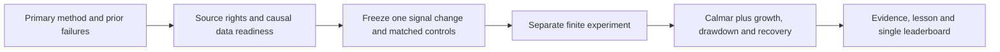

# Return to algorithm research: next mechanism screen

User requested continuing new-algorithm exploration before paper deployment.
No hosting purchase, deployment, paper orders, new financial simulation, data
acquisition or agent launch occurred. Existing historical budgets remain closed.
This scoped screen updates research direction; it does not replace portfolio
priority in the roadmap or create an unattended research goal.

The [T11 export review](2026-10-29-t11-export-validation.md) preserves the current
matched research comparator: gated T11 Calmar2.4941, CAGR92.03%, DD36.90%, legacy
longest underwater199sessions/292days. Ungated grows faster and recovers sooner.
Those are development observations, not universal SOTA or a clean holdout.
The [single leaderboard](../leaderboard.md) remains unchanged by this screen.

## Candidates screened

The order below is a study-specific inspection order based on mechanism novelty,
not a predicted return ranking. No candidate has a new reproduced score.

| Inspection order | Family / proposed pipeline contribution | Primary evidence and idea | Current material gates |
| --- | --- | --- | --- |
| 1 | Residual momentum / target selection | [Blitz, Huij and Martens2011](https://pure.eur.nl/ws/files/46882404/ResidualMomentum-2011.pdf); [QC method15304](https://www.quantconnect.com/research/15304/residual-momentum/). Rank momentum remaining after explaining stock returns with common factors, rather than ranking raw gains. | Exact score convention, factor publication timing/vintage, PIT stock universe and actions; no qualified complete licensed package in our saved review. |
| 2 | Quality selection / fundamental target ranking | [AQR Quality Minus Junk](https://www.aqr.com/insights/research/working-paper/quality-minus-junk). Study profitability/growth/safety information as a mechanism different from price-only timing. | Original paper is long-short; a long-only selection is an adaptation. PIT filings, restatements and borrow costs for an exact long-short reproduction remain unresolved. Published factor returns do not give us investable stock-level inputs. |
| 3 | Statistical-outlier momentum / target selection and breadth | [QC research21382](https://www.quantconnect.com/research/21382/statistical-outlier-selection-for-momentum-stocks/p1). Select unusually strong momentum observations instead of forcing a fixed number of holdings. | Single community study, not established state of the art. Variable breadth changes exposure/concentration; requires same-universe, matched-exposure and turnover controls. Full source/license/data eligibility unverified. |

The outlier article reports a2021–2026 Sharpe comparison of0.525 versus0.363 for
SPY. These are upstream claims with a different period/context; no comparison to
T11 is warranted. The residual-momentum article describes36monthly observations
and Fama-French regressors. Its headline robustness/Sharpe claims are not local
results. No quantitative claim from the quality paper is adopted as our result.
The university quality-paper file returned403 during reading; the author/publisher
AQR source was reviewed instead. No attempt bypassed access controls.

AQR's [century trend-following study](https://www.aqr.com/Insights/Research/Journal-Article/A-Century-of-Evidence-on-Trend-Following-Investing)
was also checked as a diversification reference. Multi-asset trend is already in
our prior research queue; relabeling it would not make it a new research family.
Its institutional multi-market implementation is not replicated by an ETF proxy.

## Selected next slice: residual-momentum feasibility

Question: can a stock-specific momentum signal be built from causally available
free inputs and separated from ordinary momentum on the same eligible universe?
This is a proposal for a different selection mechanism, not another T11 exposure
cap or a claim that residual momentum will outperform T11.

Freeze the **readiness slice** first: one method, at most two explicitly licensed
source candidates, one primary factor-data source and one bounded availability
review; zero financial runs, zero data downloads, no strategy-source export from
restricted pages and no new dependencies. End with a source/input contract or
explicit missing fields. Reuse the existing licensed-source review as negative
search evidence rather than retrying its entire1152-hit search.

Required checks before a separately bounded financial experiment:

- Reconcile the paper's exact regression window, intercept/excess-return handling,
  momentum lookback, skip convention, residual standardization and rebalance timing.
- Verify source/code reuse rights separately from paper accessibility and data
  rights. Our prior catalog entry QC-T-15304 has `whole_source_package:null` and
  `free_data_status:not_qualified_for_exact_tutorial_reproduction`.
- Check factor availability timestamps and revisions; assigning observation dates
  as publication dates would introduce look-ahead. Identify the actual usable
  lag, not an assumed lag selected after observing returns.
- Verify a PIT universe with delisted names, actions and causal membership.
  The current500-stock archive is survivor-selected; it is not a valid replacement
  for historical eligibility. A static-universe engineering diagnostic must be
  labeled as such and cannot produce an investable performance claim.
- Keep control universe, dates, capital, long-only constraints, costs and financing
  identical. Compare equal-weight universe and ordinary momentum before claiming
  an incremental residual signal. An exact long-short paper replication and a
  long-only adaptation are different experiments.
- Keep T11 in its own context. Only a separately specified common-period,
  comparable-accounting portfolio comparison could test complementarity with it.

If the readiness slice succeeds, propose one frozen signal replacement with a
finite matched case/cost budget before launch. Define numerical Calmar improvement
and growth/drawdown/recovery guardrails before looking at its outcomes. Use the
existing canonical scoring/adoption rules, not an invented passing threshold.
If readiness fails, preserve the failure and move to the next viable mechanism;
do not silently substitute price-only features or continually tune the same idea.

## Actual verification and disposition

Reviewed the prior shortlist, licensed-package record, T11 full/year/temporal
review and primary source method pages/paper. No new source code was imported,
executed or copied. The historical qualified data/native route remain unchanged.
Disposition: **residual momentum selected for readiness inspection, not eligible
for financial execution yet**. Hosting/deployment is deferred by the user's
current direction; no subscription was purchased or hosted trader launched.

[Screen receipt](evidence/2026-10-29-next-algorithm-screen.json).
