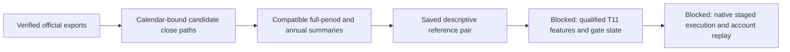

# T11 official export validation and lessons

Both user-downloaded official reference exports are preserved and verified locally. This closes the result-download blocker for the new reference pair, not the qualified-data, decision-log or native-execution requirements. No new financial run or broker order occurred in this review.

[New reference runs](2026-10-29-t11-reference-reruns.md) own cloud source/build provenance. The [original reproduction goal](2026-10-28-t11-reproduction-rsi-goal.md) remains blocked; its historical budget is unchanged. The [paper SOP](../operations/alpaca-paper.md#t11--traffic-light-pilot-preparation) owns operational readiness.

## Consistent closing-equity comparison

Legacy metrics use the same1508-session calendar, USD10,000 anchor at2019-12-31, actual calendar-day CAGR, zero-risk-free252-session sample Sharpe and close drawdown. The underwater columns preserve the original legacy convention, which excludes the recovery close. These are inspected development history, not untouched out-of-sample returns.

| Strategy | CAGR | Max drawdown | Calmar | Sharpe | Longest underwater sessions / calendar days | Ending NAV |
| --- | ---: | ---: | ---: | ---: | ---: | ---: |
| Ungated T11 | 119.67% | 51.26% | 2.3347 | 1.6901 | 146 / 214 | $1,124,734.59 |
| T11 + risk gate | 92.03% | 36.90% | 2.4941 | 1.6400 | 199 / 292 | $501,845.82 |

The gate raises Calmar about6.83% and reduces maximum drawdown by14.36 percentage points. CAGR falls27.64 percentage points; ending wealth falls about55.38%. The longest legacy underwater spell grows53 sessions and78 calendar days. Neither variant meets the approximate30% drawdown reference.

## Annual comparison

Year drawdown resets to the prior year-end anchor. Annual Calmar is the calendar-year simple return divided by year drawdown magnitude; it is not full-period CAGR/maximum drawdown.

| Year | T11 return | Gate return | T11 DD | Gate DD | T11 Sharpe | Gate Sharpe | T11 annual Calmar | Gate annual Calmar |
| --- | ---: | ---: | ---: | ---: | ---: | ---: | ---: | ---: |
| 2020 | 187.47% | 109.81% | 51.26% | 29.05% | 1.910 | 1.798 | 3.658 | 3.780 |
| 2021 | 149.94% | 137.99% | 20.07% | 16.72% | 2.356 | 2.332 | 7.471 | 8.252 |
| 2022 | 125.30% | 60.62% | 34.21% | 22.75% | 1.756 | 1.481 | 3.662 | 2.664 |
| 2023 | 103.02% | 91.76% | 27.94% | 26.63% | 1.695 | 1.803 | 3.687 | 3.446 |
| 2024 | 228.95% | 228.44% | 28.16% | 28.06% | 2.349 | 2.356 | 8.129 | 8.141 |
| 2025 | 4.04% | -0.64% | 29.68% | 29.68% | 0.362 | 0.252 | 0.136 | -0.022 |

## Temporal interpretation

Canonical temporal-v1.2 includes the recovery interval: the longest episode is147 sessions/215 days for ungated T11, versus200 sessions/293 days for the gate. Both begin at the2024-09-06 peak and trough on2025-03-13. Ungated recovers on2025-04-09; gated recovers on2025-06-26. These retrospective observations locate a missed-recovery hypothesis; they do not identify the exact decisions or causal mechanism. Both strategies end2025 below a later prior peak; the final episode is separately right-censored.

## Export and mapping audit

- Both identities and completed statuses match the two approved18215 cloud runs. Ungated: Calm Fluorescent Yellow Manatee, ae7d527233c8cec348ee4da07c9fe0eb. Gated: Hipster Blue Owlet,96cee07260398f6cdb20c92b08bc50e5.
- Each official equity series contains3699 OHLC candles, including2192 midnight samples,1315 samples at10:00 NY,191 at14:00 NY and one terminal16:00 NY sample. Every chart sample is not a completed trading session.
- Candidate closing NAV maps each saved exchange session to the following New York midnight candle close, except the final exact16:00 NY sample. This is an explicitly checked reconstruction, not the original engine decision/account trace.
- The independently saved calendar contains1508 sessions and its hash matches the original aggregate calendar hash. Both full-period legacy summaries match all available aggregate checks at the existing tolerance (USD0.01 terminal value,1e-8 fractional/ratio values, exact counts/flags/calendar hash).
- All available yearly checks are compatible after explicit four-decimal equity quantization. The first review retained four strict annual Calmar discrepancies of1.0e-8–2.94e-8. Reviewv2 propagates half-unit USD0.00005 through annual return/drawdown/Calmar; no financial parameter was changed. Exact comparisons are not claimed.
- Order identities, finite nonzero quantities, positive prices, date ranges, fill-after-create ordering and record counts pass structural checks. All1062 ungated and998 gated records have exported status code3 and order-type code4. These code counts are literal observations, not an independent fill/account proof.
- Built-in Overview statistics remain separate:119.574%/91.961% CAGR,51.300%/36.900% DD and1.908/1.709 Sharpe. Do not mix these with the custom closing-path metrics above. Different sampling, annualization and risk-free definitions require a separate engine-metric explanation; a similar number is not proof of identical definitions.
- Original downloads remain untouched. Private copies, candidate paths, temporal summaries and manifests remain under `.local/t11-reference-v2/`; no raw export or third-party strategy source is published.

## Checklist and next bounded work

- [x] Preserve both official exports and bind exact identities/hashes.
- [x] Inspect coverage/sampling and verify candidate paths against saved aggregate/year references.
- [x] Add temporal-v1.2 diagnostics while preserving legacy durations and failed strict checks.
- [ ] Obtain or build daily policy/feature/gate decision records; ordinary result exports do not contain them.
- [ ] Qualify all24 required T11 instruments, adjustments/reverse splits and gate initialization for the intended local route.
- [ ] Verify the native multi-ETF staged controller, per-event cash/positions/fees/actions/financing and restart handling.
- [ ] Reproduce decisions, orders and account transitions end-to-end before any next financial optimization or paper launch.

The next useful slice is a zero-financial-run feature/decision-producer contract and readiness audit against this new reference pair. It must bind source hashes, observed-time semantics, adjusted versus RAW inputs, Wilder initialization, gate seed and missing-data behavior. Missing original18209 daily decisions remain an explicit historical limitation, not a requirement to download the same files again.

[Machine-readable validation receipt](evidence/2026-10-29-t11-export-validation.json). This review updates evidence status, not strategy adoption or historical performance values.
