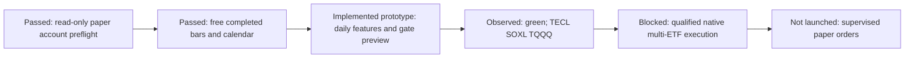

# T11 paper-pilot rehearsal

User requested trying the existing USD10,000, one-supervised-session paper pilot.
The [Alpaca SOP](../operations/alpaca-paper.md) owns broker and launch policy.
This dated record preserves what actually happened; no ongoing trader or
scheduled future session was created.

## Actions and results

- Read-only preflight at2026-10-30T03:31UTC (October29 Pacific): ACTIVE eligible
  USD paper account, flat positions and no open orders. Market closed. Broker's
  next regular open: October30 at06:30 Pacific. This is an observed clock value,
  not a scheduler or commitment to launch at that time.
- Added a separate read-only preview collector, which has no order endpoint.
  Before networking it saved a plan:24 fixed T11 symbols, adjusted daily bars
  over600 calendar days, RAW SPY since2016, SIP feed, explicit completed-data end,
  one worker,12 requests/32MB/180seconds maximum, zero retries. No keys or private
  HTTP responses are included in public evidence.
- Actual collection used3 GET requests,1,695,077 response bytes and about2.34seconds.
  Raw responses and hashes remain private. Coverage matches414 completed exchange
  sessions for all24 required instruments; the RAW gate seed contains2722sessions.
  No gaps were filled or prices fabricated. This is conditional input storage,
  not a general dataset promotion, native catalog write/read or action audit.
- The project-owned Wilder/SMA prototypes now feed the previously hash-pinned
  private T11 policy. The prototype uses Alpaca `all`-adjusted feature closes;
  gate input uses rounded-cent RAW SPY. Local gate state from the full2016 seed
  agrees with the half-length seed over the last60 states. This does not establish
  original2004 seed parity or exact native indicator/normalization parity.
- The October29 diagnostic preview is **green**, cap1.0, branch`bull_risk`:
  TECL/SOXL/TQQQ each1/3 of the policy allocation. Applying the pilot90% deployment
  would be roughly USD3000 each and USD1000 cash before fee/rounding reserves.
  No live quote, share count or executable order proposal was produced.
- **Zero broker submissions, zero new financial simulations.** The original
  one-share SPY session was not substituted. No overnight orders, hosted service,
  automation, cancellation, liquidation or account changes were performed.

## Implemented versus missing

Implemented: bounded data-only snapshot, completed-session/OHLC integrity checks,
feature construction, gate bootstrap stability diagnostic and pinned policy
preview. Three focused offline tests exercise missing/duplicate/future bars,
full-universe warmup and a stable gate. The entire offline suite is recorded in
the receipt after verification.

Still missing before orders: qualified operational feature/normalization and
missing-data contract, native multi-instrument execution bridge, aggregate pilot
spending control, staged transitions, reconciliation against actual broker
positions/orders and end-to-end failure/restart checks. A stable color or passing
account preflight does not establish these properties. The prototype's public
status stays `preview_complete_unqualified_not_for_orders`.

Private evidence:
`.local/alpaca-paper/runs/20261030T033142521664Z-preflight/summary.json` and
`.local/t11-paper-preview/20261030T033342Z/{plan,summary,manifest}.json`.
[Redacted receipt](evidence/2026-10-29-t11-paper-rehearsal.json).
