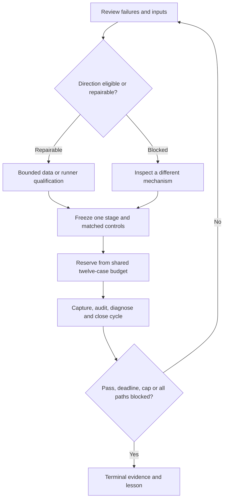

# Calmar epoch 3: continuing bounded RSI goal

**Active goal**, authorized by the user's acceptance of the four-hour/twelve-case
proposal. This goal does not complete merely because one direction is blocked.
The [program bounds](../../research/plans/calmar-epoch3.program.json) own its exact
UTC deadline and shared maximum; this document tracks work and evidence.
GRS-1.1 owns acceptance, the single leaderboard owns presentation, and original
study manifests own historical results. No prior allowance is reopened.

## Scope and stopping

At most four hours from tool-goal creation, twelve financial cases total including
failed launches, one worker, zero automatic financial retries and 300 seconds per
case. No paid resources, credentials/account changes, broker connections/orders,
services/deployment, commits or publication. Ordinary synthetic and read-only
checks do not consume financial slots, but remain within the overall deadline.
Every historical case must be reserved and captured before its subprocess starts.
Unknown/interrupted execution stops dependent work until reconciled.

The last residual-momentum cycle closes its own zero-run readiness branch; its
blockers remain real. This program may resolve those dependencies, but also has
qualified fixed-sector inputs available. It will not close on that first blocker
while another scoped path is viable. The broad stock/factor route needs actions,
PIT scope and factor availability; qualified sector data avoids those specific
stock-selection dependencies without pretending to solve them.

## First prospective cycle: correlation-aware target selection

E3-C1 changes target selection only. Keep sector-gate-v1's ten-sector universe,
252-session economic total return / 63-session volatility ranking, monthly timing,
gate initialization/hysteresis, 98% target allocation, USD300000 capital, corporate
actions, whole-share/cash model and next-open execution unchanged.

At each existing monthly decision close, take the top six momentum/volatility
sectors. Select the highest-score sector first. Select each of the next two by
minimum mean positive Pearson correlation of the preceding 63 daily economic
returns to already selected sectors; round correlation penalties to twelve decimals
for numerical tie stability, then break ties by descending momentum score,
then ascending symbol. Zero/nonfinite volatility or correlations block the case;
no silent substitution. Equal slots; do not rerank on gate-only transitions.
This is a small independently implemented diversification heuristic, not HRP
reproduction or a trained model. Correlation estimates can be unstable and the
candidate may sacrifice return by excluding persistent leaders.

Fresh controls are unchanged gated top-three and same-gate equal-weight ten
sectors. Three policies at 5bp and 10bp per side plus USD1 per nonzero order:
six cases total. Require at least 10% Calmar improvement at both costs, no lower
CAGR, deeper daily-close drawdown, longer longest underwater sessions/calendar
days, or simpler-control domination. Numerical percentage-point tolerance 1e-9;
durations exact. Use already-viewed 2017-02-01–2025-12-31 development history,
2016 warmup and the parent's temporal/cashflow conventions. No holdout/alpha claim.
No source or criterion changes after financial outcomes within this cycle.

The old capture adapter is intentionally locked to its expired program and must
not be reopened. A new versioned adapter requires offline capture/failure/restart
qualification and independent selector/account replay before any new financial
case. Shared budget enforcement must span both cycles. A second six-case cycle
may target another stage after diagnosis; freeze it before outcomes and preserve
E3-C1 source/evidence. Stop early if E3-C1 passes all declared criteria.

## Checklist and current evidence

- [x] Create active tool goal and durable aggregate bounds.
- [x] Recheck residual blockers and identify an independently viable local route.
- [x] Verify saved qualified sector bundle/source-manifest identities and all
  declared payload hashes against the completed parent plan.
- [x] Freeze E3-C1 mechanism, controls, costs, criteria and six-case ceiling.
- [x] Implement and test selector, independent replay and new bounded capture.
- [x] Freeze executable source/input identities and lifecycle qualification.
- [x] Execute E3-C1, audit every attempt and record annual/temporal findings.
- [x] If no passing candidate, choose/freeze one distinct-stage E3-C2 within the
  remaining aggregate bounds; stop if all viable paths are demonstrably blocked.
- [x] Update the existing single leaderboard and lesson after each closed cycle.
- [x] Terminal audit of shared usage, output identities, failures and stopping reason.

Public inspiration reviewed: [author's portfolio-research overview](https://www.quantresearch.org/Innovations.htm)
identifies correlation/concentration-aware allocation methods; the experiment is
our specified heuristic, not an implementation of those claimed results. No third
party strategy code is copied. This goal is not a broker service or scheduler.

## E3-C1 execution checkpoint

New source-bound qualification passed four actual synthetic probes (two successes,
intentional failure and timeout), read-only cached restarts and no failed-probe
retry. The offline suite passed 580 tests. The [six-case executable freeze](../../research/plans/calmar-epoch3-c1.frozen.json)
binds exact source/input/proof bytes and the common twelve-slot journal. E3-C1
execution was explicitly launched; captured reservation/PID/exit evidence owns
actual usage, not this live checklist. All parent source and results stay frozen.

## E3-C1 closed: diversification heuristic rejected

All six financial cases completed and passed independent Fraction account,
selection, annual and temporal replay. Both fresh gate incumbents matched the
saved parent ledger/trades/summary/selections/contributions byte for byte.
[Validated cycle receipt](evidence/2026-10-30-calmar-epoch3-c1.json) retains actual
reservations, PIDs, exits, source/input identities and all six results.

At 5bp, correlation-aware Calmar is 0.581100 versus 1.033047, CAGR 9.5850% versus
12.8871%, DD 16.4946% versus 12.4748%, longest underwater 402/585 versus 300/436
sessions/days. At 10bp Calmar is 0.543798 versus 1.003744; growth, depth and
recovery also fail. Incumbent retained. No parameter is changed to repair this result.

The saved-selection diagnosis confirms that the intended mechanism acted:
mean positive pairwise correlation at 107 monthly decisions fell from 0.5597 to
0.3939, with identical gate traces and nearly identical average gross exposure
(0.8609/0.8612). Trades rose 430 to 468 and modeled slippage USD15040.91 to
USD17807.99 at 5bp. Lower measured correlation did not compensate for displaced
leaders/portfolio returns and extra turnover. This is descriptive attribution,
not an independently validated causal return decomposition.

Full/annual comparison CSVs, 54 annual rows, account paths, monthly picks,
contributions and self-contained browser report are in
`.local/calmar-epoch3/c1-review/`; original case artifacts remain sealed under
`c1/financial/`. The single leaderboard now contains the six measured tagged rows
with their context/evidence/lesson. Shared usage is **6/12**, one worker, zero
financial failures or retries. A postprocessing command initially lacked the local
module path; it failed before touching outputs or launching a case and succeeded
with explicit `PYTHONPATH=.`. This infrastructure failure consumes no financial slot.

## E3-C2 prospective freeze: sector-breadth market conditions

The next question changes **market conditions**, not target selection. C1's
correlation heuristic is rejected; do not carry it into C2. Retain the incumbent's
volatility-adjusted top-three ranking, monthly picks, sizing/accounting, costs,
capital, dates and next-open execution. Replace the SPY-only EMA/volatility
classifier with the fraction of the same ten sector economic return indexes above
their trailing 200-close SMA. This is a fixed-sector breadth proxy, not whole-market
stock breadth or a trained risk probability.

The candidate uses these fixed, pre-implemented thresholds: unassessed until all
200-close averages are finite, initialize yellow; red immediately at breadth<=20%;
leave red after five consecutive closes with breadth>=40%, first to yellow;
green drops immediately to yellow below60%; leave yellow after five consecutive
closes at breadth>=70%. Caps remain 1/.5/0. All features shift once to the next
open; monthly picks are retained on cap-only transitions. These numeric rules
were in the source-bound synthetic proof before any C1 financial outcome and
are not fit to the rejection. No threshold search is authorized.

Three policies at both costs: breadth candidate, unchanged gated incumbent and
ungated volatility-adjusted top-three simpler control. Six remaining cases; same
strict 10%-Calmar/both-cost/growth/depth/recovery/no-control-domination criteria.
No older data source or universe is substituted. The change may detect weakness
spread across sectors, but slow breadth and hysteresis can miss rebounds and
increase turnover. This is a falsifiable development test, not asserted alpha.

Source inspiration: [StockCharts' indicator documentation](https://chartschool.stockcharts.com/table-of-contents/market-indicators/percent-above-moving-average)
describes participation above an average and warns about whipsaws. Our ETF proxy,
thresholds and staged gate are adaptations; no published portfolio performance
or code is reproduced. C2 source bytes stay identical to the qualified build.

## E3-C2 closed and terminal stop

Six more cases completed and passed independent replay; **12/12 shared financial
slots used**, no financial failures or retries. The [C2 receipt](evidence/2026-10-30-calmar-epoch3-c2.json)
records all runs and rejected guards. At 5bp, breadth Calmar is 0.467210 versus
1.033047, CAGR 7.8778% versus 12.8871%, DD 16.8615% versus 12.4748%, longest
underwater 527/768 versus 300/436 sessions/days. At 10bp, Calmar 0.433162 versus
1.003744; underwater 567/829 versus 300/436. All improvement guards fail at both
costs. The fixed rule is rejected, not tuned until it passes.

Monthly picks are identical across the two gates (107 updates). Breadth spends
291 sessions in red versus 68, caps lower on 480 sessions and higher on 84, and
reduces average gross exposure from0.8609 to0.7668. Trades increase430 to487.
Its annual return gap is especially adverse in2023 (-17.22pp),2020 (-7.75pp) and
2022 (-6.68pp). Being more conservative more often did not improve this portfolio's
drawdown or recovery. These are saved-path diagnostics, not a new historical case,
causal feature importance or an ex-ante risk probability.

The [terminal audit](evidence/2026-10-30-calmar-epoch3-terminal.json) verified twelve
sealed cases, exact source snapshots, qualified inputs, one-worker timing,
reservation-before-launch, twelve zero-difference independent account replays,
1080annual/168full/108rolling metric checks, and the authoritative journal chain.
All twelve reservations completed, both branches retired, zero slots remain.
Read-only restarts of both sealed programs caused zero launches and changed no
financial-root or journal hashes. Original parent evidence and budgets are intact.
Stop reason is the **actual shared case cap**, not a first data blocker or elapsed
four-hour maximum. No new goal or allowance is created automatically.

Both cycles updated the single tagged leaderboard, with original rows retained.
The [negative-results experience report](2026-10-30-calmar-epoch3-experience-report.md)
links full/annual/temporal results and lessons. The combined local browser package
is `.local/calmar-epoch3/review/index.html`, with108annual rows and a standalone
PNG reviewed visually. The [final closure receipt](evidence/2026-10-30-calmar-epoch3.json)
records final check outcomes. Neither challenger improves the matched incumbent;
no new alpha, protected OOS result, trained ML/RL advantage, native/broker parity,
operational readiness, purchase, order, deployment, commit or publication.

### Lessons and next proposed question

1. Correlation-aware selection achieved lower measured correlation but lost return,
   depth and recovery. A diversification feature needs an economic portfolio test.
2. Sector breadth is not a free upgrade to a SPY-based gate. More red/cash days can
   miss recoveries while the remaining exposure still incurs deeper losses.
3. Calmar must remain beside CAGR and recovery, with strict predeclared guards;
   there is no justification to relax these after seeing rejection.
4. The loop progressed past residual-momentum blockers to another qualified route,
   changed two distinct stages in separate cycles, retained adverse evidence and
   stopped at the real aggregate cap. It did not manufacture an improved algorithm.

Next proposed work is saved-decision diagnosis of risk-state transition timing and
alternative signal information, or qualified residual-momentum inputs. Do not
launch another financial study under this closed allowance. Any next goal needs
its own finite user-authorized scope and must consider these negative lessons.

## Final offline verification

`make check` exited0 after closure integration: **580 tests passed** in15.700s,
documentation check passed for178files and no broken dependencies. Versioned
parent and child receipt validation and whitespace checks passed. A read-only
comparison to the pre-C1 leaderboard confirms every original table row is retained,
exactly one table remains, and twelve measured context-tagged rows were added.
The terminal result is a completed bounded search with two rejections, not a
higher-Calmar winner. No further financial case is permitted under this program.
