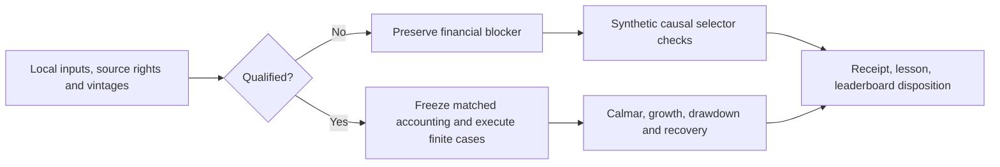

# Bounded RSI goal: residual momentum target selection

Cycle RM-20261030-01 under GRS-1.1. User requested a goal and continued algorithm
evolution. Objective: test whether common-factor-adjusted target ranking can
improve matched-context Calmar, rather than repeat SPY sizing/eligibility tweaks.
This is a prospective long-only adaptation, not a reproduction of the paper's
long-short portfolio or an improvement to T11 already established by evidence.

## Frozen bounds and prerequisite gates

- One mechanism and one changed stage: target ranking only. At most two source
  implementation candidates, one factor-data provider review, one worker, zero
  retries and 90 minutes from goal creation. This is not an unattended scheduler.
- At most six financial cases: residual ranking, ordinary momentum and equal
  weight, each at 5bp and 10bp one-way modeled trading cost. This is a maximum,
  not a launch instruction before qualification. No old budget is reopened.
- Before any financial reservation, freeze a qualified PIT universe, monthly total
  returns and actions, as-of factor vintages/availability, calendar, exact matched
  execution/accounting plan, code/data identities and supported captured runner.
  Failure of any material prerequisite blocks all financial cases; engineering
  verification can finish without claiming an improvement or using those slots.
- No data acquisition in this initial cycle, paid APIs, credentials, broker
  operations, services, deployment, commits or publication.

## Fixed selector contract and future comparison

Portfolio month t uses 36 monthly excess returns t-36 through t-1. Fit an intercept
plus MKT-RF/SMB/HML; rank the sum of fitted residuals t-12 through t-2 divided by
sample standard deviation over those 11 residuals. Exclude fitted alpha from the
score. All inputs need explicit UTC availability at or before the decision cutoff.
Use contiguous completed months; no imputation or silent use of newer vintages.
Reject rank-deficient/ill-conditioned regressions and zero residual volatility.

The future long-only treatment selects the top decile (ceiling, at least one)
with equal target weights, monthly. Ordinary 12-1 total-return momentum uses the
identical 36-month-complete eligible universe and same breadth, with lexical ID
tie breaking. Equal weight holds that same eligible universe. Proposal generation
must not add leverage, a traffic-light overlay or another selection filter.
No portfolio or return path is generated in the engineering slice.

Future financial comparison is development-only on already-viewed history:
2020-01-01 through 2025-12-31, with 2017-2019 warmup if qualified. Proposed research
screen, frozen before any new portfolio outcome: Calmar at least 10% above ordinary
momentum at both costs, CAGR no more than 1 percentage point lower, max drawdown
no more than 1 percentage point deeper, and longest underwater no more than 10%
longer. These are study criteria, not user loss limits or automatic adoption.
Report equal-weight and SPY as contextual controls; T11 is a different context.
Financial execution remains blocked until a new immutable qualified execution
freeze specifies exact fills, cashflows/actions, capital and account reconciliation.

## Readiness observations and sources

The [local stock-library owner](../data-library.md) and saved manifest identify a
2026-current-member cohort: not a historical PIT membership set, and actions are
not qualified. The selected source candidate's pinned GitHub source/license pages
failed to load during this screen; no source copied or package imported.
The factor library offers annual archives, but annual release-month evidence does
not establish exact per-month decision-time factor vintages or redistribution
rights. No factors were downloaded or inferred from price-adjustment factor files.

- [Residual Momentum, Blitz/Huij/Martens 2011, methodology pp.10–12](https://pure.eur.nl/ws/files/46882404/ResidualMomentum-2011.pdf).
- [French factor library](https://mba.tuck.dartmouth.edu/pages/faculty/ken.french/data_library.html)
  and [historical archives](https://mba.tuck.dartmouth.edu/pages/faculty/ken.french/Data_Library/f-f_factors_archive.html).
- Candidate checked, not imported: OptimalPortfolios at revision
  `1d6e128b57b1ba75cd08b4ac8a27e95166a6e1fb`; source and license pages unavailable
  to this screen. Existing licensed-package review QC-T-15304 remains blocked.

## Checklist

- [x] Freeze scope, one changed stage, finite bounds and prospective screen.
- [x] Review method and factor-data source; preserve unavailable candidate evidence.
- [x] Record actual local manifest identity and financial eligibility findings.
- [x] Implement independent monthly ranking with availability and degeneracy guards.
- [x] Test known coefficients, alpha removal, timestamp cutoffs, future perturbations,
  missing months, rank deficiency, zero residual variance and matched controls.
- [x] Run offline checks; close receipt, lesson and single-leaderboard disposition.

Original sources, historical experiments and the incumbent remain unchanged.

## Results, negative evidence and lesson

**Engineering complete; financial comparison blocked.** Actual manifest inspection
confirmed `financial_comparison_eligible=false`, `corporate_actions=not_acquired`
and 500 cataloged instruments. [Readiness receipt](evidence/2026-10-30-residual-momentum-readiness.json)
records the manifest hash, source review and unresolved gates. Annual factor
archives alone do not qualify monthly as-of versions; the provider also documents
2025 FIZ/CIZ return-method changes. No price-adjustment factor file is used as a
Fama/French return series. No market data or external strategy code was acquired.

The independently written selector produces residual, ordinary-momentum and
same-universe equal-weight proposals, coefficients, exclusions and explicit
non-qualification flags. It validates declared availability cutoffs, contiguous
history, regression rank/conditioning and finite inputs; it never emits orders.
It excludes fitted alpha, rather than mistakenly ranking alpha plus residual.
Per-cell availability is supplied evidence, not authenticated publication truth.
No long-short portfolio, accounting path, Calmar or other return was computed.

Nine synthetic tests passed, covering known coefficients, alpha invariance,
future perturbation, delayed factors, missing/late stocks, missing months,
singular regression, zero residual volatility, aligned availability, deterministic
ties, top-decile breadth and input preservation. The first eight-test run had
one fixture failure: mutable stock/factor availability buffers were accidentally
shared. An independent deep copy fixed the fixture; original failure output is
retained privately in `.local/residual-momentum-rsi-20261030/initial-failed-tests.log`.
No strategy parameter was changed after viewing market performance.

The [completion receipt](evidence/2026-10-30-residual-momentum-rsi.json) records
actual full-check results and source hashes. Leaderboard disposition: **no metric-row
change**; this is a blocked financial cycle with no measured challenger. Incumbents,
T11 evidence status and historical budgets are unchanged. Zero of six financial
slots used; no carry-forward or automatic retries.

Lesson: a common-factor adjustment is a genuinely different target-selection
mechanism, but completed historical returns and factor availability must be
qualified together. Replacing a missing PIT universe or monthly factor vintages
with current constituents/latest data would make a convenient score rather than
a faithful decision-time experiment. Synthetic conformance advances the stage
implementation, not evidence of higher Calmar.

Next bounded prerequisite: select and qualify a known-at stock universe and
split/dividend-consistent monthly returns, then establish usable factor vintages
and their availability/rights. A deliberately fixed-cohort, revised-factor
retrospective diagnostic would be a different, explicitly labeled study and would
need its own frozen scope. No further simulation is launched by this closure.

### Final verification and budget closure

`make check` exited 0: **569 tests passed** in 14.904 seconds, documentation check
passed for 176 files and no broken dependencies. Final receipt validation and
whitespace checks passed. An earlier full-check invocation stopped on the missing
completion-receipt link while closure was being assembled; its output is preserved
in `.local/residual-momentum-rsi-20261030/make-check.log`, followed by the complete
passing output in `make-check-final.log`. No missing link remains.

The plan's deadline anchor was shortened to the actual tool-goal creation time in
revision 2, before financial execution; the initial plan is retained privately.
This amendment observed no portfolio results and grants no new attempts. The
bounded goal closes on the explicitly permitted blocked-financial branch; higher
Calmar remains an unachieved research objective, not a claimed outcome.
