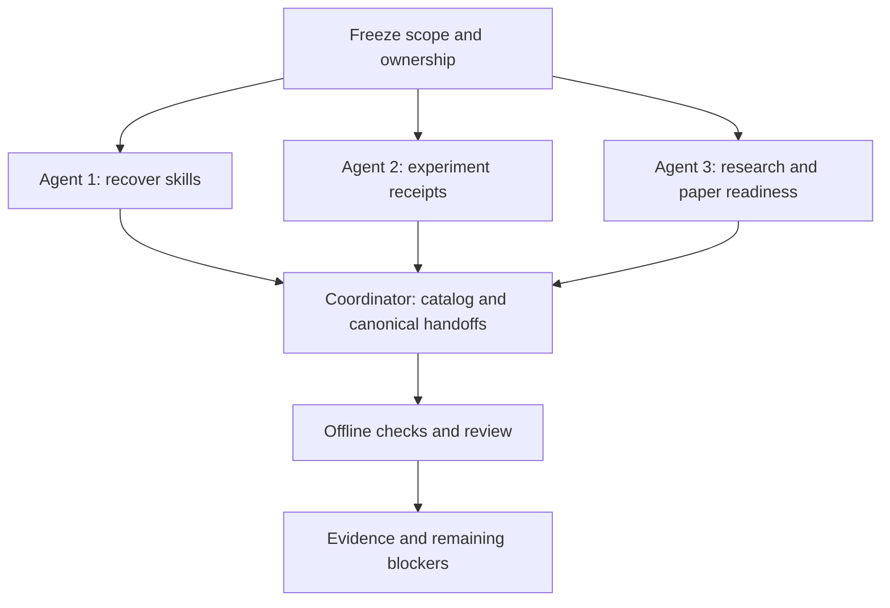

# Skills and SOP repair checklist

Scope: implement the approved six-gap repair using three agents and coordinator
integration. Zero financial runs, downloads, broker connections, orders, services
or deployments. Passing this task verifies workflow behavior, not financial alpha
or paper readiness. Existing raw evidence and unrelated dirty work are preserved.

## Ownership and acceptance

- [x] Freeze finite scope, three-agent ownership and zero external/financial activity.
- [x] Agent 1: inspect history/worktrees, recover or create three missing skills;
  record provenance and evaluate saved-fixture handoffs.
- [x] Agent 2: implement versioned offline receipt validation, negative tests and
  read-only historical T11 compatibility findings.
- [x] Agent 3: strengthen research selection, comparison and readiness handoffs;
  evaluate saved T11 without changing order eligibility.
- [x] Coordinator: reconcile catalog, role contracts, README and canonical SOP
  links, avoiding competing policy owners.
- [x] Integrate result-capture requirement and backward-compatible historical
  handling; preserve historical receipts without invented fields.
- [x] Regenerate and visually inspect team diagram.
- [x] Verify catalog/receipt/workflow negative scenarios and run `make check`.
- [x] Review changes, record lesson, evidence receipt and remaining limitations.

## Evidence and boundaries

Start checkout: `codex/rsi-gate-robustness`, HEAD
`4999ec5767eccdd6f61863b14a05e459855f95e3`; this revision does not identify
pre-existing dirty files. Private baseline status and hashes are saved at
`.local/skills-sop-repair-20261030/baseline.json`. No commit/publication is part of
this task. Agent instructions give disjoint file ownership; coordinator alone
integrates shared catalog, README, research standard and recursive SOP.

## Completed outcomes and lesson

All six repair areas are implemented within the approved offline scope. Three
parallel agents had disjoint ownership; the coordinator reviewed and integrated
shared documents. The primary checkout now has 8 advisory roles and 18 workflow
skills. The three missing skills were recovered with adaptations from preserved
isolated checkouts, not invented as evidence of prior installation.

- [Recovery provenance and saved-evidence walkthroughs](evidence/2026-10-30-skills-recovery.json):
  three recovered skills, original/adapted hashes and nine focused checks.
- [Receipt compatibility review](evidence/2026-10-30-receipt-compatibility.json):
  twelve synthetic/CLI checks; both saved T11 export hashes match; historical
  envelopes remain unchanged and are not falsely relabeled v1.
- [GRS-1.1](../research-standard.md#experiment-receipt-contract) owns the new
  receipt contract. The template validates as blocked with explicit missing fields;
  passing it does not imply an experiment occurred.
- The [research procedure](../research-development.md#evidence-transitions-are-separate)
  and [Alpaca handoff](../operations/alpaca-paper.md#research-to-paper-handoff)
  separate aggregate compatibility, daily reproduction and operational evidence.
  Eight focused readiness checks exercise reviewer-declared failure/unknown states.
- [Catalog](../skills.md), role contracts, execution/history skill pointers and
  recursive handoffs are integrated. The [team PNG](../diagrams/team-skills.png)
  was regenerated and visually inspected: all eight roles and eighteen workflows
  fit without overlapping or clipped labels.

`make check` exited 0: documentation check passed (175 files at that invocation),
no broken requirements, **560 tests passed**. Final documentation/skill checks and
receipt validation are recorded in the [completion receipt](evidence/2026-10-30-skills-sop-repair.json).
Private command output remains under `.local/skills-sop-repair-20261030/`.
Existing CI invokes `make check`, so the new regression tests enter that offline
suite without changing the hosted workflow. No hosted CI or clean-checkout claim
is made for this dirty checkout.

### Review findings and preserved failures

The recovered management instruction initially allowed synthetic metric rows;
review aligned it to the canonical no-measurement/no-row-change rule. The
leaderboard retains its table and original numerical rows, with one closure link
in the explanation. Existing receipt source hashes and both official exports were
rechecked without modification. No upstream dependency code or pins changed.

The skill-creator bundled validator was unavailable because PyYAML is not
installed; project catalog/frontmatter/link checks and saved-fixture walkthroughs
were used instead, with no installation. An initial direct write to protected
existing skill files was denied by the filesystem; the authorized update completed
through an approved scoped escalation. An agent's initial system-Python compile
cache failure and corrected `.venv` verification remain in its receipt.

Lesson: a file in an isolated checkout is recoverable work, not installed
capability. Capture result identities and artifacts while they are available;
structural validation, matching aggregates and reviewer observations each have
strictly limited meaning.

### Remaining limitations and next handoff

- T11 remains unqualified for orders; missing original daily-decision traces and
  qualified signal/native execution/account-restart evidence are not repaired here.
- Receipt validation checks declared identities and explicit local bytes. It does
  not prove scientific truth, rights, accounting correctness or completeness of
  undisclosed trials. Legacy runners are not automatically retrofitted.
- Readiness summaries organize reviewer observations; they do not independently
  measure freshness, enforce budgets, arm a broker or grant execution permission.
- No trained-model/LLM skill-quality benchmark was run; walkthroughs demonstrate
  evidence-grounded routing and preserved limits, not independent adviser skill.
- Zero new financial runs, data downloads, broker connections, orders, services,
  deployments, commits or publication. No incumbent or performance score changed.
- Next proposed research handoff remains the separately bounded residual-momentum
  readiness review; this task does not launch it or replenish expired budgets.

