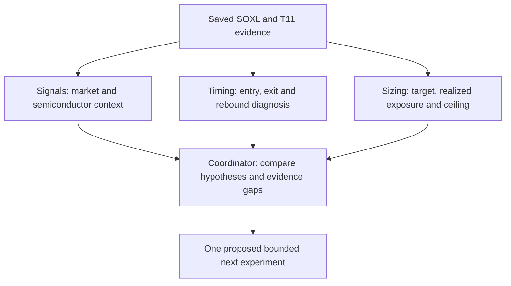

# SOXL-only parallel pipeline review

Review ID: **SOXL-REVIEW-20261030-01**. Scope: saved-evidence diagnosis and
experiment design, not a financial execution cycle. The user requested multiple
agents on the SOXL/cash optimization directions. Follow [GRS](../research-standard.md)
and the [diagnosis procedure](../research-development.md#performance-diagnosis).

## Frozen ownership and bounds

- Three agents, each at most15minutes; coordinator integration at most30minutes
  elapsed for the review. No child agents, new financial cases, downloads,
  external research, broker connections, orders or deployments.
- Each agent owns one new review file only. Coordinator owns this index and its
  receipt; existing research, source files and incomplete exports stay unchanged.
- Each lane proposes at most two hypotheses. Proposals do not authorize runs or
  reopen the exhausted eight-case cloud allowance or pending36-case programme.
- Trade universe is SOXL/cash. Other assets may supply causal information only.
  Preserve the current gated SOXL/cash policy as incumbent; full gated T11 is an
  external comparison, not a presumed transferable benchmark score.
- Sources: [eight-case report](2026-10-30-t11-soxl-cloud-results.md), its
  [incomplete receipt](evidence/2026-10-30-t11-soxl-cloud-results.json), and explicitly
  referenced private saved artifacts. Native and custom metric conventions stay
  separate. Missing decisions/orders cannot support causal trade attribution.

## Checklist

- [x] Freeze scope, ownership, finite review bounds and zero financial budget.
- [x] Launch signal, timing and sizing agents in parallel.
- [x] Review all three evidence-linked findings and free/local input readiness.
- [x] Choose one next question; retain alternatives and rejection conditions.
- [x] Check documentation and preserve a hashed review receipt (linked below).

## Integrated findings

| Lane | Evidence-backed finding | Conditional single change | Current status |
| --- | --- | --- | --- |
| [Signals](2026-10-30-soxl-signals-review.md) | Eligibility is inherited from T11, not a semiconductor-specific predictor | Fixed63-session SMH-versus-SPY relative-strength admission veto | Proposed; qualified full-period SMH inputs missing; additional veto could miss rebounds |
| [Timing](2026-10-30-soxl-timing-review.md) | Gate/eligibility changes already trigger a new intent; generic green reentry duplicates current behavior | One-close confirmation of non-risk eligibility exits, keeping red immediate | Conditional on material isolated-exit evidence; daily decisions/fills missing |
| [Sizing/execution](2026-10-30-soxl-sizing-review.md) | Targets90/45/0 are applied on changed intents, not maintained continuously | Sell-only maintenance of unchanged targets, without buy topups | Conditional on material realized drift; daily holdings/account evidence missing |

The next selected **diagnostic question** is whether realized SOXL exposure
materially exceeded the target before losses. This is not a finding that drift
caused drawdown. Use complete decision/holdings/fill/account evidence, retain
profitable breach periods, distinguish overnight gaps, and freeze materiality
before inspecting episode returns. If no material drift exists, stop this branch
and prefer the new semiconductor information hypothesis over another broad-market
gate or smooth-sizing variant. Timing confirmation remains third priority until
isolated exits are shown to matter after costs.

Recovering official exports can supply equity/order evidence, but does not
recreate decision logs that the original source never persisted. Any reconstructed
trace must be labeled as reconstruction and verified against qualified inputs
and controller state. Prospective instrumentation/replay is a separately scoped
implementation task; this review has not silently authorized a ninth cloud run.

Each agent's proposed six/eight-case allowance is an alternative future design,
not additive execution authority. Do not launch three financial searches. First
qualify capture, accounting and inputs; then freeze one change, controls, a single
aggregate budget and common acceptance rules. Existing half-sized controls are
simple exposure references, not automatically exposure-matched controls. Calmar,
CAGR, drawdown and recovery-inclusive time underwater must come from comparable
complete paths before any adoption claim.

## Disposition

Three-agent review complete; next diagnostic selected, financial test blocked by
named evidence prerequisites. No claimed performance improvement, strategy change,
leaderboard promotion or paper readiness. Actual checks: all eight frozen source
hashes and the terminal8/8 journal were inspected read-only by agents; coordinator
ran documentation validation on the integrated wave. No financial or synthetic
tests were run; prose-only changes do not require a new financial or full-suite
run. [Review receipt](evidence/2026-10-30-soxl-parallel-review.json) preserves
artifact hashes, bounds and the documentation-check result. This is a design
review receipt, not an experiment result receipt or a new leaderboard score.
