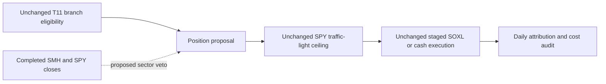

# SOXL-only market and semiconductor signal review

Read-only design review; **zero financial runs, downloads, network calls, broker
connections or child agents**. This record proposes a question, not an execution
authorization or a new allowance. [GRS](../research-standard.md) owns adoption;
[research development](../research-development.md) owns the procedure. No shared
policy, frozen study, original export or leaderboard was changed.

## Recommendation and current evidence

Prefer **one semiconductor-information hypothesis**, after recovering daily
evidence. Defer another broad-market gate variant: it overlaps earlier failed
breadth/sizing directions and supplies less new information. Trade only SOXL or
cash; other instruments are informational inputs.

The [eight-case report](2026-10-30-t11-soxl-cloud-results.md) and private
`.local/t11-soxl-cloud-v1/analysis.json` show the gate helped the restricted
SOXL policy at both costs, but did not match full gated T11. At25bp native
Overview-derived Calmar is1.271 for gated SOXL/cash versus1.137 ungated;
native maximum drawdown is48.9% versus52.8%. Full gated T11 is2.492/36.9%.
Those rounded native statistics are provisional and must not be mixed with
custom closing-path metrics. Missing official exports, daily equity and order
reconciliation prevent identifying which particular gate decisions caused losses.
Annual2022 returns do not establish branch-level causal attribution.

The tested mapping is precise: **positive pre-gate SOXL branch only** becomes
SOXL; every other T11 branch becomes cash, including its TQQQ/SPXL oversold
branches. The original broad SPY EMA/volatility gate remains; the controller
applies90/45/0% NAV target once for green/yellow/red. Execution follows staged
signal-change MOO intent, with no daily target maintenance after completion.
Targets are not continuous realized-exposure limits. The saved source
`.local/t11-soxl-cloud-v1/soxl_cash_gated_25bp/main.py` confirms this mapping and
also contains an existing SMH subscription for an inactive sleeve; a subscription
does not mean the active SOXL gate already uses that information.

## H1: sector relative weakness veto in position proposal

**Mechanism, not an observed conclusion:** a broad-market bullish state can
coexist with semiconductor-specific relative weakness. In that condition a
concentrated SOXL long may be unattractive even though original T11 admits its
diversified bullish basket. A sector check might avoid such exposure, but may
also miss semiconductor rebounds and add turnover. Current summaries do not
establish that this mismatch explains the deepest drawdown.

Change only position proposal: retain original SOXL eligibility and propose cash
when SMH underperforms SPY over63 completed common sessions. Otherwise retain
the existing proposal. The SPY gate, allocation, execution schedule, costs and
financing stay fixed. This is a sector admission veto, not a new traffic-light
cap, replacement risk model, ML classifier or asset selector.

Proposed causal feature contract:

- Input: positive, finite SMH/SPY total-return close indices on a common verified
  US session calendar, with source/adjustment/action identities and availability
  timestamps. SMH is an informational sector proxy, not assumed identical to
  SOXL's underlying benchmark. Do not synthesize SOXL as three times SMH returns.
- Value: `relative_63(t) = log(TR_SMH(t)/TR_SMH(t-63)) -
  log(TR_SPY(t)/TR_SPY(t-63))`; dimensionless log-return difference. Require64
  consecutive valid common-session closes. No future values, forward fills or
  shortened warmup. No cross-sectional stock membership assumption is needed.
- Output: admission boolean, relative value, input IDs, session, available-at,
  decision timestamp and reason. `relative_63 >= 0` admits; negative vetoes.
  The zero threshold and63-session lookback are fixed design choices, not tuned
  or financially tested here. A zero comparison can whipsaw; do not add smoothing
  or hysteresis in the same initial change.
- Timing: use only closes available before the existing decision cutoff; send
  the resulting intent through the existing next-open staged controller. No
  same-close fill. Confirm source end-time semantics rather than assuming a
  session label is an availability timestamp.
- Missing/stale/future/duplicate/nonfinite input makes the case **invalid and
  stopped**, with an explicit no-new-position output for interface checks; do
  not silently backfill it as cash performance. Original risk protections remain.

## Local readiness and prior failures

**Blocked for a financial test.** The read-only preview plan and manifest in
`.local/t11-paper-preview/20261030T033342Z/` show414 adjusted SOXL/SPY feature
sessions,2025-03-10–2026-10-29, and2722 RAW SPY seed sessions from2016-01-04.
Its explicit status is `preview_complete_unqualified_not_for_orders`; no native
indicator/normalization parity is established and its bootstrap differs from the
original2004 gate seed. SMH/SOXX are absent from that preview's24-symbol plan and
saved responses. These bytes cannot qualify a2020–2025 matched SOXL study.

The qualified issuer-v2 sector manifest exists at
`data/qualified/alpaca-sector-etfs-2016-2025-v1-issuer-v2/source-manifest.json`,
but its broad-sector scope is not evidence of qualified SMH/SOXL history.
Cloud source subscribes to SMH, but no immutable hosted price/action snapshot or
free/local full-history qualification was recovered in this review. Next input
task must establish permitted local SMH/SPY total-return features and actual
SOXL raw prices/actions for the fixed dates/warmup, without changing the model
to whichever data happens to be available. No download was performed here.

[Prior sector breadth failure](2026-10-30-calmar-epoch3-experience-report.md)
is relevant counterevidence: more red sessions lowered growth and lengthened
underwater periods. H1 adds information about the traded sector rather than
repeating broad-sector breadth thresholds, but remains an additional veto with
the same missed-rebound risk. It must not be presented as an entirely unrelated
family or used to reset old exhausted budgets. Further market/sector agreement
caps are deferred because they overlap this veto and the sizing lane.

## Proposed next experiment, not authorized execution

First recover daily evidence and classify proposed H1 disagreements with the
incumbent: avoided losses, displaced gains, already-cash warnings, order delay
and incremental costs. Use the fixed rule above for diagnostics; do not select
the lookback by its hindsight association. If no qualified daily account and
input route exists, close as blocked rather than spend financial attempts.

If a separately frozen test becomes feasible, propose **six financial cases,
one worker, two-hour launch limit, zero automatic retries**: fresh gated SOXL/cash,
H1, and a simple lower-exposure control at each25/50bp. For that simple control,
freeze base target45% instead of90%, retaining the original SPY caps and staged
execution. This is an exposure-reduction reference, not an exactly
exposure-matched control; report realized exposure/turnover and keep timing-skill
claims unassessed if exposure remains materially unmatched. Existing full gated
T11 and SOXL buy-and-hold are contextual references unless rerun under identical
source/build/accounting conventions within an explicit larger allowance.

Keep2020-01-02–2025-12-31, USD10000, original2004 RAW SPY seed, native adjusted
signal conventions, matching25/50bp fill/affordability rules, IB fees,6% debit
ACT/360 on prior cash and zero credit interest. Preserve exact source/build/data
IDs and all attempted/failure artifacts. Those dates were already inspected:
this is development evidence, never untouched OOS.

Proposed screen to freeze before execution: at both costs require at least10%
relative improvement in closing-path Calmar, at least90% of incumbent CAGR,
no deeper closing-path drawdown and no longer maximum underwater duration.
These are proposed research thresholds, not changes to mandate or adoption
policy. Report CAGR/DD/Sharpe/Calmar/annual returns and recovery-inclusive
temporal-v1.2 sessions/calendar days with censoring from the same complete equity
path. A native-only summary cannot satisfy that comparison. Reject H1 if it
fails the joint screen or is dominated by the simpler exposure control; suspend
financial interpretation on integrity/accounting failure. Stop at the first
unresolved capture/audit failure rather than launch remaining un-auditable cases.

## Actual checks and disposition

Read current project instructions, relevant skills and canonical research/docs
procedures; inspected saved analysis, frozen plan, source branch/mapping and
preview manifests/plans/symbol coverage. No performance was recomputed. One
metadata-inspection command encountered a list-valued calendar response; the
corrected reader skipped that response and inspected only bar dictionaries.
No data or frozen artifact was modified. Current proposal remains **planned and
input/evidence-blocked**, with zero cases reserved or consumed by this review.
