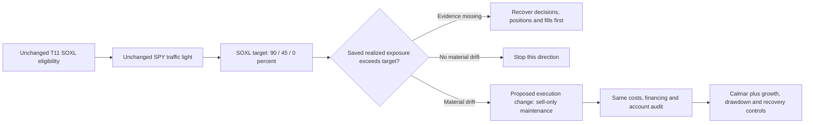

# SOXL-only sizing and risk-ceiling review

**Completed saved-evidence review; financial experiment remains blocked.** This
agent reviewed position sizing, risk ceilings and execution interaction. Zero
financial runs, downloads, network calls, broker connections or child agents.
Only this task document was written. The [golden standard](../research-standard.md)
owns adoption and receipts; [research development](../research-development.md)
owns comparison and stopping rules. This proposal does not reopen the exhausted
eight-case cloud allowance or the separate, blocked three-session programme.

## Recommendation

Diagnose **realized exposure drift before proposing another smooth volatility
sizer**. If the saved daily evidence establishes material drift beyond unchanged
SOXL targets, the most informative single-stage challenger is sell-only ceiling
maintenance. This is an execution-contract question, not a new predictor or a
claim that drift caused the observed drawdown. If drift is negligible, close this
direction without running a financial case and prioritize another agent's signal
or eligibility diagnosis. No second sizing hypothesis is recommended without
such evidence; a drawdown stop or a different volatility target would currently
be an unsupported search direction.

## What the saved evidence supports

The [eight-case report](2026-10-30-t11-soxl-cloud-results.md) records the exact
SOXL projection: only an original T11 branch with positive SOXL becomes eligible;
all other branches become cash. Portfolio targets are90/45/0 percent for
green/yellow/red. This is not every bullish T11 signal mapped to SOXL.

At25bp, native Overview shows gated SOXL/cash Calmar1.271, CAGR62.172%, DD48.900%,
versus ungated1.137/60.054%/52.800%. At50bp, gated1.057/53.149%/50.300% versus
ungated0.913/50.473%/55.300%. These are rounded native-convention summaries,
not independently reconciled closing-account metrics. The gate helps these
saved cases but does not establish a30% maximum loss.

Read-only inspection of private `soxl_cash_gated_25bp/main.py` confirms:
`_t11_weights` emits the gate cap after original SOXL eligibility;
`_funded_rebalance` multiplies by0.9 once; a changed intent enables work; open
orders defer it; completed unchanged intents return without recomputing holdings.
Consequently a90% target is not a continuously maintained90% realized limit.
The frozen plan explicitly preserves this behavior. All eight private source
hashes matched their frozen-plan identities during this review; journal usage
is8, terminal true. The frozen plan's original zero counters are creation metadata,
not current available slots.

Official exports, daily positions, decision traces and independent cash/action
reconciliation are still missing. Current summaries cannot establish how often
holdings exceeded targets, whether breaches preceded losses, how much P&L they
contributed, or whether maintenance would improve Calmar. Partial legacy
underwater counts exclude the recovery close and cannot replace temporal-v1.2.

## Separate risk concepts

| Concept | Meaning in this study | What it cannot establish |
| --- | --- | --- |
| Target cap | Desired SOXL allocation at a decision | Continuous holdings or loss limit |
| Realized drift | SOXL marked value/NAV moves after fills | That drift materially caused a loss |
| Signal risk | Broad-market/T11 signals can remain eligible during semiconductor losses | Sector-specific protection from an SPY state alone |
| Gap risk | Overnight price movement precedes a next-open reduction | A stop or cap executable at the earlier close |
| Portfolio drawdown | NAV below its own historical peak, including initial capital | A guarantee from a weight target or a green label |

SOXL exposure is measured using the actual ETF position and price. Do not multiply
portfolio weights by three in the account ledger or add a fictional extra fund
borrowing charge. Underlying leveraged economic sensitivity and broker borrowing
are distinct diagnostics. Daily-close checks also miss intraday breaches.

## Prior failures constrain this direction

The [saved SPY sizing diagnosis](2026-10-28-spy-transition-diagnosis.md) found
continuous sizing remained positive on severe March2020 losses when its discrete
control was flat; it also missed gains. This argues against removing the no-go
ceiling. It does not establish the same attribution for SOXL.

The C02 sizing evidence (`../../.local/rsi-calmar-20261028/docs/tasks/2026-10-28-ceiling-capture-study.md`; private/local artifact, not published)
then retained the discrete ceiling: Calmar0.483702/0.473450 versus
0.491514/0.481692 at5/10bp, with lower growth and only small depth improvements.
Thus “smooth sizing below the ceiling” has already failed its own SPY screen.
The [C06 execution study](2026-10-28-execution-c06.md) reduced buy-topup churn,
but its Calmar change was immaterial and growth fell. These have different assets,
dates and costs; they constrain mechanism selection, not a cross-context ranking.

The proposed question is different: SOXL's current controller does **no unchanged-
intent maintenance**, whereas C06 examined suppressing existing buy topups on SPY.
Do not call the proposed sell-only maintenance a successful sizing algorithm or
assume reduced risk compensates for missed compounding.

## One candidate, contingent on diagnosis

**Hypothesis:** trimming marked SOXL holdings that exceed the unchanged target
reduces exposure to subsequent loss sufficiently to improve net Calmar, without
material growth or recovery damage. Keep eligibility, traffic-light state,
90/45/0 targets, initial capital, dates and financing unchanged. Change execution
only: at each existing completed-close decision, absent pending or unresolved
orders, compute whole-share target from current NAV and price. Submit only excess
shares for reduction at the next permitted MOO. An unchanged-intent trim must not
create buy topups or re-entry; ordinary changed-intent orders retain the existing
controller. Red remains an unconditional zero target. Do not change fill timing
or assume a closing-price fill. Gaps and fill costs can leave a realized breach
until another eligible decision.

Before any financial case, recover existing daily evidence and count breaches
using the target applicable to the held overnight interval. Decompose observed
returns into overnight/intraday, costs and actions with reconciliation residuals.
Report profitable as well as loss-making breach intervals. These are descriptive
observed-path allocations, not a simulated no-drift counterfactual. Require at
least one material breach and a predeclared economically meaningful exposure
threshold; freeze that threshold before inspecting episode P&L. Otherwise stop.

Controls required for any later test:

- Fresh unchanged gated SOXL/cash under the same engine/accounting.
- Simple half-sized gated SOXL/cash,45/22.5/0 percent, preserving controller
  semantics. Lower drawdown alone is not an incremental timing result.
- A fixed-scalar gated control calibrated to match candidate average realized
  exposure on a declared calibration period, then frozen for evaluation.
  Calibration cannot use evaluated future returns. Exact prospective matching is
  not guaranteed: record the evaluation mismatch and a frozen tolerance before
  claiming an exposure-adjusted advantage. With no qualified daily history or
  funded calibration budget this control is currently **not ready**; do not invent
  a scalar, ignore its calibration cost, or fit it to the final evaluation path.

The existing full gated T11 and SOXL buy-and-hold results remain external context;
they cannot replace fresh comparable controls or establish temporal ranking.
Only SOXL/cash is a candidate position universe.

## Readiness, acceptance and proposed finite bounds

Required causal inputs: complete session calendar, decision timestamps, gate and
T11 eligibility before each order, target weights, opening/closing SOXL marks,
corporate actions, cash/positions, order intents/submissions/fills, financing and
fees. Raw/account and adjusted-feature conventions must be explicit. Missing
inputs, stale state, unresolved submissions or unreconciled accounts block finance.
No new data source or download was tested by this agent.

Synthetic acceptance before implementation qualification: unchanged baseline
parity; positive-return drift causing a sell; negative drift causing no buy;
zero/half/full cap transitions; correct single0.9 scaling; pending/unknown-order
no-duplicate behavior; whole-share/cost-reserve arithmetic; split-consistent
positions; prefix/future-mutation checks; next-open gap handling; restart-safe
intent identity. These are a **proposed test list, not executed tests**.

Proposed financial screening budget, **not authorized or reserved**: one candidate,
maximum eight evaluation cases (four policies ×25/50bp), one financial worker,
zero retries, two hours after an approved exact freeze. Calibration is a separate
prerequisite: if it needs financial replay, freeze its explicit finite count and
include it in a new aggregate allowance before any launch. No implicit free
calibration, parameter sweep, extra control rerun or child budget renewal.

Proposed material screen to freeze before outcomes: net full-path Calmar at least
10% above the unchanged incumbent at both costs; CAGR no lower; daily-close maximum
drawdown no deeper; longest underwater sessions and calendar days no longer;
no simpler-control domination. These are proposed study criteria, not an amendment
to the mandate or a guarantee. If growth declines, report a risk/return tradeoff
and keep the incumbent under this strict screen. Report annual results, all
underwater episodes/censoring, worst1/5/21/63-session returns, costs, turnover and
realized exposure. Independent temporal and accounting audits are prerequisites
to promotion. All2020–2025 history is viewed development evidence.

## Actual review validation and unresolved blockers

- Read AGENTS, documentation conventions, research standard, selected design and
  diagnosis skills/procedures, mandate, cloud report, private plan/source and
  related failed sizing/execution lessons.
- Verified all8 frozen source hashes without modifying private evidence.
- Read existing analysis and terminal journal; no result was recomputed as finance.
- No code changes or synthetic tests were run by this agent. The documentation
  checker passed185 files (exit0); the coordinator can rerun after integration.
- Blockers: official daily exports/decision traces, independent account parity,
  breach diagnosis, comparable temporal metrics and a qualified exposure-matched
  control/calibration contract. No favorable return or paper-readiness claim.

Lesson: a risk cap is an instruction with execution semantics. First establish
whether its realized implementation is the relevant weakness; do not repeat
failed smooth-sizing ideas because the asset or stage label changed.
